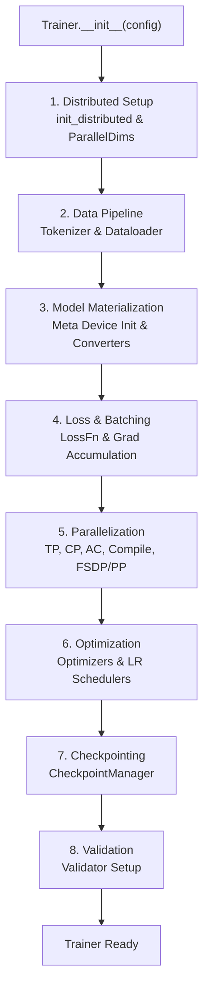
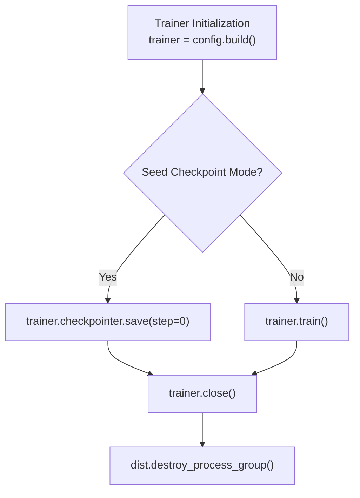
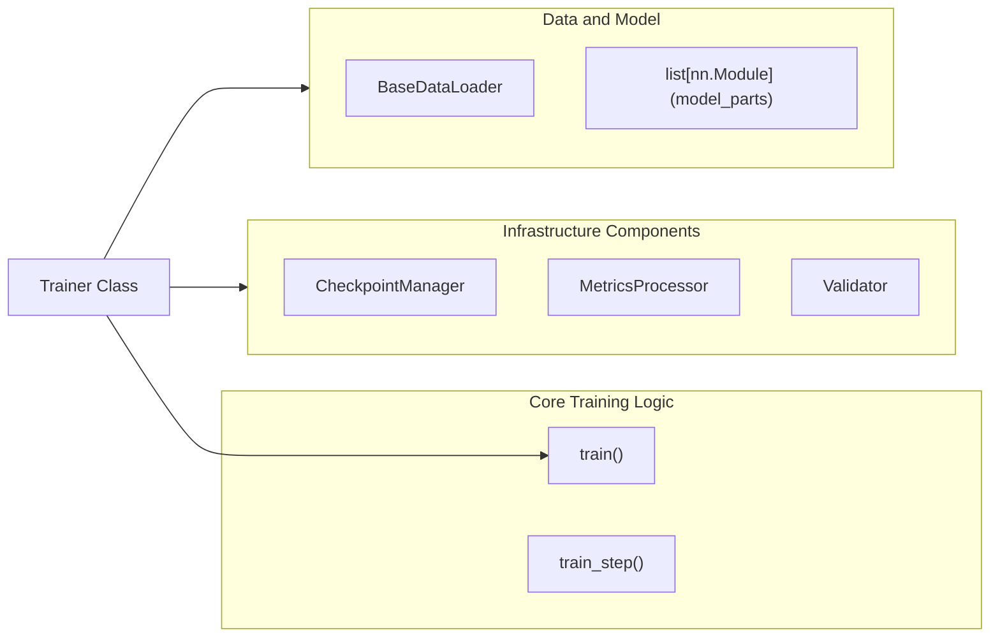

<!-- source: DeepWiki mcp.deepwiki.com · repo pytorch/torchtitan · page 3.1 Trainer Initialization and Lifecycle · fetched 2026-10-30 -->

# Trainer Initialization and Lifecycle

Relevant source files

The following files were used as context for generating this wiki page:

- [tests/unit_tests/test_set_determinism.py](tests/unit_tests/test_set_determinism.py)
- [torchtitan/components/dataloader.py](torchtitan/components/dataloader.py)
- [torchtitan/components/metrics.py](torchtitan/components/metrics.py)
- [torchtitan/components/validate.py](torchtitan/components/validate.py)
- [torchtitan/distributed/utils.py](torchtitan/distributed/utils.py)
- [torchtitan/experiments/forge/engine.py](torchtitan/experiments/forge/engine.py)
- [torchtitan/experiments/forge/example_train.py](torchtitan/experiments/forge/example_train.py)
- [torchtitan/experiments/torchft/trainer.py](torchtitan/experiments/torchft/trainer.py)
- [torchtitan/tools/utils.py](torchtitan/tools/utils.py)
- [torchtitan/train.py](torchtitan/train.py)
- [torchtitan/trainer.py](torchtitan/trainer.py)

## Purpose and Scope

This document details the complete lifecycle of the `Trainer` class, which serves as the central orchestrator of TorchTitan training jobs. The lifecycle consists of three main phases:

1.  **Initialization** (`Trainer.__init__`): Executes a carefully ordered sequence of setup operations that prepare all components (distributed, model, data, optimizer) for training.
2.  **Training Execution** (`Trainer.train()`): Runs the main training loop, handling gradient accumulation, checkpointing, validation, and profiling.
3.  **Cleanup** (`Trainer.close()`): Releases resources, flushes metrics, and finalizes asynchronous checkpointing operations.

This page covers the high-level architecture and implementation flow of these phases.

**Sources:** [torchtitan/trainer.py:55-724](), [torchtitan/train.py:17-76]()

---

## Initialization Sequence Overview

The `Trainer` constructor follows a strict initialization order, as many components depend on earlier artifacts (e.g., the optimizer needs the parallelized model).

### Initialization Flow

**Sources:** [torchtitan/trainer.py:124-370]()

### 1. Distributed and Environment Setup
The trainer first initializes the distributed backend via `dist_utils.init_distributed` [torchtitan/trainer.py:133-136](). It then constructs a `ParallelDims` object [torchtitan/trainer.py:141-150]() which defines the N-dimensional device mesh (DP, CP, TP, PP, EP). Random seeds and determinism are set via `dist_utils.set_determinism` [torchtitan/trainer.py:166-171](), ensuring that seeds are unique across certain dimensions (like PP) while shared across others for reproducibility [torchtitan/distributed/utils.py:124-192]().

**Sources:** [torchtitan/trainer.py:133-171](), [torchtitan/distributed/utils.py:124-192]()

### 2. Data Pipeline
The `tokenizer` is built using the provided configuration [torchtitan/trainer.py:177-181](). Subsequently, the `dataloader` is constructed via `config.dataloader.build()`, sharded by the data-parallel (DP) degree and rank derived from the device mesh [torchtitan/trainer.py:184-190]().

**Sources:** [torchtitan/trainer.py:177-190](), [torchtitan/components/dataloader.py:55-104]()

### 3. Model Materialization on Meta Device
To support large models that exceed single-device memory, the model is first instantiated on the `meta` device [torchtitan/trainer.py:210-213](). 
- **ModelConverters**: Before materialization, `ModelConverters` (e.g., for Float8 or MX quantization) are applied to swap standard layers with specialized implementations [torchtitan/trainer.py:216-218]().
- **MFU Calculation**: The trainer calculates the parameter count and theoretical peak FLOPs per token while the model is still on the meta device [torchtitan/trainer.py:226-229]().

**Sources:** [torchtitan/trainer.py:210-229]()

### 4. Loss and Batching
The `loss_fn` is built from the `ModelSpec` [torchtitan/trainer.py:251-253](). The trainer calculates `gradient_accumulation_steps` by comparing the `global_batch_size` against the `local_batch_size` multiplied by the DP degree [torchtitan/trainer.py:256-277]().

**Sources:** [torchtitan/trainer.py:251-277]()

### 5. Parallelization
This phase transforms the model based on the configured strategies:
- **Pipeline Parallel (PP)**: If enabled, the `pipelining_fn` splits the model into stages [torchtitan/trainer.py:280-312]().
- **SPMD Parallelism**: If PP is disabled, the model is parallelized as a single unit (applying TP, CP, and FSDP/DDP) [torchtitan/trainer.py:314-322]().
- **Materialization**: The sharded model parts are moved from `meta` to the actual device using `to_empty(device=device_type)` and weights are initialized via `model.init_weights()` [torchtitan/trainer.py:305-308]().

**Sources:** [torchtitan/trainer.py:280-322]()

### 6. Optimization and Checkpointing
Optimizers and LR Schedulers are built to wrap the parallelized model parameters [torchtitan/trainer.py:337-343](). Finally, the `CheckpointManager` is initialized, registering the model, optimizers, dataloader, and trainer state as `Stateful` components [torchtitan/trainer.py:360-376]().

**Sources:** [torchtitan/trainer.py:337-376](), [torchtitan/components/checkpoint.py]()

---

## Training Lifecycle

The lifecycle is managed by the `main()` function in `train.py`.

### Lifecycle State Machine

**Sources:** [torchtitan/train.py:41-75]()

### The train() Method
The `train()` method [torchtitan/trainer.py:620-708]() executes the main loop:
1.  **Load Checkpoint**: Restores state from the latest or specified checkpoint [torchtitan/trainer.py:624]().
2.  **Context Managers**: Wraps the loop in profiling (`Profiler`) and memory snapshot contexts [torchtitan/trainer.py:632-661]().
3.  **The Loop**: Iterates through steps, calling `train_step()` which handles forward, backward, and optimization [torchtitan/trainer.py:668]().
4.  **Validation**: Periodically invokes the `Validator` [torchtitan/trainer.py:682-684]().
5.  **Checkpointing**: Saves state based on configured frequency [torchtitan/trainer.py:676-678]().

**Sources:** [torchtitan/trainer.py:620-708]()

### Cleanup (Teardown)
The `close()` method [torchtitan/trainer.py:720-724]() ensures that:
- The `CheckpointManager` finalizes any asynchronous saves.
- The `MetricsProcessor` flushes remaining logs to backends (TensorBoard/WandB).
- In `train.py`, `torch.distributed.destroy_process_group()` is called to release network resources [torchtitan/train.py:72-74]().

**Sources:** [torchtitan/trainer.py:720-724](), [torchtitan/train.py:71-75]()

---

## Key Classes and Implementation

### Trainer.Config
A `tyro`-compatible dataclass that aggregates all sub-configurations for the training job. It includes validation logic in `__post_init__` to ensure compatibility between parallelism degrees and sequence lengths [torchtitan/trainer.py:105-131]().

| Field | Type | Description |
| :--- | :--- | :--- |
| `model_spec` | `ModelSpec` | Factory for model-specific components. |
| `training` | `TrainingConfig` | Steps, batch sizes, and dtypes. |
| `parallelism` | `ParallelismConfig` | Sharding degrees for TP, PP, FSDP, etc. |
| `checkpoint` | `CheckpointManager.Config` | Save frequency and paths. |

**Sources:** [torchtitan/trainer.py:57-103]()

### Component Association

**Sources:** [torchtitan/trainer.py:55-122]()

### Resource Monitoring
During initialization, the trainer builds a `DeviceMemoryMonitor` [torchtitan/components/metrics.py:95-101]() to track peak memory usage. This is logged immediately after model materialization to provide visibility into the memory footprint of the sharded model [torchtitan/trainer.py:234-239]().

**Sources:** [torchtitan/components/metrics.py:38-93](), [torchtitan/trainer.py:234-239]()

---

