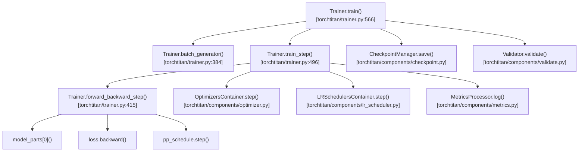
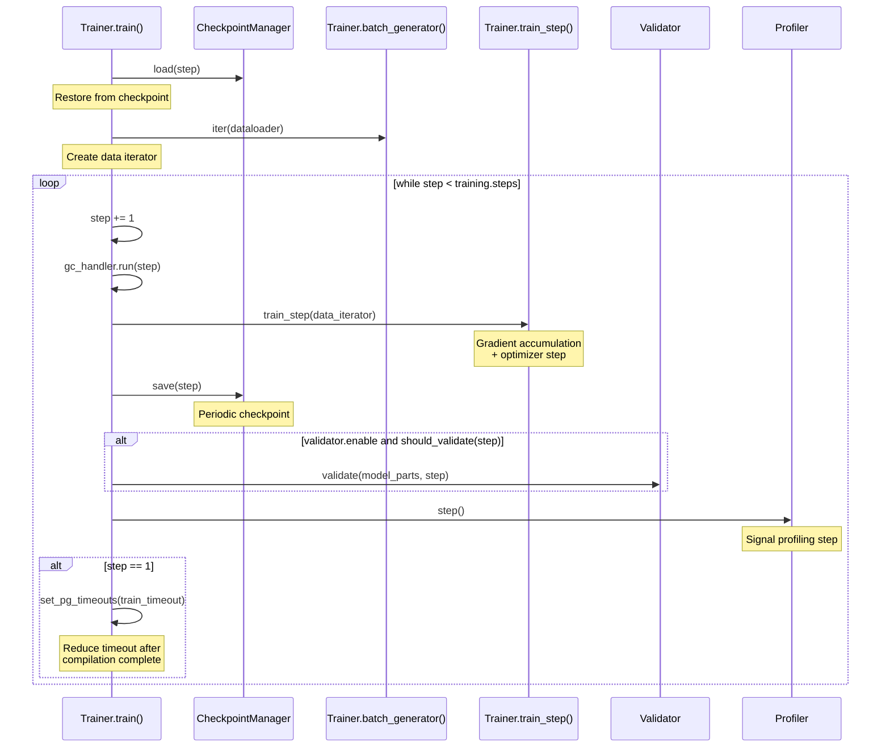
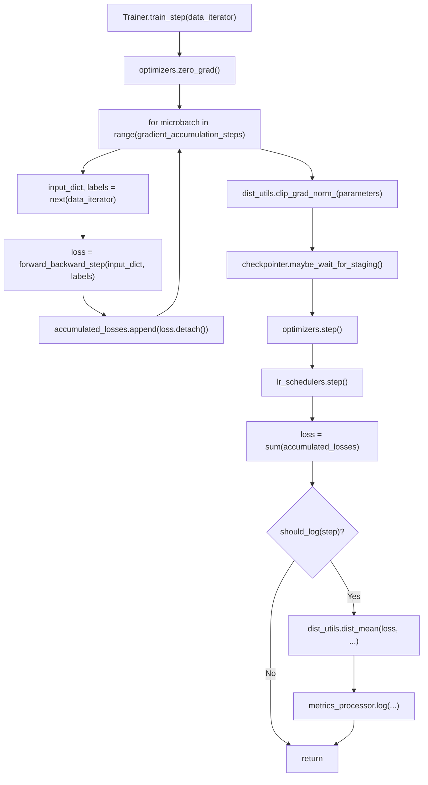
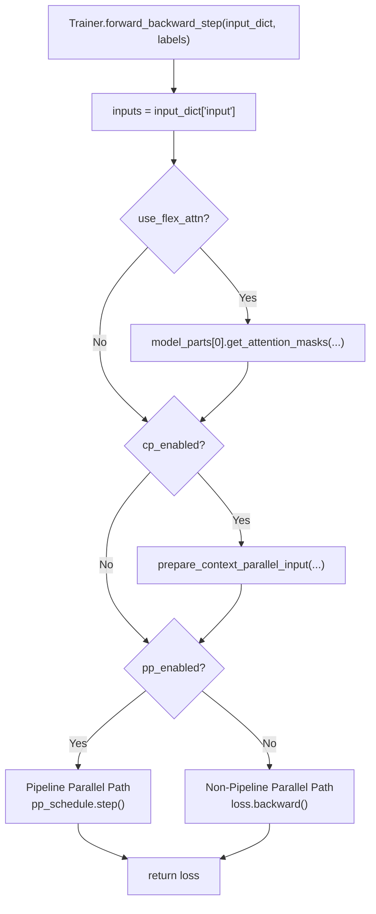

<!-- source: DeepWiki mcp.deepwiki.com · repo pytorch/torchtitan · page 3.2 Training Loop Execution · fetched 2026-10-30 -->

# Training Loop Execution

<details>
<summary>Relevant source files</summary>

The following files were used as context for generating this wiki page:

- [.ci/docker/requirements.txt](.ci/docker/requirements.txt)
- [pyproject.toml](pyproject.toml)
- [tests/unit_tests/test_loss.py](tests/unit_tests/test_loss.py)
- [torchtitan/components/loss.py](torchtitan/components/loss.py)
- [torchtitan/components/validate.py](torchtitan/components/validate.py)
- [torchtitan/experiments/forge/engine.py](torchtitan/experiments/forge/engine.py)
- [torchtitan/experiments/forge/example_train.py](torchtitan/experiments/forge/example_train.py)
- [torchtitan/experiments/graph_trainer/chunked_loss.py](torchtitan/experiments/graph_trainer/chunked_loss.py)
- [torchtitan/experiments/graph_trainer/tests/test_chunked_loss.py](torchtitan/experiments/graph_trainer/tests/test_chunked_loss.py)
- [torchtitan/experiments/torchft/trainer.py](torchtitan/experiments/torchft/trainer.py)
- [torchtitan/trainer.py](torchtitan/trainer.py)

</details>


## Purpose and Scope

This document describes the core training loop execution in TorchTitan, primarily focusing on the `train()`, `train_step()`, and `forward_backward_step()` methods of the `Trainer` class. These methods orchestrate the iterative process of consuming batches, performing forward and backward passes, and updating model parameters using PyTorch-native distributed primitives.

The training loop handles:
- Iteration over training steps and microbatches.
- Gradient accumulation for large global batch sizes.
- Forward and backward pass execution with support for Pipeline Parallelism (PP).
- Optimizer and learning rate scheduler coordination.
- Integration with checkpointing, profiling, metrics collection, and validation.

---

## Training Loop Architecture

The training loop consists of three nested levels of execution within the `Trainer` class [torchtitan/trainer.py:55]():

1.  **`train()` method**: The outer loop managing the overall lifecycle, including checkpointing, profiling, and validation [torchtitan/trainer.py:566-649]().
2.  **`train_step()` method**: The middle loop performing gradient accumulation over multiple microbatches and executing the optimizer step [torchtitan/trainer.py:496-563]().
3.  **`forward_backward_step()` method**: The inner logic executing a single forward and backward pass for one microbatch [torchtitan/trainer.py:415-494]().

### Training Loop Call Hierarchy

The following diagram maps the execution flow to the specific code entities in `torchtitan/trainer.py`.



**Sources**: [torchtitan/trainer.py:566-649](), [torchtitan/trainer.py:496-563](), [torchtitan/trainer.py:415-494]()

---

## Main Training Loop (`train` method)

The `train()` method is the entry point for the training execution. It iterates from the current step (restored from checkpoint or 0) up to the configured `total_steps`. It is decorated with `@record` to enable debug tracing on failure via TorchElastic [torchtitan/trainer.py:566]().

### Training Loop Structure



**Sources**: [torchtitan/trainer.py:566-649]()

### Key Components Integrated in Training Loop

| Component | Method Call | Purpose |
|-----------|-------------|---------|
| `CheckpointManager` | `checkpointer.load(step)` | Restore training state from checkpoint at start [torchtitan/trainer.py:601]() |
| `CheckpointManager` | `checkpointer.save(step)` | Periodically save training state [torchtitan/trainer.py:623]() |
| `Validator` | `validator.validate(...)` | Run validation at configured intervals [torchtitan/trainer.py:629]() |
| `GarbageCollection` | `gc_handler.run(step)` | Periodic garbage collection to avoid stragglers [torchtitan/tools/utils.py:59]() |
| `Profiler` | `torch_profiler.step()` | Signal profiling step boundaries [torchtitan/tools/profiler.py:147]() |

**Sources**: [torchtitan/trainer.py:566-649](), [torchtitan/tools/utils.py:46-74](), [torchtitan/tools/profiler.py:75-152]()

---

## Training Step Execution (`train_step` method)

The `train_step()` method executes a single training step, involving gradient accumulation and parameter updates [torchtitan/trainer.py:496-563]().

### Training Step Flow



**Sources**: [torchtitan/trainer.py:496-563]()

### Gradient Accumulation and Clipping

The number of gradient accumulation steps is calculated during initialization based on global batch size and data-parallel degree [torchtitan/trainer.py:212-218](). For each microbatch, `forward_backward_step()` is called [torchtitan/trainer.py:510-513]().

After accumulation, gradients are clipped across all parallelism dimensions:
```python
grad_norm = dist_utils.clip_grad_norm_(
    [p for m in self.model_parts for p in m.parameters()],
    self.config.training.max_norm,
    # ... handles PP and EP meshes
)
```
**Sources**: [torchtitan/trainer.py:515-523](), [torchtitan/distributed/utils.py:165-212]()

---

## Forward-Backward Pass (`forward_backward_step`)

This method handles the actual execution of model logic, branching based on whether Pipeline Parallelism (PP) is enabled [torchtitan/trainer.py:415-494]().

### Forward-Backward Execution Paths



**Sources**: [torchtitan/trainer.py:415-494]()

### Pipeline Parallel Execution Path

When PP is enabled, the `pp_schedule` (e.g., `PipelineScheduleSingle` or `PipelineScheduleMulti`) manages microbatch flow [torchtitan/trainer.py:450-482](). Only the first stage receives inputs from the dataloader, and only the last stage calculates losses via the provided `loss_fn`.

### Non-Pipeline Parallel Execution Path

For non-PP runs, a standard forward-backward sequence is performed:
```python
with self.train_context():
    pred = model_parts[0](inputs, **extra_inputs, **extra_kwargs)
    loss = self.loss_fn(pred, labels)
del pred
loss.backward()
```
**Sources**: [torchtitan/trainer.py:483-492]()

---

## Batch Generation and Data Flow

The `batch_generator()` method handles device placement and token tracking for each step [torchtitan/trainer.py:384-413]().

- **Token Counting**: Tracks `ntokens_seen` and updates `metrics_processor.ntokens_since_last_log` [torchtitan/trainer.py:400-402]().
- **Data Loading Time**: Measures time spent in `next(data_iterator)` to monitor dataloader bottlenecks [torchtitan/trainer.py:392-405]().
- **Device Placement**: Tensors are moved to the target device (e.g., CUDA) per microbatch to optimize memory usage [torchtitan/trainer.py:407-411]().

**Sources**: [torchtitan/trainer.py:384-413]()

---

## Training Loop State Management

The `Trainer` class maintains state that persists across steps and is saved in checkpoints via the `torch.distributed.checkpoint.stateful.Stateful` protocol [torchtitan/trainer.py:654-659]().

| Attribute | Type | Purpose |
|-----------|------|---------|
| `step` | `int` | Current training step (0-indexed) [torchtitan/trainer.py:299]() |
| `ntokens_seen` | `int` | Total tokens processed by this trainer instance [torchtitan/trainer.py:300]() |

**Sources**: [torchtitan/trainer.py:298-300](), [torchtitan/trainer.py:654-659]()

---

