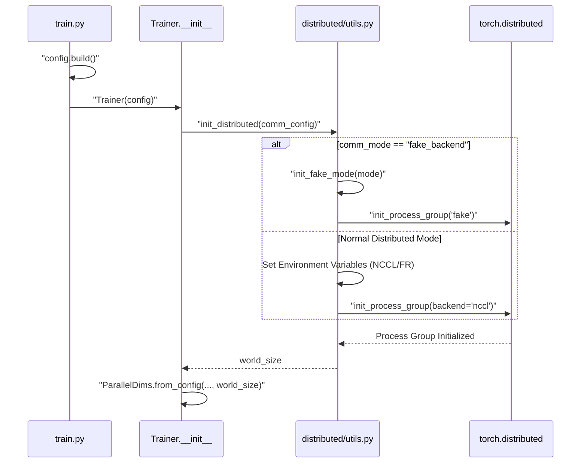

<!-- source: DeepWiki mcp.deepwiki.com · repo pytorch/torchtitan · page 3.3 Distributed Initialization and Communication · fetched 2026-10-30 -->

# Distributed Initialization and Communication

<details>
<summary>Relevant source files</summary>

The following files were used as context for generating this wiki page:

- [tests/unit_tests/test_parallel_dims.py](tests/unit_tests/test_parallel_dims.py)
- [tests/unit_tests/test_set_determinism.py](tests/unit_tests/test_set_determinism.py)
- [torchtitan/components/dataloader.py](torchtitan/components/dataloader.py)
- [torchtitan/components/lora.py](torchtitan/components/lora.py)
- [torchtitan/components/metrics.py](torchtitan/components/metrics.py)
- [torchtitan/distributed/full_dtensor.py](torchtitan/distributed/full_dtensor.py)
- [torchtitan/distributed/parallel_dims.py](torchtitan/distributed/parallel_dims.py)
- [torchtitan/distributed/spmd_types.py](torchtitan/distributed/spmd_types.py)
- [torchtitan/distributed/utils.py](torchtitan/distributed/utils.py)
- [torchtitan/tools/utils.py](torchtitan/tools/utils.py)
- [torchtitan/train.py](torchtitan/train.py)

</details>


## Purpose and Scope

This page documents the distributed training initialization and communication infrastructure in TorchTitan. It covers process group creation, communication backend selection, deterministic RNG seeding, and debugging tools for distributed training. TorchTitan is designed to support complex multi-dimensional parallelism, necessitating a robust initialization sequence that handles process groups, device meshes, and functional collectives.

## Communication Configuration

Distributed communication is controlled via the `CommConfig` section of the job configuration. This configuration manages timeouts, communication modes, and the Torch Flight Recorder for debugging.

### Configuration Parameters

| Parameter | Type | Default | Description |
|-----------|------|---------|-------------|
| `init_timeout_seconds` | int | 300 | Timeout for initialization and first train step |
| `train_timeout_seconds` | int | 100 | Timeout after first step (tighter bound) |
| `trace_buf_size` | int | 20000 | Flight recorder buffer size (0 disables) |
| `save_traces_folder` | str | "comm_traces" | Flight recorder trace output location |
| `mode` | str | "default" | Communication mode: "default", "fake_backend", or "local_tensor" |

**Sources:** [torchtitan/config/configs.py:192-212]()

## Distributed Initialization Process

### Initialization Flow

The distributed initialization is managed by the `Trainer` and helper functions in `distributed/utils.py`. The process starts in `train.py` where the `ConfigManager` parses arguments and calls `config.build()`.

**Distributed Setup Sequence**


**Sources:** [torchtitan/train.py:17-51](), [torchtitan/distributed/utils.py:346-412]()

### The `init_distributed()` Function

The `init_distributed()` function in `torchtitan/distributed/utils.py` performs the following critical steps:

1.  **Fake Mode Handling**: If `comm_config.mode` is `fake_backend` or `local_tensor`, it initializes a fake process group using the `NGPU` environment variable to define the simulated world size. [torchtitan/distributed/utils.py:357-365]()
2.  **Environment Variable Configuration**: Sets variables for the Torch Flight Recorder (`TORCH_FR_BUFFER_SIZE`) and NCCL error handling (`TORCH_NCCL_ASYNC_ERROR_HANDLING`). [torchtitan/distributed/utils.py:384-404]()
3.  **Backend Selection**: Defaults to `nccl` for CUDA devices. If CPU backend is requested, it uses a composite backend (e.g., `cuda:nccl,cpu:gloo`). [torchtitan/distributed/utils.py:374-382]()
4.  **Process Group Initialization**: Calls `torch.distributed.init_process_group()` with the specified timeout. [torchtitan/distributed/utils.py:406-410]()

**Sources:** [torchtitan/distributed/utils.py:346-412]()

## Determinism and RNG Seeding

TorchTitan uses `set_determinism` to manage reproducibility across distributed dimensions. This is vital when combining Pipeline Parallelism (PP) with SPMD parallelisms (DP, TP, CP).

**Code Entity Mapping: RNG and Determinism**
```mermaid
graph TD
    subgraph "Logic Space"
        "Reproducibility" --> "Deterministic Algos"
        "Reproducibility" --> "Mesh-Aware Seeding"
    end

    subgraph "Code Entities"
        set_determinism["set_determinism()"]
        ParallelDims["ParallelDims"]
        DebugConfig["DebugConfig"]
        DTensor["torch.distributed.tensor"]
    end

    set_determinism -->|uses| ParallelDims
    set_determinism -->|checks| DebugConfig
    set_determinism -->|sets| DTensor
```

In `set_determinism`, the system ensures that ranks within the same SPMD group share seeds, while ranks across `distinct_seed_mesh_dims` (usually PP) receive different seeds. This prevents identical weight initialization or dropout patterns across pipeline stages. [torchtitan/distributed/utils.py:124-212]()

**Sources:** [torchtitan/distributed/utils.py:124-212](), [tests/unit_tests/test_set_determinism.py:113-174]()

## Process Group Timeout Management

To handle the slow compilation and initialization phases of large models, TorchTitan uses a two-stage timeout strategy:

1.  **Initialization**: Uses `init_timeout_seconds` (default 300s) for the first step. [torchtitan/distributed/utils.py:408-410]()
2.  **Steady State**: After the first training step, `Trainer` calls `set_pg_timeouts` to reduce the timeout to `train_timeout_seconds` (default 100s). [torchtitan/distributed/utils.py:415-445]()

The `set_pg_timeouts()` function synchronizes all ranks via `dist.barrier()` before updating the timeout for the default process group and all sub-groups in `ParallelDims`. [torchtitan/distributed/utils.py:415-445]()

**Sources:** [torchtitan/distributed/utils.py:415-445]()

## Distributed Reduction Utilities

TorchTitan provides wrapper functions for distributed reductions that abstract away the differences between standard `torch.Tensor` and `DTensor`.

| Function | Operation | Logic |
|-----------|-----------|-------|
| `dist_max` | `ReduceOp.MAX` | Calls `_dist_reduce` with MAX op. [torchtitan/distributed/utils.py:94-101]() |
| `dist_sum` | `ReduceOp.SUM` | Calls `_dist_reduce` with SUM op. [torchtitan/distributed/utils.py:104-111]() |
| `dist_mean` | `ReduceOp.AVG` | Calls `_dist_reduce` with AVG op. [torchtitan/distributed/utils.py:114-121]() |

The underlying `_dist_reduce` handles `DTensor` by calling `to_local()` to ensure parity before applying `torch.distributed._functional_collectives.all_reduce`. [torchtitan/distributed/utils.py:49-91]()

**Sources:** [torchtitan/distributed/utils.py:49-121]()

## Debugging Communication Modes

### Fake Backend and Local Tensor Mode

-   **`fake_backend`**: Uses `torch.distributed` with a "fake" backend. This allows for full initialization of the `Trainer`, `DeviceMesh`, and model parallel sharding without requiring multiple GPUs. It is used for validating configurations and estimating memory. [torchtitan/distributed/utils.py:322-344]()
-   **`local_tensor`**: A specialized mode for single-GPU debugging. In `train.py`, if this mode is enabled, the execution returns early after initialization to avoid unsupported operations like `foreach_allgather` on local tensors. [torchtitan/train.py:44-49]()

**Sources:** [torchtitan/distributed/utils.py:322-344](), [torchtitan/train.py:44-49]()

### Flight Recorder

The Torch Flight Recorder (FR) is initialized via environment variables in `init_distributed`. If `trace_buf_size > 0`, it records NCCL metadata. On a timeout, `TORCH_NCCL_DUMP_ON_TIMEOUT=1` ensures the trace is saved to the directory specified by `save_traces_folder`. [torchtitan/distributed/utils.py:384-404]()

**Sources:** [torchtitan/distributed/utils.py:384-404]()

---

