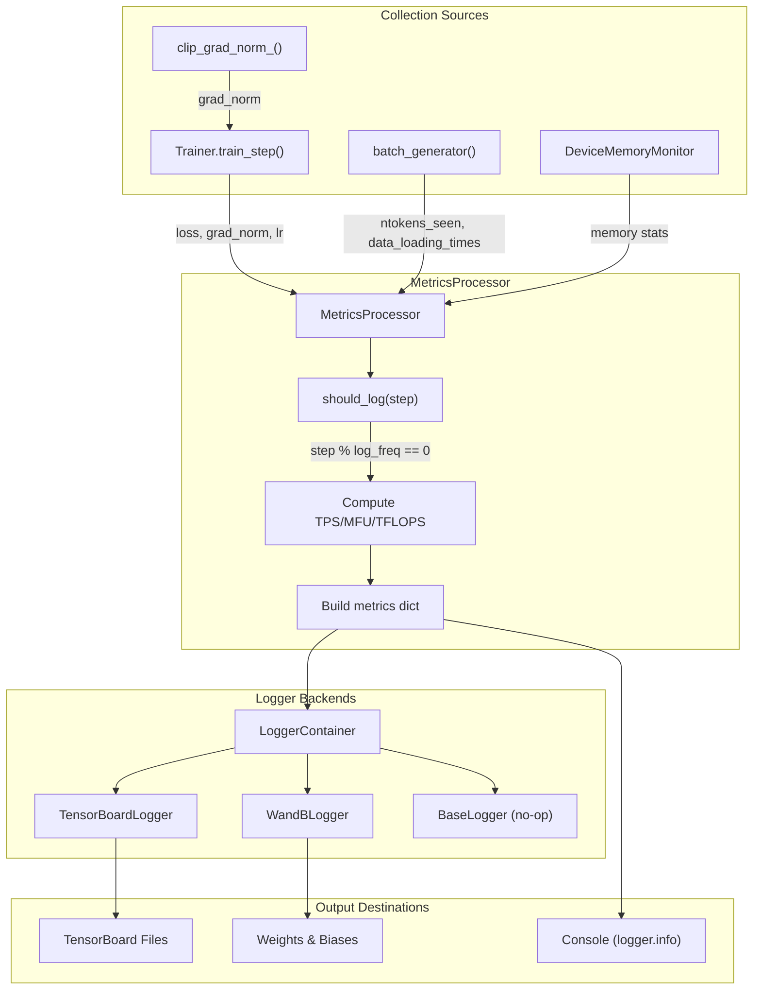
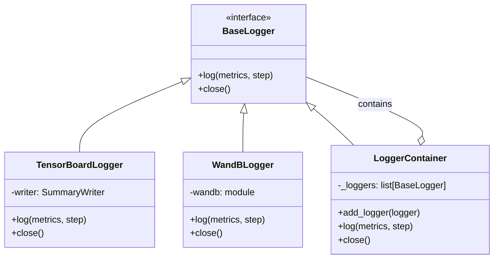
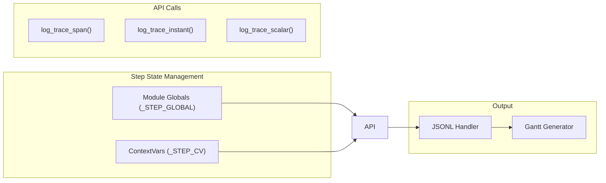

<!-- source: DeepWiki mcp.deepwiki.com · repo pytorch/torchtitan · page 3.4 Metrics Collection and Monitoring · fetched 2026-10-30 -->

# Metrics Collection and Monitoring

Relevant source files

The following files were used as context for generating this wiki page:

- [tests/unit_tests/observability/__init__.py](tests/unit_tests/observability/__init__.py)
- [tests/unit_tests/observability/test_structured_logging.py](tests/unit_tests/observability/test_structured_logging.py)
- [tests/unit_tests/test_profiler.py](tests/unit_tests/test_profiler.py)
- [tests/unit_tests/test_set_determinism.py](tests/unit_tests/test_set_determinism.py)
- [torchtitan/components/dataloader.py](torchtitan/components/dataloader.py)
- [torchtitan/components/metrics.py](torchtitan/components/metrics.py)
- [torchtitan/distributed/utils.py](torchtitan/distributed/utils.py)
- [torchtitan/observability/__init__.py](torchtitan/observability/__init__.py)
- [torchtitan/observability/structured_logger/README.md](torchtitan/observability/structured_logger/README.md)
- [torchtitan/observability/structured_logger/__init__.py](torchtitan/observability/structured_logger/__init__.py)
- [torchtitan/observability/structured_logger/gantt_generator.py](torchtitan/observability/structured_logger/gantt_generator.py)
- [torchtitan/observability/structured_logger/step_state.py](torchtitan/observability/structured_logger/step_state.py)
- [torchtitan/observability/structured_logger/structured_logging.py](torchtitan/observability/structured_logger/structured_logging.py)
- [torchtitan/tools/profiler.py](torchtitan/tools/profiler.py)
- [torchtitan/tools/utils.py](torchtitan/tools/utils.py)
- [torchtitan/train.py](torchtitan/train.py)

## Purpose and Scope

This page documents TorchTitan's metrics collection, processing, and monitoring infrastructure. It covers the `MetricsProcessor` system that tracks training performance (throughput, memory usage, loss values), computes efficiency metrics (TPS, MFU, TFLOPS), and logs them to TensorBoard or Weights & Biases. The system also includes utilities for garbage collection management and profiling tools to diagnose bottlenecks.

## Overview

TorchTitan's metrics system consists of three main layers:

1.  **Collection Layer**: The `MetricsProcessor` class aggregates metrics from various sources during training (loss values, gradient norms, token counts, timing data, memory statistics) [[torchtitan/components/metrics.py:326-491]]().
2.  **Computation Layer**: Calculates derived metrics like tokens-per-second (TPS), model FLOPS utilization (MFU), and TFLOPS based on raw measurements [[torchtitan/components/metrics.py:400-408]]().
3.  **Logging Layer**: Distributes metrics to configured backends (TensorBoard, WandB, or console-only output) [[torchtitan/components/metrics.py:178-198]]().

The system is designed to minimize overhead while providing comprehensive observability into distributed training runs across multiple parallelism dimensions.

**Sources:** [torchtitan/components/metrics.py:1-511](), [torchtitan/tools/utils.py:46-75]()

## MetricsProcessor Architecture

The following diagram illustrates the data flow from training components to the final monitoring dashboards.

**Diagram: MetricsProcessor data flow from collection to output**

The `MetricsProcessor` is instantiated during `Trainer` construction and persists throughout the training lifecycle [[torchtitan/train.py:41-51]](). It maintains internal state for incremental metrics (token counts, timing data) and coordinates with the logger backends to write metrics at intervals defined by `log_freq` [[torchtitan/components/metrics.py:348-350]]().

**Sources:** [torchtitan/components/metrics.py:326-511](), [torchtitan/train.py:17-71]()

## Core Components

### MetricsProcessor Class

The `MetricsProcessor` class [[torchtitan/components/metrics.py:326-491]]() is the central orchestrator for all metrics operations.

**Key Attributes:**

| Attribute | Type | Purpose |
| :--- | :--- | :--- |
| `logger` | `BaseLogger` | Backend logger container for TensorBoard/WandB [[torchtitan/components/metrics.py:330]]() |
| `device_memory_monitor` | `DeviceMemoryMonitor` | Tracks GPU memory usage [[torchtitan/components/metrics.py:331]]() |
| `num_flops_per_token` | `int` | FLOPs per token for MFU calculation [[torchtitan/components/metrics.py:333]]() |
| `ntokens_since_last_log` | `int` | Accumulator for tokens processed since last log [[torchtitan/components/metrics.py:336]]() |
| `data_loading_times` | `list[float]` | Data loading durations for computing overhead [[torchtitan/components/metrics.py:337]]() |
| `time_last_log` | `float` | Timestamp of last metrics log [[torchtitan/components/metrics.py:338]]() |

**Key Methods:**

*   `should_log(step)`: Returns `True` if metrics should be logged at this step based on `log_freq` [[torchtitan/components/metrics.py:356-357]]().
*   `log(step, global_avg_loss, global_max_loss, grad_norm, extra_metrics)`: Computes and logs all training metrics [[torchtitan/components/metrics.py:388-454]]().
*   `log_validation(loss, step)`: Logs validation-specific metrics [[torchtitan/components/metrics.py:456-487]]().

**Sources:** [torchtitan/components/metrics.py:326-491]()

### DeviceMemoryMonitor Class

The `DeviceMemoryMonitor` class [[torchtitan/components/metrics.py:39-95]]() tracks hardware-specific memory statistics.

**Tracked Metrics:**
The monitor returns a `DeviceMemStats` named tuple [[torchtitan/components/metrics.py:25-36]]() containing:
*   `max_active_gib`: Peak active memory in GiB [[torchtitan/components/metrics.py:65]]().
*   `max_active_pct`: Peak active memory as % of capacity [[torchtitan/components/metrics.py:66]]().
*   `max_reserved_gib`: Peak reserved memory in GiB [[torchtitan/components/metrics.py:70]]().
*   `num_alloc_retries`: Number of allocation retries [[torchtitan/components/metrics.py:73]]().
*   `num_ooms`: Number of out-of-memory errors [[torchtitan/components/metrics.py:74]]().

The monitor uses `device_module.memory_stats()` to query the underlying device backend (CUDA, XPU, etc.) [[torchtitan/components/metrics.py:62]]().

**Sources:** [torchtitan/components/metrics.py:25-95]()

## Logging Backends

### Logger Hierarchy

TorchTitan uses a composite pattern for logging, allowing multiple backends to be active simultaneously via `LoggerContainer`.

**Diagram: Logger class hierarchy and composition**

*   **TensorBoardLogger**: Wraps `torch.utils.tensorboard.SummaryWriter` [[torchtitan/components/metrics.py:115-130]]().
*   **WandBLogger**: Integrates with Weights & Biases, initializing the run with environment variables like `WANDB_PROJECT` and `WANDB_RUN_NAME` [[torchtitan/components/metrics.py:132-176]]().
*   **LoggerContainer**: Iterates through all registered loggers to dispatch metrics [[torchtitan/components/metrics.py:178-198]]().

**Sources:** [torchtitan/components/metrics.py:105-198]()

## Metric Calculations

### Throughput and Efficiency

The `MetricsProcessor` calculates three primary performance metrics:

1.  **Tokens Per Second (TPS)**:
    `TPS = ntokens_since_last_log / (time_delta * non_data_parallel_size)` [[torchtitan/components/metrics.py:400-403]]().
    The `non_data_parallel_size` is the product of TP, PP, and CP dimensions [[torchtitan/components/metrics.py:353]]().

2.  **Model FLOPS Utilization (MFU)**:
    `MFU = 100 * num_flops_per_token * TPS / gpu_peak_flops` [[torchtitan/components/metrics.py:404-407]]().
    Peak FLOPS are determined based on the device name (e.g., H100, A100) [[torchtitan/tools/utils.py:91-169]]().

3.  **TFLOPS**:
    Absolute throughput measured in trillions of floating-point operations per second:
    `TFLOPS = num_flops_per_token * TPS / 1e12` [[torchtitan/components/metrics.py:408]]().

**Sources:** [torchtitan/components/metrics.py:400-408](), [torchtitan/tools/utils.py:91-169]()

## Observability and Structured Logging

TorchTitan implements a high-performance structured logging system for training phase timing and diagnostics.

### Structured Logger Architecture

The `structured_logger` module emits JSONL events for phase timing, scalars, and diagnostics. It is designed to handle both standard SPMD training and complex Async RL scenarios [[torchtitan/observability/structured_logger/step_state.py:15-22]]().

**Diagram: Structured logging state and flow**

*   **Step State**: Uses a hybrid of module-level globals and `ContextVar` to isolate tags between concurrent async tasks (e.g., RL actors) while maintaining a shared view for standard SPMD training [[torchtitan/observability/structured_logger/step_state.py:25-38]]().
*   **Trace Spans**: The `log_trace_span` context manager records the duration of code blocks [[torchtitan/observability/structured_logger/structured_logging.py:30-31]]().
*   **Gantt Generation**: The `generate_gantt_trace` utility merges per-rank JSONL files into a Chrome Trace JSON format for visualization in Perfetto [[torchtitan/observability/structured_logger/gantt_generator.py:25-64]]().

**Sources:** [torchtitan/observability/structured_logger/step_state.py:7-63](), [torchtitan/observability/structured_logger/structured_logging.py:7-40](), [torchtitan/observability/structured_logger/gantt_generator.py:7-91]()

## Garbage Collection and Profiling

### Garbage Collection Management

To prevent performance jitter caused by unpredictable Python garbage collection (GC) in distributed settings, TorchTitan provides the `GarbageCollection` utility [[torchtitan/tools/utils.py:51-88]]().

*   **Behavior**: It disables automatic GC on initialization [[torchtitan/tools/utils.py:56]]() and triggers manual collection at a fixed frequency (default: 1000 steps) [[torchtitan/tools/utils.py:54]]().
*   **Synchronization**: This ensures all ranks perform GC at the same time, avoiding "stragglers" in the training loop [[torchtitan/tools/utils.py:50]]().

### Profiling Tools

TorchTitan integrates the PyTorch Profiler and memory snapshot tools via the `Profiler` class [[torchtitan/tools/profiler.py:99-201]]().

*   **MemoryProfiler**: Records periodic memory snapshots. It uses `stacks="python"` to keep snapshot dumps fast by avoiding C++ frame symbolization [[torchtitan/tools/profiler.py:38-62]]().
*   **Profiler Config**: Supports fine-grained control over profiling schedules, including `profiler_warmup`, `profiler_active`, and `profiler_repeat` [[torchtitan/tools/profiler.py:122-165]]().

**Sources:** [torchtitan/tools/utils.py:51-88](), [torchtitan/tools/profiler.py:38-201]()

## Metrics Rank Selection

In pipeline-parallel (PP) training, the loss is typically only visible on specific ranks. TorchTitan handles this via `_get_metrics_rank()` [[torchtitan/components/metrics.py:230-247]]().

*   **Standard PP**: The first rank of the last pipeline stage reports the loss [[torchtitan/components/metrics.py:245-246]]().
*   **Zero Bubble PP**: For `ZBVZeroBubble`, rank 0 reports the loss [[torchtitan/components/metrics.py:241-242]]().
*   **Non-PP**: Rank 0 is the default metrics rank [[torchtitan/components/metrics.py:237]]().

The function `ensure_pp_loss_visible()` warns the user if the configured `LOG_RANK` does not include the rank responsible for reporting loss [[torchtitan/components/metrics.py:199-228]]().

**Sources:** [torchtitan/components/metrics.py:199-247]()

---

