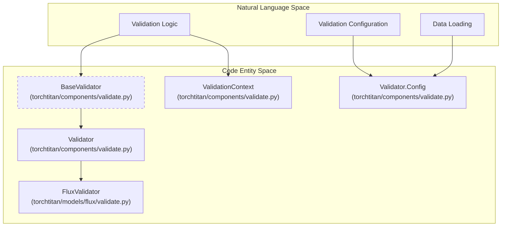
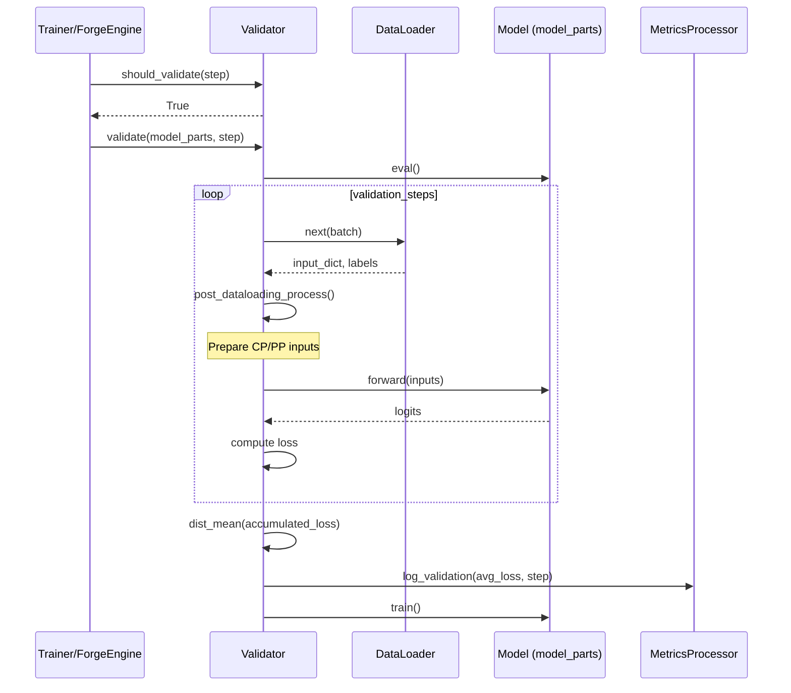

<!-- source: DeepWiki mcp.deepwiki.com · repo pytorch/torchtitan · page 3.5 Validation System · fetched 2026-10-30 -->

# Validation System

<details>
<summary>Relevant source files</summary>

The following files were used as context for generating this wiki page:

- [tests/unit_tests/test_module.py](tests/unit_tests/test_module.py)
- [torchtitan/components/validate.py](torchtitan/components/validate.py)
- [torchtitan/experiments/forge/engine.py](torchtitan/experiments/forge/engine.py)
- [torchtitan/experiments/forge/example_train.py](torchtitan/experiments/forge/example_train.py)
- [torchtitan/experiments/torchft/trainer.py](torchtitan/experiments/torchft/trainer.py)
- [torchtitan/models/flux/__init__.py](torchtitan/models/flux/__init__.py)
- [torchtitan/models/flux/config_registry.py](torchtitan/models/flux/config_registry.py)
- [torchtitan/models/flux/configs.py](torchtitan/models/flux/configs.py)
- [torchtitan/models/flux/model/autoencoder.py](torchtitan/models/flux/model/autoencoder.py)
- [torchtitan/models/flux/model/hf_embedder.py](torchtitan/models/flux/model/hf_embedder.py)
- [torchtitan/models/flux/model/layers.py](torchtitan/models/flux/model/layers.py)
- [torchtitan/models/flux/model/model.py](torchtitan/models/flux/model/model.py)
- [torchtitan/models/flux/parallelize.py](torchtitan/models/flux/parallelize.py)
- [torchtitan/models/flux/trainer.py](torchtitan/models/flux/trainer.py)
- [torchtitan/protocols/model.py](torchtitan/protocols/model.py)
- [torchtitan/trainer.py](torchtitan/trainer.py)

</details>


## Purpose and Scope

The Validation System provides periodic evaluation of model performance during training. It runs a separate validation loop using held-out data to compute validation loss, enabling monitoring of generalization and early detection of overfitting. The system integrates with all parallelization strategies (DP, TP, PP, CP, EP) and logs validation metrics through the `MetricsProcessor`.

In addition to standard text-based validation, the system supports specialized validation for generative models like Flux, including image generation and sampling during the validation phase.

## Architecture Overview

The validation system is built around the `BaseValidator` protocol and its concrete implementations. The `Validator` class manages a separate validation dataloader, coordinates model evaluation mode, and handles distributed loss reduction across parallel dimensions.

### Core Components and Entities



**Sources:** [torchtitan/components/validate.py:30-50](), [torchtitan/components/validate.py:53-91]()

## Validator Class Structure

### BaseValidator Protocol
The `BaseValidator` defines the interface for all validation components in torchtitan. It inherits from `Configurable` and requires implementations of `validate` and `should_validate`. [torchtitan/components/validate.py:33-51]()

*   `should_validate(step)`: Returns `True` if the current training step matches the configured frequency (`freq`) or if it is the first step. [torchtitan/components/validate.py:49-50]()
*   `validate(model_parts, step)`: Abstract method to execute the validation loop. [torchtitan/components/validate.py:46-47]()

### Concrete Validator Implementation
The standard `Validator` class is designed for LLM training. It initializes a validation dataloader based on the provided configuration, typically defaulting to a non-infinite iteration over a validation set like `c4_validation`. [torchtitan/components/validate.py:84-89]()

| Attribute | Role |
| :--- | :--- |
| `loss_fn` | Shared loss function used to compute validation loss. [torchtitan/components/validate.py:121]() |
| `validation_context` | Context manager (often the same as training) for execution. [torchtitan/components/validate.py:127]() |
| `pp_schedule` | Pipeline schedule used if Pipeline Parallelism is enabled. [torchtitan/components/validate.py:129]() |
| `metrics_processor` | Handles logging of validation metrics. [torchtitan/components/validate.py:128]() |

**Sources:** [torchtitan/components/validate.py:53-138]()

## Validation Execution Flow

The validation process involves switching the model to evaluation mode, iterating through a subset of validation data, and aggregating losses across the distributed mesh.



### Post-Dataloading and Context Parallelism
The `post_dataloading_process` method prepares tensors for the forward pass. If Context Parallelism (CP) is enabled, it shards the labels and inputs across the CP mesh. It also handles the distinction between `extra_inputs` (local to a PP stage) and `extra_kwargs` (forwarded across PP stages). [torchtitan/components/validate.py:139-207]()

**Sources:** [torchtitan/components/validate.py:139-207](), [torchtitan/experiments/forge/example_train.py:104-129]()

## Flux-Specific Validation

For the Flux image generation model, a specialized `FluxValidator` is used. Unlike the standard validator which primarily computes loss, `FluxValidator` is designed to support visual validation through image generation.

### Key Flux Validation Features
*   **Flux Initialization**: The `FluxTrainer` calls `flux_init` on the validator to provide the necessary components for image generation, including the autoencoder, T5 encoder, and CLIP encoder. [torchtitan/models/flux/trainer.py:123-132]()
*   **Sampling Config**: Validation for Flux uses a `SamplingConfig` to define parameters like `denoising_steps` and `classifier_free_guidance_scale`. [torchtitan/models/flux/config_registry.py:66-70]()
*   **Configuration**: The `FluxValidator.Config` allows setting the number of images to save (`save_img_count`) and the target folder (`save_img_folder`). [torchtitan/models/flux/config_registry.py:77-78]()

**Sources:** [torchtitan/models/flux/trainer.py:123-132](), [torchtitan/models/flux/config_registry.py:63-80]()

## Integration with Training

Validation is integrated into the main training lifecycle within the `Trainer` and experimental engines like `ForgeEngine`.

### Initialization
The validator is built during trainer initialization if enabled in the configuration. It receives components like the `MetricsProcessor`, `loss_fn`, and parallelism info. [torchtitan/experiments/forge/example_train.py:104-129]()

```python
# In torchtitan/experiments/forge/example_train.py
if config.validator.enable:
    self.validator = config.validator.build(
        parallelism=config.parallelism,
        dp_world_size=self.dp_degree,
        dp_rank=self.dp_rank,
        tokenizer=self.tokenizer,
        parallel_dims=self.parallel_dims,
        loss_fn=self.loss_fn,
        validation_context=self.train_context,
        metrics_processor=self.metrics_processor,
        seq_len=config.training.seq_len,
        local_batch_size=config.training.local_batch_size,
        pp_schedule=pp_schedule,
        pp_has_first_stage=pp_has_first_stage,
        pp_has_last_stage=pp_has_last_stage,
    )
```
[torchtitan/experiments/forge/example_train.py:115-129]()

### Loop Execution
The trainer checks `should_validate` at each step. During validation, the `loss_fn` is typically used in a mode that avoids rescaling (like gradient accumulation scaling) to ensure validation loss is representative of a single forward pass. [torchtitan/trainer.py:100]()

**Sources:** [torchtitan/trainer.py:100](), [torchtitan/experiments/forge/example_train.py:104-129]()

## Configuration Options

Validation behavior is defined in `Validator.Config`.

| Parameter | Default | Description |
| :--- | :--- | :--- |
| `enable` | `False` | Enables the validation system. [torchtitan/components/validate.py:74]() |
| `freq` | `10` | Frequency of validation in training steps. [torchtitan/components/validate.py:36]() |
| `steps` | `-1` | Number of steps per validation run. `-1` consumes the entire dataset. [torchtitan/components/validate.py:77]() |
| `dataloader` | `c4_validation` | Configuration for the validation dataloader. [torchtitan/components/validate.py:84-89]() |

**Warning**: Setting `steps` to `-1` can cause hangs if ranks have unequal sample counts when the dataset is exhausted. [torchtitan/components/validate.py:133-138]()

**Sources:** [torchtitan/components/validate.py:34-37](), [torchtitan/components/validate.py:72-95]()

---

