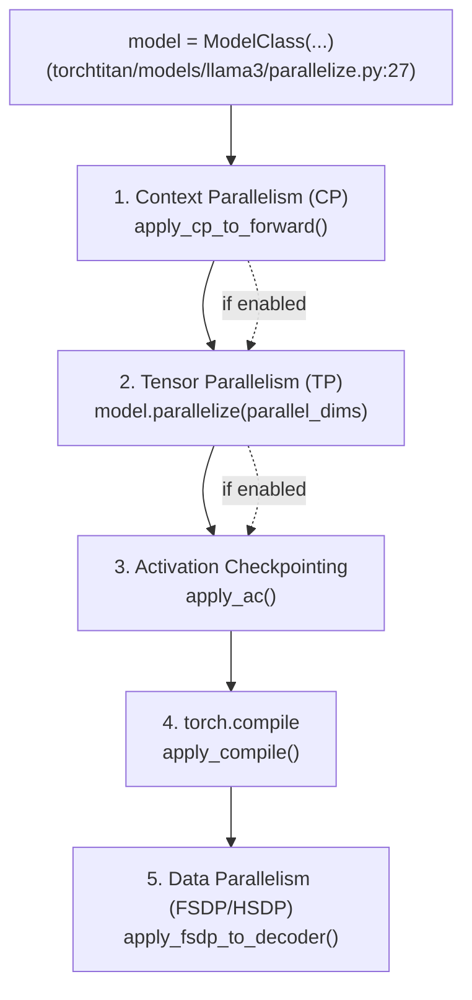
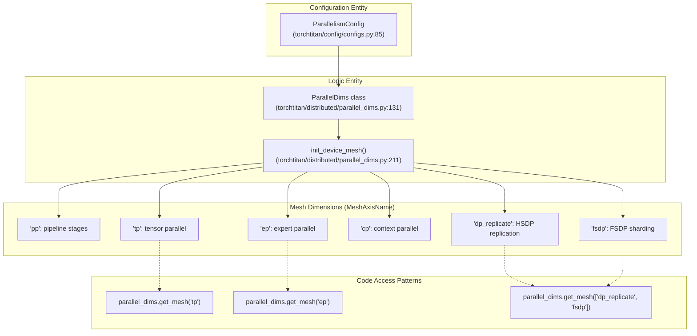

<!-- source: DeepWiki mcp.deepwiki.com · repo pytorch/torchtitan · page 4 Parallelization Strategies · fetched 2026-10-30 -->

# Parallelization Strategies

Relevant source files

The following files were used as context for generating this wiki page:

- [.github/scripts/run_8xgpu_integration_tests.sh](.github/scripts/run_8xgpu_integration_tests.sh)
- [tests/integration_tests/h100.py](tests/integration_tests/h100.py)
- [tests/unit_tests/test_parallel_dims.py](tests/unit_tests/test_parallel_dims.py)
- [torchtitan/components/lora.py](torchtitan/components/lora.py)
- [torchtitan/config/configs.py](torchtitan/config/configs.py)
- [torchtitan/distributed/full_dtensor.py](torchtitan/distributed/full_dtensor.py)
- [torchtitan/distributed/parallel_dims.py](torchtitan/distributed/parallel_dims.py)
- [torchtitan/distributed/spmd_types.py](torchtitan/distributed/spmd_types.py)
- [torchtitan/experiments/transformers_modeling_backend/parallelize.py](torchtitan/experiments/transformers_modeling_backend/parallelize.py)
- [torchtitan/models/deepseek_v3/parallelize.py](torchtitan/models/deepseek_v3/parallelize.py)
- [torchtitan/models/gpt_oss/parallelize.py](torchtitan/models/gpt_oss/parallelize.py)
- [torchtitan/models/llama3/parallelize.py](torchtitan/models/llama3/parallelize.py)
- [torchtitan/models/qwen3/parallelize.py](torchtitan/models/qwen3/parallelize.py)

This document provides an overview of TorchTitan's multi-dimensional parallelization system that enables distributed training across multiple devices and nodes. TorchTitan supports composable parallelism strategies that can be combined in various ways to scale training efficiently:

- **Data Parallelism (FSDP/HSDP/DDP)** - Distributes data batches and replicates/shards model parameters ([Data Parallelism (FSDP/HSDP/DDP)](#4.2))
- **Tensor Parallelism** - Shards individual tensors and layers across devices ([Tensor Parallelism](#4.3))
- **Pipeline Parallelism** - Splits the model into stages processed across devices ([Pipeline Parallelism](#4.4))
- **Expert Parallelism** - Distributes MoE experts across devices ([Expert Parallelism for MoE](#4.5))
- **Context Parallelism** - Splits the sequence dimension for long context training ([Context Parallelism](#4.6))

The key design principle is that these strategies are **composable**: a single training job can combine FSDP + TP + PP + CP + EP simultaneously, with each strategy operating on different dimensions of the device mesh.

## Parallelization Architecture

TorchTitan's parallelization is orchestrated through the `ParallelDims` class and the model-specific `parallelize` functions. The system follows a specific application order to ensure compatibility between different parallelization techniques.

### Parallelization Application Order

**Title: Order of Parallelization Operations (Code Flow)**

This ordering is critical because:
- **CP/TP before FSDP**: FSDP needs to see which parameters or activations are already sharded by TP or modified by CP hooks [torchtitan/models/llama3/parallelize.py:55-63]().
- **AC before compile**: Compilation occurs on checkpointed modules to ensure the graph includes recomputation logic [torchtitan/models/llama3/parallelize.py:71-80]().
- **Compile before FSDP**: In TorchTitan, `apply_compile` is typically called on individual `TransformerBlock` modules before the global FSDP wrapper is applied [torchtitan/models/llama3/parallelize.py:79-103]().

Sources: [torchtitan/models/llama3/parallelize.py:27-103](), [torchtitan/models/gpt_oss/parallelize.py:27-108](), [torchtitan/models/deepseek_v3/parallelize.py:28-111]()

### ParallelDims and Device Mesh

**Title: ParallelDims to DeviceMesh Mapping**

The `ParallelDims` class translates user configuration into a multi-dimensional `DeviceMesh` [torchtitan/distributed/parallel_dims.py:131-160](). Mesh dimensions are identified by `MeshAxisName` (e.g., `dp`, `tp`, `pp`, `cp`, `ep`) [torchtitan/distributed/parallel_dims.py:31-52]().

Sources: [torchtitan/distributed/parallel_dims.py:31-52](), [torchtitan/distributed/parallel_dims.py:131-185](), [torchtitan/config/configs.py:85-156]()

## Model Parallelization Entry Points

Each model in TorchTitan defines a `parallelize_<model_name>` function that orchestrates the application of all distributed training techniques.

### Model-Specific Parallelization Functions

| Model | Parallelization Function | Location |
|-------|-------------------------|----------|
| Llama 3 | `parallelize_llama()` | [torchtitan/models/llama3/parallelize.py:27-106]() |
| DeepSeek-V3 | `parallelize_deepseekv3()` | [torchtitan/models/deepseek_v3/parallelize.py:28-113]() |
| Qwen 3 | `parallelize_qwen3()` | [torchtitan/models/qwen3/parallelize.py:31-124]() |
| GPT-OSS | `parallelize_gptoss()` | [torchtitan/models/gpt_oss/parallelize.py:27-109]() |

Sources: [torchtitan/models/llama3/parallelize.py:27-106](), [torchtitan/models/deepseek_v3/parallelize.py:28-113](), [torchtitan/models/qwen3/parallelize.py:31-124]()

## Parallelism Strategies Overview

### Data Parallelism (FSDP/HSDP/DDP)
TorchTitan primarily utilizes PyTorch **FSDP2** for data parallelism. It supports Hybrid Sharded Data Parallelism (HSDP) when `data_parallel_replicate_degree > 1` and `data_parallel_shard_degree > 1` [torchtitan/config/configs.py:86-107](). It is applied via `apply_fsdp_to_decoder` which handles parameter sharding and mixed precision policies [torchtitan/distributed/fsdp.py:22]().

For details, see [Data Parallelism (FSDP/HSDP/DDP)](#4.2).

### Tensor Parallelism
Tensor Parallelism (TP) shards individual weight tensors and activations. TorchTitan models implement a `parallelize(parallel_dims)` method to apply TP sharding plans [torchtitan/models/llama3/parallelize.py:62](). It supports asynchronous TP via `maybe_enable_async_tp` to overlap communication with computation [torchtitan/distributed/tensor_parallel.py:24]().

For details, see [Tensor Parallelism](#4.3).

### Pipeline Parallelism
Pipeline Parallelism (PP) splits the model into stages. The degree is controlled by `pipeline_parallel_degree` [torchtitan/config/configs.py:151](). PP is often combined with FSDP, where `pp_enabled=True` is passed to the FSDP wrapper to ensure correct gradient handling across stages [torchtitan/models/llama3/parallelize.py:98]().

For details, see [Pipeline Parallelism](#4.4).

### Expert Parallelism
For Mixture of Experts (MoE) models like DeepSeek-V3, Expert Parallelism (EP) distributes experts across the `ep` mesh dimension [torchtitan/models/deepseek_v3/parallelize.py:97-108](). It can be composed with FSDP (via `efsdp` mesh) and TP [torchtitan/distributed/full_dtensor.py:60-67]().

For details, see [Expert Parallelism for MoE](#4.5).

### Context Parallelism
Context Parallelism (CP) enables training with very long sequences by sharding the sequence dimension [torchtitan/config/configs.py:180](). It is applied by wrapping attention modules with `apply_cp_to_forward` [torchtitan/models/llama3/parallelize.py:56-60]().

For details, see [Context Parallelism](#4.6).

### Activation Checkpointing
Activation Checkpointing (AC) reduces memory usage by recomputing activations during the backward pass. TorchTitan supports various modes via `apply_ac`, including selective and full checkpointing [torchtitan/distributed/activation_checkpoint.py:15]().

For details, see [Activation Checkpointing](#4.7).

## Composing Parallelism Strategies

TorchTitan's `ParallelDims` class ensures that the product of all parallelism degrees matches the total `world_size` [torchtitan/distributed/parallel_dims.py:181-185]().

**Title: Composition of Parallelism Dimensions**
| Feature | Mesh Axis | Config Parameter |
|---------|-----------|------------------|
| Data Parallel (Shard) | `fsdp` | `data_parallel_shard_degree` |
| Data Parallel (Replicate) | `dp_replicate` | `data_parallel_replicate_degree` |
| Tensor Parallel | `tp` | `tensor_parallel_degree` |
| Pipeline Parallel | `pp` | `pipeline_parallel_degree` |
| Context Parallel | `cp` | `context_parallel_degree` |
| Expert Parallel | `ep` | `expert_parallel_degree` |

For details on the complete pipeline, see [Parallelization Pipeline and Model-Specific Implementation](#4.8).

Sources: [torchtitan/distributed/parallel_dims.py:31-52](), [torchtitan/distributed/parallel_dims.py:148-160](), [torchtitan/config/configs.py:85-185]()

---

