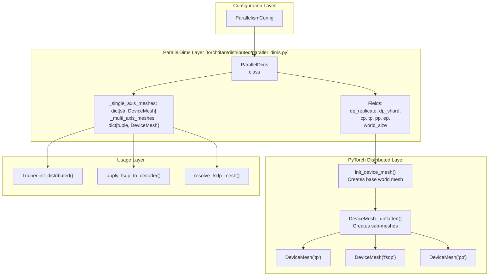
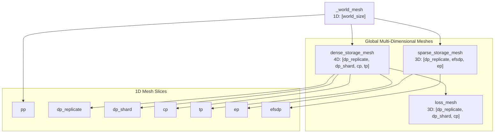

<!-- source: DeepWiki mcp.deepwiki.com · repo pytorch/torchtitan · page 4.1 ParallelDims and Device Mesh Management · fetched 2026-10-30 -->

# ParallelDims and Device Mesh Management

<details>
<summary>Relevant source files</summary>

The following files were used as context for generating this wiki page:

- [tests/unit_tests/test_parallel_dims.py](tests/unit_tests/test_parallel_dims.py)
- [torchtitan/components/lora.py](torchtitan/components/lora.py)
- [torchtitan/distributed/__init__.py](torchtitan/distributed/__init__.py)
- [torchtitan/distributed/full_dtensor.py](torchtitan/distributed/full_dtensor.py)
- [torchtitan/distributed/parallel_dims.py](torchtitan/distributed/parallel_dims.py)
- [torchtitan/distributed/spmd_types.py](torchtitan/distributed/spmd_types.py)

</details>


## Purpose and Scope

This document explains the `ParallelDims` class and its device mesh management system, which orchestrates all parallelism strategies in TorchTitan. `ParallelDims` serves as the central configuration and access point for distributed training meshes, managing up to six logical parallelism dimensions simultaneously. It bridges the gap between user-specified parallelism degrees in configuration and the actual `DeviceMesh` objects needed by PyTorch's distributed APIs.

## Overview

The `ParallelDims` class is a dataclass [torchtitan/distributed/parallel_dims.py:130-145]() that validates parallelism configurations and creates PyTorch `DeviceMesh` objects. It handles the complexity of "unflattening" a 1D world mesh into multi-dimensional meshes that represent different parallelization strategies (DP, TP, PP, CP, EP).

### Code Entity Mapping: Configuration to Mesh
The following diagram illustrates how the system translates high-level configuration into low-level `DeviceMesh` entities.



**Sources:** [torchtitan/distributed/parallel_dims.py:130-160](), [torchtitan/distributed/parallel_dims.py:284-350](), [torchtitan/distributed/full_dtensor.py:70-106]()

## Parallelism Dimensions

`ParallelDims` manages six primary parallelism dimensions:

| Dimension | Field Name | Purpose | Default Behavior |
|-----------|-----------|---------|---------------|
| Pipeline Parallel | `pp` | Number of pipeline stages | 1 (disabled) |
| Data Parallel Replicate | `dp_replicate` | HSDP replication degree | 1 (disabled) |
| Data Parallel Shard | `dp_shard` | FSDP sharding degree | -1 (auto-computed) |
| Context Parallel | `cp` | Long-context sequence sharding | 1 (disabled) |
| Tensor Parallel | `tp` | Intra-layer weight sharding | 1 (disabled) |
| Expert Parallel | `ep` | MoE expert distribution | 1 (disabled) |

The `dp_shard` dimension is special: when set to `-1`, it auto-computes to use all remaining GPUs after allocating other dimensions in `_validate()` [torchtitan/distributed/parallel_dims.py:177-178]():

```python
# From torchtitan/distributed/parallel_dims.py:178
self.dp_shard = dp_shard = self.world_size // (dp_replicate * cp * tp * pp)
```

**Validation constraints:**
- All dimensions (except `dp_shard` initially) must be `>= 1` [torchtitan/distributed/parallel_dims.py:174-175]().
- Final product must match world size: `dp_replicate * dp_shard * cp * tp * pp == world_size` [torchtitan/distributed/parallel_dims.py:181-184]().

**Sources:** [torchtitan/distributed/parallel_dims.py:131-184](), [tests/unit_tests/test_parallel_dims.py:43-142]()

## Device Mesh Architecture

`ParallelDims` creates a hierarchy of device meshes through "unflattening" the world mesh. It maintains separate logical meshes for dense parameters and sparse (expert) parameters.

### Mesh Hierarchy Diagram



**Sources:** [torchtitan/distributed/parallel_dims.py:284-414](), [torchtitan/distributed/full_dtensor.py:56-57]()

### Mesh Dimension Purposes

| Mesh Axis Name | Logical Mesh Group | Primary Use Case |
|-----------|-------------------|------------------|
| `pp` | World Mesh | Pipeline stage scheduling |
| `dp_replicate` | Dense/Sparse | HSDP outer replication dimension |
| `dp_shard` | Dense | FSDP sharding dimension |
| `cp` | Dense | Context parallel sequence sharding |
| `tp` | Dense | Tensor parallel weight sharding |
| `ep` | Sparse | MoE expert distribution |
| `efsdp` | Sparse | FSDP sharding for experts (size: `dp_shard * cp * tp // ep`) |

**Mesh Unflattening Logic:**
The `build_meshes()` method performs the unflatten operations [torchtitan/distributed/parallel_dims.py:284-350](). It uses a `backend_override` of `"fake"` for dimensions with degree 1 or for the `batch` dimension to avoid unnecessary process group creation [torchtitan/distributed/parallel_dims.py:302-311]().

**Sources:** [torchtitan/distributed/parallel_dims.py:31-52](), [torchtitan/distributed/parallel_dims.py:284-350](), [torchtitan/distributed/full_dtensor.py:70-106]()

## SPMD Backends and DTensor Integration

TorchTitan supports different backends for managing parallelism via the `spmd_backend` configuration [torchtitan/distributed/parallel_dims.py:139]():

1.  **default**: Uses standard PyTorch distributed APIs (FSDP, TP).
2.  **full_dtensor**: All parameters, buffers, and inputs become `DTensor`s on a multi-dimensional dense mesh [torchtitan/distributed/full_dtensor.py:7-16]().
3.  **spmd_types**: Uses `spmd_types` for functional SPMD annotations and layout management [torchtitan/distributed/spmd_types.py:7-21]().

### SpmdLayout and MeshAxisName
The `SpmdLayout` class [torchtitan/distributed/parallel_dims.py:56-65]() provides temporary SPMD layout annotations keyed by logical mesh axis names defined in `MeshAxisName` [torchtitan/distributed/parallel_dims.py:31-52]().

```python
# Example logical axes from MeshAxisName
class MeshAxisName(StrEnum):
    DP = "dp"
    FSDP = "fsdp"
    TP = "tp"
    CP = "cp"
    # ...
```

**Sources:** [torchtitan/distributed/parallel_dims.py:31-65](), [torchtitan/distributed/spmd_types.py:100-121](), [torchtitan/distributed/full_dtensor.py:7-16]()

## Accessing and Using Meshes

### Access Methods
`ParallelDims` provides methods to retrieve meshes for specific components:
- `get_mesh(axis_names)`: Retrieves a single or multi-axis mesh based on logical names [torchtitan/distributed/parallel_dims.py:215-224]().
- `get_activated_mesh(axis_names)`: Returns a mesh where only dimensions with degree > 1 are included [torchtitan/distributed/parallel_dims.py:236-248]().
- `resolve_fsdp_mesh()`: (In `full_dtensor.py`) Selects the dense storage mesh and `DataParallelMeshDims` for FSDP [torchtitan/distributed/full_dtensor.py:70-106]().

### Integration with Training Loop
The meshes are used extensively in the training pipeline:
1.  **Input Parallelization**: `parallelize_inputs` wraps inputs and labels as `DTensor`s on the dense storage mesh [torchtitan/distributed/full_dtensor.py:128-167]().
2.  **Model Parallelization**: `apply_fsdp_to_decoder` uses the meshes provided by `ParallelDims` to shard the model [tests/unit_tests/test_parallel_dims.py:22]().
3.  **LoRA Sharding**: LoRA adapter sharding is derived from the base linear's TP sharding using `SpmdLayout` logic [torchtitan/components/lora.py:23-47]().

**Sources:** [torchtitan/distributed/parallel_dims.py:215-248](), [torchtitan/distributed/full_dtensor.py:70-167](), [torchtitan/components/lora.py:23-47]()

---

