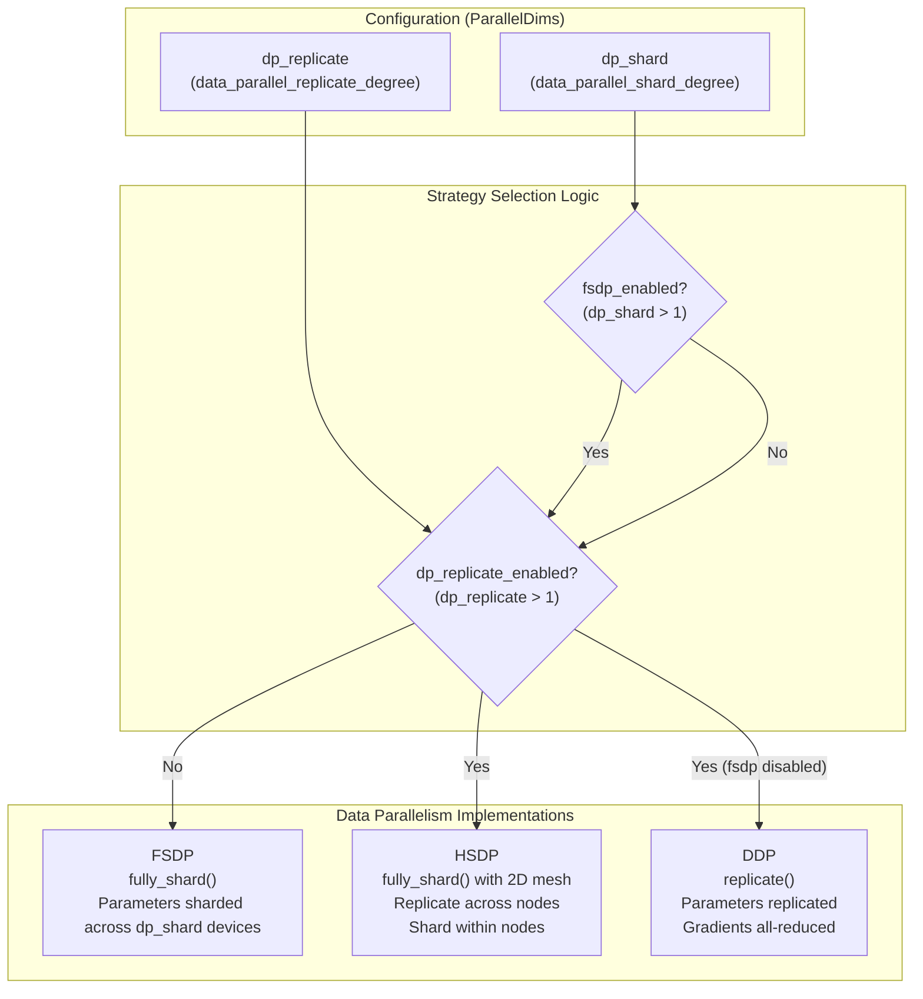
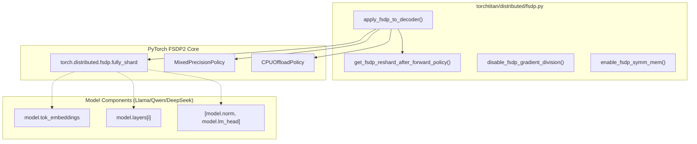
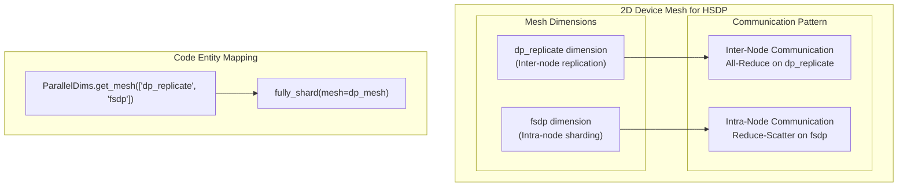

<!-- source: DeepWiki mcp.deepwiki.com · repo pytorch/torchtitan · page 4.2 Data Parallelism (FSDP/HSDP/DDP) · fetched 2026-10-30 -->

# Data Parallelism (FSDP/HSDP/DDP)

Relevant source files

The following files were used as context for generating this wiki page:

- [docs/fsdp.md](docs/fsdp.md)
- [tests/unit_tests/test_fsdp_moe_sharding.py](tests/unit_tests/test_fsdp_moe_sharding.py)
- [torchtitan/distributed/fsdp.py](torchtitan/distributed/fsdp.py)

This document details TorchTitan's data parallelism implementations using PyTorch's native FSDP2 (Fully Sharded Data Parallel), HSDP (Hybrid Sharded Data Parallel), and DDP (Distributed Data Parallel). These strategies enable training of large models by distributing parameters and gradients across multiple devices.

## Overview

TorchTitan provides three data parallelism strategies configured through the `ParallelDims` system. The choice of strategy is determined by the `data_parallel_shard_degree` and `data_parallel_replicate_degree` configuration parameters.

### Data Parallelism Strategy Selection

Sources: [torchtitan/models/llama3/parallelize.py:121-150](), [torchtitan/models/llama4/parallelize.py:172-200]()

| Strategy | `dp_replicate` | `dp_shard` | Implementation | Communication Pattern |
|----------|----------------|------------|----------------|----------------------|
| **FSDP** | 1 | > 1 | `fully_shard()` | All-gather forward, reduce-scatter backward |
| **HSDP** | > 1 | > 1 | `fully_shard()` + 2D mesh | All-gather intra-node, all-reduce inter-node |
| **DDP** | > 1 | 1 | `replicate()` | All-reduce gradients |

## FSDP2 Implementation

TorchTitan uses PyTorch's FSDP2 implementation via the `fully_shard()` API. FSDP2 represents sharded parameters as `DTensor`s sharded on dimension 0, allowing for communication-free sharded state dicts and a simpler meta-device initialization flow [docs/fsdp.md:8-10](). Unlike FSDP1, FSDP2 avoids the `FlatParameter` abstraction, which enables easier manipulation of individual parameters and lower, deterministic GPU memory usage [docs/fsdp.md:4-10]().

### FSDP Application Architecture

The `apply_fsdp_to_decoder` function in `torchtitan/distributed/fsdp.py` is the central entry point for wrapping model components [torchtitan/distributed/fsdp.py:81-135](). It handles hierarchical sharding for both dense and MoE models [torchtitan/distributed/fsdp.py:98-102]().

Sources: [torchtitan/distributed/fsdp.py:27-135](), [docs/fsdp.md:18-30]()

### Mixed Precision and Resharding

FSDP2 supports mixed precision through `MixedPrecisionPolicy`, specifying `param_dtype` and `reduce_dtype`. In TorchTitan, `cast_forward_inputs` is typically set to `False` as inputs are handled by the trainer [torchtitan/distributed/fsdp.py:136-140]().

The `reshard_after_forward` policy determines whether parameters are freed after the forward pass [docs/fsdp.md:56-57](). 
* **Always**: `True`. Saves memory, extra communication.
* **Never**: `False`. Uses more memory, faster execution.
* **Default**: Returns `not pp_enabled`. This avoids expensive per-microbatch all-gathers when Pipeline Parallelism is active [torchtitan/distributed/fsdp.py:54-78]().

### Performance Optimizations
* **Gradient Division**: `disable_fsdp_gradient_division` sets `gradient_divide_factor=1.0`. TorchTitan handles gradient scaling manually using global token counts [torchtitan/distributed/fsdp.py:27-41]().
* **Symmetric Memory**: `enable_fsdp_symm_mem` enables `set_symm_mem_for_comm()` and `set_force_sum_reduction_for_comms` for optimized communication on supported hardware [torchtitan/distributed/fsdp.py:44-51]().

## HSDP (Hybrid Sharded Data Parallel)

HSDP is used when both replication and sharding degrees are greater than 1. It utilizes a 2D `DeviceMesh` where replication occurs across one dimension (typically inter-node) and sharding occurs across the other (typically intra-node) [docs/fsdp.md:55]().

### HSDP Device Mesh Structure

Sources: [torchtitan/models/llama4/parallelize.py:173-185](), [torchtitan/distributed/fsdp.py:81-94]()

## MoE and Expert Data Parallelism

For Mixture of Experts (MoE) models, TorchTitan handles data parallelism for expert parameters specifically via an `edp_mesh` (Expert Data Parallel mesh) [torchtitan/distributed/fsdp.py:121-122]().

### Expert Parameter Sharding
If `ep_degree > 1`, MoE experts are sharded using the `edp_mesh`. A key optimization in `apply_fsdp_to_decoder` checks if the FSDP world size is greater than the number of experts. If so, it shards across dimension 1 (feature dim) instead of dimension 0 (expert dim) to ensure all ranks participate in sharding [tests/unit_tests/test_fsdp_moe_sharding.py:79-110]().

| Parameter Type | Sharding Mesh | Implementation |
|----------------|---------------|----------------|
| Non-MoE Params | `dp_mesh` (`fsdp` dim) | `fully_shard` |
| MoE Experts | `edp_mesh` (`efsdp` dim) | `fully_shard` |

Sources: [torchtitan/distributed/fsdp.py:81-135](), [tests/unit_tests/test_fsdp_moe_sharding.py:79-132]()

## DDP Implementation

When sharding is disabled (`dp_shard == 1`), TorchTitan falls back to `replicate()` (DDP). This is applied to the model using the `dp_replicate` dimension of the mesh [torchtitan/models/llama3/parallelize.py:145-150]().

### DDP Optimization with torch.compile
When `torch.compile` is enabled, TorchTitan configures DDP to work efficiently with the compiler. This includes setting `torch._dynamo.config.optimize_ddp = True` and using the `python_reducer_without_compiled_forward` if `compiled_autograd` is active [torchtitan/models/llama3/parallelize.py:330-336]().

## Configuration Options

Data parallelism is configured in the `[parallelism]` and `[training]` sections of the job configuration:

| Config Key | Description | File Reference |
|------------|-------------|----------------|
| `data_parallel_shard_degree` | Number of GPUs to shard parameters across. | [torchtitan/config.py]() |
| `data_parallel_replicate_degree` | Number of model replicas (HSDP/DDP). | [torchtitan/config.py]() |
| `fsdp_reshard_after_forward` | Policy: `default`, `always`, or `never`. | [torchtitan/distributed/fsdp.py:54-78]() |
| `enable_cpu_offload` | If true, offloads parameters to CPU. | [torchtitan/distributed/fsdp.py:110-111]() |
| `mixed_precision_param` | Dtype for parameter storage (e.g., `bfloat16`). | [torchtitan/distributed/fsdp.py:137]() |
| `mixed_precision_reduce` | Dtype for gradient reduction (e.g., `float32`). | [torchtitan/distributed/fsdp.py:138]() |

Sources: [torchtitan/distributed/fsdp.py:81-146](), [torchtitan/models/llama4/parallelize.py:172-200]()

---

