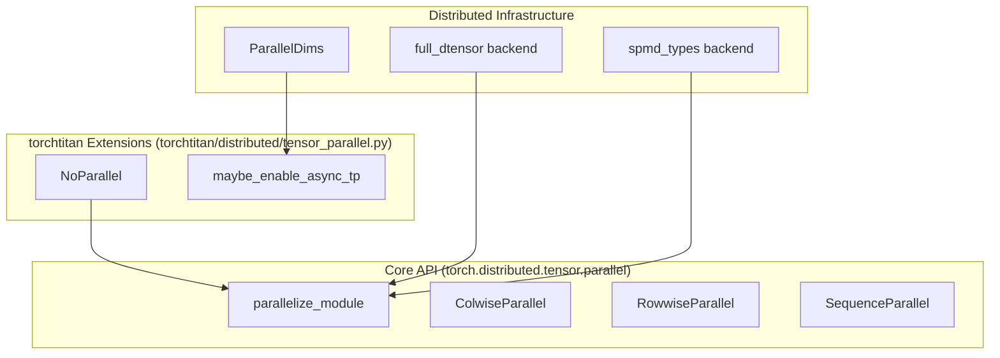
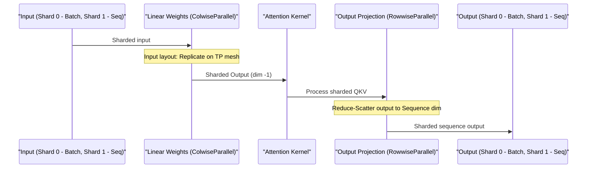
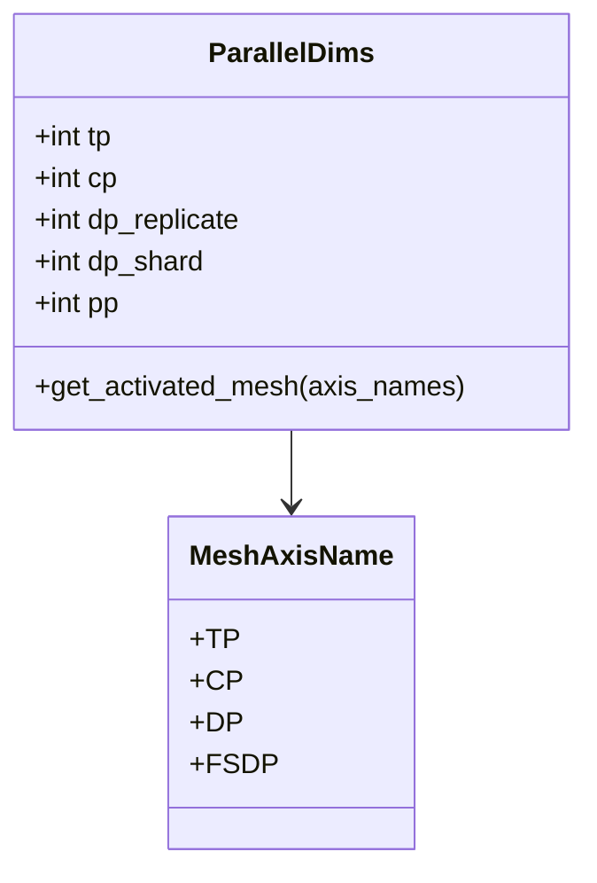

<!-- source: DeepWiki mcp.deepwiki.com · repo pytorch/torchtitan · page 4.3 Tensor Parallelism · fetched 2026-10-30 -->

# Tensor Parallelism

Relevant source files

The following files were used as context for generating this wiki page:

- [tests/unit_tests/test_parallel_dims.py](tests/unit_tests/test_parallel_dims.py)
- [torchtitan/components/lora.py](torchtitan/components/lora.py)
- [torchtitan/distributed/full_dtensor.py](torchtitan/distributed/full_dtensor.py)
- [torchtitan/distributed/parallel_dims.py](torchtitan/distributed/parallel_dims.py)
- [torchtitan/distributed/spmd_types.py](torchtitan/distributed/spmd_types.py)
- [torchtitan/distributed/tensor_parallel.py](torchtitan/distributed/tensor_parallel.py)

## Purpose and Scope

This page documents Tensor Parallelism (TP) in TorchTitan, a technique for distributing model parameters across multiple devices by sharding weight tensors along specific dimensions. TP enables training large models that exceed the memory capacity of a single accelerator by partitioning layers horizontally.

In `torchtitan`, TP is implemented using PyTorch Distributed Tensor (DTensor) APIs, allowing for composable 4D parallelism (DP, TP, PP, CP). It relies on the `ParallelDims` and `DeviceMesh` infrastructure to manage the communication groups.

Sources: [torchtitan/distributed/parallel_dims.py:48-48](), [torchtitan/distributed/tensor_parallel.py:9-16]()

## Core Tensor Parallelism Concepts

### Column-wise vs Row-wise Parallelism

Tensor Parallelism partitions linear layer weights along either the input or output dimension, requiring collective communication to maintain mathematical equivalence with the unsharded computation.

*   **Column-wise Parallelism** (`ColwiseParallel`): Splits weight matrix along the column dimension (output features). Each rank computes a subset of output features.
*   **Row-wise Parallelism** (`RowwiseParallel`): Splits weight matrix along the row dimension (input features). Input must be partitioned across ranks. Requires an all-reduce or reduce-scatter on outputs to sum partial results.
*   **Sequence Parallelism** (`SequenceParallel`): Distributes computation across the sequence length (dimension 1). This is typically applied to LayerNorm or RMSNorm layers to avoid redundant computation and reduce activation memory.

Sources: [torchtitan/distributed/tensor_parallel.py:23-34](), [torchtitan/distributed/full_dtensor.py:128-152]()

### Implementation Entities

The following diagram maps high-level TP concepts to specific classes and functions in the codebase.

**TP Code Entity Map**

Sources: [torchtitan/distributed/tensor_parallel.py:23-34](), [torchtitan/distributed/parallel_dims.py:131-160](), [torchtitan/distributed/full_dtensor.py:9-16]()

## Application to Model Components

TorchTitan applies TP systematically to transformer model components using `parallelize_module`. The parallelization plan maps module names to specific `ParallelStyle` objects.

### TransformerBlock Parallelization Plan

Each `TransformerBlock` contains attention and feed-forward sub-modules. The data flow follows a specific sharding pattern to minimize communication.

**TP Data Flow (Standard Decoder)**

Sources: [torchtitan/distributed/full_dtensor.py:128-167](), [torchtitan/distributed/spmd_types.py:124-158]()

### Specialized TP Styles

1.  **`NoParallel`**: Used for modules like the MoE router gate that require replicated computation on the TP mesh. It ensures parameters are `DTensors` on the TP mesh for consistent gradient clipping and optimizer behavior without sharding the actual math. [torchtitan/distributed/tensor_parallel.py:23-48]()
2.  **`maybe_enable_async_tp`**: Enables overlapping TP communication (All-Gather/Reduce-Scatter) with computation. This requires `torch.compile` to be enabled for the model. [torchtitan/distributed/tensor_parallel.py:102-116]()

## Implementation Details

### LoRA Adapter Sharding
When using LoRA, adapter weights must mirror the base weight's sharding to maintain consistency.
*   **`lora_a`**: Typically `Replicate` as the rank dimension is small.
*   **`lora_b`**: Mirrors the base linear's TP sharding (Column-wise or Row-wise) so its output placement matches the base layer's output.

Sources: [torchtitan/components/lora.py:23-47]()

### Multi-Axis Compatibility
TorchTitan supports complex mesh configurations where TP is composed with other dimensions. The `ParallelDims` class validates that the product of all degrees (DP, CP, TP, PP) matches the world size.

**ParallelDims Structure**

Sources: [torchtitan/distributed/parallel_dims.py:31-52](), [torchtitan/distributed/parallel_dims.py:131-160]()

## Configuration and Backends

TP behavior can be modified by the choice of SPMD backend in `ParallelismConfig`:
*   **`full_dtensor`**: All parameters and inputs are converted to `DTensor`. [torchtitan/distributed/full_dtensor.py:9-16]()
*   **`spmd_types`**: Uses a functional annotation approach to define sharding. [torchtitan/distributed/spmd_types.py:7-21]()

### Backend Logic for Inputs
When using `full_dtensor`, `parallelize_inputs` wraps tensors using `DTensor.from_local` with specific placements:
*   `dp_replicate` / `dp_shard`: Shard(0)
*   `cp`: Shard(1)
*   `tp`: Replicate

Sources: [torchtitan/distributed/full_dtensor.py:128-167]()

### Async TP Requirements
Async TP requires:
1.  `parallelism.enable_async_tensor_parallel` set to `True`.
2.  `torch.compile` enabled for the model component.
3.  Internally sets `torch._inductor.config._micro_pipeline_tp = True`.

Sources: [torchtitan/distributed/tensor_parallel.py:102-116]()

## Testing and Validation
The TP dimensions and mesh building logic are validated in `tests/unit_tests/test_parallel_dims.py`, ensuring that auto-calculation of `dp_shard` and world size assertions are correct.

Sources: [tests/unit_tests/test_parallel_dims.py:43-112]()

---

