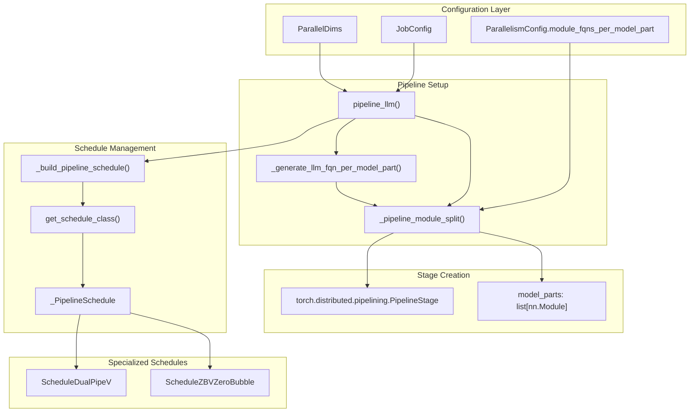
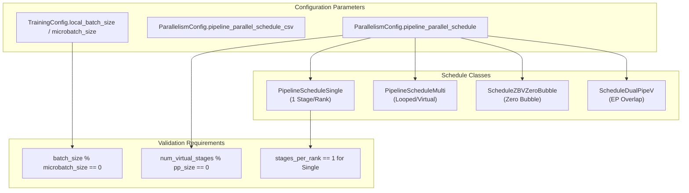
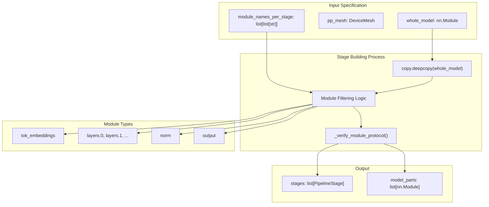

<!-- source: DeepWiki mcp.deepwiki.com · repo pytorch/torchtitan · page 4.4 Pipeline Parallelism · fetched 2026-10-30 -->

# Pipeline Parallelism

Relevant source files

The following files were used as context for generating this wiki page:

- [torchtitan/distributed/pipeline_parallel.py](torchtitan/distributed/pipeline_parallel.py)
- [torchtitan/experiments/transformers_modeling_backend/pipeline.py](torchtitan/experiments/transformers_modeling_backend/pipeline.py)

Pipeline parallelism (PP) splits a model into sequential stages distributed across multiple devices, with each stage processing different microbatches in a pipelined fashion. This enables training models that exceed single-device memory capacity by distributing model layers across devices. Unlike data parallelism which replicates the model, or tensor parallelism which shards individual layers, pipeline parallelism partitions the model vertically into complete layer subsets.

TorchTitan's pipeline parallelism implementation provides flexible model splitting strategies, multiple scheduling algorithms (GPipe, 1F1B, Zero Bubble), and deep integration with other parallelization techniques.

**Key Capabilities**:
- Automatic and manual model stage splitting via `pipeline_module_split` [torchtitan/distributed/pipeline_parallel.py:237-238]()
- Multiple schedule types including `ScheduleZBVZeroBubble` and `ScheduleDualPipeV` [torchtitan/distributed/pipeline_parallel.py:22-24]()
- Integration with FSDP, tensor parallelism, and expert parallelism [torchtitan/distributed/pipeline_parallel.py:112-126]()
- Virtual pipeline stages for improved efficiency via `pipeline_parallel_layers_per_stage` [torchtitan/distributed/pipeline_parallel.py:160-162]()
- CSV-based custom schedules for advanced optimization [torchtitan/distributed/pipeline_parallel.py:388-414]()

## Pipeline Architecture Overview

TorchTitan's pipeline parallelism implementation provides a comprehensive system for splitting models into stages and coordinating their execution across devices. The core architecture revolves around the `PipelineStage` abstraction and various scheduling strategies.

### Pipeline Component Interaction

Sources: [torchtitan/distributed/pipeline_parallel.py:68-144](), [torchtitan/distributed/pipeline_parallel.py:237-355]()

The pipeline parallelism system operates through several key components:

| Component | Purpose | Key Functions |
|-----------|---------|---------------|
| `pipeline_llm()` | Main orchestration function for LLMs | Model setup, validation, stage creation [torchtitan/distributed/pipeline_parallel.py:68]() |
| `_pipeline_module_split()` | Splits models into pipeline stages | Module filtering, stage instantiation [torchtitan/distributed/pipeline_parallel.py:237]() |
| `_build_pipeline_schedule()` | Creates execution schedules | Schedule validation, microbatch management [torchtitan/distributed/pipeline_parallel.py:388]() |
| `_generate_llm_fqn_per_model_part()` | Programmatic stage definition | Layer distribution, weight balancing [torchtitan/distributed/pipeline_parallel.py:441]() |

## Pipeline Scheduling Strategies

TorchTitan supports multiple pipeline scheduling strategies that determine how microbatches flow through pipeline stages. The scheduling system provides both predefined schedules and runtime CSV-based custom schedules.

### Schedule Types and Characteristics

Sources: [torchtitan/distributed/pipeline_parallel.py:158-208](), [torchtitan/distributed/pipeline_parallel.py:388-414]()

### Specialized Schedules

#### DualPipeV and Expert Parallel Overlap
`ScheduleDualPipeV` is a specialized schedule designed to overlap Expert Parallel (EP) communication with Pipeline Parallel (PP) computation [torchtitan/distributed/pipeline_parallel.py:22](). 

- **Mechanism**: It utilizes specialized synchronization hooks to ensure that communication for MoE layers in one microbatch overlaps with computation in another.
- **Constraints**: It cannot be used with Activation Checkpointing (AC) in certain configurations as the execution order requires intermediate activations to remain in memory for overlap efficiency.

#### Zero Bubble (ZBV)
`ScheduleZBVZeroBubble` implements advanced scheduling to minimize pipeline bubbles (idle time) by pairing stages in a V-style pattern, particularly effective when using virtual stages [torchtitan/distributed/pipeline_parallel.py:23]().

## Model Splitting and Stage Creation

The model splitting system transforms a complete model into distributed pipeline stages. The `_pipeline_module_split()` function provides fine-grained control over which modules belong to each stage.

Sources: [torchtitan/distributed/pipeline_parallel.py:237-355](), [torchtitan/experiments/transformers_modeling_backend/pipeline.py:148-154]()

The module splitting process follows these steps:
1. **Deep Copy**: Each stage starts with a complete model copy to preserve structure [torchtitan/distributed/pipeline_parallel.py:280]().
2. **Module Filtering**: Removes modules not assigned to the current stage based on FQNs [torchtitan/distributed/pipeline_parallel.py:284-335]().
3. **Stage Assignment**: Determines which stages run on each rank using `pp_mesh.get_local_rank()` [torchtitan/distributed/pipeline_parallel.py:246]().

### Weight Balancing
The `_generate_llm_fqn_per_model_part()` function allows for "weighting" the first and last stages. This is useful because the first stage (embeddings) and last stage (output head) often have different memory/compute profiles than middle transformer layers [torchtitan/distributed/pipeline_parallel.py:444-447]().

## Configuration Integration

Pipeline parallelism configuration is managed via `ParallelismConfig` and `TrainingConfig` [torchtitan/distributed/pipeline_parallel.py:27-32]().

| Configuration Parameter | Purpose | Source |
|------------------------|---------|--------|
| `pipeline_parallel_degree` | Number of PP ranks in the device mesh | [torchtitan/distributed/pipeline_parallel.py:82]() |
| `pipeline_parallel_schedule` | Schedule class (GPipe, 1F1B, DualPipeV, ZBV) | [torchtitan/distributed/pipeline_parallel.py:103]() |
| `pipeline_parallel_layers_per_stage` | Defines virtual stages for interleaved pipelines | [torchtitan/distributed/pipeline_parallel.py:160]() |
| `pipeline_parallel_first_stage_less_layers` | Weight for embedding stage balancing | [torchtitan/distributed/pipeline_parallel.py:168]() |
| `pipeline_parallel_last_stage_less_layers` | Weight for output stage balancing | [torchtitan/distributed/pipeline_parallel.py:169]() |

Sources: [torchtitan/distributed/pipeline_parallel.py:147-208]()

## Integration with Parallelization System

Pipeline parallelism integrates with TorchTitan's broader parallelization ecosystem by applying SPMD-style techniques (FSDP, TP, EP) to each `model_part` after the split [torchtitan/distributed/pipeline_parallel.py:112-126]().

### Parallelization Pipeline
1. **Model Splitting**: Model is partitioned into `model_parts`.
2. **SPMD Application**: `parallelize_fn` is called for each part to apply TP, AC, and FSDP [torchtitan/distributed/pipeline_parallel.py:114-122]().
3. **Module Update**: The parallelized module is assigned back to the `PipelineStage.submod` [torchtitan/distributed/pipeline_parallel.py:126]().
4. **Schedule Creation**: The `PipelineSchedule` is built using the parallelized stages [torchtitan/distributed/pipeline_parallel.py:128-133]().

Sources: [torchtitan/distributed/pipeline_parallel.py:109-133]()

---

