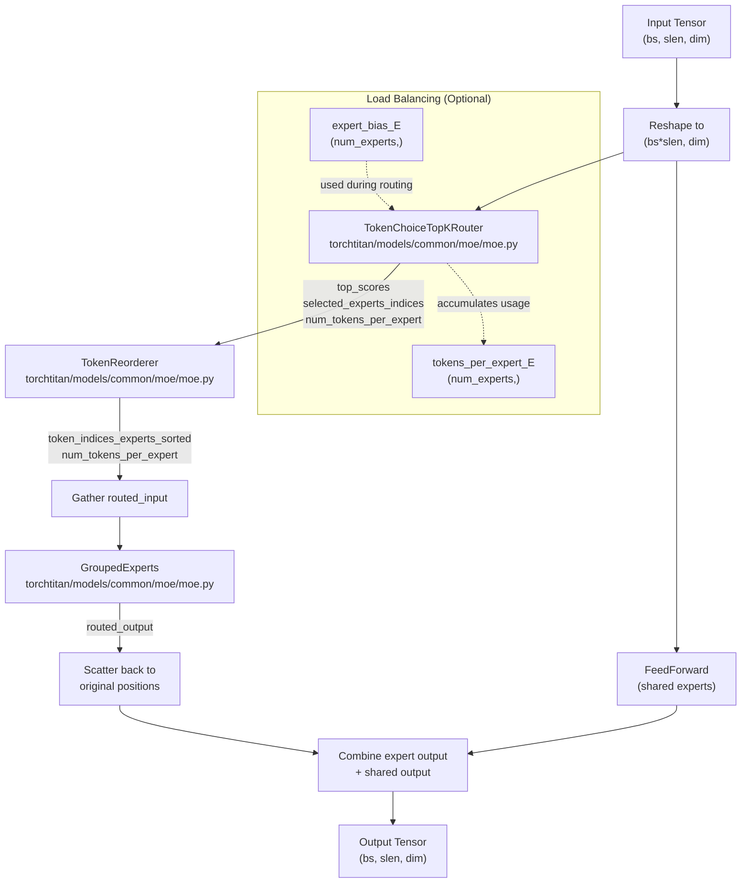
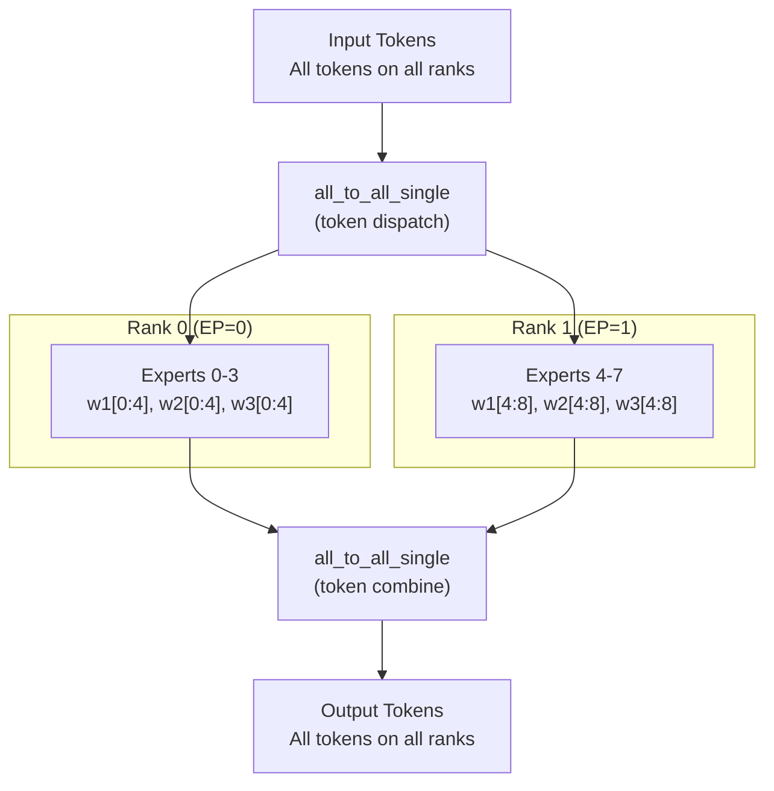
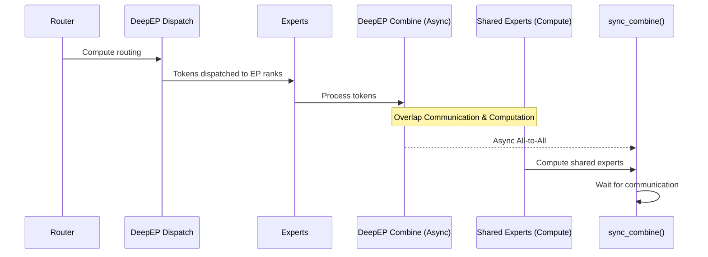

<!-- source: DeepWiki mcp.deepwiki.com · repo pytorch/torchtitan · page 4.5 Expert Parallelism for MoE · fetched 2026-10-30 -->

# Expert Parallelism for MoE

<details>
<summary>Relevant source files</summary>

The following files were used as context for generating this wiki page:

- [tests/unit_tests/test_expert_parallel.py](tests/unit_tests/test_expert_parallel.py)
- [torchtitan/components/quantization/utils.py](torchtitan/components/quantization/utils.py)
- [torchtitan/distributed/deepep/deepep.py](torchtitan/distributed/deepep/deepep.py)
- [torchtitan/distributed/deepep/hybridep.py](torchtitan/distributed/deepep/hybridep.py)
- [torchtitan/models/common/moe_sharding.py](torchtitan/models/common/moe_sharding.py)
- [torchtitan/models/deepseek_v3/sharding.py](torchtitan/models/deepseek_v3/sharding.py)
- [torchtitan/models/gpt_oss/sharding.py](torchtitan/models/gpt_oss/sharding.py)
- [torchtitan/models/qwen3/sharding.py](torchtitan/models/qwen3/sharding.py)
- [torchtitan/models/qwen3_5/__init__.py](torchtitan/models/qwen3_5/__init__.py)

</details>


This document describes TorchTitan's Expert Parallelism (EP) implementation for Mixture-of-Experts (MoE) models. Expert Parallelism distributes experts across multiple devices to enable scaling of MoE architectures beyond the memory capacity of a single device. This page covers the parallelization strategies, token routing mechanisms, and implementation details of EP, including advanced backends like DeepEP and HybridEP.

## MoE Architecture Overview

The MoE implementation in torchtitan consists of three core components that work together to route tokens through experts efficiently.

### MoE Module Components



**Sources:** [torchtitan/models/common/moe/moe.py:414-547](), [torchtitan/models/common/moe_sharding.py:175-183]()

The `MoE` module orchestrates token routing through three sequential steps:

1.  **Router** (`TokenChoiceTopKRouter`): Computes routing scores and selects top-k experts for each token.
2.  **Reorderer** (`TokenReorderer`): Reorders tokens to group them by expert assignment.
3.  **Experts** (`GroupedExperts`): Processes grouped tokens through the selected experts.

## Expert Parallelism Strategies

TorchTitan implements several parallelization strategies for MoE models, targeting different hardware configurations and communication backends.

### ExpertParallel Class

`ExpertParallel` distributes experts across devices by sharding expert parameters along the expert dimension (dimension 0). This is the core EP strategy.



**Sources:** [torchtitan/distributed/expert_parallel.py:74-179]()

#### Implementation Details

The `ExpertParallel._partition_fn` method shards expert parameters along dimension 0 using `distribute_tensor` [torchtitan/distributed/expert_parallel.py:82-85](). Token dispatch and combine are handled by `_token_dispatch` and `_token_combine` using `all_to_all_single_autograd` [torchtitan/distributed/expert_parallel.py:123-166]().

### ExpertTensorParallel (ETP)

`ExpertTensorParallel` combines Expert Parallelism and Tensor Parallelism in a 2D mesh configuration. This is used when experts are sharded across both EP and TP dimensions.

```python
# Shard along both expert dimension (0) and TP dimension (1 or 2)
# w1 shape = (experts, out_dim, in_dim)
distribute_tensor(mod.w1, device_mesh, [Shard(0), Shard(1)])  # Column-wise sharding [torchtitan/distributed/expert_parallel.py:191-193]
```

**Sources:** [torchtitan/distributed/expert_parallel.py:181-248]()

### DeepEP and HybridEP Implementations

For models like DeepSeek-V3, torchtitan supports specialized backends that optimize communication and enable overlapping computation with communication.

#### DeepEPExpertParallel

`DeepEPExpertParallel` uses the DeepEP library for efficient all-to-all communication. It supports an asynchronous `combine` operation, allowing `shared_experts` computation to overlap with the token combine communication [torchtitan/models/common/moe/moe_deepep.py:100-103]().



**Sources:** [torchtitan/distributed/expert_parallel.py:314-468](), [torchtitan/models/common/moe/moe_deepep.py:46-112](), [torchtitan/distributed/deepep/deepep.py:165-195]()

#### HybridEPExpertParallel

`HybridEPExpertParallel` implements a hybrid approach for communication, specifically optimized for GB200 NVLink72 systems using TMA-optimized all-to-all [torchtitan/distributed/deepep/hybridep.py:7-11](). It follows a similar structure to DeepEP but uses `hybridep` primitives and `DispatchHandle` to flow through the `torch.compile` graph [torchtitan/distributed/deepep/hybridep.py:33-39]().

**Sources:** [torchtitan/distributed/expert_parallel.py:471-554](), [torchtitan/distributed/deepep/hybridep.py:113-191]()

## Token Dispatching and Reordering

Efficient token routing is critical for MoE performance. torchtitan provides multiple `TokenDispatcher` implementations:

*   **AllToAllTokenDispatcher**: Uses standard NCCL `all_to_all` primitives. It reorders tokens from rank-major to expert-major layout via `_permute` [torchtitan/models/common/token_dispatcher.py:48-62]().
*   **DeepEPTokenDispatcher**: Interfaces with the `deepep` custom ops to perform low-latency RDMA-based dispatch [torchtitan/models/common/token_dispatcher.py:236-258]().
*   **HybridEPTokenDispatcher**: Uses `hybridep` for GB200 systems, supporting both blocking and non-blocking modes based on a `capacity_factor` [torchtitan/distributed/deepep/hybridep.py:12-19]().

### Sharding Configurations

Sharding for MoE is managed via `ShardingConfig` helpers. For routed experts, the system uses `expert_param_placement_sparse` to shard on dimension 0 (the expert dimension) [torchtitan/models/common/moe_sharding.py:29-47](). Shared experts follow a standard dense TP plan [torchtitan/models/common/moe_sharding.py:71-91]().

**Sources:** [torchtitan/models/common/moe_sharding.py:7-183](), [torchtitan/models/common/token_dispatcher.py:12-111]()

## Pipeline Parallelism Overlap (DualPipeV)

When using Pipeline Parallelism (PP) with MoE, torchtitan can enable `DualPipeV` to overlap EP communication with PP computation.

`DualPipeExpertParallel` is a wrapper that adds synchronization hooks (`SyncHook`) to dispatch and combine operations [torchtitan/distributed/dual_pipe_v.py:60-104](). These hooks coordinate with a `HookCoordinator` to alternate between compute and communication ops, maximizing throughput [torchtitan/distributed/dual_pipe_v.py:107-151]().

**Sources:** [torchtitan/distributed/dual_pipe_v.py:33-208]()

## Activation Checkpointing (SAC) Integration

Expert Parallelism in torchtitan is integrated with Selective Activation Checkpointing (SAC). The system specifically identifies MoE communication ops to ensure they are handled correctly during recomputation.

`_get_save_ops` includes DeepEP and HybridEP dispatch/combine ops in the "MUST_SAVE" list to avoid redundant communication during the backward pass [torchtitan/distributed/activation_checkpoint.py:54-63]().

**Sources:** [torchtitan/distributed/activation_checkpoint.py:28-87]()

## Summary of EP Classes

| Class | Purpose | Mesh Requirement |
|-------|---------|------------------|
| `ExpertParallel` | Standard EP sharding experts on dim 0. | 1D EP mesh [torchtitan/distributed/expert_parallel.py:74]() |
| `ExpertTensorParallel` | 2D sharding (EP + TP) for experts. | 2D [ep, tp] mesh [torchtitan/distributed/expert_parallel.py:181]() |
| `DeepEPExpertParallel` | Optimized EP using DeepEP backend. | 1D EP mesh [torchtitan/distributed/expert_parallel.py:314]() |
| `HybridEPExpertParallel` | Optimized EP using HybridEP backend for NVLink72. | 1D EP mesh [torchtitan/distributed/expert_parallel.py:471]() |
| `DualPipeExpertParallel`| Wrapper for PP/EP overlap. | PP + EP enabled [torchtitan/distributed/dual_pipe_v.py:60]() |

**Sources:** [torchtitan/distributed/expert_parallel.py](), [torchtitan/distributed/dual_pipe_v.py]()

---

