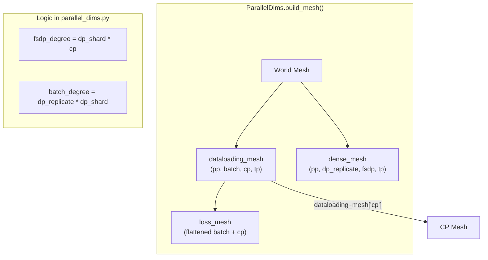
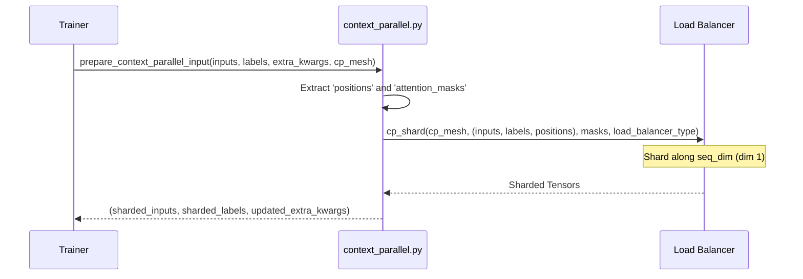

<!-- source: DeepWiki mcp.deepwiki.com · repo pytorch/torchtitan · page 4.6 Context Parallelism · fetched 2026-10-30 -->

# Context Parallelism

Relevant source files

The following files were used as context for generating this wiki page:

- [torchtitan/distributed/context_parallel.py](torchtitan/distributed/context_parallel.py)

## Purpose and Scope

This document describes Context Parallelism (CP) in torchtitan, a parallelization technique that enables training with extremely long sequences (1M+ tokens) by splitting the sequence dimension across multiple devices. Context Parallelism addresses the memory constraints of processing long contexts in transformer models by distributing activation memory across multiple GPUs.

In torchtitan, CP is implemented using PyTorch's native `DeviceMesh` and `DTensor` abstractions. It specifically integrates with Scaled Dot Product Attention (SDPA) and FlexAttention to distribute the computation of the attention matrix.

For information about other parallelization strategies, see:
- Data Parallelism (FSDP/HSDP/DDP): [4.2]()
- Tensor Parallelism: [4.3]()
- Pipeline Parallelism: [4.4]()
- Expert Parallelism for MoE: [4.5]()

## Context Parallelism Overview

Context Parallelism splits the sequence dimension across multiple devices. Unlike Tensor Parallelism which shards model parameters, or Pipeline Parallelism which shards layers, Context Parallelism shards the input tensors (tokens, positions, and masks) along the sequence length dimension.

**Key Characteristics:**
- **Sequence Sharding**: Splits `seq_len` across `cp_degree` devices [torchtitan/distributed/context_parallel.py:163-166]().
- **Memory Efficiency**: Distributes activation memory across devices proportionally to the CP degree.
- **Communication**: Requires ring-style communication or all-to-all patterns during the attention computation. In torchtitan, this is achieved either via `flex_cp_allgather` for FlexAttention [torchtitan/distributed/context_parallel.py:67-68]() or via `DTensor` redistribution for SDPA [torchtitan/distributed/context_parallel.py:84-91]().
- **Load Balancing**: Supports specialized load balancers like `_HeadTailLoadBalancer` (for SDPA) and `_PTRRLoadBalancer` (for FlexAttention) to handle causal masking imbalances [torchtitan/distributed/context_parallel.py:18-20]().

Sources: [torchtitan/distributed/context_parallel.py:1-106](), [torchtitan/distributed/parallel_dims.py:68-106]()

## Device Mesh Integration

Context Parallelism is a first-class dimension in the `ParallelDims` configuration. The `build_mesh` method creates several specialized meshes to handle the intersection of CP with other parallelism strategies.

**Mesh Dimension Definitions:**
- **`cp`**: The dedicated Context Parallelism dimension used for sharding sequences [torchtitan/distributed/parallel_dims.py:25-26]().
- **`fsdp`**: This dimension includes both `dp_shard` and `cp` [torchtitan/distributed/parallel_dims.py:162-164](). This ensures that when CP is used, FSDP handles weight all-gathers and gradient reductions across the CP ranks as well.
- **`loss`**: Flattened from `batch` and `cp` dimensions [torchtitan/distributed/parallel_dims.py:175-177](). Since both DP and CP parallelize data, they both require weight gradient reduction, which is coordinated via this mesh.

Sources: [torchtitan/distributed/parallel_dims.py:19-27](), [torchtitan/distributed/parallel_dims.py:68-106](), [torchtitan/distributed/parallel_dims.py:137-179]()

## Configuration and Constraints

Context Parallelism is enabled via the `parallelism.context_parallel_degree` parameter.

### Sequence Length Requirements
CP imposes strict divisibility requirements on the sequence length. The sequence length must be divisible by the `seq_len_divisor`, which is calculated as:
`divisor = tp_degree * 2 * cp_degree` [torchtitan/distributed/parallel_dims.py:53-54]().

The factor of 2 is required by the underlying ring attention implementation to ensure balanced communication buffers during the forward and backward passes.

### Model-Level Validation
Models validate these constraints during configuration. For instance, `VarlenAttention` is currently not supported for CP [torchtitan/distributed/context_parallel.py:97-98]().

Sources: [torchtitan/distributed/parallel_dims.py:48-56](), [torchtitan/distributed/context_parallel.py:97-103]()

## Implementation Detail: `context_parallel.py`

The `torchtitan/distributed/context_parallel.py` module provides the core logic for applying CP to attention modules and preparing sharded inputs.

### `apply_cp_to_forward`
This function wraps the inner attention `forward` with CP logic. It must be called **before** `Module.parallelize()` so the CP wrapper is captured inside the `local_map` wrapping [torchtitan/distributed/context_parallel.py:35-42]().

| Attention Type | Logic | Implementation Detail |
| :--- | :--- | :--- |
| `FlexAttention` | `flex_cp_allgather` | Manually allgathers K/V across the CP mesh [torchtitan/distributed/context_parallel.py:57-72](). |
| `ScaledDotProductAttention` | `DTensor` wrapping | Wraps Q, K, V as CP-sharded `DTensor`s with `Shard(2)` placement [torchtitan/distributed/context_parallel.py:74-95](). |

Sources: [torchtitan/distributed/context_parallel.py:35-106]()

### Data Flow: `prepare_context_parallel_input`
Before the forward pass, inputs must be sharded across the CP mesh. This is handled by `prepare_context_parallel_input`, which coordinates the sharding of tokens, labels, positions, and masks [torchtitan/distributed/context_parallel.py:108-115]().

**Load Balancing Patterns:**
- **`headtail`**: Uses `_HeadTailLoadBalancer` (default for SDPA) [torchtitan/distributed/context_parallel.py:176-177](). It distributes the causal attention computation by pairing "head" chunks of the sequence with "tail" chunks to equalize the FLOPs per rank.
- **`ptrr`**: Uses `_PTRRLoadBalancer` (recommended for FlexAttention) [torchtitan/distributed/context_parallel.py:177-178]().

Sources: [torchtitan/distributed/context_parallel.py:108-152](), [torchtitan/distributed/context_parallel.py:155-212]()

## Application in the Parallelization Pipeline

Context Parallelism is typically applied after Tensor Parallelism and before FSDP wrapping. In the parallelization pipeline (e.g., for Llama models), the order is:

1.  **Tensor Parallelism**: Apply TP to linear layers and attention projections.
2.  **Context Parallelism**: Call `apply_cp_to_forward` on the attention layers [torchtitan/distributed/context_parallel.py:35]().
3.  **FSDP**: Wrap the entire block using the `dp_shard_cp` dimension of the mesh.

### Integration with FSDP
When `cp > 1`, torchtitan uses a combined dimension for FSDP. This ensures that the model parameters are sharded across the combined DP and CP ranks, maximizing memory savings.

Sources: [torchtitan/distributed/parallel_dims.py:162-164](), [torchtitan/distributed/context_parallel.py:35-55]()

## Summary of Support

| Feature | Support Status |
| :--- | :--- |
| **Attention Backends** | SDPA [torchtitan/distributed/context_parallel.py:74](), FlexAttention [torchtitan/distributed/context_parallel.py:57]() |
| **Data Parallelism** | FSDP, HSDP (via `dp_shard_cp` mesh) [torchtitan/distributed/parallel_dims.py:162]() |
| **Load Balancing** | Head-Tail, PTRR [torchtitan/distributed/context_parallel.py:18-20]() |
| **Varlen Attention** | ❌ Not Supported [torchtitan/distributed/context_parallel.py:97-98]() |

Sources: [torchtitan/distributed/context_parallel.py:56-103](), [torchtitan/distributed/parallel_dims.py:162-164]()

---

