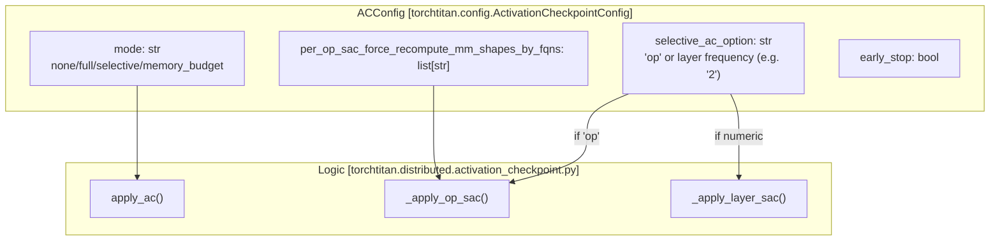
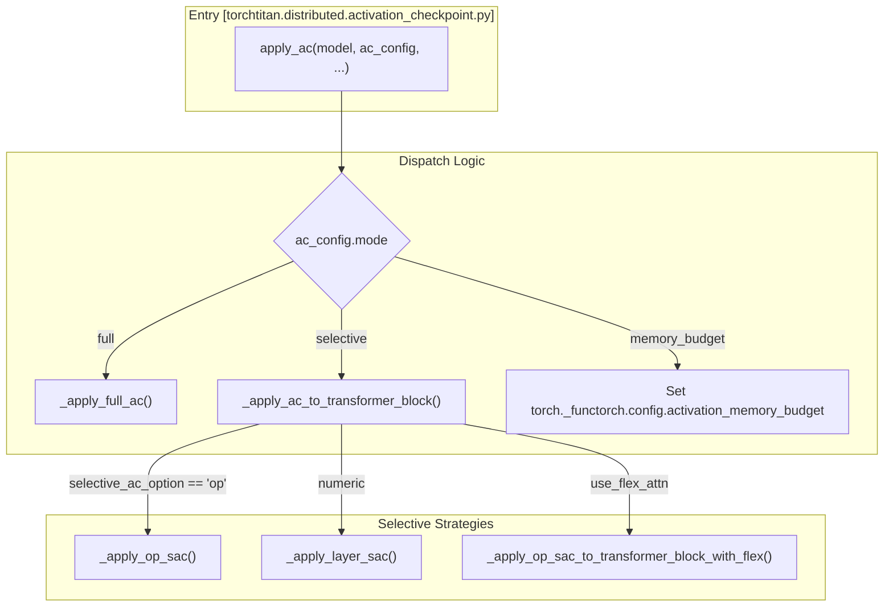

<!-- source: DeepWiki mcp.deepwiki.com · repo pytorch/torchtitan · page 4.7 Activation Checkpointing · fetched 2026-10-30 -->

# Activation Checkpointing

Relevant source files

The following files were used as context for generating this wiki page:

- [tests/unit_tests/test_activation_checkpoint.py](tests/unit_tests/test_activation_checkpoint.py)
- [torchtitan/distributed/activation_checkpoint.py](torchtitan/distributed/activation_checkpoint.py)

## Purpose and Scope

Activation Checkpointing (AC) is a memory optimization technique that trades computation for memory by selectively recomputing activations during the backward pass instead of storing them. This enables training larger models or using larger batch sizes by reducing peak memory usage.

This page documents torchtitan's activation checkpointing implementation, configuration options, and integration with other parallelization strategies. It covers the specialized "Selective Activation Checkpointing" (SAC) policies designed for modern architectures like Mixture-of-Experts (MoE) and models using FlexAttention.

---

## Activation Checkpointing Modes

torchtitan supports four activation checkpointing modes through the `ActivationCheckpointConfig` class:

| Mode | Description | Use Case |
|------|-------------|----------|
| `none` | No activation checkpointing | Maximum training speed, sufficient memory available. |
| `full` | Recompute all activations within wrapped modules | Maximum memory savings, willing to accept ~33-50% compute overhead. |
| `selective` | Intelligently save expensive activations, recompute cheap ones | Recommended balance for most LLM training. |
| `memory_budget` | Compiler-driven AC with specified memory budget | Precise memory control when using `torch.compile`. |

**Sources:** [torchtitan/config/job_config.py:112-126](), [torchtitan/distributed/activation_checkpoint.py:276-326]()

---

## Configuration Structure

The configuration flows from the `JobConfig` into the `apply_ac` utility.

### Key Configuration Fields
- **`selective_ac_option`**: When set to `"op"`, it enables fine-grained per-operation SAC. When set to a number (e.g., `"2"`), it checkpoints every Nth layer. [torchtitan/distributed/activation_checkpoint.py:278-294]()
- **`per_op_sac_force_recompute_mm_shapes_by_fqns`**: Allows users to specify certain linear layers (by FQN) whose matrix multiplication shapes should always be recomputed to save memory. [torchtitan/distributed/activation_checkpoint.py:102-116]()
- **`early_stop`**: If `True`, the checkpointing wrapper can skip recomputation if gradients are not required for certain inputs. [torchtitan/distributed/activation_checkpoint.py:165]()

**Sources:** [torchtitan/distributed/activation_checkpoint.py:102-116](), [torchtitan/distributed/activation_checkpoint.py:278-294]()

---

## Implementation Architecture

The core logic resides in `torchtitan/distributed/activation_checkpoint.py`. It uses the PyTorch Distributed `checkpoint_wrapper` to wrap modules.

**Sources:** [torchtitan/distributed/activation_checkpoint.py:276-326]()

---

## Selective Activation Checkpointing (SAC)

SAC is the most sophisticated mode in torchtitan. It differentiates between "expensive" operations (to be saved) and "cheap" operations (to be recomputed).

### Per-Operation Policy
The function `_get_save_ops()` defines a set of operations that should be saved to avoid expensive recomputation or re-communication:
- **Compute Intensive**: Matmuls (`aten.linear`, `aten.mm`), SDPA variants, FlexAttention, and `aten.max` (critical for Float8/quantization scaling). [torchtitan/distributed/activation_checkpoint.py:35-51]()
- **Communication Intensive**: `reduce_scatter_tensor`, `all_to_all_single`, and vendor-specific MoE kernels like `deepep` or `hybridep`. [torchtitan/distributed/activation_checkpoint.py:57-66]()

### The Custom Policy Wrapper
The `_apply_op_sac` function implements a `wrapped_policy` using `create_selective_checkpoint_contexts` that:
1. **Always Saves D2H Syncs**: Specifically `_to_copy` from CUDA to CPU, often used for MoE metadata/expert routing. [torchtitan/distributed/activation_checkpoint.py:128-137]()
2. **Every-Other-Matmul**: To further save memory, the policy saves every second matmul/linear operation by default. [torchtitan/distributed/activation_checkpoint.py:151-155]()
3. **FQN-based Recompute**: If a matmul's RHS shape matches a shape derived from the `per_op_sac_force_recompute_mm_shapes_by_fqns` list, it is forced to recompute (`PREFER_RECOMPUTE`). [torchtitan/distributed/activation_checkpoint.py:142-148]()

**Sources:** [torchtitan/distributed/activation_checkpoint.py:28-90](), [torchtitan/distributed/activation_checkpoint.py:122-167]()

---

## FlexAttention Compatibility

FlexAttention requires `torch.compile` to be performant. Standard AC wrappers can interfere with graph capture. `_apply_op_sac_to_transformer_block_with_flex` manages this by:
- Wrapping the MoE/Feed-Forward part with SAC.
- Wrapping the Attention part with `FullAC` if compilation is disabled, or SAC if enabled, ensuring the `flex_attention` kernel remains efficient. [torchtitan/distributed/activation_checkpoint.py:214-273]()

**Sources:** [torchtitan/distributed/activation_checkpoint.py:214-273]()

---

## Integration in Parallelization Pipeline

AC is applied after Tensor Parallelism (TP) but before FSDP. This ensures that the activations being checkpointed are the sharded versions produced by TP.

In model-specific `parallelize.py` files, `apply_ac` is called to wrap the transformer layers. The `apply_ac` function iterates through the model's named modules to find and wrap relevant blocks. [torchtitan/distributed/activation_checkpoint.py:276-294]()

---

## Memory and FLOPs Tradeoffs

The following data is derived from the torchtitan unit tests in `tests/unit_tests/test_activation_checkpoint.py` using a toy Transformer block:

| Mode | Activation Memory (MB) | Backward FLOPs (Relative) |
| :--- | :--- | :--- |
| **No AC** | 2.0 | 8.0 |
| **Selective AC (Default)** | 3.0 | 9.0 |
| **SAC (Force Recompute First MM)** | 2.0 | 10.0 |
| **SAC (Force Recompute Last MM)** | 1.0 | 11.0 |
| **Full AC** | 0.0 | 12.0 |

*Note: In some small-scale cases, SAC may use more memory than "No AC" because it saves outputs of communication ops that might otherwise be transient, but it scales significantly better for large models.*

**Sources:** [tests/unit_tests/test_activation_checkpoint.py:122-126](), [tests/unit_tests/test_activation_checkpoint.py:201-205]()

---

