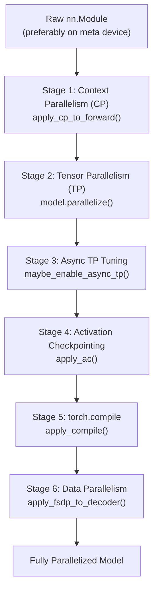
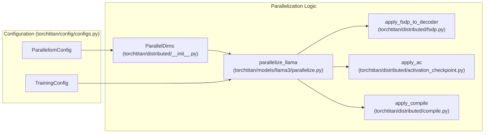
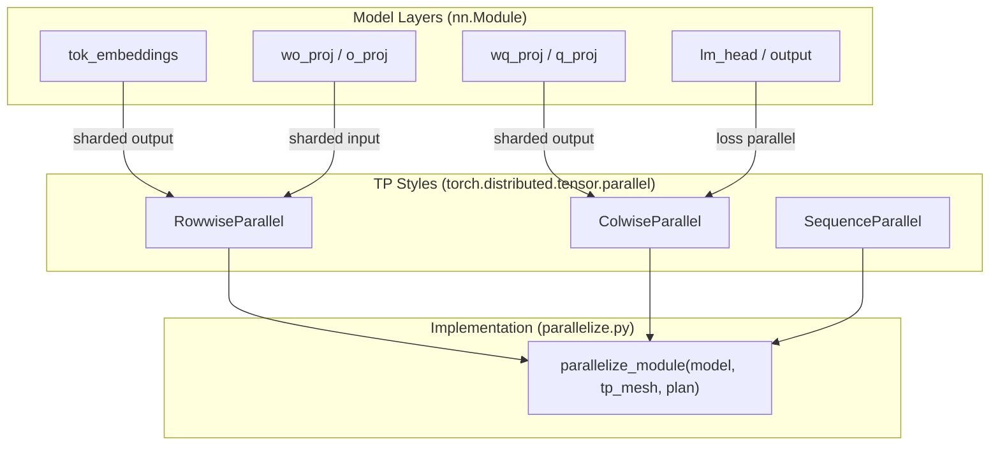

<!-- source: DeepWiki mcp.deepwiki.com · repo pytorch/torchtitan · page 4.8 Parallelization Pipeline and Model-Specific Implementation · fetched 2026-10-30 -->

# Parallelization Pipeline and Model-Specific Implementation

<details>
<summary>Relevant source files</summary>

The following files were used as context for generating this wiki page:

- [.github/scripts/run_8xgpu_integration_tests.sh](.github/scripts/run_8xgpu_integration_tests.sh)
- [tests/integration_tests/h100.py](tests/integration_tests/h100.py)
- [tests/unit_tests/test_compile_moe.py](tests/unit_tests/test_compile_moe.py)
- [tests/unit_tests/test_compile_regional_inductor.py](tests/unit_tests/test_compile_regional_inductor.py)
- [torchtitan/config/configs.py](torchtitan/config/configs.py)
- [torchtitan/distributed/compile.py](torchtitan/distributed/compile.py)
- [torchtitan/experiments/transformers_modeling_backend/parallelize.py](torchtitan/experiments/transformers_modeling_backend/parallelize.py)
- [torchtitan/models/deepseek_v3/parallelize.py](torchtitan/models/deepseek_v3/parallelize.py)
- [torchtitan/models/gpt_oss/parallelize.py](torchtitan/models/gpt_oss/parallelize.py)
- [torchtitan/models/llama3/parallelize.py](torchtitan/models/llama3/parallelize.py)
- [torchtitan/models/qwen3/parallelize.py](torchtitan/models/qwen3/parallelize.py)

</details>


## Purpose and Scope

This page documents the complete parallelization pipeline used in TorchTitan, showing the sequential stages through which a model is transformed from a raw `nn.Module` to a fully parallelized, optimized training-ready module. It explains the ordering requirements, implementation details for each stage, and how different model architectures (Llama3, DeepSeek-V3, Qwen3, GPT-OSS) apply these transformations.

The pipeline ensures that complex distributed strategies like Tensor Parallelism (TP), Context Parallelism (CP), Activation Checkpointing (AC), and Fully Sharded Data Parallel (FSDP) are composed correctly without functional conflicts.

---

## Parallelization Pipeline Overview

Every model in TorchTitan follows a strictly ordered parallelization pipeline. The order is critical because later stages depend on transformations (such as weight sharding or module wrapping) applied by earlier stages.

### The Standard Pipeline Order



1.  **Context Parallelism (CP)**: Applied first to attention sub-modules so CP logic runs inside local tensor boundaries.
2.  **Tensor Parallelism (TP)**: Shards weights across the TP dimension and modifies forward passes for all-reduce/all-gather.
3.  **Async TP**: If enabled, configures asynchronous communication for TP to overlap with computation (requires `torch.compile`).
4.  **Activation Checkpointing (AC)**: Wraps modules to trade computation for memory during backward passes.
5.  **torch.compile**: Applied per-TransformerBlock to fuse kernels and optimize the graph.
6.  **Data Parallelism (FSDP/HSDP)**: Final sharding of parameters and optimizer states across the DP mesh.

**Sources:**  
[torchtitan/models/llama3/parallelize.py:27-104](), [torchtitan/models/gpt_oss/parallelize.py:27-108](), [torchtitan/models/deepseek_v3/parallelize.py:28-112](), [torchtitan/models/qwen3/parallelize.py:31-123]()

---

## Main Parallelization Entry Points

Each model family provides a `parallelize_<model>` function that orchestrates the pipeline. These functions are called by the trainer after model materialization.

| Model | Entry Point Function | File Path |
| :--- | :--- | :--- |
| **Llama 3** | `parallelize_llama` | [torchtitan/models/llama3/parallelize.py:27]() |
| **DeepSeek-V3** | `parallelize_deepseekv3` | [torchtitan/models/deepseek_v3/parallelize.py:28]() |
| **Qwen 3** | `parallelize_qwen3` | [torchtitan/models/qwen3/parallelize.py:31]() |
| **GPT-OSS** | `parallelize_gptoss` | [torchtitan/models/gpt_oss/parallelize.py:27]() |
| **HF Transformers** | `parallelize_hf_transformers` | [torchtitan/experiments/transformers_modeling_backend/parallelize.py:39]() |

### Standardized Signature
Most implementations follow this signature to consume the global configuration:
```python
def parallelize_model(
    model: nn.Module,
    *,
    parallel_dims: ParallelDims,
    training: TrainingConfig,
    parallelism: ParallelismConfig,
    compile_config: CompileConfig,
    ac_config: ActivationCheckpointConfig,
    dump_folder: str,
)
```

**Sources:**  
[torchtitan/models/llama3/parallelize.py:27-36](), [torchtitan/models/gpt_oss/parallelize.py:27-36](), [torchtitan/models/qwen3/parallelize.py:31-41]()

---

## Pipeline Stage Details

### 1. Tensor and Context Parallelism
If `full_dtensor` is selected as the backend, `model.parallelize(parallel_dims)` is called directly [torchtitan/models/gpt_oss/parallelize.py:50](). Otherwise:
*   **CP**: `apply_cp_to_forward` is applied to `inner_attention` modules [torchtitan/models/gpt_oss/parallelize.py:55-59]().
*   **TP**: `model.parallelize(parallel_dims)` shards the internal linear layers [torchtitan/models/gpt_oss/parallelize.py:61]().

### 2. Async TP
Async TP allows for overlapping the all-reduce of one linear layer with the computation of the next. It is enabled via `maybe_enable_async_tp` and is typically only effective when `torch.compile` is also active [torchtitan/models/llama3/parallelize.py:63-64](), [torchtitan/config/configs.py:136-137]().

### 3. Activation Checkpointing (AC)
AC is applied using `apply_ac`. It must happen **after** TP/CP wrapping but **before** `torch.compile`.
*   Supports different modes: `full` or `selective`.
*   Requires knowledge of whether compilation is enabled to handle coordinate descent and graph captures correctly [torchtitan/models/gpt_oss/parallelize.py:64-68]().

### 4. torch.compile
Compilation is applied at the `TransformerBlock` level rather than the whole model. This improves compilation time by leveraging the repeated structure of the model [torchtitan/distributed/compile.py:35-39]().
*   **Regional Inductor**: For models using `FlexAttention`, a special "scoop" is used to ensure the attention region is compiled with Inductor even if the outer backend is `aot_eager` [torchtitan/distributed/compile.py:61-87]().

### 5. Data Parallelism (FSDP2)
`apply_fsdp_to_decoder` is the final step. It handles:
*   **Mesh Resolution**: Resolving the 2D/3D mesh into `dp_replicate` and `fsdp` dimensions [torchtitan/models/gpt_oss/parallelize.py:78-81]().
*   **Mixed Precision**: Applying `param_dtype` and `reduce_dtype` as specified in `TrainingConfig` [torchtitan/models/gpt_oss/parallelize.py:96-97]().
*   **Symmetric Memory**: Enabling FSDP2 symmetric-memory optimizations if requested [torchtitan/models/gpt_oss/parallelize.py:105]().

---

## Model-Specific Implementations

While the pipeline order is strict, how specific layers are sharded varies by architecture.

### GPT-OSS and Llama
These models use a standard TP plan sharding `tok_embeddings` row-wise and `output` column-wise, with `TransformerBlock` internals sharded into `ColumnParallel` (FFN gate/up, Attn QKV) and `RowParallel` (FFN down, Attn out).

### Qwen 3
Qwen 3 includes a `skip_dp` flag in its parallelization function, allowing the pipeline to stop after AC/Compile for inference-only use cases where FSDP hooks might interfere with `torch.inference_mode()` [torchtitan/models/qwen3/parallelize.py:86-87]().

### HF Transformers (Experimental)
The `transformers_modeling_backend` provides a generic `apply_non_moe_tp` function that maps standard HF layer names (e.g., `q_proj`, `k_proj`, `v_proj`) to TP sharding styles [torchtitan/experiments/transformers_modeling_backend/parallelize.py:111-150]().

---

## Technical Mapping: Concept to Code

The following diagrams bridge high-level parallelization concepts to the specific code entities in the `torchtitan` repository.

### Parallelization Logic Flow
This diagram shows how `ParallelismConfig` and `ParallelDims` drive the execution of specific distributed functions.



**Sources:**  
[torchtitan/config/configs.py:85-156](), [torchtitan/models/llama3/parallelize.py:27-104](), [torchtitan/distributed/compile.py:35-40]()

### TP Sharding Plan Mapping
This diagram shows how model layers are associated with `torch.distributed.tensor.parallel` styles within the model-specific implementation.



**Sources:**  
[torchtitan/experiments/transformers_modeling_backend/parallelize.py:111-150](), [torchtitan/models/llama3/parallelize.py:61-62]()

---

## Configuration Summary

The following configuration parameters from `ParallelismConfig` and `TrainingConfig` directly control the pipeline behavior:

| Parameter | Pipeline Impact | Code Reference |
| :--- | :--- | :--- |
| `spmd_backend` | Switches between `default` and `full_dtensor` logic. | [torchtitan/config/configs.py:142-149]() |
| `enable_async_tensor_parallel` | Triggers `maybe_enable_async_tp`. | [torchtitan/config/configs.py:136-137]() |
| `mixed_precision_param` | Sets the `param_dtype` for FSDP. | [torchtitan/config/configs.py:58-64]() |
| `fsdp_reshard_after_forward` | Controls memory vs. comms trade-off in FSDP. | [torchtitan/config/configs.py:109-122]() |
| `enable_fsdp_symm_mem` | Enables FSDP2 hardware-specific optimizations. | [torchtitan/config/configs.py:124-128]() |

**Sources:**  
[torchtitan/config/configs.py:28-156](), [torchtitan/models/gpt_oss/parallelize.py:93-106]()

---

