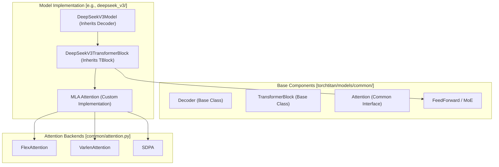
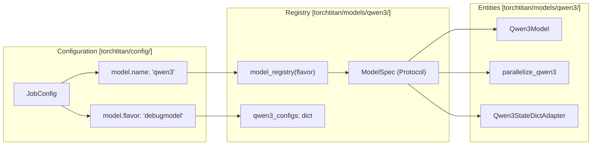

<!-- source: DeepWiki mcp.deepwiki.com · repo pytorch/torchtitan · page 5 Model System · fetched 2026-10-30 -->

# Model System

Relevant source files

The following files were used as context for generating this wiki page:

- [torchtitan/models/README.md](torchtitan/models/README.md)
- [torchtitan/models/common/config_utils.py](torchtitan/models/common/config_utils.py)
- [torchtitan/models/deepseek_v3/__init__.py](torchtitan/models/deepseek_v3/__init__.py)
- [torchtitan/models/gpt_oss/__init__.py](torchtitan/models/gpt_oss/__init__.py)
- [torchtitan/models/llama3/__init__.py](torchtitan/models/llama3/__init__.py)
- [torchtitan/models/qwen3/__init__.py](torchtitan/models/qwen3/__init__.py)

The model system in torchtitan provides a modular and extensible architecture for training large-scale generative models. It abstracts model-specific logic through a unified registration system and shared components, allowing the core training engine to support diverse architectures ranging from Llama 3/4 to DeepSeek-V3 and multimodal models like Qwen3.5.

## Supported Model Families

torchtitan supports a variety of state-of-the-art architectures. Each family is contained within its own directory under `torchtitan/models/` and includes its own configuration registry, state dict adapters, and parallelization logic.

| Model Family | Key Architectural Features | Source Directory |
|--------------|---------------------------|------------------|
| **Llama 3** | GQA, RoPE, SwiGLU, RMSNorm | [torchtitan/models/llama3/]() |
| **Llama 4** | MoE support, iRoPE (layer-wise RoPE), FlexAttention | [torchtitan/models/llama4/]() |
| **DeepSeek-V3** | Multi-Head Latent Attention (MLA), DeepEP MoE | [torchtitan/models/deepseek_v3/]() |
| **Qwen3** | Weight tying, GQA, Cos/Sin RoPE | [torchtitan/models/qwen3/]() |
| **Qwen3.5 VLM** | Multimodal, GatedDeltaNet linear attention, MRoPE | [torchtitan/models/qwen3_5/]() |
| **GPT-OSS** | Attention sinks, Sliding window attention, MoE | [torchtitan/models/gpt_oss/]() |
| **Flux** | Diffusion-based image generation | [torchtitan/models/flux/]() |

Sources: [torchtitan/models/llama3/__init__.py:37-41](), [torchtitan/models/deepseek_v3/__init__.py:40-44](), [torchtitan/models/qwen3/__init__.py:40-44](), [torchtitan/models/gpt_oss/__init__.py:34-38]()

## Model Architecture Overview

The model system is built on a hierarchy of reusable components. Most LLMs in the repository inherit from a base `Decoder` class and are composed of `TransformerBlock` instances. Models use a declarative configuration pattern where sub-components (Attention, FFN, MoE) are configured via nested dataclasses.

**Model Component Hierarchy**

Sources: [torchtitan/models/common/decoder.py:20-20](), [torchtitan/models/deepseek_v3/model.py:30-59](), [torchtitan/models/common/config_utils.py:38-70]()

## Model Registration and Selection

Models are integrated into the system via a `model_registry` function in each model's `__init__.py`. This function returns a `ModelSpec` object, which contains the model's configuration, parallelization function, and loss builder. The `config_registry.py` in each model folder defines specific flavors (e.g., `llama3_8b`, `deepseek_v3_small`) by returning fully populated `Model.Config` objects.

**Code Entity Mapping: Model Selection**

For details on the registration protocol, see [TrainSpec Protocol and Model Registry](#5.1).

Sources: [torchtitan/models/qwen3/__init__.py:33-44](), [torchtitan/models/README.md:42-51](), [torchtitan/models/deepseek_v3/__init__.py:34-38]()

## Shared Architectural Components

To maintain consistency and reduce code duplication, torchtitan provides a suite of common components in `torchtitan/models/common/`. These are typically instantiated via helper functions in `config_utils.py`.

*   **Attention Wrappers**: Support for `FlexAttention`, `SDPA`, and `VarlenAttention`. Helpers like `get_attention_config` map backend strings to module configurations. For details, see [Attention Mechanisms](#5.2).
*   **Rotary Embeddings (RoPE)**: Implementations for standard, Llama-style, and YaRN scaling, supporting both `ComplexRoPE` and `CosSinRoPE`.
*   **Mixture of Experts (MoE)**: A modular MoE system supporting various routers (e.g., `TokenChoiceTopKRouter`) and dispatchers (`AllToAll`, `DeepEP`, `HybridEP`).
*   **Initialization**: A depth-scaled initialization system (`depth_scaled_std`) that adjusts parameter variance based on layer index to stabilize training.

Sources: [torchtitan/models/common/config_utils.py:38-70](), [torchtitan/models/common/rope.py:24-28](), [torchtitan/models/common/param_init.py:30-30](), [torchtitan/models/common/moe/__init__.py:18-18]()

## Child Pages

*   **[TrainSpec Protocol and Model Registry](#5.1)**: Detailed documentation on how models are defined, registered, and materialized during training.
*   **[Attention Mechanisms](#5.2)**: Technical deep-dive into the various attention implementations, masking strategies, and RoPE configurations.
*   **[Llama Model Family](#5.3)**: Implementation details for Llama 3 and Llama 4, including the iRoPE system and Llama 4's interleaved MoE architecture.
*   **[DeepSeek-V3 Architecture](#5.4)**: Coverage of DeepSeek-V3's unique Multi-Head Latent Attention (MLA) and its high-performance MoE implementation using DeepEP.
*   **[Other Model Architectures (Qwen3, GPT-OSS, Flux)](#5.5)**: Documentation for Qwen3, GPT-OSS (with attention sinks), and the Flux diffusion model.
*   **[Qwen3.5 Multimodal Model (VLM)](#5.6)**: Documentation for the Qwen3.5 VLM, vision encoders, and hybrid linear/full attention architectures.

---

