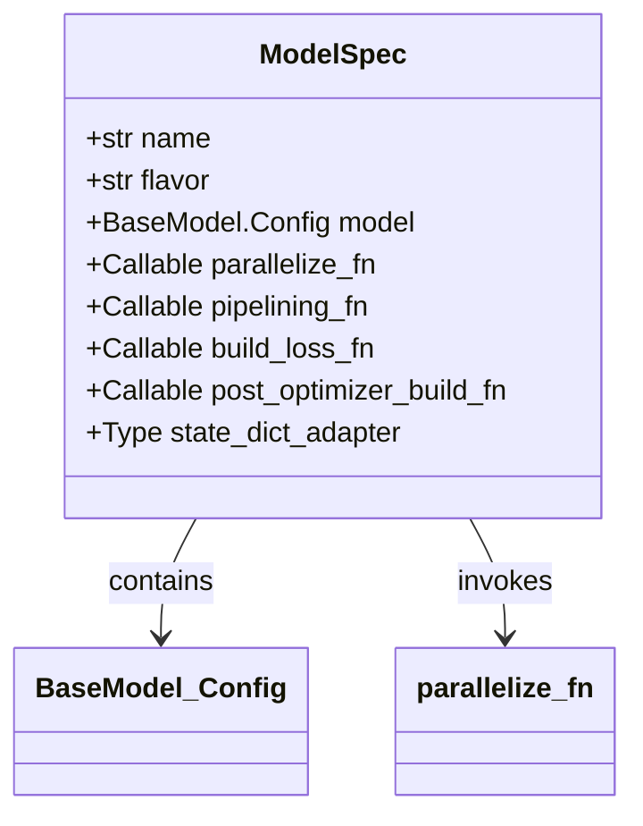
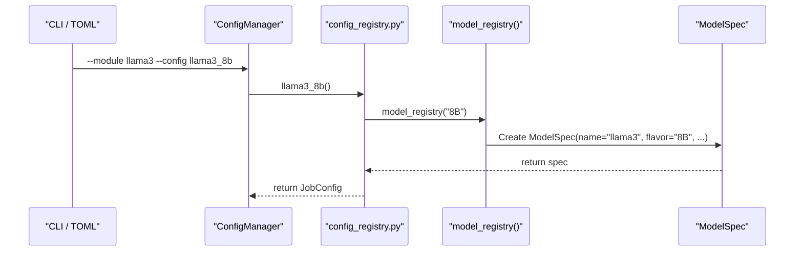
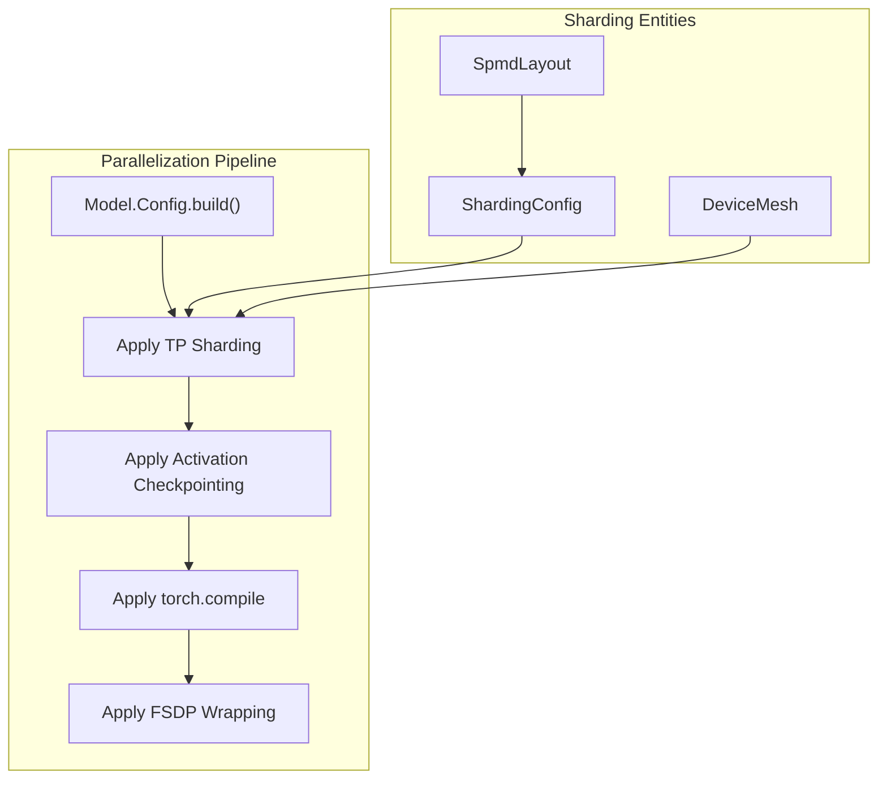

<!-- source: DeepWiki mcp.deepwiki.com · repo pytorch/torchtitan · page 5.1 TrainSpec Protocol and Model Registry · fetched 2026-10-30 -->

# TrainSpec Protocol and Model Registry

<details>
<summary>Relevant source files</summary>

The following files were used as context for generating this wiki page:

- [tests/unit_tests/test_embedding.py](tests/unit_tests/test_embedding.py)
- [torchtitan/models/common/__init__.py](torchtitan/models/common/__init__.py)
- [torchtitan/models/common/config_utils.py](torchtitan/models/common/config_utils.py)
- [torchtitan/models/common/decoder.py](torchtitan/models/common/decoder.py)
- [torchtitan/models/common/decoder_sharding.py](torchtitan/models/common/decoder_sharding.py)
- [torchtitan/models/common/embedding.py](torchtitan/models/common/embedding.py)
- [torchtitan/models/common/feed_forward.py](torchtitan/models/common/feed_forward.py)
- [torchtitan/models/common/nn_modules.py](torchtitan/models/common/nn_modules.py)
- [torchtitan/models/deepseek_v3/__init__.py](torchtitan/models/deepseek_v3/__init__.py)
- [torchtitan/models/gpt_oss/__init__.py](torchtitan/models/gpt_oss/__init__.py)
- [torchtitan/models/llama3/__init__.py](torchtitan/models/llama3/__init__.py)
- [torchtitan/models/llama3/sharding.py](torchtitan/models/llama3/sharding.py)
- [torchtitan/models/qwen3/__init__.py](torchtitan/models/qwen3/__init__.py)
- [torchtitan/protocols/module.py](torchtitan/protocols/module.py)
- [torchtitan/protocols/sharding.py](torchtitan/protocols/sharding.py)

</details>


## Purpose and Scope

This document explains the **Model Registry** system and the **ModelSpec** protocol in `torchtitan`. These systems provide a standardized interface for defining, registering, and instantiating model architectures. By decoupling model-specific logic from the core training engine, `torchtitan` supports diverse architectures—including Llama 3/4, DeepSeek-V3, Qwen3, and Flux—through a pluggable registry.

This page covers:
- The **ModelSpec** protocol and its required components.
- The **Model Registry** mechanism using `model_registry` and `config_registry.py`.
- Core architectural building blocks: **Decoder** and **TransformerBlock**.
- Implementation details for adding new models.

---

## ModelSpec Protocol

The `ModelSpec` protocol is the central abstraction that encapsulates all metadata and functions required to build and parallelize a specific model family.


**Diagram: ModelSpec Structure** - Associates the protocol attributes with their functional roles.

### Key Components
| Component | Description |
|:---|:---|
| `model` | An instance of `BaseModel.Config` (a dataclass) that holds architectural hyperparameters and the `build()` method. [torchtitan/protocols/model_spec.py:16]() |
| `parallelize_fn` | Applies 4D parallelism (TP, CP, EP, FSDP) and activation checkpointing to the model. [torchtitan/protocols/model_spec.py:17]() |
| `pipelining_fn` | Optional function to split the model into stages for Pipeline Parallelism. [torchtitan/protocols/model_spec.py:18]() |
| `build_loss_fn` | Factory for the loss function (e.g., `build_cross_entropy_loss`). [torchtitan/protocols/model_spec.py:19]() |
| `state_dict_adapter` | Logic for converting between `torchtitan` and external (e.g., HuggingFace) checkpoint formats. [torchtitan/protocols/model_spec.py:21]() |

**Sources:** [torchtitan/protocols/model_spec.py:7-22](), [torchtitan/models/llama3/__init__.py:31-35](), [torchtitan/models/deepseek_v3/__init__.py:33-38]()

---

## Model Registry and Configuration

`torchtitan` uses a two-tier registry system: one for model architectures (`model_registry`) and one for training configurations (`config_registry.py`).

### Model Registration Flow
Models are registered in their respective package `__init__.py` files. For example, Llama 3, Qwen3, and DeepSeek-V3 register their flavors via a `model_registry` function.


**Diagram: Configuration to ModelSpec Resolution** - Maps the data flow from user input to the `ModelSpec` entity.

### config_registry.py
The `config_registry.py` file in each model directory (e.g., `torchtitan/models/llama3/config_registry.py`) defines functions that return a `JobConfig`. These functions call `model_registry(flavor)` to attach the correct `ModelSpec` to the configuration.

**Sources:** [torchtitan/models/llama3/__init__.py:37-41](), [torchtitan/models/qwen3/__init__.py:40-44](), [torchtitan/models/deepseek_v3/__init__.py:40-44]()

---

## Core Model Building Blocks

Most generative models in `torchtitan` derive from shared base classes in `torchtitan/models/common/decoder.py` and utilize `Module` from `torchtitan/protocols/module.py`.

### The Decoder Base Class
`Decoder` is the base class for autoregressive decoder-only language models. It provides a standardized `__init__`, `forward`, and `init_states` mechanism.

- **Configuration:** The `Decoder.Config` includes `dim`, `vocab_size`, and a list of `TransformerBlock.Config` (or subclasses). [torchtitan/models/common/decoder.py:70-80]()
- **Weight Tying:** Supports tying `tok_embeddings` and `lm_head` weights. [torchtitan/models/common/decoder.py:81-83]()
- **Runtime Updates:** `update_from_config` validates and propagates parallelism settings (like TP degree) to RoPE and attention layers. [torchtitan/models/common/decoder.py:112-160]()

### TransformerBlock
`TransformerBlock` standardizes the structure of a single transformer layer:
1. **Attention Norm** (`attention_norm`)
2. **Attention Module** (`attention`)
3. **FFN/MoE Norm** (`ffn_norm`)
4. **FeedForward** or **MoE** module. [torchtitan/models/common/decoder.py:42-60]()

### Configurable Module Protocol
All model components inherit from `Module`, which combines `nn.Module` with the `Configurable` protocol.
- **State Initialization:** `init_states` recursively initializes parameters and buffers across the module tree. [torchtitan/protocols/module.py:69-94]()
- **Parameter Initialization:** `_init_self_parameters` handles weight initialization via `param_init` dict lookups or `reset_parameters()`. [torchtitan/protocols/module.py:157-179]()

**Sources:** [torchtitan/models/common/decoder.py:36-110](), [torchtitan/protocols/module.py:37-117](), [torchtitan/models/common/__init__.py:24]()

---

## Implementing a New Model

To integrate a new architecture, a developer must implement the `ModelSpec` protocol and define model-specific configurations.

### 1. Build Helpers
Models use shared utilities in `torchtitan/models/common/config_utils.py` to construct sub-configs for Attention, FFN, and MoE.
- `make_gqa_config`: Builds Grouped-Query Attention configs. [torchtitan/models/common/config_utils.py:73-131]()
- `make_ffn_config`: Builds standard FFN configs. [torchtitan/models/common/config_utils.py:134-153]()
- `make_moe_config`: Builds Mixture-of-Experts configs. [torchtitan/models/common/config_utils.py:155-170]()

### 2. Parameter Initialization
`torchtitan` favors depth-scaled initialization for transformer layers. Model packages typically define initialization dictionaries for different layer types.
- **Llama 3:** Uses `_depth_init` for depth-scaled truncated normal initialization. [torchtitan/models/llama3/__init__.py:61-66]()
- **DeepSeek-V3:** Implements specific initializers for its MLA attention and MoE experts. [torchtitan/models/deepseek_v3/__init__.py:55-76]()

### 3. Sharding Configuration
Sharding is defined declaratively using `ShardingConfig` and `SpmdLayout`.
- `dense_param_placement`: Defines how dense parameters are placed across DP, CP, and TP axes. [torchtitan/models/common/decoder_sharding.py:19-31]()
- `set_gqa_attention_sharding`: Configures TP sharding for GQA blocks. [torchtitan/models/common/decoder_sharding.py:132-165]()

### 4. Registration
In the model's `__init__.py`, the `model_registry` function returns the `ModelSpec`.

```python
# Example structure from torchtitan/models/llama3/__init__.py
def _debugmodel(attn_backend: str) -> Llama3Model.Config:
    # Build layers and return Llama3Model.Config
    ...

# The registry then maps flavors to these factory functions
```

**Sources:** [torchtitan/models/common/config_utils.py:7-170](), [torchtitan/models/common/decoder_sharding.py:1-165](), [torchtitan/models/llama3/__init__.py:68-137](), [torchtitan/protocols/sharding.py:66-120]()

---

## Data Flow: Model Parallelization and Sharding

The `parallelize_fn` provided in the `ModelSpec` is responsible for applying the sharding configurations to the model instance.


**Diagram: Model Parallelization Pipeline** - Shows how sharding configurations (Code Entities) are applied during the model setup.

1. **Build Config:** `Trainer` retrieves the `model` (a `BaseModel.Config`) from the `ModelSpec`.
2. **Sharding Specs:** Functions like `set_llama3_sharding_config` populate `sharding_config` fields on all sub-configs. [torchtitan/models/llama3/sharding.py:25-45]()
3. **Resolve Placements:** At runtime, `resolve_placements` maps `SpmdLayout` to actual `Placement` objects (Shard, Replicate) based on the active `DeviceMesh`. [torchtitan/protocols/sharding.py:126-160]()
4. **Distribute:** `Module.parallelize` uses these placements to call `distribute_tensor` on parameters and buffers. [torchtitan/protocols/module.py:97-116]()

**Sources:** [torchtitan/models/llama3/sharding.py:25-79](), [torchtitan/protocols/sharding.py:126-160](), [torchtitan/protocols/module.py:69-117]()

---

