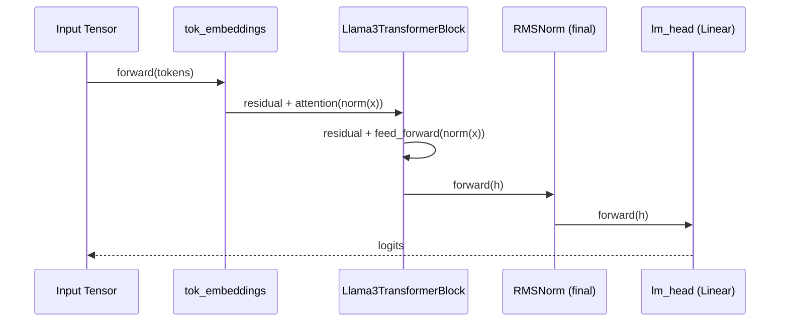

<!-- source: DeepWiki mcp.deepwiki.com · repo pytorch/torchtitan · page 5.3 Llama Model Family · fetched 2026-10-30 -->

# Llama Model Family

<details>
<summary>Relevant source files</summary>

The following files were used as context for generating this wiki page:

- [tests/unit_tests/test_tp_kv_heads_validation.py](tests/unit_tests/test_tp_kv_heads_validation.py)
- [torchtitan/experiments/transformers_modeling_backend/model.py](torchtitan/experiments/transformers_modeling_backend/model.py)
- [torchtitan/models/common/config_utils.py](torchtitan/models/common/config_utils.py)
- [torchtitan/models/deepseek_v3/__init__.py](torchtitan/models/deepseek_v3/__init__.py)
- [torchtitan/models/deepseek_v3/model.py](torchtitan/models/deepseek_v3/model.py)
- [torchtitan/models/gpt_oss/__init__.py](torchtitan/models/gpt_oss/__init__.py)
- [torchtitan/models/gpt_oss/model.py](torchtitan/models/gpt_oss/model.py)
- [torchtitan/models/llama3/__init__.py](torchtitan/models/llama3/__init__.py)
- [torchtitan/models/llama3/model.py](torchtitan/models/llama3/model.py)
- [torchtitan/models/qwen3/__init__.py](torchtitan/models/qwen3/__init__.py)
- [torchtitan/models/qwen3/model.py](torchtitan/models/qwen3/model.py)

</details>


This document covers the Llama 3 and Llama 4 model architectures implemented in `torchtitan`. Both models share a common foundation but differ in key architectural features, particularly around Mixture of Experts (MoE) support, rotary positional embeddings (RoPE) configuration, and weight tying.

For information about other model architectures, see [DeepSeek-V3 Architecture](#5.4) and [Other Model Architectures (Qwen3, GPT-OSS, Flux)](#5.5). For details on the `ModelSpec` protocol that enables model registration, see [TrainSpec Protocol and Model Registry](#5.1).

## Architecture Overview

Both Llama 3 and Llama 4 follow a standard decoder-only Transformer architecture. Llama 4 introduces structural complexity through interleaved MoE layers and NoRoPE (no rotary positional embedding) layers.

### System to Code Entity Mapping

The following diagram bridges the architectural concepts to their specific implementations in the `torchtitan/models/` directory.

```mermaid
graph TB
    subgraph "Llama 3 Architecture [torchtitan/models/llama3/]"
        L3_Model["Llama3Model<br/>(model.py)"]
        L3_Block["Llama3TransformerBlock<br/>(model.py)"]
        L3_Config["Llama3Model.Config<br/>(model.py)"]
        
        L3_Model --> L3_Block
        L3_Config -.->|configures| L3_Model
    end
    
    subgraph "Llama 4 Architecture [torchtitan/models/llama4/]"
        L4_Model["Llama4Model<br/>(model.py)"]
        L4_Block["Llama4TransformerBlock<br/>(model.py)"]
        L4_Config["Llama4Model.Config<br/>(model.py)"]
        
        L4_Model --> L4_Block
        L4_Config -.->|configures| L4_Model
    end
    
    subgraph "Shared Components [torchtitan/models/common/]"
        Base_Dec["Decoder<br/>(decoder.py)"]
        Base_Block["TransformerBlock<br/>(decoder.py)"]
        Base_Attn["GQAttention<br/>(attention.py)"]
        Base_FFN["FeedForward<br/>(feed_forward.py)"]
        Base_MoE["MoE<br/>(moe/moe.py)"]
    end
    
    L3_Model --|> Base_Dec
    L4_Model --|> Base_Dec
    L3_Block --|> Base_Block
    L4_Block --|> Base_Block
    
    L3_Block --> Base_Attn
    L3_Block --> Base_FFN
    
    L4_Block --> Base_Attn
    L4_Block --> Base_FFN
    L4_Block --> Base_MoE
```

**Sources**: [torchtitan/models/llama3/model.py:19-53](), [torchtitan/models/llama3/model.py:53-101](), [torchtitan/models/common/decoder.py:1-50]()

## Llama 3 Architecture

Llama 3 is a dense decoder-only Transformer. It utilizes Grouped-Query Attention (GQA) and standard Feed-Forward Networks (FFN).

### Key Features
- **Weight Tying**: Optionally shares weights between `tok_embeddings` and the `lm_head` linear layer [torchtitan/models/llama3/__init__.py:180-185]().
- **GQA**: Implemented via `GQAttention` (configured via `make_gqa_config`) in the `Llama3TransformerBlock` [torchtitan/models/llama3/__init__.py:89-98]().
- **Standard FFN**: Uses the `FeedForward` module for every layer, built via `make_ffn_config` [torchtitan/models/llama3/__init__.py:99-104]().
- **Validation**: Includes strict checks to ensure `n_heads` and `n_kv_heads` are divisible by the `tensor_parallel_degree` [tests/unit_tests/test_tp_kv_heads_validation.py:106-148]().

### Forward Pass Flow



**Sources**: [torchtitan/models/llama3/model.py:42-50](), [torchtitan/models/llama3/__init__.py:68-107]()

## Llama 4 Architecture

Llama 4 introduces advanced features for large-scale training, specifically interleaved MoE and "NoRoPE" (No Rotary Positional Embedding) layers.

### Interleaved MoE
Llama 4 can interleave standard FFN layers with MoE layers based on the `interleave_moe_layer_step` configuration. A layer is MoE-enabled if it meets the configured stride criteria, allowing for hybrid dense-MoE architectures.

### iRoPE (NoRoPE Layers)
Llama 4 supports disabling RoPE for specific layers using `every_n_layers_nope`.
- Specific layers are configured to skip rotary positional embeddings, relying on other layers to provide global positional information.
- This is often combined with `FlexAttention` to handle complex masking strategies.

### Hidden Dimension Computation
Llama 4 (and similar models like Llama 3) uses `compute_ffn_hidden_dim` to determine the intermediate dimension of the FFN, often rounding to a `multiple_of` (e.g., 256 or 1024) to optimize kernel performance [torchtitan/models/llama3/__init__.py:128-128]().

**Sources**: [torchtitan/models/common/config_utils.py:134-153](), [torchtitan/models/llama3/__init__.py:192-208]()

## Model Configurations

Models are registered via `llama3_configs` and `llama4_configs` dictionaries. These contain `Llama3Model.Config` and `Llama4Model.Config` objects that define the hyperparameters.

### Comparison of Model Flavors

| Feature | Llama 3 (1B) | Llama 3 (3B) | Llama 3 (8B) |
| :--- | :--- | :--- | :--- |
| **Dim** | 2048 | 3072 | 4096 |
| **Layers** | 16 | 28 | 32 |
| **Attention Heads** | 32 | 24 | 32 |
| **KV Heads** | 8 | 8 | 8 |
| **Weight Tying** | Yes | Yes | No |
| **FFN Multiplier** | 1.5 | 1.0 | 1.3 |

**Sources**: [torchtitan/models/llama3/__init__.py:171-208](), [torchtitan/models/llama3/__init__.py:211-248]()

## Implementation Details

### Weight Initialization
Both models implement specific initialization schemes. Linear layers typically use `trunc_normal_` with a standard deviation of 0.02 [torchtitan/models/llama3/__init__.py:44-47](). Output projections and deep layers often use `depth_scaled_std` to account for signal variance across many layers [torchtitan/models/llama3/__init__.py:61-66]().

### Sharding and Parallelism
The `update_from_config` method in `Llama3Model.Config` triggers `set_llama3_sharding_config`. This function configures:
- **Loss Parallelism**: Sharding the final cross-entropy loss calculation [torchtitan/models/llama3/model.py:87-87]().
- **Sequence Parallelism**: Sharding activations along the sequence dimension when Tensor Parallelism is active [torchtitan/models/llama3/model.py:88-88]().

### Comparison with other Architectures
While Llama models use standard GQA/FFN, other models in `torchtitan` implement more complex variations:
- **DeepSeek-V3**: Uses Multi-head Latent Attention (MLA) with LoRA-style compression for Q and KV [torchtitan/models/deepseek_v3/model.py:25-51]().
- **Qwen3**: Includes support for `qk_norm` (normalizing query and key before dot product) [torchtitan/models/qwen3/__init__.py:115-115]().
- **GPT-OSS**: Implements attention sinks and sliding window attention [torchtitan/models/gpt_oss/model.py:65-70]().

**Sources**: [torchtitan/models/llama3/model.py:66-90](), [torchtitan/models/deepseek_v3/model.py:98-125](), [torchtitan/models/gpt_oss/model.py:108-112]()

---

