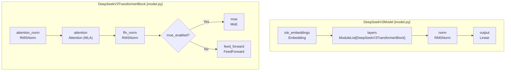
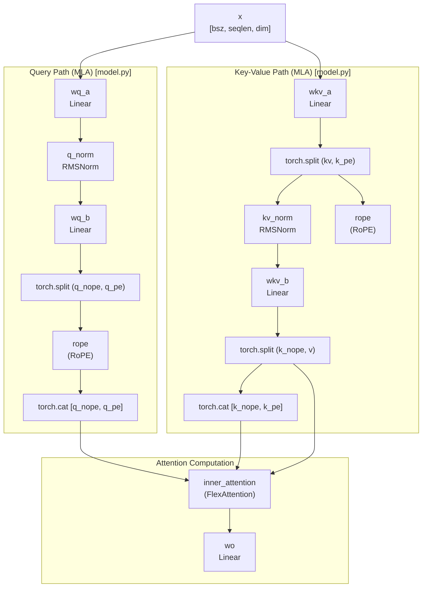

<!-- source: DeepWiki mcp.deepwiki.com · repo pytorch/torchtitan · page 5.4 DeepSeek-V3 Architecture · fetched 2026-10-30 -->

# DeepSeek-V3 Architecture

Relevant source files

The following files were used as context for generating this wiki page:

- [tests/unit_tests/test_tp_kv_heads_validation.py](tests/unit_tests/test_tp_kv_heads_validation.py)
- [torchtitan/experiments/transformers_modeling_backend/model.py](torchtitan/experiments/transformers_modeling_backend/model.py)
- [torchtitan/models/deepseek_v3/README.md](torchtitan/models/deepseek_v3/README.md)
- [torchtitan/models/deepseek_v3/model.py](torchtitan/models/deepseek_v3/model.py)
- [torchtitan/models/deepseek_v3/state_dict_adapter.py](torchtitan/models/deepseek_v3/state_dict_adapter.py)
- [torchtitan/models/gpt_oss/model.py](torchtitan/models/gpt_oss/model.py)
- [torchtitan/models/gpt_oss/state_dict_adapter.py](torchtitan/models/gpt_oss/state_dict_adapter.py)
- [torchtitan/models/llama3/model.py](torchtitan/models/llama3/model.py)
- [torchtitan/models/llama3/state_dict_adapter.py](torchtitan/models/llama3/state_dict_adapter.py)
- [torchtitan/models/qwen3/model.py](torchtitan/models/qwen3/model.py)
- [torchtitan/models/qwen3/state_dict_adapter.py](torchtitan/models/qwen3/state_dict_adapter.py)
- [torchtitan/models/qwen3_5/state_dict_adapter.py](torchtitan/models/qwen3_5/state_dict_adapter.py)

## Purpose and Scope

This document describes the DeepSeek-V3 model architecture implementation in `torchtitan`, focusing on its unique Multi-Head Latent Attention (MLA) mechanism, Mixture-of-Experts (MoE) integration, and state dict adapters for HuggingFace (HF) interoperability. DeepSeek-V3 is a sparse MoE transformer model that introduces memory-efficient attention computation and optimized communication backends.

For general model system architecture and the `ModelSpec` protocol, see [5.1](). For MoE training specifics and load balancing, see [9.3](). For attention mechanism implementations (FlexAttention, SDPA), see [5.2]().

## Model Overview

DeepSeek-V3 is implemented in the `DeepSeekV3Model` class, which inherits from the `Decoder` protocol [torchtitan/models/deepseek_v3/model.py:165](). It follows a transformer structure using `DeepSeekV3TransformerBlock` [torchtitan/models/deepseek_v3/model.py:128](). The model supports standard dense layers and MoE layers, with sharding configurations handled during initialization via `set_deepseek_v3_sharding_config` [torchtitan/models/deepseek_v3/model.py:184-193]().

**Sources:** [torchtitan/models/deepseek_v3/model.py:128-174](), [torchtitan/models/deepseek_v3/model.py:184-193]()

## Multi-Head Latent Attention (MLA)

MLA is the defining feature of DeepSeek-V3, reducing KV cache size through low-rank compression. The `Attention` class implements this logic [torchtitan/models/deepseek_v3/model.py:25](). It utilizes a low-rank bottleneck for both queries and key-values, splitting projections into non-positional (`nope`) and positional (`pe`) components to optimize memory.

### MLA Architecture and Data Flow

The forward pass [torchtitan/models/deepseek_v3/model.py:90-125]() handles the complex projection logic:

### Key MLA Configuration
The `Attention.Config` [torchtitan/models/deepseek_v3/model.py:32-51]() defines the rank and dimension parameters:

| Parameter | Description |
|-----------|-------------|
| `q_lora_rank` | Query LoRA rank; if 0, use standard `wq` [torchtitan/models/deepseek_v3/model.py:64]() |
| `kv_lora_rank` | Key-value LoRA rank for compression [torchtitan/models/deepseek_v3/model.py:43]() |
| `qk_nope_head_dim` | Query/key dimension without positional encoding [torchtitan/models/deepseek_v3/model.py:46]() |
| `qk_rope_head_dim` | Query/key dimension for RoPE positional encoding [torchtitan/models/deepseek_v3/model.py:47]() |
| `v_head_dim` | Value head dimension [torchtitan/models/deepseek_v3/model.py:48]() |

**Sources:** [torchtitan/models/deepseek_v3/model.py:25-125]()

## MoE and DeepEP Integration

DeepSeek-V3 utilizes Mixture-of-Experts (MoE) layers for scaling. The implementation supports integration with **DeepEP**, an optimized communication backend for MoE training [torchtitan/models/deepseek_v3/README.md:13]().

### Load Balancing and Router
The model supports expert bias and score correction via the router. The state dict adapter maps HF's `e_score_correction_bias` to torchtitan's `expert_bias_E` [torchtitan/models/deepseek_v3/state_dict_adapter.py:53]().

### Training Configurations
`torchtitan` provides several debug and production configurations for DeepSeek-V3:
- `deepseek_v3_debugmodel`: For quick local testing [torchtitan/models/deepseek_v3/README.md:20]().
- `deepseek_v3_16b`: Adapted from the 16B parameter model [torchtitan/models/deepseek_v3/README.md:24-25]().
- `deepseek_v3_671b`: The full-scale model configuration [torchtitan/models/deepseek_v3/README.md:29-30]().

**Sources:** [torchtitan/models/deepseek_v3/README.md:16-31](), [torchtitan/models/deepseek_v3/state_dict_adapter.py:45-53]()

## State Dict Adapters and HF Interoperability

Interoperability with HuggingFace (HF) is provided via the `DeepSeekV3StateDictAdapter` [torchtitan/models/deepseek_v3/state_dict_adapter.py:20](). This adapter handles the translation between HF's safetensor format and the Distributed Checkpoint (DCP) format used by `torchtitan`.

### Key Conversion Logic
- **Parameter Mapping:** The `from_hf_map` defines the translation between HF keys (e.g., `model.layers.{}.self_attn.kv_a_proj_with_mqa.weight`) and `torchtitan` keys (e.g., `layers.{}.attention.wkv_a.weight`) [torchtitan/models/deepseek_v3/state_dict_adapter.py:31-56]().
- **MoE Expert Splitting:** The adapter splits HF's individual expert weights into `torchtitan`'s grouped expert format and vice-versa [torchtitan/models/deepseek_v3/state_dict_adapter.py:102-145]().
- **Quantization Support:** For the 671B model, the adapter can use `QuantizedHuggingFaceStorageReader` to load quantized weights into float32 tensors [torchtitan/models/deepseek_v3/state_dict_adapter.py:80-93]().

### Checkpoint Conversion Script
Offline conversion is supported via `scripts/checkpoint_conversion/convert_from_hf.py` [torchtitan/models/deepseek_v3/README.md:38-41]().

**Sources:** [torchtitan/models/deepseek_v3/state_dict_adapter.py:20-161](), [torchtitan/models/deepseek_v3/README.md:34-42]()

---

