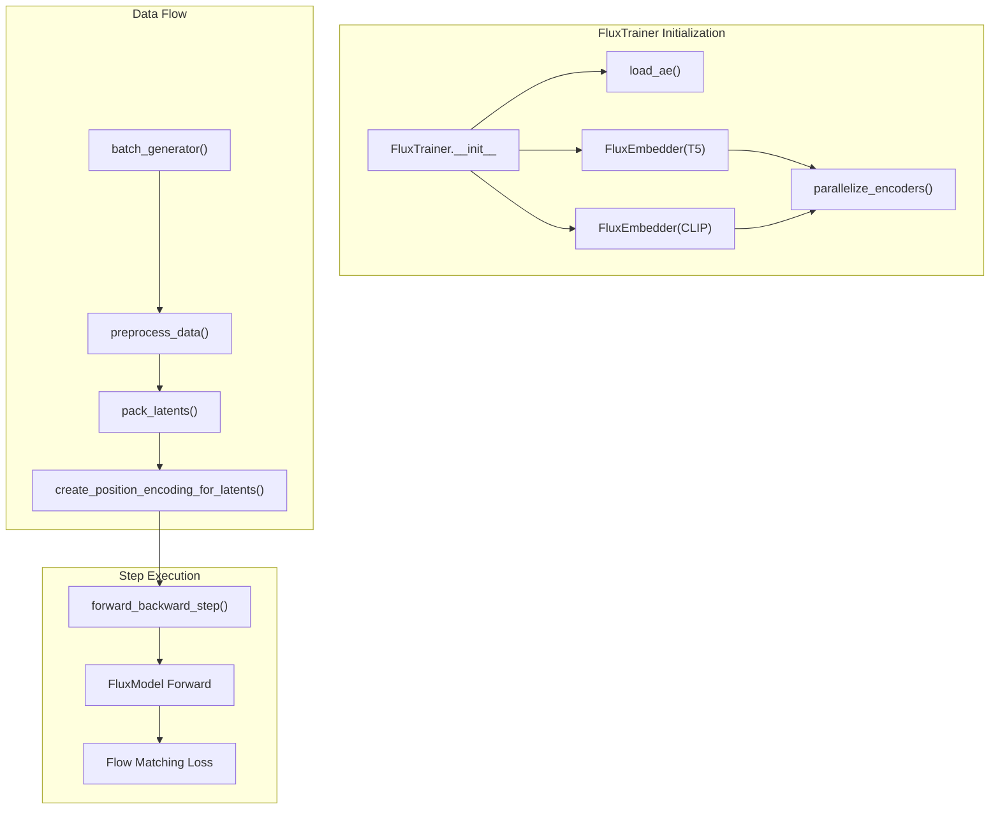
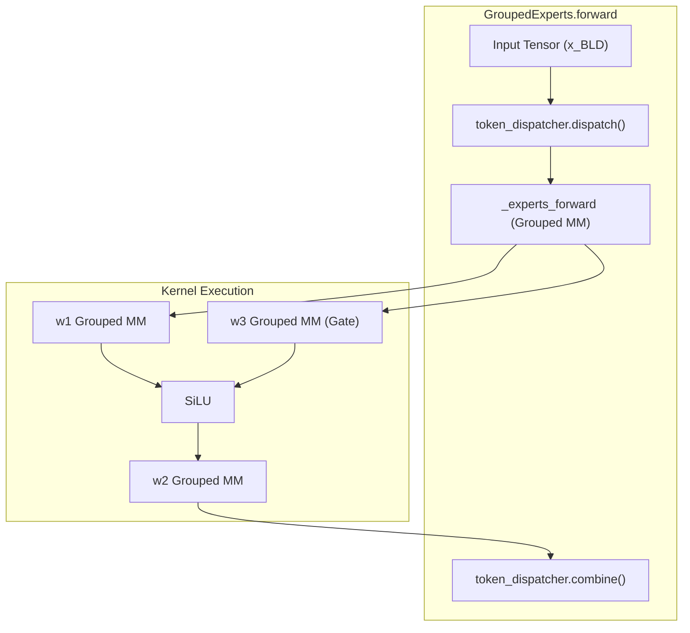

<!-- source: DeepWiki mcp.deepwiki.com · repo pytorch/torchtitan · page 5.5 Other Model Architectures (Qwen3, GPT-OSS, Flux) · fetched 2026-10-30 -->

# Other Model Architectures (Qwen3, GPT-OSS, Flux)

Relevant source files

The following files were used as context for generating this wiki page:

- [tests/integration_tests/flux.py](tests/integration_tests/flux.py)
- [tests/unit_tests/test_dataset_flux.py](tests/unit_tests/test_dataset_flux.py)
- [tests/unit_tests/test_module.py](tests/unit_tests/test_module.py)
- [torchtitan/models/common/moe.py](torchtitan/models/common/moe.py)
- [torchtitan/models/common/token_dispatcher.py](torchtitan/models/common/token_dispatcher.py)
- [torchtitan/models/flux/README.md](torchtitan/models/flux/README.md)
- [torchtitan/models/flux/__init__.py](torchtitan/models/flux/__init__.py)
- [torchtitan/models/flux/config_registry.py](torchtitan/models/flux/config_registry.py)
- [torchtitan/models/flux/configs.py](torchtitan/models/flux/configs.py)
- [torchtitan/models/flux/inference/infer.py](torchtitan/models/flux/inference/infer.py)
- [torchtitan/models/flux/model/autoencoder.py](torchtitan/models/flux/model/autoencoder.py)
- [torchtitan/models/flux/model/hf_embedder.py](torchtitan/models/flux/model/hf_embedder.py)
- [torchtitan/models/flux/model/layers.py](torchtitan/models/flux/model/layers.py)
- [torchtitan/models/flux/model/model.py](torchtitan/models/flux/model/model.py)
- [torchtitan/models/flux/parallelize.py](torchtitan/models/flux/parallelize.py)
- [torchtitan/models/flux/trainer.py](torchtitan/models/flux/trainer.py)
- [torchtitan/models/flux/utils.py](torchtitan/models/flux/utils.py)
- [torchtitan/models/gpt_oss/moe.py](torchtitan/models/gpt_oss/moe.py)
- [torchtitan/models/qwen3/README.md](torchtitan/models/qwen3/README.md)
- [torchtitan/protocols/model.py](torchtitan/protocols/model.py)

## Purpose and Scope

This page documents additional model architectures supported by torchtitan beyond the primary Llama and DeepSeek families. It focuses on the technical implementation of the **FLUX** text-to-image model, the **Qwen3** architecture, and specialized Mixture of Experts (MoE) components used in models like **GPT-OSS**.

torchtitan uses a modular approach where each model family defines its own `Trainer`, `Parallelize` logic, and `Configs`, while sharing core infrastructure for distributed training and optimization.

---

## FLUX Model Architecture

FLUX is a high-performance text-to-image flow-matching model. Unlike standard LLMs, FLUX requires a multimodal pipeline involving text encoders (CLIP and T5), a Variational Autoencoder (VAE), and a main transformer that processes both image patches and text embeddings.

### FLUX Training Lifecycle

The `FluxTrainer` overrides the base `Trainer` to handle the specific requirements of diffusion/flow training, such as image-to-latent encoding and sequence length calculation for combined modalities. It initializes the `AutoEncoder`, `clip_encoder`, and `t5_encoder` on the training device [torchtitan/models/flux/trainer.py:83-112]().

**Sources:** [torchtitan/models/flux/trainer.py:32-119](), [torchtitan/models/flux/utils.py:21-28]()

### Key Components

| Component | Code Entity | Description |
| :--- | :--- | :--- |
| **Autoencoder** | `AutoEncoder` | Downscales images to latents using `load_ae`. [torchtitan/models/flux/model/autoencoder.py:156-223]() |
| **Text Embedders** | `FluxEmbedder` | Wraps HuggingFace CLIP and T5 models. [torchtitan/models/flux/model/hf_embedder.py:15-45]() |
| **Latent Packing** | `pack_latents` | Converts `[B, C, H, W]` latents into sequences for the transformer. [torchtitan/models/flux/utils.py:24]() |
| **Parallelization** | `parallelize_flux` | Applies FSDP, CP, and AC to the Flux transformer. [torchtitan/models/flux/parallelize.py:34-66]() |

### FLUX Parallelization Strategy
FLUX supports a combination of FSDP, Context Parallelism (CP), and Activation Checkpointing (AC):
- **FSDP**: Applied to `double_blocks`, `single_blocks`, and input/output layers [torchtitan/models/flux/parallelize.py:93-124]().
- **Context Parallelism**: Applied to all `inner_attention` modules in `double_blocks` and `single_blocks` [torchtitan/models/flux/parallelize.py:171-203]().
- **Torch Compile**: Applied per-block (`DoubleStreamBlock`, `SingleStreamBlock`) with `fullgraph=True` [torchtitan/models/flux/parallelize.py:133-150]().

---

## Mixture of Experts (MoE) Implementations

torchtitan provides highly optimized MoE components used across architectures like GPT-OSS and Qwen3. These implementations focus on reducing communication overhead via specialized token dispatchers.

### Grouped Matrix Multiplication
To efficiently process tokens assigned to different experts, the `GroupedExperts` module uses `torch._grouped_mm`. This avoids the overhead of padding all experts to the same size [torchtitan/models/common/moe.py:82-96]().

**Sources:** [torchtitan/models/common/moe.py:54-96](), [torchtitan/models/common/moe.py:113-143]()

### GPT-OSS MoE Features
The GPT-OSS implementation in `GptOssGroupedExperts` includes unique architectural features:
1. **ScaleBiasForward**: A custom autograd function that scales bias by `1/tp_degree` in the forward pass to cancel out extra reductions in Tensor Parallel MoE, while keeping gradients unscaled [torchtitan/models/gpt_oss/moe.py:20-41]().
2. **SwiGLU with Limits**: A specialized `swiglu` activation that includes a `limit` parameter to clamp input values, improving training stability [torchtitan/models/gpt_oss/moe.py:43-50]().
3. **Grouped MM with Bias**: Unlike standard MoE, GPT-OSS experts include bias terms which are handled via `repeat_interleave` and the `ScaleBiasForward` op [torchtitan/models/gpt_oss/moe.py:137-158]().

---

## Token Routing Mechanisms

The `TokenChoiceTopKRouter` implements token-choice routing where each token is routed to the top K experts [torchtitan/models/common/moe.py:158-165]().

- **Top-K Routing**: Experts are selected based on router scores from the `gate` linear layer [torchtitan/models/common/moe.py:181-205]().
- **Node-Limited Routing**: Optionally divides experts into groups and restricts selection to `num_limited_groups` to reduce cross-node communication [torchtitan/models/common/moe.py:162-165]().
- **Dispatching**: The `LocalTokenDispatcher` handles local reordering via `torch.argsort` [torchtitan/models/common/token_dispatcher.py:71-107]().

---

## Configuration and Training

Other models are integrated into the `config_registry.py` and can be launched using the standard `run_train.sh` script.

### FLUX Configuration Presets
torchtitan provides several presets for FLUX:
- `flux_debugmodel`: Small scale for local testing [torchtitan/models/flux/config_registry.py:28-86]().
- `flux_schnell`: Fast 4-step distillation model [torchtitan/models/flux/config_registry.py:139-186]().
- `flux_dev`: Standard development configuration [torchtitan/models/flux/config_registry.py:89-136]().
- `flux_schnell_mxfp8`: Optimized version using **MXFP8 quantization** for Blackwell hardware [torchtitan/models/flux/config_registry.py:189-205]().

### Quantization for FLUX
FLUX supports `MXFP8LinearConverter` which dynamically quantizes linear layers in the transformer blocks and input/output projections. This requires SM100+ hardware and `torchao` nightly [torchtitan/models/flux/README.md:63-110]().

---

## Validation and Inference

### FLUX Validation
The `FluxValidator` handles periodic image generation during training [torchtitan/models/flux/config_registry.py:23](). It uses a `SamplingConfig` to define denoising steps and Classifier-Free Guidance (CFG) scales [torchtitan/models/flux/config_registry.py:63-80]().

### FLUX Inference
A dedicated inference script allows generating images from a trained checkpoint. It calculates the image token count based on the `AutoEncoder` downscale ratio and latent patch size [torchtitan/models/flux/trainer.py:47-51]().

**Sources:** [torchtitan/models/flux/trainer.py:43-56](), [torchtitan/models/flux/config_registry.py:81-85]()

---

