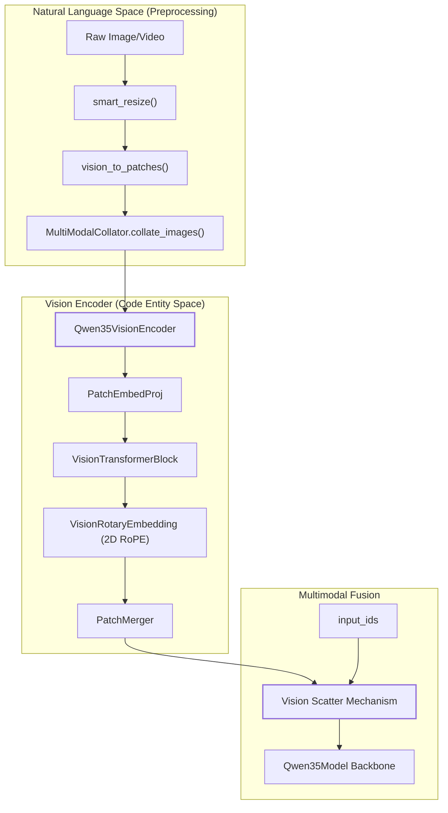
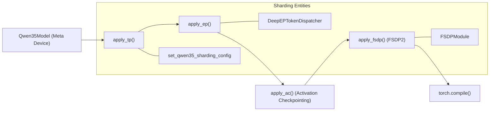

<!-- source: DeepWiki mcp.deepwiki.com · repo pytorch/torchtitan · page 5.6 Qwen3.5 Multimodal Model (VLM) · fetched 2026-10-30 -->

# Qwen3.5 Multimodal Model (VLM)

Relevant source files

The following files were used as context for generating this wiki page:

- [.ci/docker/requirements-vlm.txt](.ci/docker/requirements-vlm.txt)
- [tests/unit_tests/test_expert_parallel.py](tests/unit_tests/test_expert_parallel.py)
- [torchtitan/components/quantization/utils.py](torchtitan/components/quantization/utils.py)
- [torchtitan/distributed/deepep/deepep.py](torchtitan/distributed/deepep/deepep.py)
- [torchtitan/distributed/deepep/hybridep.py](torchtitan/distributed/deepep/hybridep.py)
- [torchtitan/hf_datasets/multimodal/mm_collator.py](torchtitan/hf_datasets/multimodal/mm_collator.py)
- [torchtitan/hf_datasets/multimodal/mm_datasets.py](torchtitan/hf_datasets/multimodal/mm_datasets.py)
- [torchtitan/hf_datasets/multimodal/utils/image.py](torchtitan/hf_datasets/multimodal/utils/image.py)
- [torchtitan/hf_datasets/multimodal/utils/video.py](torchtitan/hf_datasets/multimodal/utils/video.py)
- [torchtitan/models/qwen3_5/__init__.py](torchtitan/models/qwen3_5/__init__.py)
- [torchtitan/models/qwen3_5/sharding.py](torchtitan/models/qwen3_5/sharding.py)

The Qwen3.5 Multimodal Model (VLM) in `torchtitan` is a sophisticated Vision-Language Model implementation featuring a hybrid attention architecture and native support for high-resolution, variable aspect ratio visual inputs. It integrates a GatedDeltaNet linear attention mechanism alongside standard full attention and supports advanced distributed training features including Tensor Parallelism (TP), Expert Parallelism (EP), and Pipeline Parallelism (PP).

Sources: [torchtitan/models/qwen3_5/__init__.py:1-57](), [torchtitan/models/qwen3_5/model.py:1-50]()

## Architectural Overview

Qwen3.5 utilizes a hybrid backbone that alternates between standard Transformer blocks and GatedDeltaNet blocks. This design aims to balance the long-range modeling capabilities of full attention with the efficiency of linear attention.

### Hybrid Attention Mechanism
The model consists of two primary block types:
1.  **Full Attention Blocks**: Implemented in `Qwen35Attention`, these use standard Multi-Head Attention (MHA) or Grouped-Query Attention (GQA) with `MRoPE` (Multimodal Rotary Positional Embeddings) [torchtitan/models/qwen3_5/model.py:435-480]().
2.  **GatedDeltaNet Blocks**: Implemented in `GatedDeltaNet`, these leverage the `flash-linear-attention` (FLA) library to provide a gated linear attention mechanism with a `GatedDeltaKernel` [torchtitan/models/qwen3_5/model.py:284-330]().

### Vision Encoder and Processing
The vision component is a ViT-based encoder (`Qwen35VisionEncoder`) designed for native aspect ratio support.

| Component | Description | Code Entity |
| :--- | :--- | :--- |
| **Patching** | Converts images/videos into 3D patches (T, H, W) | `vision_to_patches` |
| **2D RoPE** | Rotary embeddings for spatial awareness | `VisionRotaryEmbedding` |
| **Patch Merger** | Concatenates adjacent patches to reduce sequence length | `PatchMerger` |
| **Vision Scatter** | Injects visual tokens into the LLM sequence | `Qwen35Model.forward` |

Sources: [torchtitan/models/qwen3_5/vision_encoder.py:1-100](), [torchtitan/hf_datasets/multimodal/utils/image.py:191-205](), [torchtitan/models/qwen3_5/model.py:734-750]()

### Qwen3.5 Data Flow: Visual Input to LLM Space

The following diagram illustrates how raw visual data is transformed into tokens compatible with the language model backbone.

Sources: [torchtitan/hf_datasets/multimodal/mm_collator.py:39-78](), [torchtitan/models/qwen3_5/vision_encoder.py:315-350](), [torchtitan/models/qwen3_5/model.py:716-740]()

## Mixture of Experts (MoE) Variant

Qwen3.5 supports a Mixture of Experts (MoE) architecture where a portion of the FFN layers are replaced with expert-parallel layers.

*   **Shared Experts**: A fixed FFN that processes every token to capture common knowledge [torchtitan/models/qwen3_5/model.py:173-200]().
*   **Routed Experts**: Experts selected by a router, typically sharded across `ep_mesh` [torchtitan/models/qwen3_5/sharding.py:137-143]().
*   **Sigmoid Gating**: Qwen3.5 uses a unique sigmoid-gated mechanism for its shared experts [torchtitan/models/qwen3_5/sharding.py:148-169]().

### MoE Dispatcher Integration
The model supports multiple token dispatchers for Expert Parallelism:
*   **DeepEP**: Optimized for DeepSeek-style MoE communication [torchtitan/distributed/deepep/deepep.py:58-68]().
*   **HybridEP**: Optimized for NVLink systems (e.g., GB200) using TMA-optimized all-to-all [torchtitan/distributed/deepep/hybridep.py:8-19]().

## Distributed Parallelism

Qwen3.5 is designed to scale across thousands of GPUs using a 4D parallelism strategy.

### Sharding Strategy
The sharding logic is centralized in `torchtitan/models/qwen3_5/sharding.py`.

| Layer Type | Parallelism Applied | Code Implementation |
| :--- | :--- | :--- |
| **Attention (Full)** | Tensor Parallel (TP) on `wq`, `wk`, `wv`, `wo` | `_set_full_attention_sharding` |
| **GatedDeltaNet** | Head-sharded TP on projections | `_set_deltanet_sharding` |
| **MoE Experts** | Expert Parallel (EP) + TP (optional) | `set_moe_sharding_config` |
| **Vision Encoder** | Memory-efficient TP (no Sequence Parallel) | `_set_vision_encoder_sharding` |

Sources: [torchtitan/models/qwen3_5/sharding.py:100-130](), [torchtitan/models/qwen3_5/sharding.py:172-185]()

### Parallelization Hierarchy
The model applies transformations in a specific order to ensure compatibility between different distributed primitives.

Sources: [torchtitan/models/qwen3_5/parallelize.py:54-90](), [torchtitan/models/qwen3_5/sharding.py:87-114]()

## Multimodal Dataset Support

The VLM implementation includes a specialized data pipeline in `torchtitan/hf_datasets/multimodal/` to handle interleaved text and visual data.

### Key Data Components
1.  **MultiModalCollator**: Handles the batching of variable-sized image/video patches. It ensures that the `max_num_patch` in a batch is divisible by the `spatial_merge_size**2` to satisfy the `PatchMerger` requirements [torchtitan/hf_datasets/multimodal/mm_collator.py:63-68]().
2.  **MRoPE Position Building**: The collator builds 3D position IDs (Temporal, Height, Width) for the Multimodal Rotary Positional Embeddings [torchtitan/hf_datasets/multimodal/mm_collator.py:137-180]().
3.  **Video Processing**: Uses `PyAV` for efficient frame sampling and `torchvision` for SIMD-accelerated resizing [torchtitan/hf_datasets/multimodal/utils/video.py:19-40]().

### Smart Resizing
To handle native aspect ratios while staying within memory limits, the system uses a `smart_resize` algorithm. It calculates target dimensions that are multiples of the `patch_size * merge_size` while respecting a total pixel budget (`max_pixels`) [torchtitan/hf_datasets/multimodal/utils/image.py:119-140]().

Sources: [torchtitan/hf_datasets/multimodal/mm_datasets.py:87-125](), [torchtitan/hf_datasets/multimodal/mm_collator.py:22-38]()

---

