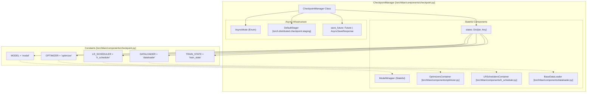
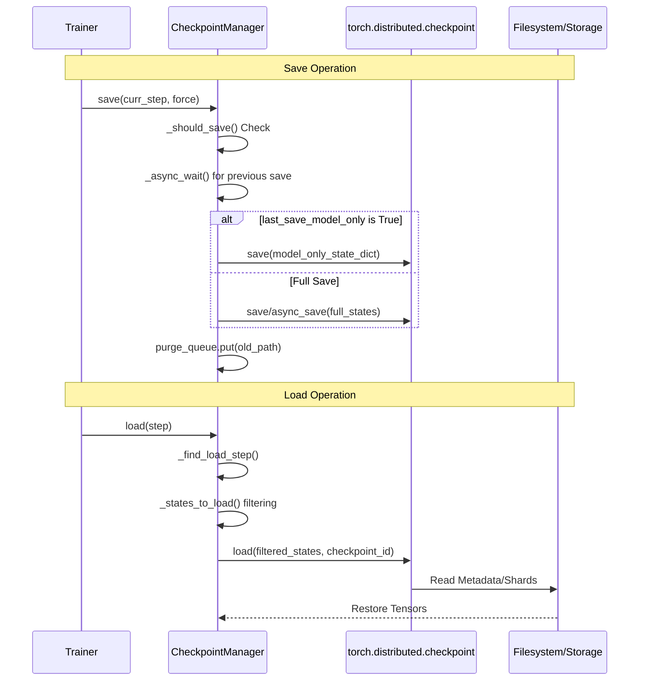

<!-- source: DeepWiki mcp.deepwiki.com · repo pytorch/torchtitan · page 6 Checkpoint Management · fetched 2026-10-30 -->

# Checkpoint Management

Relevant source files

The following files were used as context for generating this wiki page:

- [docs/checkpoint.md](docs/checkpoint.md)
- [tests/unit_tests/test_checkpoint.py](tests/unit_tests/test_checkpoint.py)
- [torchtitan/components/checkpoint.py](torchtitan/components/checkpoint.py)

## Purpose and Scope

Checkpoint Management in TorchTitan handles the persistence and recovery of training state across interruptions and failures. The `CheckpointManager` class orchestrates saving and loading of model parameters, optimizer states, learning rate scheduler states, dataloader positions, and custom training states. This system supports multiple checkpoint formats, asynchronous saving modes, automatic purging of stale checkpoints, and integration with fault tolerance mechanisms.

For information about fault tolerance recovery mechanisms, see [Fault Tolerance Integration](#6.4). For configuration options related to checkpointing, see [Configuration System](#2).

Sources: [torchtitan/components/checkpoint.py:1-47](), [torchtitan/components/checkpoint.py:135-182](), [docs/checkpoint.md:1-5]()

## CheckpointManager Architecture

### Core Class Responsibilities

The `CheckpointManager` class is the central orchestrator for all checkpointing operations. It manages five categories of stateful components, identified by string constants:

| Component | Key Constant | Content |
|-----------|-------------|---------|
| Model Parameters | `MODEL` | Weights, biases, and persistent buffers from all model parts |
| Optimizer States | `OPTIMIZER` | Momentum, variance, and other optimizer-specific state per parameter |
| LR Scheduler States | `LR_SCHEDULER` | Step counts and scheduler-specific state |
| Dataloader Position | `DATALOADER` | Current iteration index for resumable data loading |
| Training State | `TRAIN_STATE` | Custom states like step counter, tokens seen, etc. |

The manager wraps these components in a unified state dictionary and coordinates their serialization using PyTorch Distributed Checkpoint (DCP) APIs. For details, see [CheckpointManager Architecture](#6.1).

Sources: [torchtitan/components/checkpoint.py:43-47](), [torchtitan/components/checkpoint.py:135-182]()

### Class Structure and Key Entities

The following diagram maps the high-level checkpointing concepts to the specific classes and constants used in the codebase.

**Checkpoint Entity Mapping**

Sources: [torchtitan/components/checkpoint.py:43-47](), [torchtitan/components/checkpoint.py:56-98](), [torchtitan/components/checkpoint.py:135-248]()

### ModelWrapper for State Dict Flattening

The `ModelWrapper` class solves a critical problem for Pipeline Parallelism (PP): when multiple model chunks exist per rank, their state dictionaries must be merged into a single dictionary to avoid key collisions during checkpoint save/load. It also provides a unified `Stateful` interface for the checkpointing system.

Sources: [torchtitan/components/checkpoint.py:56-98](), [torchtitan/components/checkpoint.py:152-160]()

## Checkpoint Operations and Modes

### Checkpoint Operations

TorchTitan supports three distinct checkpoint types, each optimized for different use cases: training resumption, final model export, and per-replica fault tolerance.

**Checkpoint Saving and Loading Lifecycle**

Sources: [torchtitan/components/checkpoint.py:482-561](), [torchtitan/components/checkpoint.py:563-659](), [docs/checkpoint.md:7-54]()

### Async Save Modes

The `AsyncMode` enum defines how checkpoints are written to disk:
- `DISABLED`: Synchronous save, blocks training.
- `ASYNC`: Uses `dcp.async_save` to offload writing to a background thread.
- `ASYNC_WITH_PINNED_MEM`: Uses `DefaultStager` to copy state to pinned CPU memory first, allowing the GPU to resume training immediately while the CPU handles serialization.

For details on purging logic via `purge_thread` and staging lifecycles, see [Checkpoint Operations and Modes](#6.2).

Sources: [torchtitan/components/checkpoint.py:50-54](), [torchtitan/components/checkpoint.py:108-133](), [torchtitan/components/checkpoint.py:402-426]()

## Checkpoint Formats and Interoperability

TorchTitan leverages PyTorch Distributed Checkpoint (DCP) as its primary format, which supports efficient sharding and resharding.

- **DCP Resharding**: Allows loading a checkpoint saved with one parallelism configuration (e.g., TP=2, PP=4) into a different one (e.g., TP=4, PP=2) automatically during `dcp.load`.
- **HuggingFace Interoperability**: Supports saving and loading in HuggingFace format using `HuggingFaceStorageWriter` and `consolidate_safetensors_files_on_every_rank`.
- **PyTorch Export**: Supports converting sharded DCP checkpoints into a single consolidated `.pt` file via `torch.distributed.checkpoint.format_utils`.

For details on conversion scripts and the `BaseStateDictAdapter` protocol, see [Checkpoint Formats and Interoperability](#6.3).

Sources: [torchtitan/components/checkpoint.py:24-27](), [torchtitan/components/checkpoint.py:372-475](), [docs/checkpoint.md:67-108]()

## Fault Tolerance Integration

The checkpoint system is integrated with the `FTManager` to handle node failures and recovery.

- **Per-replica Dataloader Checkpoints**: When `enable_ft_dataloader_checkpoints` is true, each replica saves its unique dataloader position to a private folder to handle data state recovery in elastic training.
- **Quorum-based Recovery**: The system can restore state from in-memory or local replicas during node-level failures.
- **Persistent Checkpoints**: Only the replica with `participating_rank() == 0` is typically responsible for saving the full persistent checkpoint to shared storage.

For details on TorchFT integration and the `FaultTolerantTrainer`, see [Fault Tolerance Integration](#6.4).

Sources: [torchtitan/components/checkpoint.py:154-167](), [torchtitan/components/checkpoint.py:208-248](), [torchtitan/components/checkpoint.py:710-737]()

---

