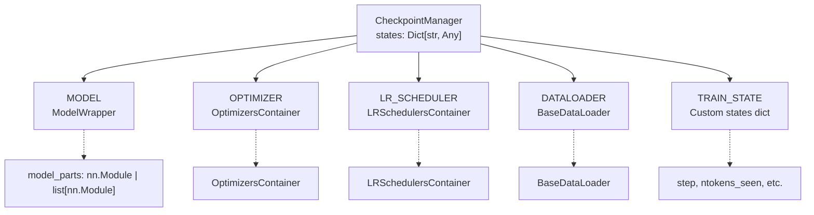
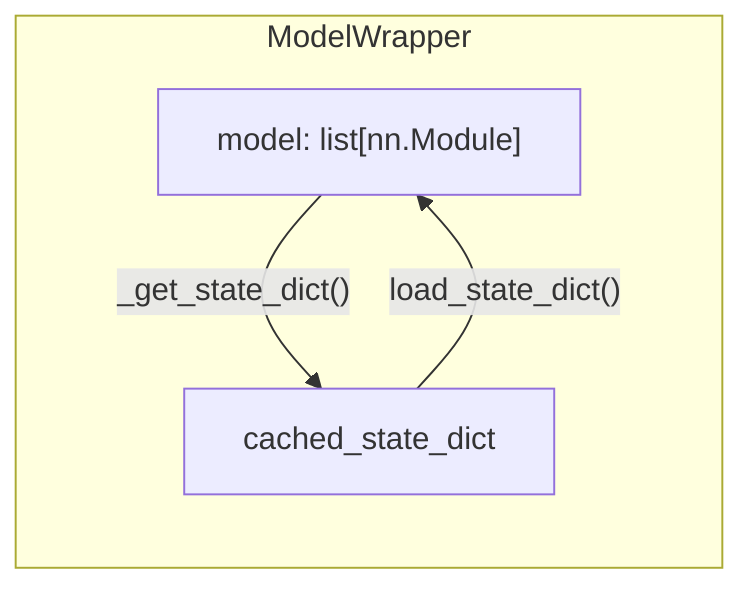
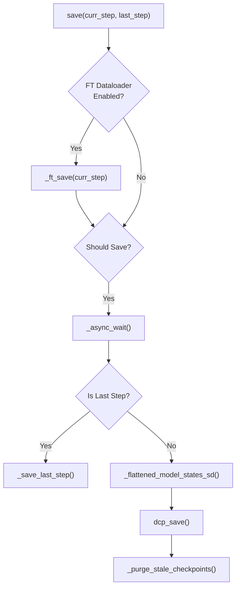

<!-- source: DeepWiki mcp.deepwiki.com · repo pytorch/torchtitan · page 6.1 CheckpointManager Architecture · fetched 2026-10-30 -->

# CheckpointManager Architecture

Relevant source files

The following files were used as context for generating this wiki page:

- [docs/checkpoint.md](docs/checkpoint.md)
- [tests/unit_tests/test_checkpoint.py](tests/unit_tests/test_checkpoint.py)
- [torchtitan/components/checkpoint.py](torchtitan/components/checkpoint.py)

## Purpose and Scope

The `CheckpointManager` class manages the checkpointing logic for the `torchtitan` trainer. It orchestrates the saving and loading of all stateful components, including model parameters, optimizer states, learning rate scheduler states, dataloader positions, and custom training state. The architecture is designed to handle the complexities of large-scale distributed training, such as pipeline parallelism and fault tolerance, while providing support for multiple checkpoint formats and asynchronous saving modes.

**Sources:** [torchtitan/components/checkpoint.py:135-181]()

## Stateful Components

The `CheckpointManager` tracks several categories of stateful components. Each component typically implements the `Stateful` protocol, providing `state_dict()` and `load_state_dict()` methods.

### Component Registry

**Sources:** [torchtitan/components/checkpoint.py:43-47](), [torchtitan/components/checkpoint.py:182-205]()

| Component Key | Type | Contents | Purpose |
|--------------|------|----------|---------|
| `MODEL` | `ModelWrapper` | Parameters from all `model_parts` | Flattens state dicts from multiple model chunks (required for PP) |
| `OPTIMIZER` | `OptimizersContainer` | Optimizer states | Manages persistence for all optimizers in the job |
| `LR_SCHEDULER` | `LRSchedulersContainer` | Scheduler state | Tracks learning rate progress and warmup/decay state |
| `DATALOADER` | `BaseDataLoader` | Iteration position | Enables exact resumption of data streaming |
| `TRAIN_STATE` | `dict[str, Any]` | Metadata | Stores step counters and training progress |

**Sources:** [torchtitan/components/checkpoint.py:43-47](), [torchtitan/components/checkpoint.py:182-205]()

### ModelWrapper Implementation

The `ModelWrapper` class [torchtitan/components/checkpoint.py:56-98]() wraps one or more `nn.Module` parts. It provides a unified `state_dict()` by merging the state dicts of all constituent parts.

**Key behaviors:**
- **Initialization**: Flattens all model parts' state dicts into `cached_state_dict` during `__init__` [torchtitan/components/checkpoint.py:80-82]().
- **State Retrieval**: `state_dict()` returns the cached dictionary to avoid repeated expensive calls to sharded state retrieval [torchtitan/components/checkpoint.py:88-89]().
- **Loading**: `load_state_dict()` iterates through model parts with `strict=False` and then refreshes the cache [torchtitan/components/checkpoint.py:91-97]().

**Sources:** [torchtitan/components/checkpoint.py:56-98]()

## Checkpoint Modes and Types

### Asynchronous Checkpoint Modes

`CheckpointManager` supports three modes for saving state, defined by the `AsyncMode` enum [torchtitan/components/checkpoint.py:50-53]().

| Mode | Enum Value | Description |
|------|------------|-------------|
| `DISABLED` | `"disabled"` | Synchronous blocking save using `dcp.save()` [torchtitan/components/checkpoint.py:433-435](). |
| `ASYNC` | `"async"` | Non-blocking save using `dcp.async_save()` with `AsyncCheckpointerType.THREAD` [torchtitan/components/checkpoint.py:412-421](). |
| `ASYNC_WITH_PINNED_MEM` | `"async_with_pinned_mem"` | Minimal-blocking save using `DefaultStager` and `AsyncCheckpointerType.PROCESS` [torchtitan/components/checkpoint.py:423-431](). |

**Sources:** [torchtitan/components/checkpoint.py:50-53](), [torchtitan/components/checkpoint.py:412-435]()

### Checkpoint Formats

The system supports standard Distributed Checkpoint (DCP) and HuggingFace (HF) formats.

- **DCP**: The default format. It supports resharding, allowing training to resume on a different number of GPUs than the saving job [docs/checkpoint.md:58-59]().
- **HuggingFace**: Enabled via `last_save_in_hf` [docs/checkpoint.md:72](). It uses `HuggingFaceStorageWriter` and `consolidate_safetensors_files_on_every_rank` to produce standard HF-compatible `safetensors` files [torchtitan/components/checkpoint.py:382-407](), [torchtitan/components/checkpoint.py:438-445]().

**Sources:** [torchtitan/components/checkpoint.py:382-445](), [docs/checkpoint.md:56-81]()

## Core Operations

### Save Operation Flow

The `save()` method [torchtitan/components/checkpoint.py:492-571]() manages the full saving lifecycle.

**Key Implementation Details:**
- **Wait for Previous**: Before starting a new save, it calls `_async_wait()` to ensure the previous async operation is finished [torchtitan/components/checkpoint.py:522]().
- **State Flattening**: Calls `_flattened_model_states_sd()` to move model parameters to the top level of the state dict while keeping other components (optimizer, etc.) nested [torchtitan/components/checkpoint.py:530](), [torchtitan/components/checkpoint.py:749-760]().
- **Staging**: In `ASYNC_WITH_PINNED_MEM` mode, it uses `DefaultStager` to copy tensors to pinned memory before starting the async save process [torchtitan/components/checkpoint.py:533-542]().

**Sources:** [torchtitan/components/checkpoint.py:492-571](), [torchtitan/components/checkpoint.py:749-760]()

### Load Operation Flow

The `load()` method [torchtitan/components/checkpoint.py:573-669]() restores training state.

1. **FT Dataloader**: Loads per-replica dataloader state via `_ft_load()` if enabled [torchtitan/components/checkpoint.py:587-588]().
2. **Step Selection**: Finds the latest checkpoint step using `_find_load_step()` if no specific step is provided [torchtitan/components/checkpoint.py:604-611]().
3. **State Selection**: Calls `_states_to_load()` to filter out keys specified in `exclude_from_loading` [torchtitan/components/checkpoint.py:653](), [torchtitan/components/checkpoint.py:762-791]().
4. **DCP Load**: Invokes `dcp.load()` and manually updates the `ModelWrapper` cache [torchtitan/components/checkpoint.py:659-668]().

**Sources:** [torchtitan/components/checkpoint.py:573-669](), [torchtitan/components/checkpoint.py:762-791]()

## Pipeline Parallelism Support

Checkpointing in Pipeline Parallelism (PP) requires special handling for state collisions.

1. **Optimizer Flattening**: Each PP rank has a separate optimizer. `torchtitan` uses optimizer flattening (passing `flatten_optimizer_state_dict` to DCP) to prevent collisions between parameter groups across different ranks [torchtitan/components/checkpoint.py:139-152]().
2. **Multiple Model Chunks**: With complex PP schedules (virtual stages), a rank has multiple model chunks. `ModelWrapper` merges these into one state dict to simplify the checkpoint structure [torchtitan/components/checkpoint.py:152-158]().
3. **LR Schedulers**: Schedulers are flattened with the assumption that all lr_schedulers in the container share the same state [torchtitan/components/checkpoint.py:160-162]().

**Sources:** [torchtitan/components/checkpoint.py:139-162]()

## Fault Tolerance Integration

When `FTManager` is provided, `CheckpointManager` supports two types of checkpoints:

1. **Full Persistent Checkpoint**: Saved only by the replica where `ft_manager.participating_rank() == 0`. It contains the complete training state [torchtitan/components/checkpoint.py:168-173](), [torchtitan/components/checkpoint.py:515-519]().
2. **Per-Replica Checkpoint**: Contains only the `DATALOADER` state. Every replica saves its own dataloader state to a folder prefixed with its `ft_replica_id` [torchtitan/components/checkpoint.py:174-176](), [torchtitan/components/checkpoint.py:720-727]().

**Sources:** [torchtitan/components/checkpoint.py:163-176](), [torchtitan/components/checkpoint.py:515-519](), [torchtitan/components/checkpoint.py:720-727]()

## Checkpoint Purging

To manage disk space, `CheckpointManager` can automatically delete old checkpoints based on `keep_latest_k` [torchtitan/components/checkpoint.py:308-313]().

**Implementation details:**
- A dedicated `purge_thread` [torchtitan/components/checkpoint.py:108-133]() processes deletion requests asynchronously.
- The thread is started during `CheckpointManager` initialization if `keep_latest_k > 0` [torchtitan/components/checkpoint.py:308-318]().
- Only rank 0 (or the FT participating rank 0) enqueues paths for deletion [torchtitan/components/checkpoint.py:857-865]().

**Sources:** [torchtitan/components/checkpoint.py:108-133](), [torchtitan/components/checkpoint.py:308-318](), [torchtitan/components/checkpoint.py:856-879]()

---

