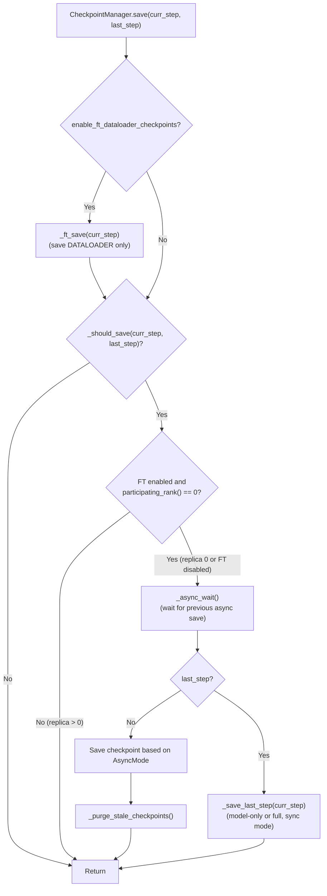
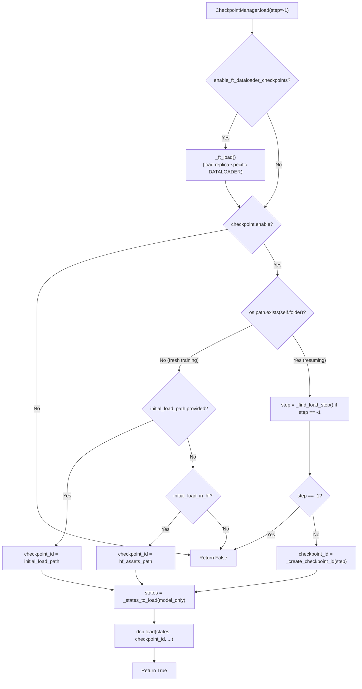
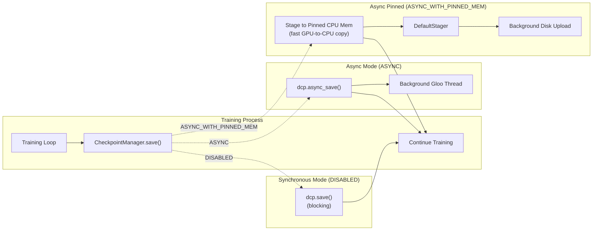
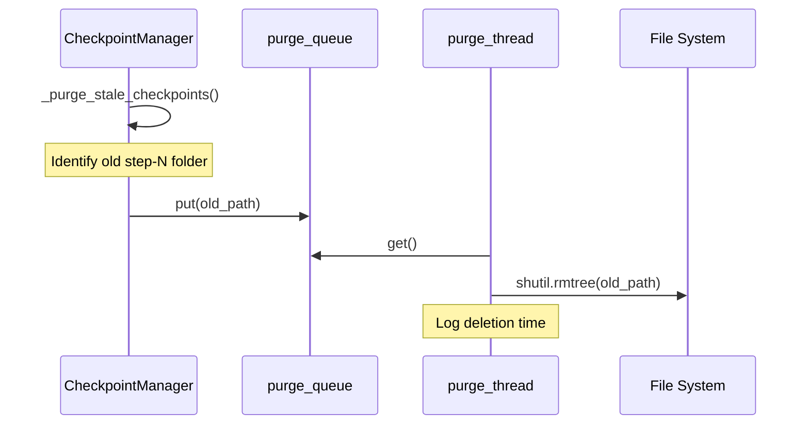

<!-- source: DeepWiki mcp.deepwiki.com · repo pytorch/torchtitan · page 6.2 Checkpoint Operations and Modes · fetched 2026-10-30 -->

# Checkpoint Operations and Modes

<details>
<summary>Relevant source files</summary>

The following files were used as context for generating this wiki page:

- [docs/checkpoint.md](docs/checkpoint.md)
- [tests/unit_tests/test_checkpoint.py](tests/unit_tests/test_checkpoint.py)
- [torchtitan/components/checkpoint.py](torchtitan/components/checkpoint.py)

</details>


## Purpose and Scope

This page documents the checkpoint save and load operations in TorchTitan's `CheckpointManager`, including the three async modes, checkpoint retention policies, and configuration options. For the overall checkpoint system architecture and stateful components, see [CheckpointManager Architecture](#6.1). For checkpoint format details (DCP, HuggingFace, PyTorch .pt) and resharding capabilities, see [Checkpoint Formats and Interoperability](#6.3). For fault tolerance-specific checkpointing, see [Fault Tolerance Integration](#6.4).

The checkpoint system provides three key operations:
1. **Saving** checkpoints at configurable intervals with async modes.
2. **Loading** checkpoints from disk with optional model-only or full restoration.
3. **Purging** stale checkpoints based on retention policies.

## Save Operations

### Save Method and Invocation

The `CheckpointManager.save(curr_step: int, last_step: bool = False)` method [torchtitan/components/checkpoint.py:482-561]() is the primary interface for checkpoint saving. It is called from the training loop at each step, but only performs actual saves based on checkpoint policy.

#### Save Decision Logic



**Sources:** [torchtitan/components/checkpoint.py:482-561](), [torchtitan/components/checkpoint.py:710-737]()

#### Save Policy Rules

The `_should_save(curr_step, last_step)` method [torchtitan/components/checkpoint.py:815-828]() determines when saves occur based on the `CheckpointManager.Config` [torchtitan/components/checkpoint.py:184-286]():

| Condition | Save Triggered? | Configuration Parameter |
|-----------|----------------|-------------------------|
| `enable = False` | No | `checkpoint.enable` |
| `load_only = True` | No | `checkpoint.load_only` |
| `curr_step == 1` and first step enabled | Yes | `checkpoint.enable_first_step_checkpoint` |
| `last_step == True` | Yes | Always when training completes |
| `curr_step % interval == 0` | Yes | `checkpoint.interval` |

**Sources:** [torchtitan/components/checkpoint.py:815-828](), [tests/unit_tests/test_checkpoint.py:331-363]()

### Checkpoint Types

#### Full Checkpoints
Full checkpoints save all stateful components for complete training resumption. These are stored as constant strings [torchtitan/components/checkpoint.py:43-47]():
- `MODEL`: Model parameters (via `ModelWrapper` [torchtitan/components/checkpoint.py:56-98]()).
- `OPTIMIZER`: Optimizer states (via `OptimizersContainer` [torchtitan/components/optimizer.py:27-142]()).
- `LR_SCHEDULER`: Learning rate scheduler states [torchtitan/components/lr_scheduler.py:26-48]().
- `DATALOADER`: Data loading position [torchtitan/components/dataloader.py:33-143]().
- `TRAIN_STATE`: Custom training state (step counters, tokens seen, etc.).

The method `_flattened_model_states_sd()` [torchtitan/components/checkpoint.py:739-750]() flattens model states into the top-level state dict while keeping other components nested.

**Sources:** [torchtitan/components/checkpoint.py:43-47](), [torchtitan/components/checkpoint.py:739-750](), [torchtitan/components/checkpoint.py:520-547]()

#### Model-Only Checkpoints
Model-only checkpoints save just the `MODEL` component, optionally with dtype conversion for export. This is triggered when `last_save_model_only = True` [torchtitan/components/checkpoint.py:210]() at the final training step or during initial loading [torchtitan/components/checkpoint.py:223]().

```python
# Logic in _save_last_step [torchtitan/components/checkpoint.py:783-813]
states = self.states[MODEL].state_dict()
if self.export_dtype != torch.float32:
    states = {k: v.to(self.export_dtype) for k, v in states.items()}
```

**Sources:** [torchtitan/components/checkpoint.py:783-813](), [torchtitan/components/checkpoint.py:274-282](), [docs/checkpoint.md:16-24]()

#### Fault Tolerance Per-Replica Checkpoints
When `enable_ft_dataloader_checkpoints = True` [torchtitan/components/checkpoint.py:284](), each replica saves its own `DATALOADER` state to a replica-specific folder prefixed with the `ft_replica_id` [torchtitan/components/checkpoint.py:166-167]().

**Sources:** [torchtitan/components/checkpoint.py:710-717](), [torchtitan/components/checkpoint.py:212-221](), [torchtitan/components/checkpoint.py:154-167]()

## Load Operations

### Load Method and Resolution

The `CheckpointManager.load(step: int = -1)` method [torchtitan/components/checkpoint.py:563-659]() resolves which checkpoint to load:



**Sources:** [torchtitan/components/checkpoint.py:563-659]()

### Finding the Latest Checkpoint

The `_find_load_step(folder)` method [torchtitan/components/checkpoint.py:672-701]() scans the checkpoint folder for valid checkpoints by listing directories matching pattern `step-(\d+)` [torchtitan/components/checkpoint.py:680]() and verifying the presence of `.metadata` (DCP) or HuggingFace index files [torchtitan/components/checkpoint.py:688-692]().

**Sources:** [torchtitan/components/checkpoint.py:672-701](), [tests/unit_tests/test_checkpoint.py:298-326]()

## Async Checkpoint Modes

TorchTitan supports three `AsyncMode` values [torchtitan/components/checkpoint.py:50-54]() to optimize training throughput:

### Async Mode Comparison

| Mode | Enum Value | Implementation | Overhead | Use Case |
|------|-----------|----------------|----------|----------|
| **Disabled** | `DISABLED` | Blocking `dcp.save()` | Highest | Debugging, small models |
| **Async** | `ASYNC` | `dcp.async_save()` (Gloo) | Medium | Standard production |
| **Async Pinned** | `ASYNC_WITH_PINNED_MEM` | `DefaultStager` | Lowest | Large-scale production |

**Sources:** [torchtitan/components/checkpoint.py:50-54](), [torchtitan/components/checkpoint.py:289-324]()

### Async Mode Architecture



**Sources:** [torchtitan/components/checkpoint.py:350-440](), [torchtitan/components/checkpoint.py:521-534]()

### Coordination and Staging
- **Wait Mechanism**: `_async_wait()` [torchtitan/components/checkpoint.py:830-844]() ensures previous async saves complete before starting a new one.
- **Staging**: In `ASYNC_WITH_PINNED_MEM`, `maybe_wait_for_staging()` [torchtitan/components/checkpoint.py:661-670]() ensures GPU-to-CPU staging is complete before the next training iteration modifies the tensors.

**Sources:** [torchtitan/components/checkpoint.py:830-844](), [torchtitan/components/checkpoint.py:661-670]()

## Checkpoint Retention and Purging

### Keep-Latest-K Policy
The `keep_latest_k` configuration [torchtitan/components/checkpoint.py:202]() controls the retention policy. If `keep_latest_k > 0`, TorchTitan maintains a background thread to delete older checkpoints. Note that `keep_latest_k=1` is disallowed to ensure safe async operations [torchtitan/components/checkpoint.py:307-310]().

**Sources:** [torchtitan/components/checkpoint.py:202](), [torchtitan/components/checkpoint.py:307-310]()

### Background Purge Thread
The `purge_thread` [torchtitan/components/checkpoint.py:108-133]() consumes paths from a `purge_queue`. This allows the training process to continue without waiting for the file system to complete recursive deletions (`shutil.rmtree`) [torchtitan/components/checkpoint.py:125]().



**Sources:** [torchtitan/components/checkpoint.py:108-133](), [torchtitan/components/checkpoint.py:846-869]()

## Configuration Options

| Parameter | Type | Default | Description |
|-----------|------|---------|-------------|
| `enable` | bool | True | Enable checkpointing system [torchtitan/components/checkpoint.py:186](). |
| `interval` | int | 1 | Steps between saves [torchtitan/components/checkpoint.py:199](). |
| `async_mode` | str | "disabled" | Async mode (DISABLED, ASYNC, ASYNC_WITH_PINNED_MEM) [torchtitan/components/checkpoint.py:193](). |
| `keep_latest_k` | int | 0 | Number of recent checkpoints to keep (0=all) [torchtitan/components/checkpoint.py:202](). |
| `last_save_model_only` | bool | False | Save only model weights at the final step [torchtitan/components/checkpoint.py:210](). |
| `export_dtype` | str | "float32" | Target dtype for model export [torchtitan/components/checkpoint.py:274](). |
| `exclude_from_loading` | list | [] | Components to skip during loading [torchtitan/components/checkpoint.py:282](). |

**Sources:** [torchtitan/components/checkpoint.py:184-286](), [docs/checkpoint.md:44-54]()

---

