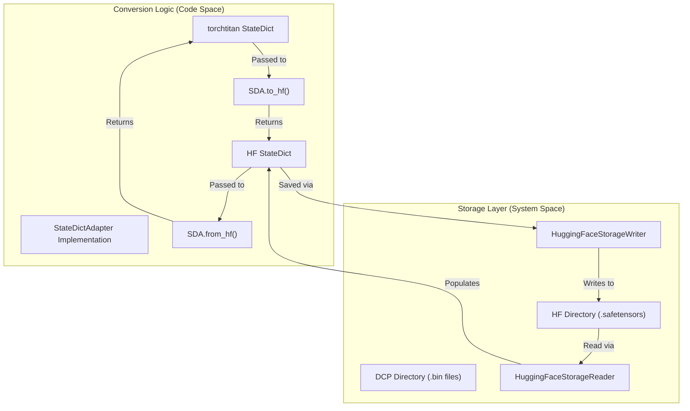
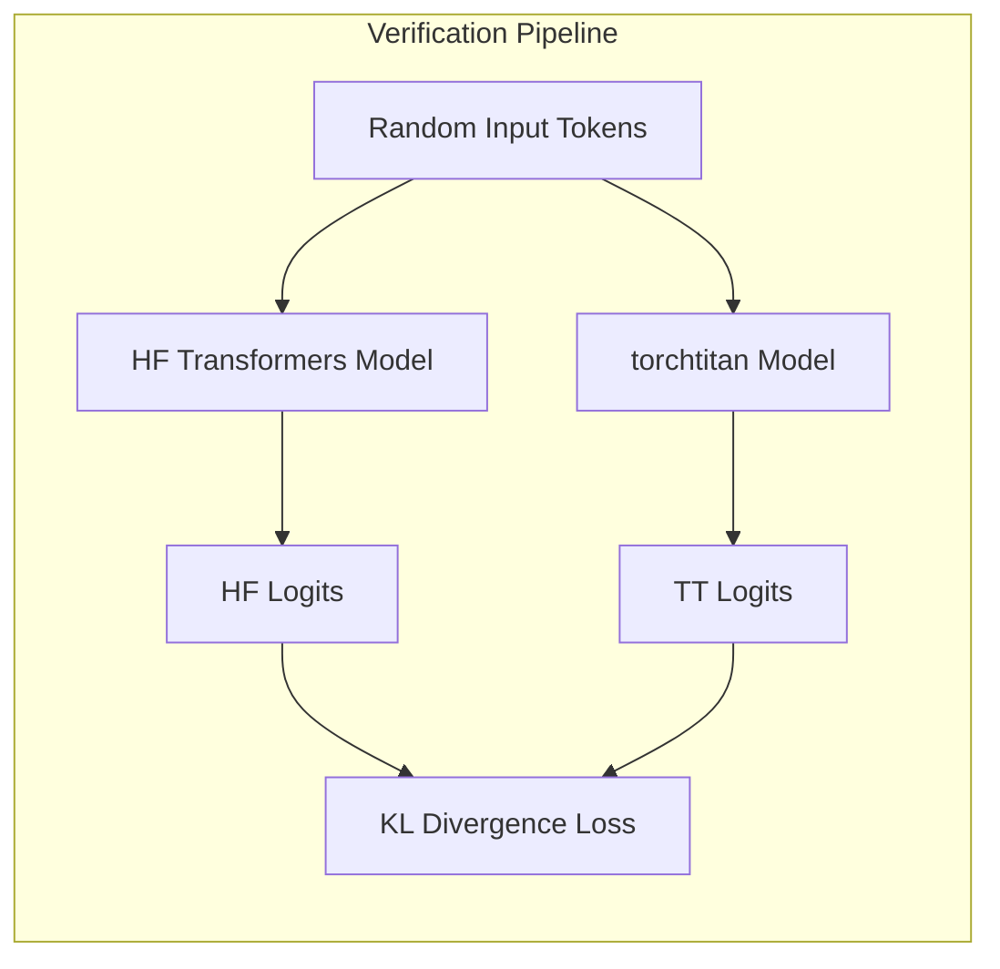

<!-- source: DeepWiki mcp.deepwiki.com · repo pytorch/torchtitan · page 6.3 Checkpoint Formats and Interoperability · fetched 2026-10-30 -->

# Checkpoint Formats and Interoperability

Relevant source files

The following files were used as context for generating this wiki page:

- [scripts/checkpoint_conversion/README.md](scripts/checkpoint_conversion/README.md)
- [scripts/checkpoint_conversion/convert_from_hf.py](scripts/checkpoint_conversion/convert_from_hf.py)
- [scripts/checkpoint_conversion/convert_to_hf.py](scripts/checkpoint_conversion/convert_to_hf.py)
- [scripts/checkpoint_conversion/numerical_tests_example.py](scripts/checkpoint_conversion/numerical_tests_example.py)
- [scripts/download_hf_assets.py](scripts/download_hf_assets.py)
- [torchtitan/models/deepseek_v3/state_dict_adapter.py](torchtitan/models/deepseek_v3/state_dict_adapter.py)
- [torchtitan/models/gpt_oss/state_dict_adapter.py](torchtitan/models/gpt_oss/state_dict_adapter.py)
- [torchtitan/models/llama3/state_dict_adapter.py](torchtitan/models/llama3/state_dict_adapter.py)
- [torchtitan/models/qwen3/state_dict_adapter.py](torchtitan/models/qwen3/state_dict_adapter.py)
- [torchtitan/models/qwen3_5/state_dict_adapter.py](torchtitan/models/qwen3_5/state_dict_adapter.py)
- [torchtitan/protocols/__init__.py](torchtitan/protocols/__init__.py)
- [torchtitan/protocols/state_dict_adapter.py](torchtitan/protocols/state_dict_adapter.py)

## Purpose and Scope

This page documents the checkpoint formats supported by torchtitan and the mechanisms for converting between them. It covers the native DCP (Distributed Checkpoint) format, HuggingFace `safetensors` format, and the protocols for interoperability, including the `BaseStateDictAdapter` and model-specific transformations for MoE and Vision-Language models.

For information about the `CheckpointManager` architecture and stateful components, see [6.1 CheckpointManager Architecture](). For checkpoint saving/loading operations and async modes, see [6.2 Checkpoint Operations and Modes]().

---

## Overview of Checkpoint Formats

torchtitan supports three primary checkpoint formats, each optimized for different stages of the model lifecycle:

| Format | Description | Use Case | Implementation |
|--------|-------------|----------|----------------|
| **DCP** | Native sharded format using `torch.distributed.checkpoint` | Distributed training checkpoints with full state (optimizer, etc.) | `dcp.save()` / `dcp.load()` |
| **HuggingFace** | `safetensors` format with HF-compatible naming | Model export for inference and HF ecosystem interoperability | `HuggingFaceStorageWriter` |
| **PyTorch .pt** | Consolidated single-file format | Legacy compatibility, single-device loading | `dcp_to_torch` utility |

---

## BaseStateDictAdapter Protocol

Interoperability with HuggingFace is achieved through the `BaseStateDictAdapter` protocol [torchtitan/protocols/state_dict_adapter.py:20-79](). This abstract class defines the interface for translating between torchtitan's native state dict format and the HF format.

### Key Components

- **`to_hf`**: Converts a native torchtitan state dict to HuggingFace format [torchtitan/protocols/state_dict_adapter.py:42-51]().
- **`from_hf`**: Converts an HF state dict back to the native format [torchtitan/protocols/state_dict_adapter.py:54-63]().
- **`fqn_to_index_mapping`**: A mapping derived from `model.safetensors.index.json` used by the `HuggingFaceStorageWriter` to determine which tensors belong in which sharded file [torchtitan/protocols/state_dict_adapter.py:92-112]().
- **`get_hf_storage_reader`**: Returns the appropriate reader (standard or quantized) for loading weights [torchtitan/protocols/state_dict_adapter.py:66-78]().

### Data Flow for HF Conversion

**Sources:** [torchtitan/protocols/state_dict_adapter.py:20-135](), [scripts/checkpoint_conversion/convert_to_hf.py:19-67](), [scripts/checkpoint_conversion/convert_from_hf.py:18-45]()

---

## Model-Specific Implementations

### Llama 3 Adapter
The `Llama3StateDictAdapter` handles the permutation of weights required for RoPE compatibility between HuggingFace and native implementations [torchtitan/models/llama3/state_dict_adapter.py:69-90](). It also manages the splitting and fusing of QKV weights if `fuse_qkv` is enabled in the config [torchtitan/models/llama3/state_dict_adapter.py:118-134]().

### DeepSeek-V3 and MoE Adapters
MoE models use the `MoEStateDictAdapter` [torchtitan/models/utils.py:19-170](), which addresses the complexity of "GroupedExperts".
- **Weight Transformation**: torchtitan stores experts as a single 3D parameter (GroupedExperts), while HF stores them as separate modules. The adapter splits these during `to_hf` [torchtitan/models/deepseek_v3/state_dict_adapter.py:123-130]().
- **Quantization**: DeepSeek-V3 supports loading from quantized HF checkpoints using a specialized `QuantizedHuggingFaceStorageReader` with a specific block size [torchtitan/models/deepseek_v3/state_dict_adapter.py:81-93]().

### Qwen 3.5 Multimodal Adapter
The `Qwen35StateDictAdapter` handles complex vision-language mappings [torchtitan/models/qwen3_5/state_dict_adapter.py:42-109]():
- **Vision Encoder**: Maps HF `visual.blocks` to TT `vision_encoder.layers`.
- **Patch Embedding**: Converts HF `Conv3d` weights to TT `Linear` weights via reshape [torchtitan/models/qwen3_5/state_dict_adapter.py:83-85]().
- **GatedDeltaNet**: Manages the fusion/splitting of `in_proj_qkv` and `conv1d` weights [torchtitan/models/qwen3_5/state_dict_adapter.py:53-56]().

---

## Conversion Utilities and Verification

### Conversion Scripts
torchtitan provides standalone scripts for offline conversion:
- `convert_to_hf.py`: Loads a DCP checkpoint and saves it as HF safetensors [scripts/checkpoint_conversion/convert_to_hf.py:19-67]().
- `convert_from_hf.py`: Loads an HF checkpoint and saves it in DCP format [scripts/checkpoint_conversion/convert_from_hf.py:18-45]().
- `download_hf_assets.py`: Downloads `config.json`, `tokenizer.json`, and `model.safetensors.index.json` from the HF Hub to facilitate conversion [scripts/download_hf_assets.py:13-55]().

### Numerical Verification
To ensure conversion correctness, the `numerical_tests_example.py` script compares the outputs of a native torchtitan model against a HuggingFace `transformers` model [scripts/checkpoint_conversion/numerical_tests_example.py:104-168](). It uses KL Divergence to detect subtle errors, such as missing weight permutations [scripts/checkpoint_conversion/numerical_tests_example.py:20-27]().

**Sources:** [scripts/checkpoint_conversion/numerical_tests_example.py:20-168](), [scripts/checkpoint_conversion/README.md:14-25]()

---

## DCP Resharding

A primary advantage of the DCP format is automatic resharding. This allows loading a checkpoint into a training job with a different parallelism configuration (e.g., different `TP` or `PP` degrees) than the one used during saving.

1. **Materialization**: The model is initialized on the `meta` device [torchtitan/models/utils.py:72-78]().
2. **Loading**: When `dcp.load()` is called, the library uses the `DTensor` sharding metadata to identify which slices of the saved tensors are required for the current rank's device mesh.
3. **Resharding**: DCP handles the redistribution of shards across the new mesh automatically during the load process.

**Sources:** [torchtitan/protocols/state_dict_adapter.py:115-121](), [scripts/checkpoint_conversion/convert_from_hf.py:36-39]()

---

