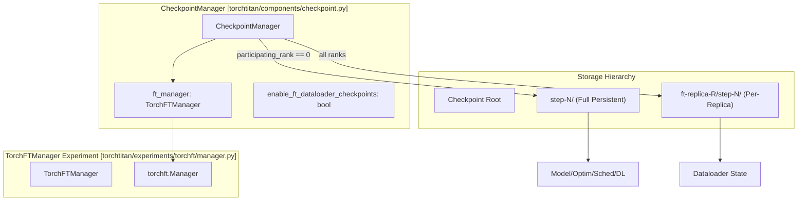
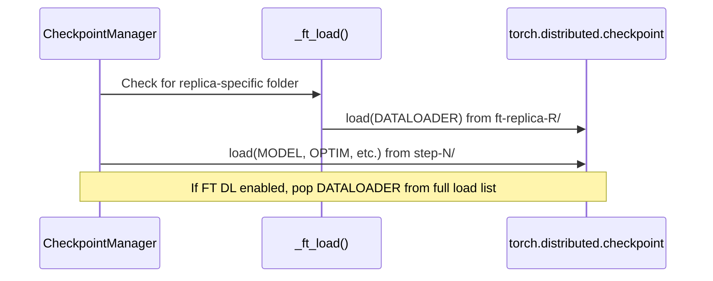
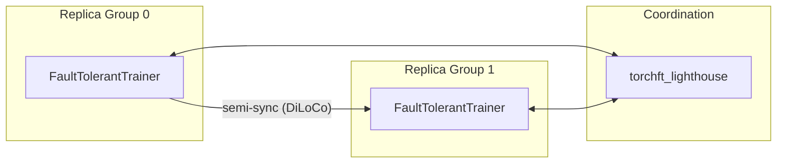

<!-- source: DeepWiki mcp.deepwiki.com · repo pytorch/torchtitan · page 6.4 Fault Tolerance Integration · fetched 2026-10-30 -->

# Fault Tolerance Integration

Relevant source files

The following files were used as context for generating this wiki page:

- [.github/CODEOWNERS](.github/CODEOWNERS)
- [tests/README.md](tests/README.md)
- [torchtitan/components/validate.py](torchtitan/components/validate.py)
- [torchtitan/experiments/forge/engine.py](torchtitan/experiments/forge/engine.py)
- [torchtitan/experiments/forge/example_train.py](torchtitan/experiments/forge/example_train.py)
- [torchtitan/experiments/graph_trainer/.claude/autodev.md](torchtitan/experiments/graph_trainer/.claude/autodev.md)
- [torchtitan/experiments/graph_trainer/.claude/nightly_scout.md](torchtitan/experiments/graph_trainer/.claude/nightly_scout.md)
- [torchtitan/experiments/torchft/README.md](torchtitan/experiments/torchft/README.md)
- [torchtitan/experiments/torchft/__init__.py](torchtitan/experiments/torchft/__init__.py)
- [torchtitan/experiments/torchft/checkpoint.py](torchtitan/experiments/torchft/checkpoint.py)
- [torchtitan/experiments/torchft/config/__init__.py](torchtitan/experiments/torchft/config/__init__.py)
- [torchtitan/experiments/torchft/trainer.py](torchtitan/experiments/torchft/trainer.py)
- [torchtitan/trainer.py](torchtitan/trainer.py)

## Purpose and Scope

This document describes how TorchTitan integrates with **TorchFT** (PyTorch Fault Tolerance) and the experimental **FaultTolerantTrainer** to provide resilience against training failures. The system enables individual replica recovery without restarting the entire training job, utilizing quorum-based recovery and a dual-checkpointing strategy.

For general checkpoint save/load operations, see [6.2 Checkpoint Operations](). For the broader checkpoint management architecture, see [6.1 CheckpointManager Architecture]().

---

## Overview

TorchTitan's fault tolerance integration uses TorchFT to enable elastic training. The system maintains two distinct checkpoint types to balance performance and recovery granularity:

1.  **Full Persistent Checkpoint**: Contains the complete training state (model, optimizer, scheduler, dataloader, train state). Saved only by the replica with `ft_manager.participating_rank() == 0` [torchtitan/components/checkpoint.py:159-161]().
2.  **Per-Replica Checkpoint**: Contains only the dataloader state. Saved by every replica to its own unique folder (prefixed with `ft-replica-`) to enable individual data-position recovery [torchtitan/components/checkpoint.py:165-167]().

This strategy allows replicas to recover independently while minimizing storage overhead. If a replica fails, it loads the shared full persistent checkpoint for model/optimizer state and its own per-replica checkpoint for dataloader state [torchtitan/components/checkpoint.py:161-164]().

**Sources:** [torchtitan/components/checkpoint.py:154-182]()

---

## Fault Tolerance Architecture

The `CheckpointManager` integrates with a `TorchFTManager` (from the `torchft` experiment) to coordinate state saving and loading across replicas.

**Diagram: Fault Tolerance Integration Architecture**

**Sources:** [torchtitan/components/checkpoint.py:125-182](), [torchtitan/components/checkpoint.py:703-717](), [torchtitan/experiments/torchft/manager.py:23-26]()

---

## FTManager Integration

### Initialization and Registration

When `fault_tolerance.enable` is set, the `CheckpointManager` extracts the `replica_id` and registers callback functions with the underlying `torchft.Manager` [torchtitan/components/checkpoint.py:208-211]().

| Action | Code Entity | Purpose |
| :--- | :--- | :--- |
| **Registration** | `ft_manager.manager.set_state_dict_fns` | Registers `state_dict` and `load_state_dict` callbacks for TorchFT [torchtitan/components/checkpoint.py:227-228](). |
| **Caching** | `optimizers.init_cache_state_dict()` | Initializes optimizer state dict caching to avoid expensive re-computation during FT heartbeats [torchtitan/components/checkpoint.py:223-225](). |
| **ID Mapping** | `ft_replica_id` | Maps the FT replica ID to the checkpoint folder structure [torchtitan/components/checkpoint.py:208-209](). |

**Sources:** [torchtitan/components/checkpoint.py:203-247]()

### State Dict Callbacks

The callbacks registered with TorchFT specifically exclude the dataloader to prevent conflicts with the per-replica strategy:

*   **`state_dict()`**: Returns `MODEL`, `OPTIMIZER`, `LR_SCHEDULER`, and `TRAIN_STATE` [torchtitan/components/checkpoint.py:229-236]().
*   **`load_state_dict(state_dict)`**: Restores the aforementioned components from a provided dictionary [torchtitan/components/checkpoint.py:238-242]().

---

## Dual-Checkpoint Strategy Implementation

### Full Persistent Checkpoint (Rank 0)

The full checkpoint is the "source of truth" for weights. It is saved only if `ft_manager.participating_rank() == 0` [torchtitan/components/checkpoint.py:554-556](). This prevents N replicas from redundantly writing the same model weights to the same shared storage.

**Sources:** [torchtitan/components/checkpoint.py:554-560]()

### Per-Replica Dataloader Checkpoint (All Ranks)

Each replica maintains its own dataloader position. This is critical because in distributed data loading, different replicas/shards see different data [torchtitan/components/checkpoint.py:165-167]().

*   **Pathing**: `_ft_folder()` generates paths like `ft-replica-{id}/step-{N}` [torchtitan/components/checkpoint.py:703-708]().
*   **Async Saving**: Per-replica saves always use `AsyncMode.ASYNC` to avoid blocking the training loop [torchtitan/components/checkpoint.py:714-716]().
*   **State**: Only the `DATALOADER` component is included in these checkpoints [torchtitan/components/checkpoint.py:710-713]().

**Sources:** [torchtitan/components/checkpoint.py:703-717]()

---

## Recovery and Loading Logic

### Loading Sequence

When `CheckpointManager.load()` is called, it performs a two-stage restoration:

1.  **FT Load**: Calls `_ft_load()` to check for the latest per-replica dataloader checkpoint [torchtitan/components/checkpoint.py:566-568]().
2.  **Full Load**: Calls the standard `dcp.load()` for the full persistent checkpoint [torchtitan/components/checkpoint.py:616-621]().

**Diagram: Fault Tolerant Loading Sequence**

**Sources:** [torchtitan/components/checkpoint.py:563-659](), [torchtitan/components/checkpoint.py:719-737]()

### Conflict Resolution

If `enable_ft_dataloader_checkpoints` is `True`, the `CheckpointManager` explicitly removes the `DATALOADER` key from the state dictionary before loading the full persistent checkpoint [torchtitan/components/checkpoint.py:778-779](). This ensures the replica-specific data position is not overwritten by the global rank 0's data position.

**Sources:** [torchtitan/components/checkpoint.py:752-781]()

---

## Experimental TorchFT Integration (TorchFT Experiment)

The `torchtitan/experiments/torchft/` directory contains the logic for the `FaultTolerantTrainer`.

### FaultTolerantTrainer and Quorum

The experiment uses a **Lighthouse** service to manage the quorum of replicas.

*   **FaultTolerantTrainer**: Inherits from the base `Trainer` but adds `ft_manager` support and adjusts data parallel info based on replica status [torchtitan/experiments/torchft/trainer.py:34-70]().
*   **Quorum-based Recovery**: Replicas join a group; if a replica fails, the remaining quorum can continue training [torchtitan/experiments/torchft/README.md:23-25]().
*   **DiLoCo Support**: Supports Distributed Low-Communication (DiLoCo) training where replica groups synchronize weights every N steps [torchtitan/experiments/torchft/README.md:62-67]().

**Diagram: Multi-Replica TorchFT Coordination**

**Sources:** [torchtitan/experiments/torchft/trainer.py:34-70](), [torchtitan/experiments/torchft/README.md:28-45]()

### Configuration Options

| Option | Description |
| :--- | :--- |
| `--fault_tolerance.enable` | Enables the TorchFT integration [torchtitan/experiments/torchft/README.md:50](). |
| `--fault_tolerance.group_size` | Total number of replica groups [torchtitan/experiments/torchft/README.md:51](). |
| `--fault_tolerance.replica_id` | Unique ID for the current replica group [torchtitan/experiments/torchft/README.md:52](). |
| `--fault_tolerance.sync_steps` | Steps between weight synchronizations in semi-sync mode [torchtitan/experiments/torchft/README.md:85](). |

**Sources:** [torchtitan/experiments/torchft/README.md:79-88]()

---

## Checkpoint Purging and Maintenance

The `CheckpointManager` handles purging of old checkpoints in a fault-tolerant manner:

*   **Shared Purging**: Only the replica with `participating_rank() == 0` is allowed to delete shared full persistent checkpoints [torchtitan/components/checkpoint.py:851-854]().
*   **Replica Purging**: Each replica is responsible for purging its own `ft-replica-` folders to stay within `keep_latest_k` [torchtitan/components/checkpoint.py:846-869]().
*   **Purge Thread**: Deletions occur on a dedicated `purge_thread` to prevent `shutil.rmtree` from causing stalls [torchtitan/components/checkpoint.py:99-123]().

**Sources:** [torchtitan/components/checkpoint.py:846-869](), [torchtitan/components/checkpoint.py:99-123]()

---

