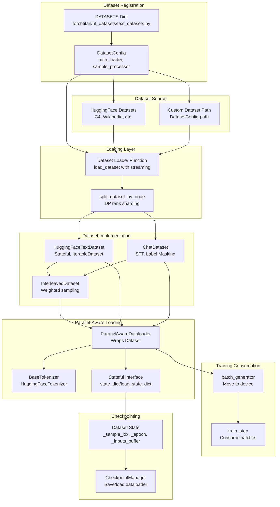
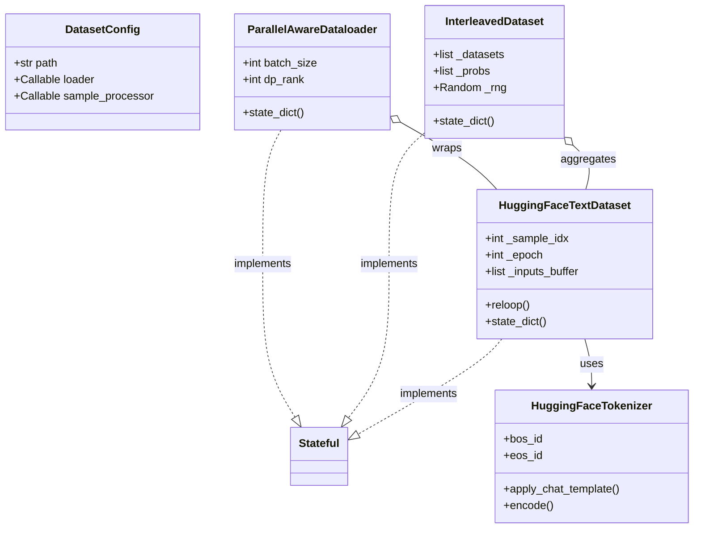

<!-- source: DeepWiki mcp.deepwiki.com · repo pytorch/torchtitan · page 7 Data Pipeline · fetched 2026-10-30 -->

# Data Pipeline

Relevant source files

The following files were used as context for generating this wiki page:

- [docs/datasets.md](docs/datasets.md)
- [tests/assets/losses/sft_debugmodel_cuda.txt](tests/assets/losses/sft_debugmodel_cuda.txt)
- [tests/assets/sft_test/data.json](tests/assets/sft_test/data.json)
- [tests/assets/tokenizer/tokenizer_config.json](tests/assets/tokenizer/tokenizer_config.json)
- [tests/unit_tests/test_chat_dataset.py](tests/unit_tests/test_chat_dataset.py)
- [tests/unit_tests/test_dataloader.py](tests/unit_tests/test_dataloader.py)
- [tests/unit_tests/test_dataset_checkpointing.py](tests/unit_tests/test_dataset_checkpointing.py)
- [tests/unit_tests/test_dataset_interleaving.py](tests/unit_tests/test_dataset_interleaving.py)
- [tests/unit_tests/test_tokenizer.py](tests/unit_tests/test_tokenizer.py)
- [torchtitan/components/tokenizer.py](torchtitan/components/tokenizer.py)
- [torchtitan/hf_datasets/__init__.py](torchtitan/hf_datasets/__init__.py)
- [torchtitan/hf_datasets/interleaved.py](torchtitan/hf_datasets/interleaved.py)
- [torchtitan/hf_datasets/text_datasets.py](torchtitan/hf_datasets/text_datasets.py)

## Purpose and Scope

This document covers TorchTitan's data loading and management systems for text, instruction-tuning (SFT), and multimodal training. It explains how datasets are configured, loaded, tokenized, distributed across data parallel ranks, and checkpointed for resumption. The pipeline is designed to be highly modular, supporting HuggingFace datasets, custom local datasets, and sophisticated multi-source interleaving.

The data pipeline integrates deeply with the checkpointing system to ensure exact resumption of data iteration after a job restart, supporting both map-style and iterable-style (streaming) datasets.

---

## Data Pipeline Architecture

**Data Pipeline Flow**: Dataset configurations are registered in the `DATASETS` dictionary [torchtitan/hf_datasets/text_datasets.py:38-54](). The loader function retrieves data (typically via HuggingFace `load_dataset`), which is sharded across DP ranks using `split_dataset_by_node` [torchtitan/hf_datasets/text_datasets.py:95](). The dataset implementations (`HuggingFaceTextDataset`, `ChatDataset`) handle tokenization and buffer management [torchtitan/hf_datasets/text_datasets.py:128-165](). `ParallelAwareDataloader` wraps these to provide batching and implements the `Stateful` interface for checkpointing [torchtitan/components/dataloader.py:11-13]().

**Sources**: [torchtitan/hf_datasets/text_datasets.py:38-165](), [torchtitan/hf_datasets/interleaved.py:27-47](), [torchtitan/components/dataloader.py:11-13]()

---

## Dataset System and Configuration

TorchTitan uses a standardized `DatasetConfig` structure [torchtitan/hf_datasets/__init__.py:14-18]() to define how datasets are fetched and processed. This registry-based approach allows for easy extension to new data sources like Wikipedia or local JSON files.

### Dataset Types
*   **Pre-training**: Plain text datasets like C4, processed via `HuggingFaceTextDataset` [torchtitan/hf_datasets/text_datasets.py:73]().
*   **Instruction-tuning (SFT)**: Chat datasets handled by `ChatDataset`, which supports prompt masking and sample packing [tests/unit_tests/test_chat_dataset.py:19-30]().
*   **Interleaved**: Multi-source configurations where datasets are sampled according to weights [torchtitan/hf_datasets/interleaved.py:27-57]().

For details on configuration and adding custom datasets, see [Dataset System and Configuration](#7.1).

**Sources**: [torchtitan/hf_datasets/__init__.py:14-18](), [docs/datasets.md:1-53](), [torchtitan/hf_datasets/text_datasets.py:38-54]()

---

## HuggingFace Dataset Integration

The pipeline is optimized for the HuggingFace `datasets` ecosystem, supporting both standard and streaming modes. Streaming is preferred for large-scale pretraining to minimize memory overhead [torchtitan/hf_datasets/text_datasets.py:27-29]().

The integration supports:
*   **Automatic Sharding**: Using `split_dataset_by_node` to ensure each DP rank sees a unique subset of data [torchtitan/hf_datasets/text_datasets.py:95]().
*   **Interleaving**: Sampling from multiple HF sources with configurable weights to create specific token mixtures [docs/datasets.md:91-112]().

For details on streaming modes and HF specific configurations, see [HuggingFace Dataset Integration](#7.2).

**Sources**: [torchtitan/hf_datasets/text_datasets.py:27-35](), [torchtitan/hf_datasets/interleaved.py:105-107](), [docs/datasets.md:158-161]()

---

## Tokenization

The tokenization system is built around the `BaseTokenizer` protocol [torchtitan/components/tokenizer.py:19](). It primarily uses `HuggingFaceTokenizer`, which handles BOS/EOS inference, special token mapping, and Jinja-based chat templates [torchtitan/components/tokenizer.py:94-111]().

Key features include:
*   **Chat Templates**: Support for rendering multi-turn conversations into formatted text using `apply_chat_template` [torchtitan/components/tokenizer.py:80-91]().
*   **Position Management**: Automatic generation of per-document positions that reset at boundaries, matching inference framework behaviors [torchtitan/hf_datasets/text_datasets.py:139-144]().

For details on tokenizer protocols and configuration, see [Tokenization](#7.3).

**Sources**: [torchtitan/components/tokenizer.py:19-111](), [torchtitan/hf_datasets/text_datasets.py:139-144]()

---

## Stateful DataLoader and Checkpointing

TorchTitan ensures exact resumption of training via stateful data iteration. Components like `HuggingFaceTextDataset` and `InterleavedDataset` implement `state_dict` and `load_state_dict` to track their progress [torchtitan/hf_datasets/text_datasets.py:188-190]().

### Checkpointing Mechanism
*   **State Tracking**: The dataset tracks `_sample_idx`, `_epoch`, and any remaining tokens in `_inputs_buffer` [torchtitan/hf_datasets/text_datasets.py:102-107]().
*   **Deterministic Shuffling**: Map-style datasets are reshuffled on re-loop using a seed derived from the epoch [torchtitan/hf_datasets/text_datasets.py:178-181]().
*   **Interleaver State**: `InterleavedDataset` snapshots the RNG state of the interleaver and the states of all child sources [torchtitan/hf_datasets/interleaved.py:136-141]().

For details on stateful iteration and checkpoint integration, see [Stateful DataLoader and Checkpointing](#7.4).

**Sources**: [torchtitan/hf_datasets/text_datasets.py:172-187](), [torchtitan/hf_datasets/interleaved.py:136-148](), [tests/unit_tests/test_dataset_checkpointing.py:35-70]()

---

## Data Pipeline Entities in Code

**Code Entity Mapping**: The training loop interacts with `ParallelAwareDataloader` [torchtitan/components/dataloader.py:11](). This dataloader wraps a `Stateful` dataset (like `HuggingFaceTextDataset` [torchtitan/hf_datasets/text_datasets.py:73]() or `InterleavedDataset` [torchtitan/hf_datasets/interleaved.py:27]()). These datasets use a `BaseTokenizer` [torchtitan/components/tokenizer.py:19]() to transform raw samples into tokens.

**Sources**: [torchtitan/hf_datasets/text_datasets.py:73-107](), [torchtitan/hf_datasets/interleaved.py:27-57](), [torchtitan/components/dataloader.py:11-13]()

---

