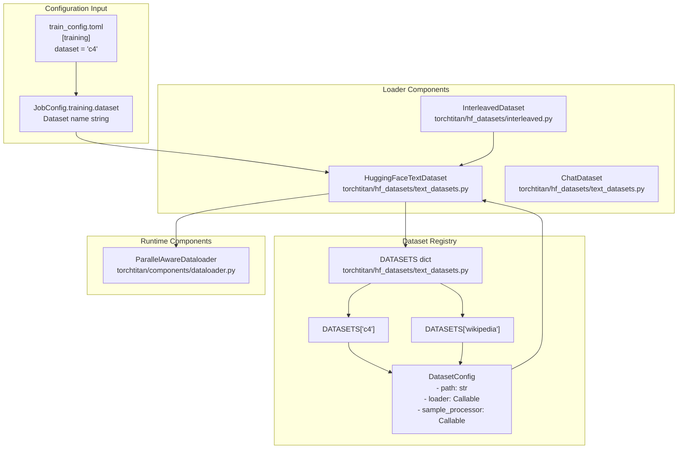
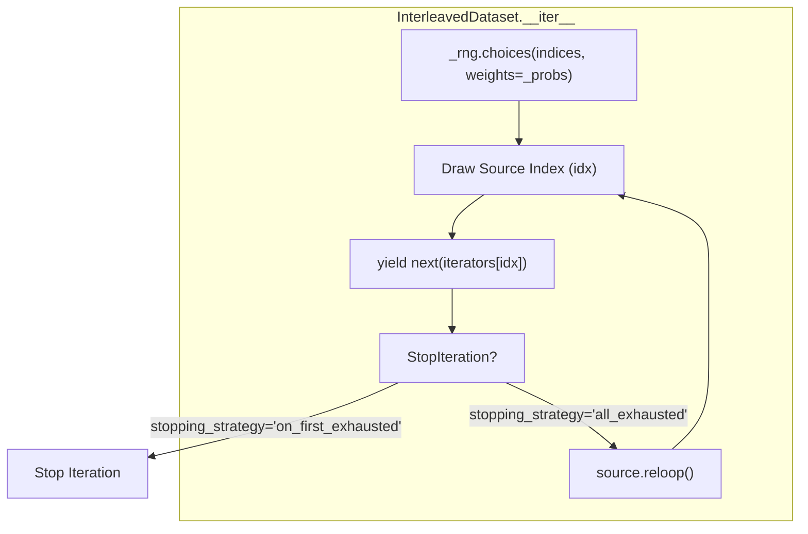

<!-- source: DeepWiki mcp.deepwiki.com · repo pytorch/torchtitan · page 7.1 Dataset System and Configuration · fetched 2026-10-30 -->

# Dataset System and Configuration

<details>
<summary>Relevant source files</summary>

The following files were used as context for generating this wiki page:

- [docs/datasets.md](docs/datasets.md)
- [tests/unit_tests/test_chat_dataset.py](tests/unit_tests/test_chat_dataset.py)
- [tests/unit_tests/test_dataloader.py](tests/unit_tests/test_dataloader.py)
- [tests/unit_tests/test_dataset_checkpointing.py](tests/unit_tests/test_dataset_checkpointing.py)
- [tests/unit_tests/test_dataset_interleaving.py](tests/unit_tests/test_dataset_interleaving.py)
- [torchtitan/hf_datasets/interleaved.py](torchtitan/hf_datasets/interleaved.py)
- [torchtitan/hf_datasets/text_datasets.py](torchtitan/hf_datasets/text_datasets.py)

</details>


## Purpose and Scope

This document describes TorchTitan's dataset configuration system, which enables registration and use of custom datasets for pre-training (plain text), instruction-tuning/SFT (chat), and multimodal (vision) tasks. The system provides a registry-based architecture where datasets are defined via `DatasetConfig` objects that specify loading functions, text processing functions, and HuggingFace dataset paths. This design makes it straightforward to add new datasets by implementing a loader function, a sample processor function, and registering them in the `DATASETS` dictionary.

The dataset system also provides stateful, distributed-aware data loading that handles data parallel distribution and checkpointing for deterministic resumption, including support for weighted interleaving of multiple data sources.

For stateful dataloader implementation and checkpoint/resume details, see page 7.4. For tokenizer configuration and implementation, see page 7.3. For HuggingFace dataset integration specifics, see page 7.2.

## Dataset Configuration System Overview

The dataset system uses a registry pattern centered around the `DATASETS` dictionary, where each entry is a `DatasetConfig` object specifying how to load and process a specific dataset.

### Configuration Flow



**Sources:** [torchtitan/hf_datasets/text_datasets.py:38-54](), [docs/datasets.md:1-10](), [torchtitan/hf_datasets/interleaved.py:27-47]()

## DatasetConfig Structure

The `DatasetConfig` class [torchtitan/hf_datasets/text_datasets.py:22-22]() is imported and used to define how to load and process a dataset. It typically contains:

| Field | Type | Description |
|-------|------|-------------|
| `path` | `str` | Default HuggingFace Hub path or local filesystem path |
| `loader` | `Callable` | Function that loads the dataset given a path |
| `sample_processor` | `Callable` | Function that extracts text or messages from a dataset sample |

### Example DatasetConfig

```python
# From torchtitan/hf_datasets/text_datasets.py:38-43
DATASETS = {
    "c4": DatasetConfig(
        path="allenai/c4",
        loader=partial(_load_c4_dataset, split="train"),
        sample_processor=_process_c4_text,
    ),
}
```

The `loader` function receives `dataset_path` and returns a HuggingFace `Dataset` or `IterableDataset` [torchtitan/hf_datasets/text_datasets.py:27-29](). The `sample_processor` function receives individual samples and extracts the content to be tokenized [torchtitan/hf_datasets/text_datasets.py:32-34]().

**Sources:** [torchtitan/hf_datasets/text_datasets.py:22-54](), [docs/datasets.md:16-53]()

## Dataset Registry (DATASETS Dictionary)

The `DATASETS` dictionary [torchtitan/hf_datasets/text_datasets.py:38-54]() serves as the global registry. Built-in datasets include:

| Dataset Name | HuggingFace Path | Split | Description |
|--------------|------------------|-------|-------------|
| `"c4"` | `"allenai/c4"` | `train` | Training split of C4 dataset |
| `"c4_validation"` | `"allenai/c4"` | `validation` | Validation split of C4 dataset |
| `"c4_test"` | `"tests/assets/c4_test"` | `train` | Local test asset for CI |

### Loader Functions

Loader functions configure how to load the dataset from HuggingFace Hub:

**`_load_c4_dataset()`** [torchtitan/hf_datasets/text_datasets.py:27-29]():
```python
def _load_c4_dataset(dataset_path: str, split: str):
    """Load C4 dataset with default configuration."""
    return load_dataset(dataset_path, name="en", split=split, streaming=True)
```

Key parameters:
- `streaming=True`: Enables streaming mode for large datasets (no full download required) [torchtitan/hf_datasets/text_datasets.py:29-29]().
- `split`: Specifies `"train"` or `"validation"` split [torchtitan/hf_datasets/text_datasets.py:27-29]().

**Sources:** [torchtitan/hf_datasets/text_datasets.py:27-54](), [docs/datasets.md:23-32]()

### Sample Processor Functions

Sample processor functions extract text from dataset-specific sample formats:

**`_process_c4_text()`** [torchtitan/hf_datasets/text_datasets.py:32-34]():
```python
def _process_c4_text(sample: dict[str, Any]) -> str:
    """Process C4 dataset sample text."""
    return sample["text"]
```

For SFT/Chat datasets, the processor returns a list of message dictionaries [docs/datasets.md:75-80]():
```python
def process_gsm8k(sample: dict) -> list[dict]:
    return [
        {"role": "user",      "content": sample["question"]},
        {"role": "assistant", "content": sample["answer"]},
    ]
```

**Sources:** [torchtitan/hf_datasets/text_datasets.py:32-34](), [docs/datasets.md:75-80]()

## Multi-source Interleaved Dataloaders

TorchTitan supports weighted interleaving of multiple datasets through `InterleavedDataset` [torchtitan/hf_datasets/interleaved.py:27-47](). This allows mixing different data sources (e.g., C4 and Wikipedia) with specific sampling weights.

### Interleaving Logic



Weights are treated as **sampling probabilities**. If source A has weight 3.0 and source B has weight 1.0, 75% of drawn samples will come from source A [docs/datasets.md:156-161]().

**Sources:** [torchtitan/hf_datasets/interleaved.py:27-135](), [docs/datasets.md:91-161]()

## Adding Custom Datasets

### Pre-training (Plain Text)
1. **Define Loader**: Create a function using `load_dataset` [docs/datasets.md:23-32]().
2. **Define Processor**: Create a function returning a string [docs/datasets.md:37-40]().
3. **Register**: Add to `DATASETS` in `torchtitan/hf_datasets/text_datasets.py` [docs/datasets.md:45-53]().

### Instruction-tuning (Chat)
Chat datasets are typically configured via `ChatDataLoader.Config` which takes a `sample_processor` that converts raw samples into `[user, assistant]` message pairs [docs/datasets.md:70-87](). The `ChatDataset` handles prompt masking (setting labels to `IGNORE_INDEX` for user prompts) and packing multiple samples into a single sequence [tests/unit_tests/test_chat_dataset.py:56-89]().

**Sources:** [docs/datasets.md:1-177](), [tests/unit_tests/test_chat_dataset.py:56-143]()

## Dataset Checkpointing and Resumption

The dataset system implements the `Stateful` protocol [torchtitan/hf_datasets/text_datasets.py:73-73]().

### State Management
- **HuggingFaceTextDataset**: Saves `_sample_idx`, `_epoch`, and token/position buffers [torchtitan/hf_datasets/text_datasets.py:102-107]().
- **InterleavedDataset**: Saves the `_rng` state and calls `state_dict()` on all underlying sources [torchtitan/hf_datasets/interleaved.py:136-141]().
- **Deterministic Resumption**: On resume, map-style datasets use `skip(self._sample_idx)` and reshuffle using `seed=42 + self._epoch` to ensure byte-identical continuations [torchtitan/hf_datasets/text_datasets.py:108-117](), [tests/unit_tests/test_dataset_checkpointing.py:71-84]().

### Position Handling
To support document boundaries in packed sequences, `HuggingFaceTextDataset` and `ChatDataset` reset positions to 0 at the start of each document [torchtitan/hf_datasets/text_datasets.py:140-146](), [tests/unit_tests/test_chat_dataset.py:173-195](). This ensures RoPE embeddings correctly reflect the distance within a single document even when multiple documents are packed into one `seq_len` window.

**Sources:** [torchtitan/hf_datasets/text_datasets.py:73-187](), [torchtitan/hf_datasets/interleaved.py:136-148](), [tests/unit_tests/test_dataset_checkpointing.py:71-138]()

---

