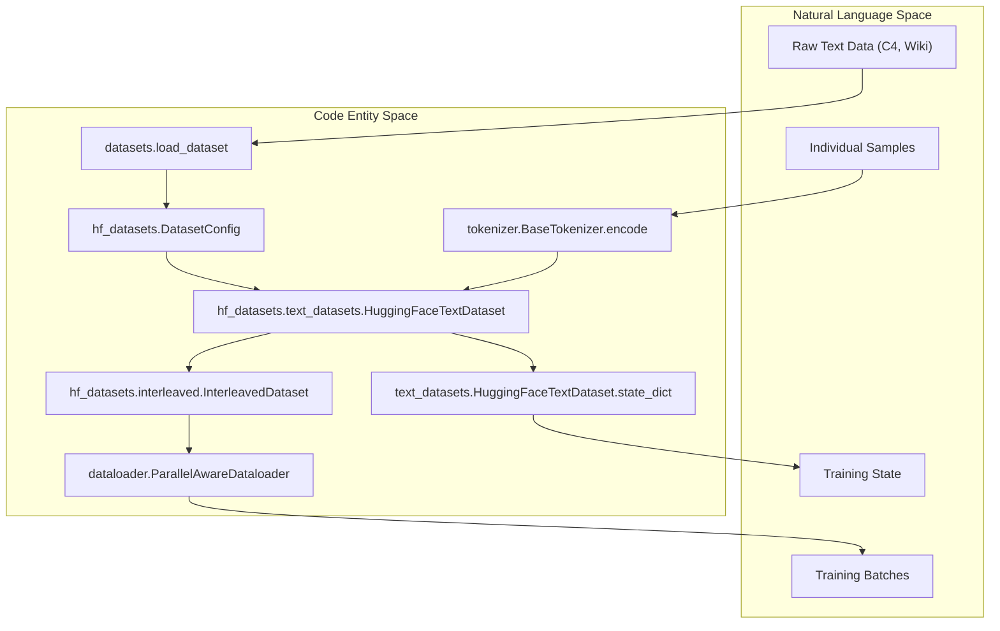
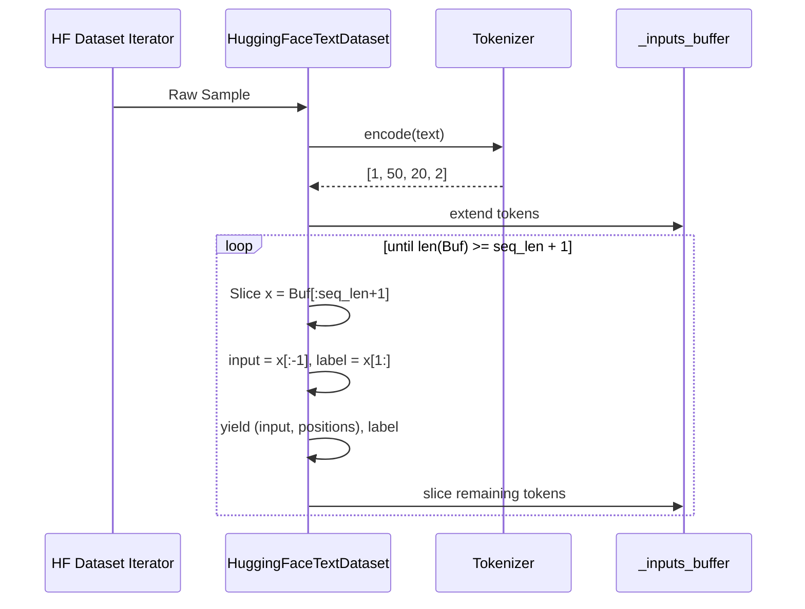

<!-- source: DeepWiki mcp.deepwiki.com · repo pytorch/torchtitan · page 7.2 HuggingFace Dataset Integration · fetched 2026-10-30 -->

# HuggingFace Dataset Integration

<details>
<summary>Relevant source files</summary>

The following files were used as context for generating this wiki page:

- [docs/datasets.md](docs/datasets.md)
- [tests/unit_tests/test_chat_dataset.py](tests/unit_tests/test_chat_dataset.py)
- [tests/unit_tests/test_dataloader.py](tests/unit_tests/test_dataloader.py)
- [tests/unit_tests/test_dataset_checkpointing.py](tests/unit_tests/test_dataset_checkpointing.py)
- [tests/unit_tests/test_dataset_interleaving.py](tests/unit_tests/test_dataset_interleaving.py)
- [torchtitan/hf_datasets/interleaved.py](torchtitan/hf_datasets/interleaved.py)
- [torchtitan/hf_datasets/text_datasets.py](torchtitan/hf_datasets/text_datasets.py)

</details>


## Purpose and Scope

This document covers the integration of HuggingFace datasets within `torchtitan`. It details the implementation of the `HuggingFaceTextDataset`, the dataset registration system, and the mechanisms for streaming, sharding, and stateful checkpointing. The system supports three primary training flavors: **pre-training** (plain text), **instruction-tuning / SFT** (chat), and **multimodal** (vision).

For the broader dataset architecture including `ParallelAwareDataloader`, see [Dataset System Architecture](7.1). For tokenization details, see [Tokenization](7.3).

## System Architecture

The integration bridges HuggingFace's data structures with PyTorch's `IterableDataset` and `Stateful` protocols.

### Code Entity Space Bridge

The following diagram maps high-level data concepts to specific classes and functions in the `torchtitan` codebase.


**Sources:** [torchtitan/hf_datasets/text_datasets.py:73-107](), [torchtitan/hf_datasets/interleaved.py:27-47](), [torchtitan/components/dataloader.py:11-19]()

## Dataset Registration System

Datasets are registered in a central `DATASETS` dictionary within `torchtitan/hf_datasets/text_datasets.py`. Each entry uses a `DatasetConfig` dataclass.

| Field | Type | Description |
|:---|:---|:---|
| `path` | `str` | The HuggingFace Hub path or local path. |
| `loader` | `Callable` | Function to invoke `load_dataset`. |
| `sample_processor` | `Callable` | Logic to extract strings from the raw HF sample dict. |

### Implementation Details
The `DATASETS` registry includes configurations for pretraining (C4) and validation variants.

```python
DATASETS = {
    "c4": DatasetConfig(
        path="allenai/c4",
        loader=partial(_load_c4_dataset, split="train"),
        sample_processor=_process_c4_text,
    ),
    # ... other datasets
}
```
**Sources:** [torchtitan/hf_datasets/text_datasets.py:38-54](), [docs/datasets.md:45-53]()

## HuggingFaceTextDataset Implementation

The `HuggingFaceTextDataset` class [torchtitan/hf_datasets/text_datasets.py:73-107]() is the core engine for streaming text data. It inherits from `torch.utils.data.IterableDataset` and implements `torch.distributed.checkpoint.stateful.Stateful`.

### Data Flow and Tokenization
The dataset processes samples through a greedy packing mechanism:
1. **Loading**: Invokes the registered `loader`.
2. **Sharding**: Uses `split_dataset_by_node` to shard data across `dp_rank` [torchtitan/hf_datasets/text_datasets.py:95]().
3. **Encoding**: Calls `tokenizer.encode` with `add_bos=True` and `add_eos=True` [torchtitan/hf_datasets/text_datasets.py:135-137]().
4. **Buffering**: Tokens are added to `_inputs_buffer`.
5. **Yielding**: When the buffer exceeds `seq_len + 1`, it yields a windowed slice where `input = x[:-1]` and `label = x[1:]` [torchtitan/hf_datasets/text_datasets.py:149-165]().

### Position Management
To support long-context models and RoPE-based attention, the dataset maintains a `_positions_buffer`. Positions reset to `0` at document boundaries but wrap at `seq_len` to ensure they stay within the RoPE cache limits [torchtitan/hf_datasets/text_datasets.py:146-155]().


**Sources:** [torchtitan/hf_datasets/text_datasets.py:128-165]()

## Multi-Source Interleaving

`torchtitan` supports interleaving multiple datasets using `InterleavedDataset` [torchtitan/hf_datasets/interleaved.py:27]().

- **Weights**: Sampling probabilities (normalized internally) determine the likelihood of drawing from a source at each step [torchtitan/hf_datasets/interleaved.py:105]().
- **Stopping Strategies**: 
    - `on_first_exhausted`: Stops when any source is empty, defining an epoch boundary [torchtitan/hf_datasets/interleaved.py:126]().
    - `all_exhausted`: Re-loops exhausted sources via `reloop()` until every source has been exhausted at least once [torchtitan/hf_datasets/interleaved.py:133]().
- **Determinism**: Uses a seeded `random.Random` instance to ensure byte-identical continuations across checkpoints [torchtitan/hf_datasets/interleaved.py:106, 139]().

**Sources:** [torchtitan/hf_datasets/interleaved.py:27-148](), [docs/datasets.md:91-161]()

## Stateful Checkpointing

Resumption is handled by storing the internal buffers and the underlying iterator state.

### State Dictionary Structure
The `state_dict` includes:
- `inputs_buffer`: Unprocessed tokens from the current document.
- `positions_buffer`: Corresponding RoPE positions.
- `sample_idx`: For map-style datasets, the index to skip to.
- `epoch`: Tracks the current epoch for deterministic re-shuffling [torchtitan/hf_datasets/text_datasets.py:188-197]().

### Resumption Logic
When `load_state_dict` is called:
1. Buffers are restored.
2. If the dataset is map-style, `_get_data_iter` uses `.skip(self._sample_idx)` [torchtitan/hf_datasets/text_datasets.py:115]().
3. Map-style datasets are re-shuffled using a seed based on the restored `epoch` to ensure consistency [torchtitan/hf_datasets/text_datasets.py:180]().

**Sources:** [torchtitan/hf_datasets/text_datasets.py:103-117](), [torchtitan/hf_datasets/text_datasets.py:188-212](), [tests/unit_tests/test_dataset_checkpointing.py:71-125]()

## Supervised Fine-Tuning (SFT) Integration

For SFT, `torchtitan` provides the `ChatDataset` class. Unlike pre-training datasets, `ChatDataset` applies label masking to ensure the model only learns to predict assistant responses.

### Label Masking
The `ChatDataset` uses a `sample_processor` to convert data into `[user, assistant]` message lists. It then:
1. Renders the full conversation via `tokenizer.apply_chat_template`.
2. Masks all tokens in the `labels` tensor that correspond to the prompt using `IGNORE_INDEX` [tests/unit_tests/test_chat_dataset.py:56-88]().

### Packing and Positions
Similar to the text dataset, `ChatDataset` supports greedy packing of multiple short conversations into a single `seq_len`. It ensures `positions` reset to `0` at the start of every new conversation in the packed sequence [tests/unit_tests/test_chat_dataset.py:173-195]().

**Sources:** [tests/unit_tests/test_chat_dataset.py:18-23](), [docs/datasets.md:66-87]()

## Configuration and Usage

Datasets are typically configured via the `JobConfig` or model-specific registries.

### Example: Interleaved Pre-training
```python
dataloader=InterleavedHuggingFaceTextDataLoader.Config(
    sources=[
        HFDataSource(dataset="c4",         weight=7.0, infinite=True),
        HFDataSource(dataset="wikipedia",  weight=2.0, infinite=True),
    ],
    seed=42,
)
```
**Sources:** [docs/datasets.md:97-113](), [tests/unit_tests/test_dataloader.py:188-198]()

### Custom Dataset Setup
Users can add custom datasets by following the pattern in `docs/datasets.md`:
1. Define a loader using `datasets.load_dataset(..., streaming=True)`.
2. Define a processor to return a string.
3. Register in `DATASETS` [docs/datasets.md:16-53]().

**Sources:** [docs/datasets.md:1-53]()

---

