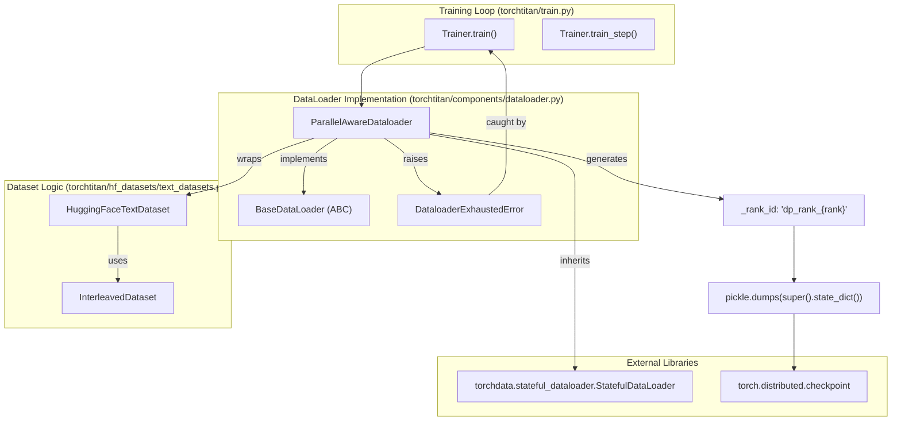
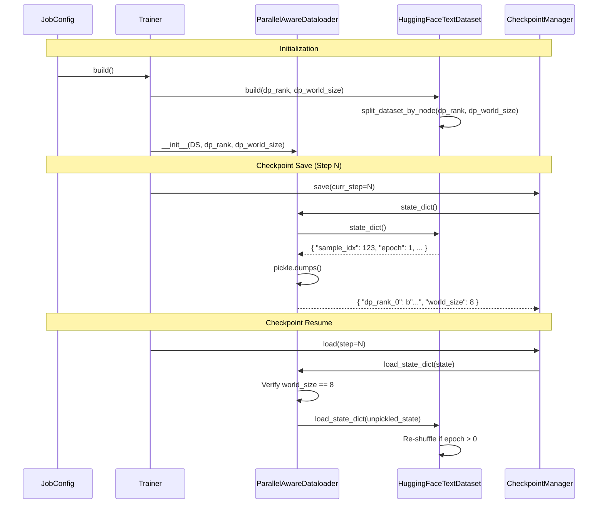

<!-- source: DeepWiki mcp.deepwiki.com · repo pytorch/torchtitan · page 7.4 Stateful DataLoader and Checkpointing · fetched 2026-10-30 -->

# Stateful DataLoader and Checkpointing

Relevant source files

The following files were used as context for generating this wiki page:

- [docs/datasets.md](docs/datasets.md)
- [tests/unit_tests/test_chat_dataset.py](tests/unit_tests/test_chat_dataset.py)
- [tests/unit_tests/test_dataloader.py](tests/unit_tests/test_dataloader.py)
- [tests/unit_tests/test_dataset_checkpointing.py](tests/unit_tests/test_dataset_checkpointing.py)
- [tests/unit_tests/test_dataset_interleaving.py](tests/unit_tests/test_dataset_interleaving.py)
- [tests/unit_tests/test_set_determinism.py](tests/unit_tests/test_set_determinism.py)
- [torchtitan/components/dataloader.py](torchtitan/components/dataloader.py)
- [torchtitan/components/metrics.py](torchtitan/components/metrics.py)
- [torchtitan/distributed/utils.py](torchtitan/distributed/utils.py)
- [torchtitan/hf_datasets/interleaved.py](torchtitan/hf_datasets/interleaved.py)
- [torchtitan/hf_datasets/text_datasets.py](torchtitan/hf_datasets/text_datasets.py)
- [torchtitan/tools/utils.py](torchtitan/tools/utils.py)
- [torchtitan/train.py](torchtitan/train.py)

## Purpose and Scope

This document describes torchtitan's stateful dataloader implementation, which enables precise checkpoint/resume of data iteration state during training. This capability ensures that training can be interrupted and resumed without data duplication or loss, which is critical for fault tolerance and reproducible training runs.

This page covers the `ParallelAwareDataloader` class, its integration with `torchdata.stateful_dataloader`, the `dp_rank`-based state tracking mechanism, and the distributed data flow. For general checkpoint management architecture, see [Checkpoint Management](). For fault tolerance integration, see [Fault Tolerance Integration](). For dataset configuration and registration, see [Dataset System and Configuration]().

---

## Stateful DataLoader Concept

A **stateful dataloader** maintains internal state that tracks its position in the dataset. When checkpointed, this state can be serialized and later restored to resume iteration from the exact same position. This prevents the following issues during training interruption:

| Issue | Impact Without Stateful Dataloader | With Stateful Dataloader |
|-------|-----------------------------------|--------------------------|
| **Data Duplication** | Re-processing samples already seen | Exact resumption from checkpoint position |
| **Incorrect Step Count** | Mismatch between optimizer step and data samples | Synchronized step and sample counts |
| **Loss Spikes** | Re-seeing same data causes loss curve artifacts | Smooth loss curve across restarts |
| **Convergence Issues** | Repeated samples affect model convergence | Proper data ordering maintained |

torchtitan implements this via the `ParallelAwareDataloader` class [torchtitan/components/dataloader.py:55-69](), which inherits from `torchdata.stateful_dataloader.StatefulDataLoader`.

**Sources:** [torchtitan/components/dataloader.py:55-69](), [torchtitan/components/dataloader.py:11-20]()

---

## DataLoader Architecture and Entity Mapping

The following diagrams map the conceptual data flow to the specific code entities responsible for stateful loading and distributed sharding.

**Diagram: Code Entity Mapping for Stateful Loading**

The `ParallelAwareDataloader` acts as the primary interface, wrapping the `StatefulDataLoader` from `torchdata` to provide distributed-aware state management [torchtitan/components/dataloader.py:55-104](). The underlying `HuggingFaceTextDataset` also implements the `Stateful` protocol to track its own buffers and sample indices [torchtitan/hf_datasets/text_datasets.py:73-74]().

**Sources:** [torchtitan/components/dataloader.py:38-69](), [torchtitan/components/dataloader.py:140-148](), [torchtitan/train.py:51-65](), [torchtitan/hf_datasets/text_datasets.py:73-74]()

---

## Implementation Details

### ParallelAwareDataloader

The `ParallelAwareDataloader` is designed to handle data loading across multiple data-parallel (DP) ranks. It ensures that each rank only saves and loads its own specific state to avoid redundancy in the global checkpoint.

#### Key Functions:
- **`__init__`**: Initializes the dataloader with `dp_rank` and `dp_world_size`, setting up a unique `_rank_id` (e.g., `"dp_rank_0"`) [torchtitan/components/dataloader.py:91-104]().
- **`state_dict()`**: Captures the state of the underlying `StatefulDataLoader`. It pickles this state and stores it under the rank-specific key to ensure backward compatibility and avoid state replication across non-DP dimensions [torchtitan/components/dataloader.py:140-147]().
- **`load_state_dict()`**: Restores state using the rank-specific key. It performs a safety check to ensure `dp_world_size` is consistent between the checkpoint and the current run, as resharding is not currently supported [torchtitan/components/dataloader.py:149-168]().

### Dataset State Tracking
Individual datasets like `HuggingFaceTextDataset` maintain their own state, including `_sample_idx`, `_epoch`, and token buffers (`_inputs_buffer`, `_positions_buffer`) [torchtitan/hf_datasets/text_datasets.py:102-107](). This allows the dataset to resume exactly where it left off, even within a packed sequence.

### Exception Handling
torchtitan defines `DataloaderExhaustedError` [torchtitan/components/dataloader.py:32-35](). This custom exception inherits from `Exception` (not `StopIteration`) to avoid being wrapped in a `RuntimeError` by Python's generator handling (PEP 479), allowing the training loop to catch it cleanly [torchtitan/components/dataloader.py:25-31]().

**Sources:** [torchtitan/components/dataloader.py:25-35](), [torchtitan/components/dataloader.py:102-104](), [torchtitan/components/dataloader.py:140-168](), [torchtitan/hf_datasets/text_datasets.py:102-107]()

---

## Distributed Data Flow and Sharding

**Diagram: Distributed State Flow**

The dataloader's state is strictly tied to the `dp_rank`. During a save operation, the `ParallelAwareDataloader` encapsulates the internal iterator and dataset state into a dictionary keyed by the rank ID [torchtitan/components/dataloader.py:140-148](). Sharding is handled at the dataset level using `split_dataset_by_node` [torchtitan/hf_datasets/text_datasets.py:95]().

**Sources:** [torchtitan/components/dataloader.py:140-168](), [torchtitan/train.py:51-65](), [torchtitan/hf_datasets/text_datasets.py:95](), [torchtitan/hf_datasets/text_datasets.py:188-195]()

---

## Interleaved Datasets and Re-looping

torchtitan supports weighted interleaving of multiple datasets via `InterleavedDataset` [torchtitan/hf_datasets/interleaved.py:27-47]().

### Interleaving Mechanics
- **Weights**: sampling probabilities are normalized internally to control the relative likelihood of drawing from each source [torchtitan/hf_datasets/interleaved.py:105-106]().
- **Stopping Strategy**: Supports `on_first_exhausted` or `all_exhausted`. The latter uses a `reloop()` method to reset and reshuffle exhausted sources until all have finished [torchtitan/hf_datasets/interleaved.py:124-135]().
- **Statefulness**: The `InterleavedDataset` saves the interleaver RNG state and the `state_dict` of every underlying source [torchtitan/hf_datasets/interleaved.py:136-142]().

### Map-style Shuffling
For map-style datasets, re-looping triggers a deterministic re-shuffle using the current epoch as part of the seed [torchtitan/hf_datasets/text_datasets.py:172-181](). This ensures that the model sees a different sample order in each epoch while remaining reproducible across restarts [tests/unit_tests/test_dataset_checkpointing.py:71-84]().

**Sources:** [torchtitan/hf_datasets/interleaved.py:27-148](), [torchtitan/hf_datasets/text_datasets.py:172-181](), [tests/unit_tests/test_dataset_checkpointing.py:71-84]()

---

## Checkpoint/Resume Validation

The system is validated through unit tests that simulate training interruptions and verify bitwise identical output.

### Validation Logic
The test suite in `test_dataset_checkpointing.py` verifies resumption:
1. Initialize a dataloader for a specific `dp_rank` [tests/unit_tests/test_dataset_checkpointing.py:42-44]().
2. Iterate for 2050 steps to trigger re-looping and capture `state_dict()` [tests/unit_tests/test_dataset_checkpointing.py:47-50]().
3. Create a fresh dataloader and call `load_state_dict(state)` [tests/unit_tests/test_dataset_checkpointing.py:53-56]().
4. Compare the next 500 samples between the original and resumed iterators to ensure `input`, `positions`, and `labels` match exactly [tests/unit_tests/test_dataset_checkpointing.py:59-69]().

### Seed Checkpoints
The system also supports creating "seed" checkpoints. If `config.checkpoint.create_seed_checkpoint` is enabled, the trainer saves a checkpoint at step 0 and exits [torchtitan/train.py:53-63](). This is restricted to single-device runs to ensure the checkpoint is unsharded and can be used as a base for future distributed runs [torchtitan/train.py:56-58]().

**Sources:** [tests/unit_tests/test_dataset_checkpointing.py:35-70](), [torchtitan/train.py:53-63]()

---

## Configuration and Usage

The dataloader is configured via the `ParallelAwareDataloader.Config` dataclass [torchtitan/components/dataloader.py:71-86]().

### Key Configuration Parameters:
| Parameter | Description | Constraint |
|-----------|-------------|------------|
| `num_workers` | Number of subprocesses for data loading | Defaults to 0 [torchtitan/components/dataloader.py:73-74]() |
| `persistent_workers` | Keep workers alive between epochs | Requires `num_workers > 0` [torchtitan/components/dataloader.py:76-77]() |
| `pin_memory` | Copy tensors to CUDA pinned memory | [torchtitan/components/dataloader.py:79-80]() |
| `prefetch_factor` | Batches loaded in advance per worker | Requires `num_workers > 0` [torchtitan/components/dataloader.py:82-86]() |

The `_validate_kwargs` method ensures that incompatible arguments (like `persistent_workers` when `num_workers=0`) are sanitized before being passed to the underlying `StatefulDataLoader` [torchtitan/components/dataloader.py:107-139]().

**Sources:** [torchtitan/components/dataloader.py:71-86](), [torchtitan/components/dataloader.py:107-139]()

---

