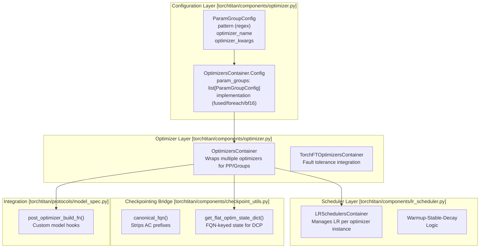
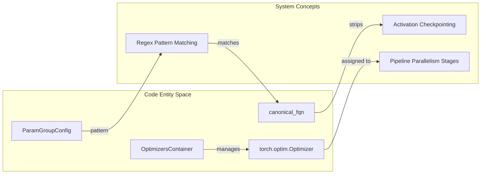

<!-- source: DeepWiki mcp.deepwiki.com · repo pytorch/torchtitan · page 8 Optimization Components · fetched 2026-10-30 -->

# Optimization Components

Relevant source files

The following files were used as context for generating this wiki page:

- [scripts/checkpoint_compat_test.py](scripts/checkpoint_compat_test.py)
- [tests/unit_tests/test_lr_scheduler.py](tests/unit_tests/test_lr_scheduler.py)
- [tests/unit_tests/test_optimizer_param_groups.py](tests/unit_tests/test_optimizer_param_groups.py)
- [tests/unit_tests/test_state_dict_keys.py](tests/unit_tests/test_state_dict_keys.py)
- [tests/unit_tests/test_train_spec.py](tests/unit_tests/test_train_spec.py)
- [torchtitan/components/checkpoint_utils.py](torchtitan/components/checkpoint_utils.py)
- [torchtitan/components/lr_scheduler.py](torchtitan/components/lr_scheduler.py)
- [torchtitan/components/optimizer.py](torchtitan/components/optimizer.py)
- [torchtitan/experiments/torchft/optimizer.py](torchtitan/experiments/torchft/optimizer.py)
- [torchtitan/overrides/fused_swiglu.py](torchtitan/overrides/fused_swiglu.py)

## Purpose and Scope

This page provides an overview of TorchTitan's optimization infrastructure, which manages optimizers, learning rate schedulers, and gradient operations during training. The optimization components are designed to support multi-dimensional parallelism, particularly handling the complexity of Pipeline Parallelism (PP) where each model stage requires its own optimizer instance, and Expert Parallelism (EP) where specialized gradient handling is required for MoE layers.

The system emphasizes a "container" approach, wrapping standard PyTorch primitives into distributed-aware collections that simplify the main training loop.

For detailed information on:
- **Optimizers Container and Management**: See [Optimizers Container and Management](#8.1)
- **Learning Rate Schedulers**: See [Learning Rate Schedulers](#8.2)
- **Gradient Management**: See [Gradient Management](#8.3)
- **The Training Loop**: See [Training Loop Execution](#3.2)

## System Architecture

The optimization system consists of three main subsystems: optimizer containers that manage one or more optimizer instances, learning rate schedulers that control learning rate decay, and gradient management utilities that handle clipping and accumulation across distributed meshes.

**Architecture of Optimization Components**

Sources: [torchtitan/components/optimizer.py:39-100](), [torchtitan/components/lr_scheduler.py:25-51](), [torchtitan/components/checkpoint_utils.py:7-24](), [torchtitan/protocols/model_spec.py:15-25]()

## Core Abstractions

### OptimizersContainer
The `OptimizersContainer` class wraps multiple PyTorch optimizer instances into a single interface that mimics `torch.optim.Optimizer` [torchtitan/components/optimizer.py:72-83](). It supports mixed optimizer types and parameter grouping via regex patterns [torchtitan/components/optimizer.py:39-55]().

**Entity Association: Config to Optimizer**

| Component | Purpose | Key File |
|-----------|---------|----------|
| `OptimizersContainer` | Base container for multiple optimizers and param groups | [torchtitan/components/optimizer.py:72-122]() |
| `ParamGroupConfig` | Configuration for a parameter group with its own optimizer | [torchtitan/components/optimizer.py:39-68]() |
| `TorchFTOptimizersContainer` | Fault tolerance integration via TorchFT | [torchtitan/experiments/torchft/optimizer.py:26-38]() |
| `canonical_fqn` | Strips `_checkpoint_wrapped_module` from parameter names | [torchtitan/components/checkpoint_utils.py:43-51]() |

### LRSchedulersContainer
Learning rate schedulers are managed by `LRSchedulersContainer`, which wraps one scheduler per optimizer instance [torchtitan/components/lr_scheduler.py:25-48](). It implements advanced scheduling logic including **Warmup-Stable-Decay (WSD)** [torchtitan/components/lr_scheduler.py:130-153]().

**Key Configuration Parameters**:
- `warmup_steps`: Steps for initial LR ramp-up [torchtitan/components/lr_scheduler.py:52-55]().
- `decay_ratio`: Proportion of steps for the decay phase (WSD) [torchtitan/components/lr_scheduler.py:65-72]().
- `decay_type`: Choice of `linear`, `sqrt`, or `cosine` [torchtitan/components/lr_scheduler.py:74-80]().
- `min_lr_factor`: Floor for LR decay [torchtitan/components/lr_scheduler.py:82-87]().
- `total_steps`: Decouples LR schedule from actual training steps for debugging [torchtitan/components/lr_scheduler.py:57-63]().

Sources: [torchtitan/components/optimizer.py:72-122](), [torchtitan/components/lr_scheduler.py:25-153](), [torchtitan/components/checkpoint_utils.py:43-51]()

## Training and Checkpoint Integration

### Optimizer State Materialization
Optimizers create state lazily on the first `step()`. TorchTitan provides `init_optim_state` to materialize these tensors (e.g., Adam's `exp_avg`) before saving or loading checkpoints [torchtitan/components/checkpoint_utils.py:53-63](). This is done by running a zero-gradient, zero-LR step [torchtitan/components/checkpoint_utils.py:88-92]().

### Checkpoint Compatibility
The `get_flat_optim_state_dict` utility converts integer-indexed optimizer states into FQN-keyed states [torchtitan/components/checkpoint_utils.py:95-114](). This ensures that checkpoints remain compatible even if the number of pipeline stages or the model sharding changes [torchtitan/components/checkpoint_utils.py:130-143]().

### Expert Parallelism (EP) and MoE
For Mixture-of-Experts (MoE), TorchTitan provides specialized optimization hooks:
- **Load Balancing**: `register_moe_load_balancing_hook` allows models to register custom logic for updating expert routing parameters [torchtitan/components/optimizer.py:34-35]().
- **Post-Build Hooks**: The `ModelSpec` protocol allows models to define a `post_optimizer_build_fn` to register step hooks (e.g., for gradient scaling or custom MoE updates) [tests/unit_tests/test_train_spec.py:45-56]().

Sources: [torchtitan/components/checkpoint_utils.py:53-114](), [torchtitan/components/optimizer.py:34-35](), [tests/unit_tests/test_train_spec.py:45-131]()

---

