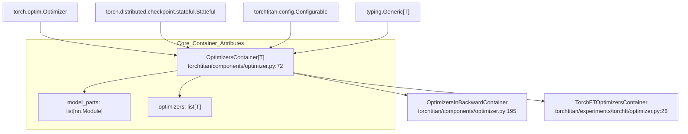
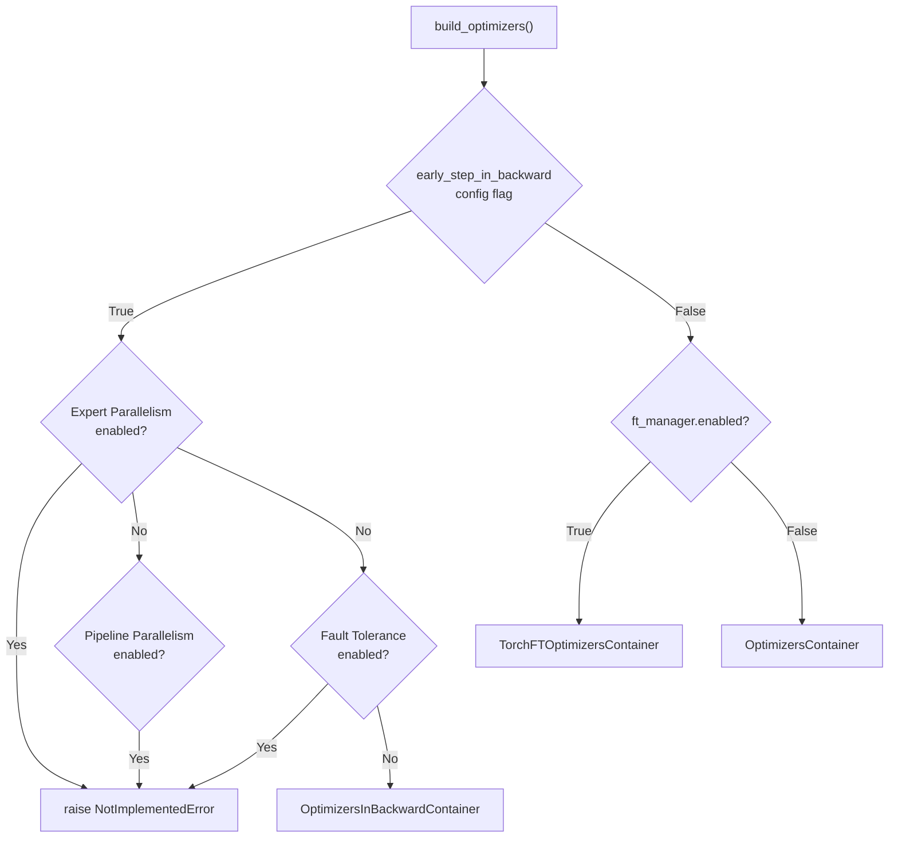
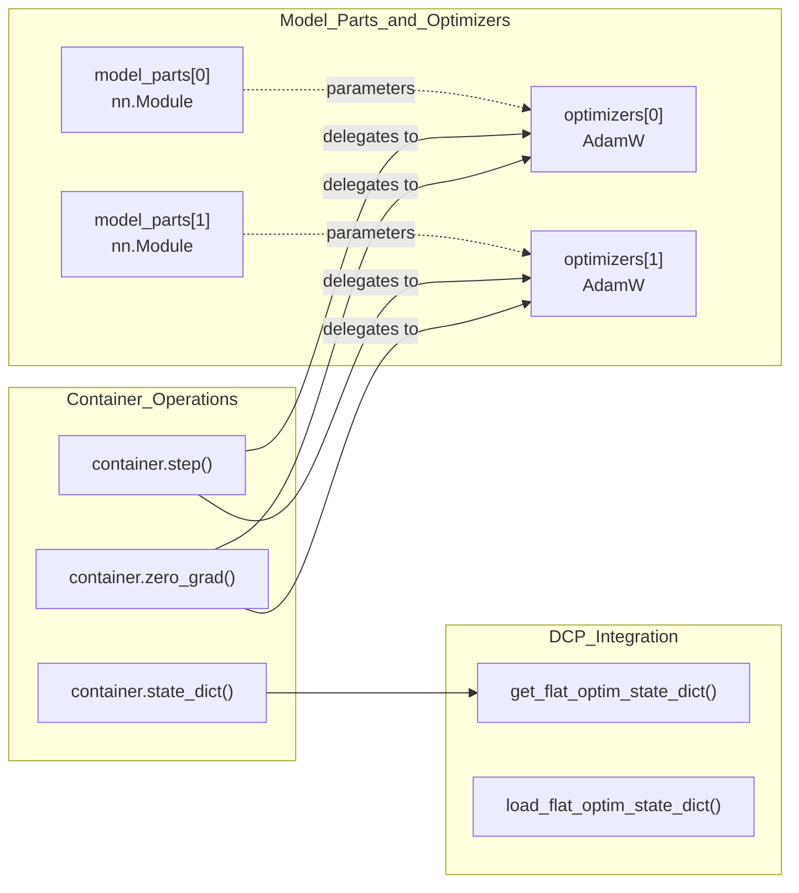

<!-- source: DeepWiki mcp.deepwiki.com · repo pytorch/torchtitan · page 8.1 Optimizers Container and Management · fetched 2026-10-30 -->

# Optimizers Container and Management

Relevant source files

The following files were used as context for generating this wiki page:

- [scripts/checkpoint_compat_test.py](scripts/checkpoint_compat_test.py)
- [tests/unit_tests/test_lr_scheduler.py](tests/unit_tests/test_lr_scheduler.py)
- [tests/unit_tests/test_optimizer_param_groups.py](tests/unit_tests/test_optimizer_param_groups.py)
- [tests/unit_tests/test_state_dict_keys.py](tests/unit_tests/test_state_dict_keys.py)
- [tests/unit_tests/test_train_spec.py](tests/unit_tests/test_train_spec.py)
- [torchtitan/components/checkpoint_utils.py](torchtitan/components/checkpoint_utils.py)
- [torchtitan/components/lr_scheduler.py](torchtitan/components/lr_scheduler.py)
- [torchtitan/components/optimizer.py](torchtitan/components/optimizer.py)
- [torchtitan/experiments/torchft/optimizer.py](torchtitan/experiments/torchft/optimizer.py)
- [torchtitan/overrides/fused_swiglu.py](torchtitan/overrides/fused_swiglu.py)

This document covers TorchTitan's optimizer container system, which manages multiple optimizers across distributed model parts. The container architecture provides a unified interface for standard optimization, optimizer-in-backward execution, and fault-tolerant training. For learning rate scheduling, see page 8.2. For optimizer configuration details, see [Configuration System](2.1). For distributed training strategies that necessitate this container system, see [Parallelization Strategies](4).

## Overview and Architecture

TorchTitan uses an optimizer container system to manage multiple optimizers across distributed model parts. This architecture is necessary because:

1.  **Pipeline Parallelism**: When using pipeline parallelism, the model is split into multiple `model_parts`, each requiring its own optimizer instance [torchtitan/components/optimizer.py:81-82]().
2.  **Unified Interface**: The container provides a single `Optimizer`-compatible interface regardless of how many underlying optimizers exist [torchtitan/components/optimizer.py:75-76]().
3.  **Distributed Checkpointing**: The container implements `Stateful` for distributed checkpoint operations with automatic resharding support [torchtitan/components/optimizer.py:72-72]().
4.  **Advanced Execution Modes**: Specialized containers support optimizer-in-backward and fault-tolerant training [torchtitan/components/optimizer.py:195-202](), [torchtitan/experiments/torchft/optimizer.py:26-31]().

### Container Class Hierarchy

**Diagram: OptimizersContainer Class Hierarchy**

**Sources:** [torchtitan/components/optimizer.py:72-195](), [torchtitan/experiments/torchft/optimizer.py:26-31]()

### Container Selection Logic

The `build_optimizers` function in `torchtitan/components/optimizer.py` selects the appropriate container based on configuration and runtime requirements:

**Diagram: Container Selection Decision Tree**

**Sources:** [torchtitan/components/optimizer.py:353-413]()

## OptimizersContainer: Core Implementation

The `OptimizersContainer` class is a generic container that wraps multiple optimizer instances. It supports mixed optimizer types and parameter grouping via regex patterns [torchtitan/components/optimizer.py:73-79]().

### Key Responsibilities

1.  **Multi-Optimizer Orchestration**: Delegates `step()` and `zero_grad()` calls to all wrapped optimizers [torchtitan/components/optimizer.py:281-287]().
2.  **Distributed State Management**: Uses `get_flat_optim_state_dict` and `load_flat_optim_state_dict` for resharding-aware checkpointing [torchtitan/components/optimizer.py:289-306]().
3.  **Iterator Protocol**: Implements `__iter__` to allow iteration over individual optimizers [torchtitan/components/optimizer.py:274-275]().
4.  **Parameter Grouping**: Maps parameters to specific optimizers using `ParamGroupConfig` patterns [torchtitan/components/optimizer.py:149-166]().

### Implementation Pattern

The container uses `_build_param_groups` to partition model parameters by their matching regex patterns and optimizer types [torchtitan/components/optimizer.py:149-166](). Parameters are assigned to the first matching pattern [torchtitan/components/optimizer.py:169-169]().

**Diagram: OptimizersContainer State Management**

**Sources:** [torchtitan/components/optimizer.py:72-306](), [torchtitan/components/checkpoint_utils.py:95-128]()

### DCP State Dictionary Operations

The container uses custom utilities for optimizer state management:

*   `get_flat_optim_state_dict(optimizer)` - Converts native state dict to a flat, FQN-keyed dict for DCP [torchtitan/components/checkpoint_utils.py:95-114]().
*   `load_flat_optim_state_dict(optimizer, flat_sd)` - Loads a flat FQN-keyed dict back into the optimizer [torchtitan/components/checkpoint_utils.py:117-128]().
*   `init_optim_state(optimizer)` - Materializes lazy optimizer state (e.g., Adam momentum) before save/load [torchtitan/components/checkpoint_utils.py:53-93]().

**Sources:** [torchtitan/components/checkpoint_utils.py:53-128]()

## OptimizersInBackwardContainer: Optimizer-in-Backward Mode

The `OptimizersInBackwardContainer` enables optimizer steps to execute during the backward pass via hooks. This reduces peak memory usage by eliminating the need to store full gradients [torchtitan/components/optimizer.py:196-202]().

### Execution Model

Instead of the standard post-backward step, this container registers a `post_accumulate_grad_hook` on every parameter.

**Diagram: Optimizer-in-Backward Hook Registration**

```mermaid
graph TB
    subgraph "Initialization_Phase"
        Init["OptimizersInBackwardContainer.__init__()"]
        CreateOptims["Create one optimizer per parameter<br/>optim_dict[param] = optimizer_cls([param], **kwargs)"]
        DefineHook["Define optim_hook(param)<br/>optim_dict[param].step()<br/>optim_dict[param].zero_grad()"]
        RegisterHook["param.register_post_accumulate_grad_hook(optim_hook)"]
        
        Init --> CreateOptims
        CreateOptims --> DefineHook
        DefineHook --> RegisterHook
    end
    
    subgraph "Backward_Execution"
        Backward["loss.backward()"]
        GradAccumulated["Gradient for param accumulated"]
        TriggerHook["Post-accumulate hook fired"]
        OptimStep["optim_dict[param].step()"]
        OptimZero["optim_dict[param].zero_grad()"]
        
        Backward --> GradAccumulated
        GradAccumulated --> TriggerHook
        TriggerHook --> OptimStep
        OptimStep --> OptimZero
    end
    
    subgraph "Training_Loop_API"
        LoopStep["optimizer_container.step()"]
        LoopZero["optimizer_container.zero_grad()"]
        NoOp["No-op (work done in backward)"]
        
        LoopStep --> NoOp
        LoopZero --> NoOp
    end
```

**Sources:** [torchtitan/components/optimizer.py:195-265]()

### Implementation Details

1.  **Per-Parameter Optimizers**: Creates one optimizer instance per parameter to allow fine-grained hook execution [torchtitan/components/optimizer.py:220-223]().
2.  **Hook Registration**: Uses `register_post_accumulate_grad_hook` to trigger optimizer step when gradient is ready [torchtitan/components/optimizer.py:226-230]().
3.  **No-Op Public Methods**: `step()` and `zero_grad()` are no-ops since work happens in backward hooks [torchtitan/components/optimizer.py:232-238]().

### Compatibility Constraints

Optimizer-in-backward mode has several limitations enforced by `build_optimizers` [torchtitan/components/optimizer.py:353-382]():

| Feature | Compatible | Reason |
| :--- | :--- | :--- |
| Standard DP/TP/FSDP | ✅ Yes | Hook-based execution works with these parallelisms |
| Pipeline Parallelism (PP) | ❌ No | PP schedules require explicit optimizer control between microbatches |
| Expert Parallelism (EP) | ❌ No | EP requires coordinated gradient scaling across experts |
| Fault Tolerance (FT) | ❌ No | TorchFT requires explicit optimizer quorum points |

**Sources:** [torchtitan/components/optimizer.py:353-382]()

## TorchFTOptimizersContainer: Fault Tolerance Integration

The `TorchFTOptimizersContainer` wraps the standard container to integrate with `torchft` for fault-tolerant training [torchtitan/experiments/torchft/optimizer.py:26-31]().

### TorchFT Integration Points

**Diagram: TorchFTOptimizersContainer Coordination**

```mermaid
graph TB
    subgraph "Container_Initialization"
        Init["TorchFTOptimizersContainer.__init__()"]
        SuperInit["OptimizersContainer.__init__()"]
        ForceState["Force optimizer state initialization<br/>init_optim_state(optim)"]
        CreateFTOptim["self._ft_optimizer = torchft.Optimizer(ft_manager, self)"]
        
        Init --> SuperInit
        SuperInit --> ForceState
        ForceState --> CreateFTOptim
    end
    
    subgraph "Cached_State_Management"
        InitCache["init_cache_state_dict()"]
        CacheSD["cache_state_dict = super().state_dict()"]
        GetSD["state_dict()"]
        ReturnCache["return cache_state_dict"]
        
        InitCache --> CacheSD
        GetSD --> ReturnCache
    end
    
    subgraph "Quorum_Coordination"
        CallStep["optimizer.step()"]
        CheckFlag{"_use_ft_optimizer?"}
        FTStep["_ft_optimizer.step()"]
        StandardStep["super().step()"]
        
        CallStep --> CheckFlag
        CheckFlag -->|True| FTStep
        CheckFlag -->|False| StandardStep
    end
```

**Sources:** [torchtitan/experiments/torchft/optimizer.py:31-88]()

### State Caching Strategy

`TorchFTOptimizersContainer` implements a state caching mechanism to optimize `torchft` quorum checks:

1.  **Force Initialization**: On construction, forces optimizer state initialization to ensure all state tensors exist [torchtitan/experiments/torchft/optimizer.py:42-43]().
2.  **Cache State Dict**: Stores the FQN-keyed state dict in `cache_state_dict` [torchtitan/experiments/torchft/optimizer.py:50-51]().
3.  **Fast State Dict Access**: `state_dict()` returns the cached state without repeating expensive DCP operations [torchtitan/experiments/torchft/optimizer.py:53-54]().

**Sources:** [torchtitan/experiments/torchft/optimizer.py:40-62]()

## Multi-Optimizer Management for Pipeline Parallelism

Pipeline parallelism splits the model into stages distributed across ranks. The optimizer container manages one optimizer per model part (stage) [torchtitan/components/optimizer.py:81-82]().

### Distributed Checkpoint Coordination

The container ensures that optimizer state is keyed by canonical FQNs, which is critical for resharding:

1.  **Canonical FQNs**: `canonical_fqn` strips activation-checkpointing wrapper prefixes (e.g., `_checkpoint_wrapped_module`) from parameter names [torchtitan/components/checkpoint_utils.py:43-50]().
2.  **FQN-Keyed State**: `get_flat_optim_state_dict` produces a state dict where keys match the model's canonical FQNs [torchtitan/components/checkpoint_utils.py:95-114]().
3.  **Index Collision Avoidance**: By using FQN keys instead of integer parameter IDs, the container avoids collisions when multiple pipeline stages are on the same rank [torchtitan/components/checkpoint_utils.py:98-100]().

**Sources:** [torchtitan/components/checkpoint_utils.py:43-114](), [torchtitan/components/optimizer.py:289-306]()

---

