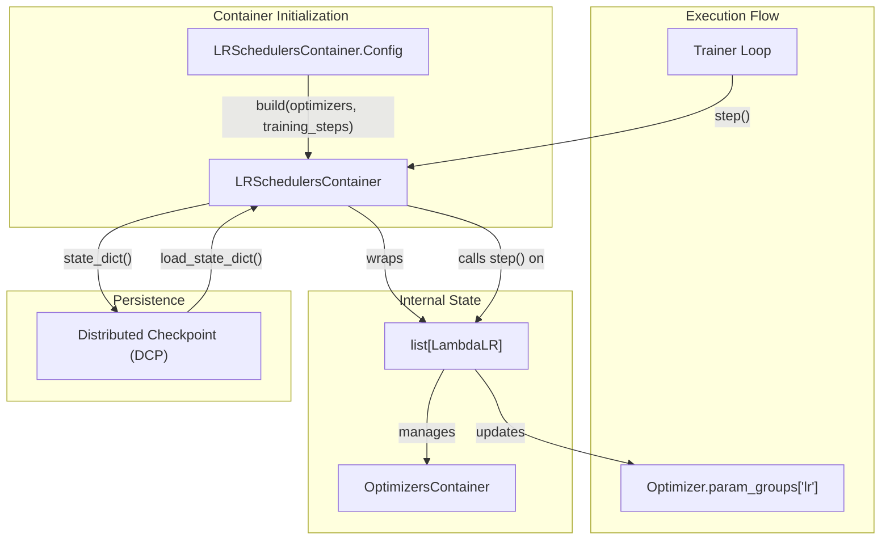
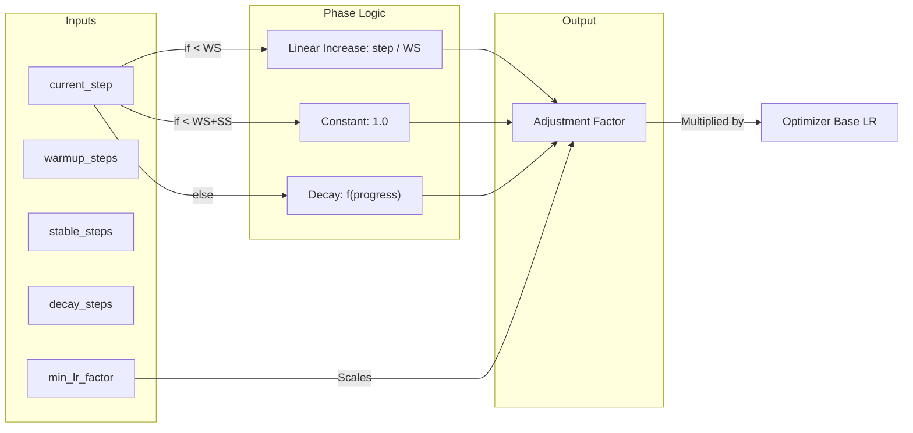
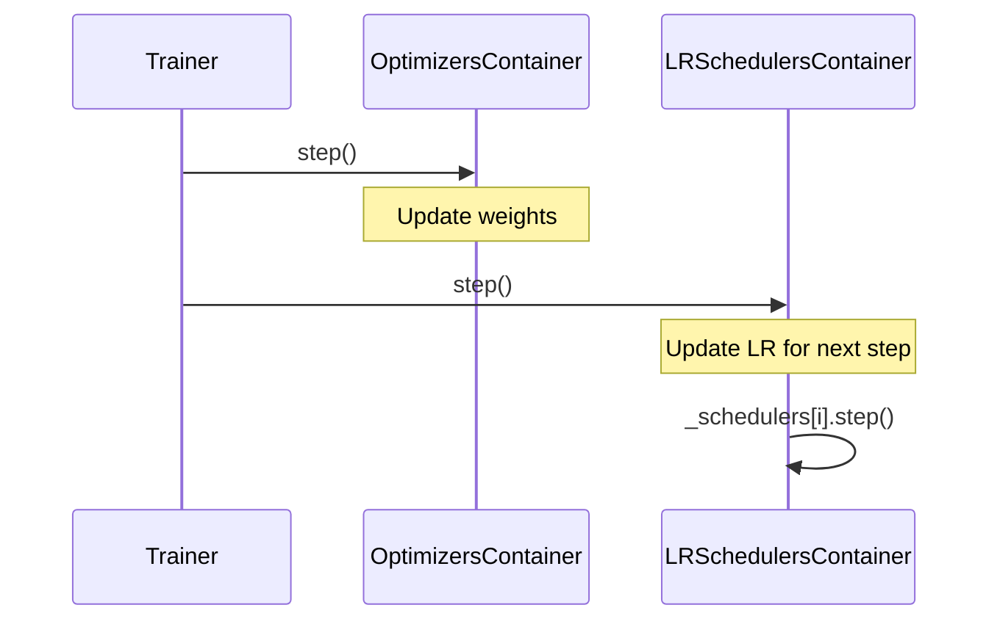

<!-- source: DeepWiki mcp.deepwiki.com · repo pytorch/torchtitan · page 8.2 Learning Rate Schedulers · fetched 2026-10-30 -->

# Learning Rate Schedulers

Relevant source files

The following files were used as context for generating this wiki page:

- [scripts/checkpoint_compat_test.py](scripts/checkpoint_compat_test.py)
- [tests/unit_tests/test_lr_scheduler.py](tests/unit_tests/test_lr_scheduler.py)
- [tests/unit_tests/test_optimizer_param_groups.py](tests/unit_tests/test_optimizer_param_groups.py)
- [tests/unit_tests/test_state_dict_keys.py](tests/unit_tests/test_state_dict_keys.py)
- [tests/unit_tests/test_train_spec.py](tests/unit_tests/test_train_spec.py)
- [torchtitan/components/checkpoint_utils.py](torchtitan/components/checkpoint_utils.py)
- [torchtitan/components/lr_scheduler.py](torchtitan/components/lr_scheduler.py)
- [torchtitan/components/optimizer.py](torchtitan/components/optimizer.py)
- [torchtitan/experiments/torchft/optimizer.py](torchtitan/experiments/torchft/optimizer.py)
- [torchtitan/overrides/fused_swiglu.py](torchtitan/overrides/fused_swiglu.py)

This page documents the learning rate scheduling system in `torchtitan`. The system is designed to handle complex training regimes, including Warmup-Stable-Decay (WSD) patterns, across distributed model parts. It leverages a container-based architecture to manage multiple schedulers synchronously while maintaining compatibility with PyTorch's distributed checkpointing and resharding mechanisms.

## Core Architecture

The scheduling system is centered around the `LRSchedulersContainer` class. This container wraps multiple `torch.optim.lr_scheduler.LRScheduler` instances (currently supporting `LambdaLR`) to provide a unified interface for the training loop.

### LRSchedulersContainer

The `LRSchedulersContainer` implements the `Stateful` protocol for checkpointing and the `Configurable` protocol for initialization. It ensures that all optimizers managed by the `OptimizersContainer` receive consistent learning rate updates.

**Sources:** [torchtitan/components/lr_scheduler.py:25-48](), [torchtitan/components/lr_scheduler.py:177-210]()

### Virtual Last Step Mechanism
To prevent the learning rate from dropping to exactly zero at the final training step (which can cause numerical issues or prevent final weight updates), the builder adds a "virtual last step" by calculating `stable_steps` as `total_steps + 1 - warmup_steps - decay_steps`. This ensures the decay phase terminates at a small non-zero value unless `min_lr_factor` is explicitly zero.
**Sources:** [torchtitan/components/lr_scheduler.py:125-126]()

## Warmup-Stable-Decay (WSD) Scheduling

TorchTitan implements the Warmup-Stable-Decay (WSD) schedule, which is particularly effective for large-scale generative AI training. The schedule is divided into three distinct phases:

1.  **Warmup**: Linear increase from 0 to the base learning rate.
2.  **Stable**: Constant learning rate maintained at the base value.
3.  **Decay**: Reduction of the learning rate based on a chosen curve.

### Decay Types
The system supports three mathematical curves for the decay phase, implemented in the `linear_warmup_stable_decay` function:

| Decay Type | Mathematical Logic | Description |
| :--- | :--- | :--- |
| **Linear** | `1.0 - progress` | Linearly decays from 1.0 to the `min_lr_factor`. |
| **Sqrt** | `1.0 - sqrt(progress)` | Decays following a 1 minus square root curve. |
| **Cosine** | `0.5 * (1 + cos(pi * progress))` | Smoothly decays following a half-period cosine curve. |

**Sources:** [torchtitan/components/lr_scheduler.py:74-80](), [torchtitan/components/lr_scheduler.py:130-153](), [torchtitan/components/lr_scheduler.py:170-175]()

### Data Flow for LR Calculation
The following diagram illustrates how configuration parameters are transformed into the multiplicative factor used by `LambdaLR`.

**Sources:** [torchtitan/components/lr_scheduler.py:154-175]()

## Configuration

The scheduler is configured via the `LRSchedulersContainer.Config` dataclass.

| Parameter | Type | Default | Description |
| :--- | :--- | :--- | :--- |
| `warmup_steps` | `int` | `200` | Number of steps for the initial linear ramp-up. |
| `total_steps` | `int` | `None` | Total steps for the schedule. Defaults to `training.steps` if `None`. |
| `decay_ratio` | `float` | `None` | Proportion of total steps for the decay phase. If `None`, decay starts after warmup. |
| `decay_type` | `str` | `"linear"` | The curve used for decay: `"linear"`, `"sqrt"`, or `"cosine"`. |
| `min_lr_factor` | `float` | `0.0` | The floor for the learning rate as a ratio of the base LR. |

**Sources:** [torchtitan/components/lr_scheduler.py:50-88]()

## Checkpointing and Resharding

Because `LRScheduler.state_dict()` in PyTorch is not natively "resharding friendly" (it often contains non-tensor metadata indexed by parameter position), `LRSchedulersContainer` handles the persistence of the training progress (`last_epoch`).

### Implementation Details
*   **Saving**: On save, only the `last_epoch` (current step) is saved.
*   **Loading**: On load, `last_epoch` is restored. Each scheduler then recomputes its learning rate from its own optimizer's `base_lrs`.
*   **Mixed Optimizers**: This approach handles mixed optimizers with different base learning rates and resharding scenarios where the number of schedulers may change between save and load (e.g., changing Pipeline Parallelism degrees).

**Sources:** [torchtitan/components/lr_scheduler.py:39-44](), [torchtitan/components/lr_scheduler.py:212-225]()

## Integration in Training Loop

The scheduler is updated at the end of every training step, typically after the optimizer has successfully updated the model weights.

**Sources:** [torchtitan/components/lr_scheduler.py:207-210](), [tests/unit_tests/test_lr_scheduler.py:117]()

---

