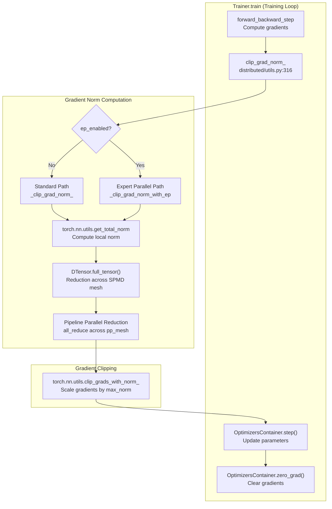
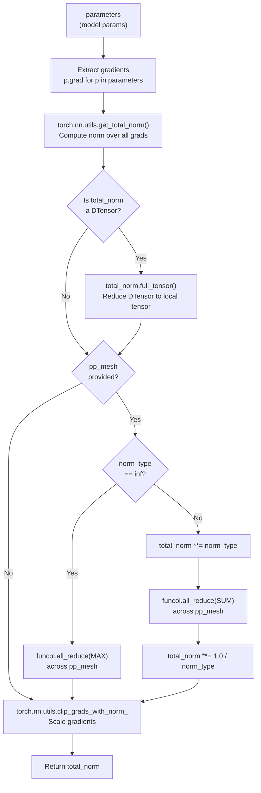
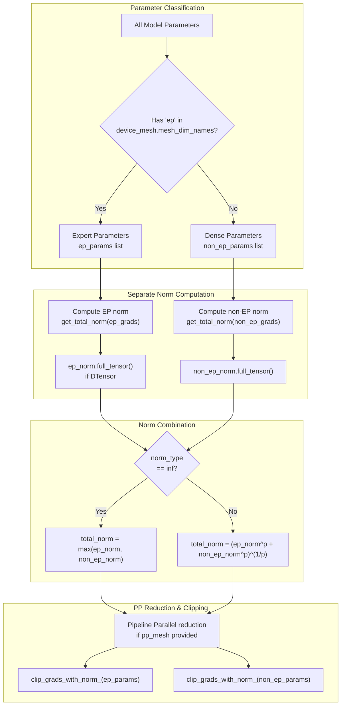

<!-- source: DeepWiki mcp.deepwiki.com · repo pytorch/torchtitan · page 8.3 Gradient Management · fetched 2026-10-30 -->

# Gradient Management

<details>
<summary>Relevant source files</summary>

The following files were used as context for generating this wiki page:

- [tests/unit_tests/test_parallel_dims.py](tests/unit_tests/test_parallel_dims.py)
- [tests/unit_tests/test_set_determinism.py](tests/unit_tests/test_set_determinism.py)
- [torchtitan/components/dataloader.py](torchtitan/components/dataloader.py)
- [torchtitan/components/lora.py](torchtitan/components/lora.py)
- [torchtitan/components/metrics.py](torchtitan/components/metrics.py)
- [torchtitan/distributed/full_dtensor.py](torchtitan/distributed/full_dtensor.py)
- [torchtitan/distributed/parallel_dims.py](torchtitan/distributed/parallel_dims.py)
- [torchtitan/distributed/spmd_types.py](torchtitan/distributed/spmd_types.py)
- [torchtitan/distributed/utils.py](torchtitan/distributed/utils.py)
- [torchtitan/tools/utils.py](torchtitan/tools/utils.py)
- [torchtitan/train.py](torchtitan/train.py)

</details>


## Purpose and Scope

This page documents TorchTitan's gradient management system, which handles gradient clipping and gradient norm computation in distributed training environments. The system ensures correct gradient norm calculation across all parallelism dimensions (Data Parallel, Tensor Parallel, Pipeline Parallel, Expert Parallel, Context Parallel) and applies gradient clipping before the optimizer step.

For information about optimizer construction and management, see [8.1 Optimizers Container and Management](). For details on parallelization strategies that affect gradient management, see [4 Parallelization Strategies]().

## Overview

Gradient management in TorchTitan consists of two primary operations:

1. **Gradient Norm Computation**: Calculating the total gradient norm across all model parameters and all parallelism dimensions.
2. **Gradient Clipping**: Scaling gradients to prevent them from exceeding a maximum norm threshold.

The system extends PyTorch's standard `torch.nn.utils.clip_grad_norm_` to correctly handle distributed training with multi-dimensional parallelism. Standard gradient clipping only computes norms along Data Parallel/FSDP/Tensor Parallel dimensions, but TorchTitan requires additional reductions across Pipeline Parallel stages and special handling for Expert Parallel meshes.

**Key Design Principle**: The gradient norm must be computed over the **entire model** before clipping, even when the model is split across Pipeline Parallel stages or when experts are sharded across Expert Parallel meshes.

Sources: [torchtitan/distributed/utils.py:316-394]()

## Gradient Clipping Architecture



**Figure 1: Gradient Management Flow in Training Loop**

Sources: [torchtitan/distributed/utils.py:316-394](), [torchtitan/trainer.py:303-315]()

### Function Signature

The main entry point in `torchtitan/distributed/utils.py` is `clip_grad_norm_` with the following signature:

```python
def clip_grad_norm_(
    parameters: torch.Tensor | Iterable[torch.Tensor],
    max_norm: float,
    norm_type: float = 2.0,
    error_if_nonfinite: bool = False,
    foreach: bool | None = None,
    pp_mesh: DeviceMesh | None = None,
    ep_enabled: bool = False,
) -> torch.Tensor:
```

| Parameter | Type | Description |
|-----------|------|-------------|
| `parameters` | `torch.Tensor` or `Iterable[torch.Tensor]` | Model parameters to clip |
| `max_norm` | `float` | Maximum gradient norm threshold |
| `norm_type` | `float` | Type of norm (2.0 for L2, inf for infinity norm) |
| `error_if_nonfinite` | `bool` | Whether to raise error on NaN/Inf gradients |
| `foreach` | `bool` or `None` | Use faster foreach-based implementation |
| `pp_mesh` | `DeviceMesh` or `None` | Pipeline Parallel mesh for cross-stage reduction |
| `ep_enabled` | `bool` | Whether Expert Parallel is enabled |

Sources: [torchtitan/distributed/utils.py:316-352]()

## Standard Gradient Clipping Path



**Figure 2: Standard Gradient Clipping Implementation**

The standard path handles gradient clipping when Expert Parallel is not enabled. The process involves three key steps:

1. **Local Norm Computation**: Use `torch.nn.utils.get_total_norm()` to compute the gradient norm. This function automatically handles gradients that are `DTensor` instances with `_NormPartial` placements. [torchtitan/distributed/utils.py:370-371]()

2. **DTensor Reduction**: If the total norm is a `DTensor`, call `.full_tensor()` to reduce it across the non-PP parallelism dimensions (DP, FSDP, TP, CP). This ensures the norm reflects contributions from all sharded or replicated parameters. [torchtitan/distributed/utils.py:374-383]()

3. **Pipeline Parallel Reduction**: If `pp_mesh` is provided, perform an additional reduction across PP stages using functional collectives (`funcol.all_reduce`). [torchtitan/distributed/utils.py:385-391]()
   - For infinity norm (`norm_type == inf`): Use `MAX` reduction.
   - For p-norm: Raise to power `norm_type`, perform `SUM` reduction, then take `1/norm_type` root.

Sources: [torchtitan/distributed/utils.py:364-394]()

### DTensor Handling

When parameters are sharded using FSDP or replicated across TP dimensions, their gradients are `DTensor` instances. The `get_total_norm()` function returns a `DTensor` with `_NormPartial` placement, indicating that the norm is computed locally but needs reduction. Calling `.full_tensor()` performs the necessary all-reduce operation across the `DeviceMesh` associated with the `DTensor` to obtain the global norm. [torchtitan/distributed/utils.py:374-383]().

Sources: [torchtitan/distributed/utils.py:66-82](), [torchtitan/distributed/utils.py:374-383]()

## Pipeline Parallel Support

Pipeline Parallel splits the model across multiple stages, with each stage residing on different devices. Since `torch.nn.utils.clip_grad_norm_` only computes norms over parameters on the local device, it cannot see gradients from other PP stages. TorchTitan solves this by manually reducing the gradient norm across the PP mesh.

### Implementation Details

For L2 norm (most common case), the implementation performs:

```python
# total_norm is the local norm squared if norm_type != inf
if pp_mesh is not None:
    if norm_type == float("inf"):
        total_norm = funcol.all_reduce(total_norm, reduceOp="MAX", group=pp_mesh)
    else:
        total_norm = funcol.all_reduce(total_norm, reduceOp="SUM", group=pp_mesh)
        total_norm = total_norm**(1.0 / norm_type)
```

This ensures all stages in the pipeline arrive at the same global norm value before scaling their local gradients.

Sources: [torchtitan/distributed/utils.py:385-391]()

## Expert Parallel Support

Expert Parallel introduces additional complexity because expert parameters and non-expert (dense) parameters are sharded on different device meshes. The expert mesh may have dimensions not present in the dense parameter mesh.



**Figure 3: Expert Parallel Gradient Clipping Path**

### EP Parameter Classification

The function `_clip_grad_norm_with_ep` separates parameters into two categories by inspecting their `DeviceMesh`:

1. **Expert Parameters**: Parameters where `p.device_mesh.mesh_dim_names` contains `"ep"`. [torchtitan/distributed/utils.py:415-420]()
2. **Dense Parameters**: All other parameters.

### Norm Combination Logic

After computing norms for each group separately and reducing any `DTensor` partials, they are combined:

**For infinity norm**:
```python
total_norm = torch.maximum(ep_grads_total_norm, non_ep_grads_total_norm)
```

**For p-norm**:
```python
total_norm = (ep_grads_total_norm**norm_type + non_ep_grads_total_norm**norm_type)
total_norm = total_norm**(1.0 / norm_type)
```

Sources: [torchtitan/distributed/utils.py:433-439]()

## Gradient Accumulation and Reduction

In large-scale training, gradients are often accumulated over multiple microbatches.

### Scaled Gradient Reduction for MoE
When using Mixture of Experts (MoE), TorchTitan provides a mechanism to register load balancing hooks. The function `register_moe_load_balancing_hook` allows attaching a hook to the model to handle auxiliary losses or specific gradient scaling required by MoE routing. [torchtitan/components/optimizer.py:410-419]().

Sources: [torchtitan/components/optimizer.py:30-31](), [torchtitan/components/optimizer.py:410-419]()

### Integration with Optimizers
The `OptimizersContainer` manages one or more optimizers. In standard training, `OptimizersContainer.step()` is called after `clip_grad_norm_`. [torchtitan/trainer.py:314-315](). When `OptimizersInBackwardContainer` is used, the optimizer `step()` and `zero_grad()` are effectively triggered by backward hooks via `register_post_accumulate_grad_hook`. This allows for overlapping gradient computation with the optimizer step.

Sources: [torchtitan/components/optimizer.py:177-186](), [torchtitan/trainer.py:314-315]()

## Determinism and Reproducibility

Gradient management is also affected by RNG states. The `set_determinism` function ensures that seeds are consistent across specific dimensions. For example, in Pipeline Parallelism, TorchTitan can set different seeds across PP groups while maintaining the same seed across SPMD groups (DP/TP). [torchtitan/distributed/utils.py:130-145]().

Sources: [torchtitan/distributed/utils.py:124-145](), [torchtitan/distributed/utils.py:178-185]()

### Key Determinism Flags
- `torch.use_deterministic_algorithms(True)`: Enables deterministic algorithms for operations like convolution. [torchtitan/distributed/utils.py:148-150]().
- `torch.backends.cudnn.deterministic = True`: Ensures CUDNN uses deterministic kernels. [torchtitan/distributed/utils.py:151]().
- `CUBLAS_WORKSPACE_CONFIG=":4096:8"`: Required for deterministic CuBLAS operations. [torchtitan/distributed/utils.py:161]().

Sources: [torchtitan/distributed/utils.py:146-161]()

## Summary Table: Gradient Clipping logic

| Scenario | Reduction Dimension | Tooling |
|----------|---------------------|---------|
| **FSDP / TP / CP** | SPMD Mesh | `DTensor.full_tensor()` |
| **Pipeline Parallel** | PP Mesh | `funcol.all_reduce` (SUM/MAX) |
| **Expert Parallel** | EP Mesh | Split params, compute dual norms, combine |
| **Accumulation** | Temporal | Backward hooks / manual accumulation |

Sources: [torchtitan/distributed/utils.py:316-452](), [torchtitan/components/optimizer.py:1-200]()

---

