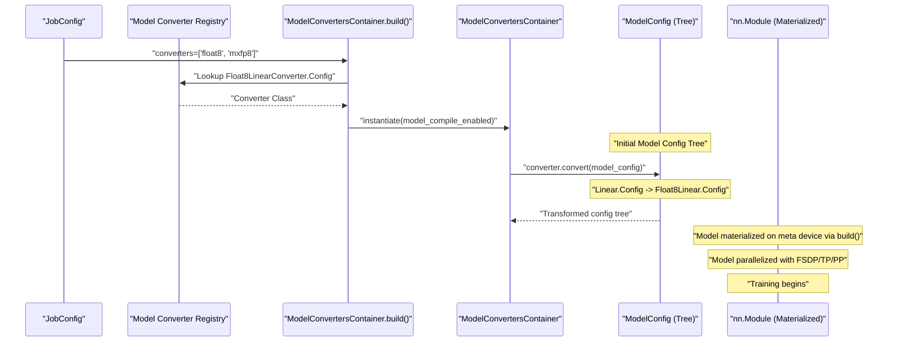
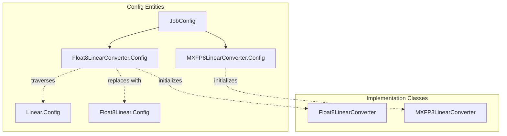

<!-- source: DeepWiki mcp.deepwiki.com · repo pytorch/torchtitan · page 9 Advanced Training Features · fetched 2026-10-30 -->

# Advanced Training Features

Relevant source files

The following files were used as context for generating this wiki page:

- [tests/unit_tests/test_compile_moe.py](tests/unit_tests/test_compile_moe.py)
- [tests/unit_tests/test_compile_regional_inductor.py](tests/unit_tests/test_compile_regional_inductor.py)
- [tests/unit_tests/test_quantization.py](tests/unit_tests/test_quantization.py)
- [torchtitan/components/quantization/__init__.py](torchtitan/components/quantization/__init__.py)
- [torchtitan/components/quantization/float8.py](torchtitan/components/quantization/float8.py)
- [torchtitan/components/quantization/mx.py](torchtitan/components/quantization/mx.py)
- [torchtitan/distributed/compile.py](torchtitan/distributed/compile.py)

This page documents TorchTitan's advanced training techniques that enhance training performance and enable scaling to larger models. These features include quantization for reduced precision training, `torch.compile` for kernel fusion, and specialized techniques for Mixture of Experts (MoE) models. All features are designed to compose with parallelism strategies and work across different model architectures.

TorchTitan implements these features through a unified **Model Converter** system that applies transformations to model configurations before the model is fully materialized and parallelized. This architecture enables clean composition of multiple optimization techniques.

## Feature Categories

TorchTitan's advanced training features fall into three main categories:

| Category | Features | Purpose | Sub-page |
|----------|----------|---------|----------|
| **Quantization** | Float8, MXFP8 | Reduce precision to accelerate computation on H100/Blackwell GPUs | [Quantization (Float8 and MXFP8)](#9.1) |
| **Compilation** | `torch.compile`, regional inductor, block-level compilation | Kernel fusion and graph optimization | [torch.compile Integration](#9.2) |
| **MoE Training** | Grouped GEMMs, load balancing, expert routing, DeepEP | Specialized techniques for Mixture of Experts models | [Mixture of Experts Training](#9.3) |

These features can be combined to achieve optimal training efficiency. For example, a Llama 4 MoE model might use Float8 quantization + `torch.compile` + Expert Parallelism simultaneously.

**Sources:** [torchtitan/components/quantization/float8.py:53-72](), [torchtitan/components/quantization/mx.py:50-61]()

## Model Converter System Architecture

TorchTitan implements advanced features through a `ModelConverter` pattern (via the `QuantizationConverter` base class) that applies transformations to model configuration trees. This design enables transformations to occur before the model is materialized on the device, facilitating efficient initialization.

### Converter Execution Flow

**Diagram: Model Converter Execution in Training Pipeline**

**Converter Protocol**: Each converter inherits from `QuantizationConverter` and implements:
- `convert(model_config)`: Traverses the configuration tree and replaces standard module configs with quantized variants (e.g., swapping `Linear.Config` for `Float8Linear.Config` [torchtitan/components/quantization/float8.py:146-166]()).

Converters are initialized with global training state, such as `model_compile_enabled`, to ensure that the chosen quantization recipes are compatible with the execution backend [torchtitan/components/quantization/__init__.py:21-32]().

**Sources:** [torchtitan/components/quantization/__init__.py:21-32](), [torchtitan/components/quantization/float8.py:53-166](), [torchtitan/components/quantization/mx.py:50-96]()

### Converter Configuration Pattern

**Diagram: Quantization Configuration Entities**

The configuration system uses nested dataclasses. Converters like `Float8LinearConverter` use a `Config` class to define recipes and filtering rules [torchtitan/components/quantization/float8.py:56-72]().

**Sources:** [torchtitan/components/quantization/float8.py:56-72](), [torchtitan/components/quantization/mx.py:53-60](), [torchtitan/components/quantization/__init__.py:28-32]()

## Overview of Advanced Training Features

### Quantization (Page 9.1)

TorchTitan supports two primary quantization approaches for accelerating training on modern GPUs, primarily integrated via `torchao`:

**Float8 Training** reduces linear layer precision to 8-bit floating point (FP8) on H100 GPUs (SM89+). It provides:
- **Recipe-based Scaling**: Supports standard recipes like `rowwise` via `TorchAOFloat8LinearConfig` [torchtitan/components/quantization/float8.py:108-110]().
- **Auto-Filtering**: Skips layers too small to benefit from FP8 using `_auto_filter_for_recipe` to avoid performance regressions on small kernels [torchtitan/components/quantization/float8.py:123-134]().
- **MoE Support**: Specialized `Float8GroupedExpertsConverter` for MoE architectures [torchtitan/components/quantization/float8.py:207-227]().

**MXFP8 Training** uses Microscaling formats on Blackwell (SM100) GPUs. It supports:
- **Linear Layer Conversion**: Swapping standard layers for `MXFP8Linear` [torchtitan/components/quantization/mx.py:50-96]().
- **MoE Expert Quantization**: Using `MXFP8GroupedExpertsConverter` to apply microscaling to expert grouped GEMMs [torchtitan/components/quantization/mx.py:139-189]().

For details, see [Quantization (Float8 and MXFP8)](#9.1).

**Sources:** [torchtitan/components/quantization/float8.py:53-166](), [torchtitan/components/quantization/mx.py:50-96](), [torchtitan/components/quantization/mx.py:139-189]()

### torch.compile Integration (Page 9.2)

`torch.compile` is critical for performance when using quantization, as it fuses the necessary scaling and casting operations [torchtitan/components/quantization/__init__.py:13-15]().

- **Per-Block Compilation**: `apply_compile` targets individual `TransformerBlock` instances to keep compilation times manageable [torchtitan/distributed/compile.py:35-59]().
- **Regional Inductor**: A specialized backend strategy that "scoops" specific regions (like `FlexAttention`) into Inductor while keeping the rest of the graph in `aot_eager` [torchtitan/distributed/compile.py:61-96]().
- **MoE Compatibility**: Ensures scalar outputs are captured for data-dependent routing in MoE dispatch [torchtitan/distributed/compile.py:42]().

For details, see [torch.compile Integration](#9.2).

**Sources:** [torchtitan/distributed/compile.py:35-96](), [torchtitan/components/quantization/__init__.py:13-15]()

### Mixture of Experts Training (Page 9.3)

MoE training involves specialized optimizations to handle expert routing and computation:
- **Grouped GEMMs**: Efficient execution of expert layers via `GroupedExperts` [torchtitan/models/common/moe.py]().
- **Quantization Alignment**: MXFP8 grouped GEMMs require specific padding (typically multiples of 32 or 128) for hardware alignment [torchtitan/components/quantization/mx.py:151-155]().
- **Dispatcher Swapping**: Converters can automatically swap token dispatchers to satisfy quantization requirements [torchtitan/components/quantization/mx.py:176]().

For details, see [Mixture of Experts Training](#9.3).

**Sources:** [torchtitan/components/quantization/mx.py:151-155](), [torchtitan/components/quantization/mx.py:175-176](), [tests/unit_tests/test_compile_moe.py:52-75]()

## Hardware Requirements

| Feature | Hardware Requirement | Fallback |
|---------|---------------------|----------|
| **Float8** | NVIDIA SM89+ (H100/L40) [torchtitan/components/quantization/float8.py:85-91]() | `emulate=True` (Eager mode only) |
| **MXFP8** | NVIDIA SM100+ (Blackwell) [torchtitan/components/quantization/mx.py:70-72]() | None |
| **Compilation** | Recommended for all modern GPUs | Eager mode |

**Sources:** [torchtitan/components/quantization/float8.py:85-91](), [torchtitan/components/quantization/mx.py:70-72]()

---

