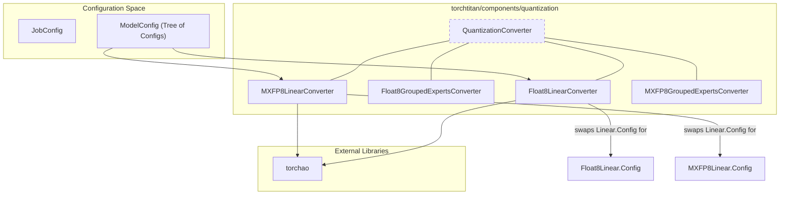
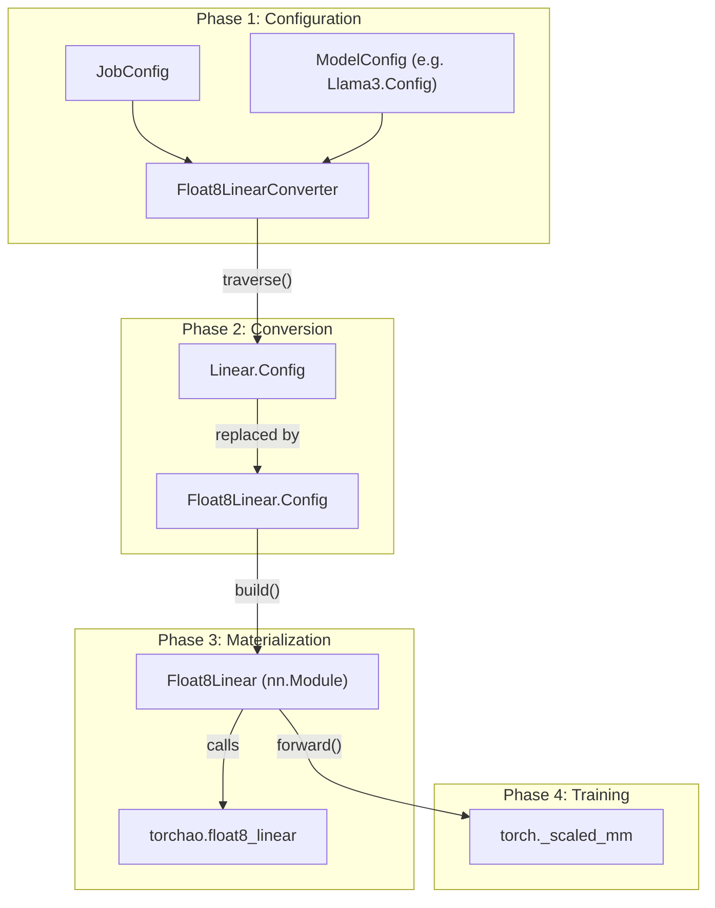

<!-- source: DeepWiki mcp.deepwiki.com · repo pytorch/torchtitan · page 9.1 Quantization (Float8 and MXFP8) · fetched 2026-10-30 -->

# Quantization (Float8 and MXFP8)

Relevant source files

The following files were used as context for generating this wiki page:

- [tests/unit_tests/test_quantization.py](tests/unit_tests/test_quantization.py)
- [torchtitan/components/quantization/__init__.py](torchtitan/components/quantization/__init__.py)
- [torchtitan/components/quantization/float8.py](torchtitan/components/quantization/float8.py)
- [torchtitan/components/quantization/mx.py](torchtitan/components/quantization/mx.py)

## Purpose and Scope

This document covers TorchTitan's quantization support for training large language models using reduced-precision formats: **Float8** (FP8) and **MXFP8** (Microscaling FP8). Quantization reduces memory footprint and accelerates training by converting `nn.Linear` layers or MoE parameters to use lower-precision arithmetic while maintaining model quality. TorchTitan integrates with [TorchAO](https://github.com/pytorch/ao) to provide these quantization capabilities through the `ModelConverter` system.

**Sources:** [torchtitan/components/quantization/float8.py:1-33](), [torchtitan/components/quantization/mx.py:1-25]()

---

## Overview

TorchTitan supports two primary quantization formats for training:

| Format | Precision | Scaling Strategy | Hardware Requirement | Use Case |
|--------|-----------|------------------|---------------------|----------|
| **Float8** (FP8) | 8-bit (E4M3/E5M2) | Tensorwise or Rowwise dynamic scaling | NVIDIA H100 (SM89+) | General purpose training speedup |
| **MXFP8** | 8-bit (E4M3) | Block-based microscaling (1x32) | NVIDIA Blackwell (SM100+) | High accuracy, next-gen hardware |

Both formats quantize model weights and activations during forward/backward passes, trading reduced precision for:
- **Memory savings**: Reduction in parameter communication bandwidth via FSDP all-gather.
- **Compute acceleration**: Faster matrix multiplications using specialized tensor cores.
- **Training speedup**: Significant throughput gains when paired with `torch.compile`.

**Sources:** [torchtitan/components/quantization/float8.py:56-68](), [torchtitan/components/quantization/mx.py:70-71](), [torchtitan/components/quantization/__init__.py:13-15]()

---

## Model Converter System

Quantization is implemented using the `ModelConverter` protocol. Converters mutate the model configuration tree before the model is materialized. This allows the system to swap standard `Linear.Config` objects for quantized variants like `Float8Linear.Config`.

### Quantization Architecture

**Key Entities:**
- `QuantizationConverter`: Base class for all quantization-related config transformers [torchtitan/components/quantization/__init__.py:21-32]().
- `Float8Linear`: A subclass of `TorchAOFloat8Linear` that implements the `Module` protocol for initialization [torchtitan/components/quantization/float8.py:27-47]().
- `MXFP8Linear`: A subclass of `TorchAOMXFP8Linear` that implements the `Module` protocol [torchtitan/components/quantization/mx.py:25-44]().

**Sources:** [torchtitan/components/quantization/__init__.py:21-32](), [torchtitan/components/quantization/float8.py:27-47](), [torchtitan/components/quantization/mx.py:25-44]()

---

## Float8 Quantization

### Float8LinearConverter

The `Float8LinearConverter` traverses the model configuration and replaces matching `Linear.Config` instances with `Float8Linear.Config`.

**Scaling Recipes:**
- **rowwise**: Per-row scale factors for higher accuracy. This is the default recipe [torchtitan/components/quantization/float8.py:58]().
- **rowwise_with_gw_hp**: Rowwise scaling with high-precision gradient weights.

**Implementation Logic:**
1. **Hardware Check**: Validates SM89+ or checks if `emulate=True` is set for testing [torchtitan/components/quantization/float8.py:85-91]().
2. **Recipe Selection**: Loads `Float8LinearConfig` from `torchao` based on the requested recipe [torchtitan/components/quantization/float8.py:108-110]().
3. **Filtering**: Uses `_auto_filter_for_recipe` to skip small GEMMs (if `auto_filter_small_kn` is specified) or manual FQN filtering [torchtitan/components/quantization/float8.py:123-142]().
4. **Traversal**: Uses `model_config.traverse(Linear.Config)` to find and replace configuration nodes [torchtitan/components/quantization/float8.py:151-163]().

**Sources:** [torchtitan/components/quantization/float8.py:53-165]()

### Float8 MoE Experts

For Mixture-of-Experts, `Float8GroupedExpertsConverter` quantizes grouped GEMMs. It dynamically creates a quantized subclass of the expert module (e.g., `GptOssGroupedExperts`) and applies `torchao.quantization.quantize_` during initialization [torchtitan/components/quantization/float8.py:171-213]().

**Sources:** [torchtitan/components/quantization/float8.py:171-213](), [tests/unit_tests/test_quantization.py:48-67]()

---

## MXFP8 Quantization

### MXFP8LinearConverter

`MXFP8LinearConverter` replaces standard linear layers with `MXFP8Linear`, which utilizes the Microscaling format (E4M3 with shared exponents).

**Implementation Logic:**
1. **Hardware Requirement**: Strictly requires SM100 (Blackwell) or later [torchtitan/components/quantization/mx.py:70-71]().
2. **Compilation Requirement**: Issues a warning if `torch.compile` is disabled, as MXFP8 performance relies on kernel fusion [torchtitan/components/quantization/mx.py:73-77]().
3. **Conversion**: Replaces `Linear.Config` with `MXFP8Linear.Config` for FQNs matching the user-provided list [torchtitan/components/quantization/mx.py:82-93]().

**Sources:** [torchtitan/components/quantization/mx.py:50-96]()

### MXFP8 MoE Experts

The `MXFP8GroupedExpertsConverter` targets MoE `GroupedExperts`. It performs two key transformations:
1. **Token Padding**: Adjusts the token dispatcher to pad expert groups to a multiple of 32 (or 128 for certain kernels) for hardware alignment [torchtitan/components/quantization/mx.py:151-155](), [torchtitan/components/quantization/mx.py:176]().
2. **Subclassing**: Wraps the expert class with `MXFP8GroupedExperts`, which applies the `mxfp8_rceil` recipe during initialization [torchtitan/components/quantization/mx.py:112-136]().

**Sources:** [torchtitan/components/quantization/mx.py:101-187]()

---

## FSDP Integration

Quantization in TorchTitan is designed to work seamlessly with FSDP2 (Per-parameter sharding). When modules are converted to Float8 or MXFP8, their parameters are initialized in the quantized format. FSDP handles the sharding and all-gather of these quantized parameters, reducing communication overhead.

- **Float8**: Can reduce FSDP all-gather traffic by 2x if parameters are stored in FP8.
- **Alignment**: `MXFP8` requires specific padding (multiples of 32/128) to ensure that grouped GEMMs can be executed efficiently on Blackwell hardware [torchtitan/components/quantization/mx.py:151-155]().

**Sources:** [torchtitan/components/quantization/mx.py:151-155](), [torchtitan/components/quantization/float8.py:116-119]()

---

## Code Entity Mapping

The following diagram maps quantization components to their roles in the model lifecycle.

**Sources:** [torchtitan/components/quantization/float8.py:27-47](), [torchtitan/components/quantization/float8.py:146-165](), [torchtitan/components/quantization/__init__.py:21-32]()

---

## Best Practices and Constraints

1. **torch.compile**: Quantization modules are intended to be run under `torch.compile` for competitive performance. Without compilation, the overhead of scaling and casting can negate the benefits of reduced precision [torchtitan/components/quantization/__init__.py:13-15]().
2. **Hardware Constraints**: 
    - Float8 requires NVIDIA H100+ (SM89). Emulation mode is available for testing on older hardware but is slow and incompatible with `torch.compile` [torchtitan/components/quantization/float8.py:68-71]().
    - MXFP8 strictly requires NVIDIA Blackwell+ (SM100) [torchtitan/components/quantization/mx.py:70-71]().
3. **Filtering**: It is often beneficial to skip quantizing the first and last layers of a model (e.g., `tok_embeddings` and `output`) to maintain stability. Use `filter_fqns` in the converter config [torchtitan/components/quantization/float8.py:61-66]().
4. **Inductor Config**: When using `rowwise` Float8, TorchTitan automatically sets `torch._inductor.config.emulate_precision_casts = True` to handle specific hardware casting behaviors [torchtitan/components/quantization/float8.py:116-118]().

**Sources:** [torchtitan/components/quantization/float8.py:68-91](), [torchtitan/components/quantization/mx.py:70-71](), [torchtitan/components/quantization/__init__.py:13-15]()

---

