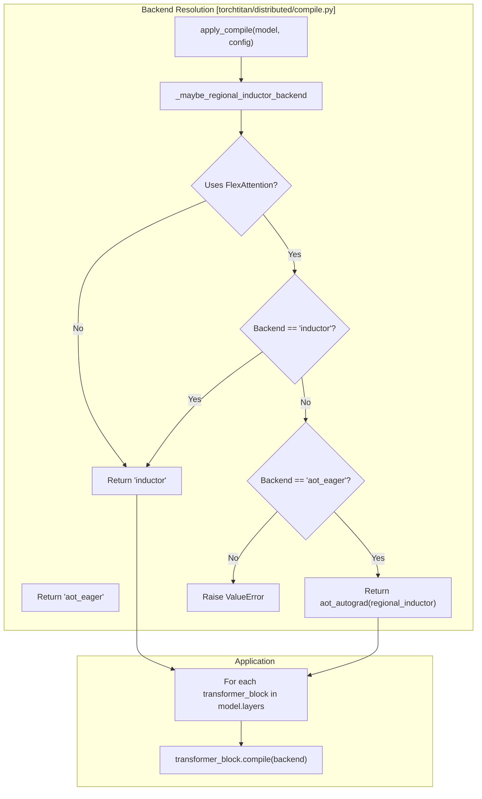
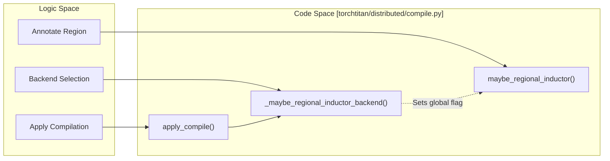

<!-- source: DeepWiki mcp.deepwiki.com · repo pytorch/torchtitan · page 9.2 torch.compile Integration · fetched 2026-10-30 -->

# torch.compile Integration

Relevant source files

The following files were used as context for generating this wiki page:

- [tests/unit_tests/test_compile_moe.py](tests/unit_tests/test_compile_moe.py)
- [tests/unit_tests/test_compile_regional_inductor.py](tests/unit_tests/test_compile_regional_inductor.py)
- [torchtitan/distributed/compile.py](torchtitan/distributed/compile.py)

## Purpose and Scope

This document describes how TorchTitan integrates `torch.compile` to optimize model execution through PyTorch's compilation framework. It covers the core implementation in `torchtitan/distributed/compile.py`, the specialized `regional_inductor` backend for `FlexAttention`, and how compilation interacts with parallelization and activation checkpointing.

For details on the models using these features, see [Llama Model Family (Section 5.3)](/torchtitan/wiki/5.3) or [DeepSeek-V3 Architecture (Section 5.4)](/torchtitan/wiki/5.4).

---

## Overview

TorchTitan applies `torch.compile` primarily at the **TransformerBlock** level [torchtitan/distributed/compile.py:37-39](). This granular approach leverages the repeated structural symmetry of transformer layers to minimize compilation latency while maximizing graph optimization coverage.

**Key Design Decisions:**
- **Per-block compilation**: Instead of compiling the entire model, TorchTitan iterates through `model.layers` and calls `.compile()` on each `TransformerBlock` [torchtitan/distributed/compile.py:55-56]().
- **Fullgraph mode**: Blocks are compiled with `fullgraph=True` to ensure the entire layer is captured as a single optimized graph [torchtitan/distributed/compile.py:56]().
- **MoE Support**: Configures `torch._dynamo.config.capture_scalar_outputs = True` to handle data-dependent dynamic shapes in token-choice MoE dispatch [torchtitan/distributed/compile.py:40-42]().
- **AC Compatibility**: Sets `skip_fwd_side_effects_in_bwd_under_checkpoint = True` to prevent divergences during activation checkpointing recomputation, specifically regarding Python side-effects like RoPE cache updates [torchtitan/distributed/compile.py:43-50]().

Sources: [torchtitan/distributed/compile.py:35-59]()

---

## Compilation Strategies and Backends

The primary entry point is `apply_compile`, which configures the global Dynamo state and dispatches the compilation to model layers.

### Regional Inductor for FlexAttention
A significant feature of the integration is the handling of `FlexAttention`. Since `FlexAttention` only has an Inductor lowering (Triton kernel), it requires special handling when the user selects a non-Inductor backend like `aot_eager`.

The function `_maybe_regional_inductor_backend` manages this logic:
1. **Detection**: It checks if the model contains any `FlexAttention` modules [torchtitan/distributed/compile.py:73]().
2. **Backend Wrapping**: If the backend is `aot_eager` and `FlexAttention` is present, it returns an `aot_autograd` backend using `regional_inductor` as the compiler [torchtitan/distributed/compile.py:96]().
3. **Scooping**: The `regional_inductor` "scoops" out regions annotated with `compile_with_inductor` and lowers them to Inductor, while the rest of the graph remains in the primary backend [torchtitan/distributed/compile.py:61-69]().

### Data Flow for Backend Selection

Sources: [torchtitan/distributed/compile.py:52-96]()

---

## Implementation Details

### Context Management for Regional Compilation
The `maybe_regional_inductor` function provides a context manager used within model code (specifically `FlexAttention.forward`) to mark regions for the regional compiler.

- If `_regional_inductor_enabled` is `False`, it returns a `nullcontext` [torchtitan/distributed/compile.py:109-110]().
- If enabled, it uses `fx_traceback.annotate` to tag the region with `compile_with_inductor` metadata, passing along specific `inductor_configs` [torchtitan/distributed/compile.py:111-113]().

### Code Entity Mapping

| System Concept | Code Entity | File |
|:---|:---|:---|
| Entry Point | `apply_compile` | [torchtitan/distributed/compile.py:35]() |
| Backend Selection | `_maybe_regional_inductor_backend` | [torchtitan/distributed/compile.py:61]() |
| Region Annotation | `maybe_regional_inductor` | [torchtitan/distributed/compile.py:99]() |
| Compilation Target | `transformer_block.compile` | [torchtitan/distributed/compile.py:56]() |
| Config Object | `CompileConfig` | [torchtitan/distributed/compile.py:15]() |

Sources: [torchtitan/distributed/compile.py:1-114]()

---

## Interaction with Parallelization

Compilation is typically applied after model sharding (Tensor Parallelism) and Activation Checkpointing (AC) wrapping, but before FSDP wrapping. This ensures:
1. The compiler sees the sharded shapes produced by TP.
2. The compiler can optimize the recomputation graphs created by AC.
3. FSDP hooks do not interfere with the initial graph capture of the `TransformerBlock`.

### Testing and Validation
The integration is validated through unit tests that ensure:
- **MoE Compilation**: `TestApplyCompile` verifies that `apply_compile` works with `GroupedExperts` and handles dynamic token counts [tests/unit_tests/test_compile_moe.py:46-77]().
- **Regional Inductor**: `TestRegionalInductorBackend` validates the backend selection logic and ensures the correct annotation metadata is emitted [tests/unit_tests/test_compile_regional_inductor.py:21-64]().
- **Codegen**: `TestRegionalInductorCodegen` performs GPU-based checks to confirm that `FlexAttention` correctly lowers to Triton kernels under the regional scoop [tests/unit_tests/test_compile_regional_inductor.py:67-128]().

Sources: [tests/unit_tests/test_compile_moe.py:1-82](), [tests/unit_tests/test_compile_regional_inductor.py:1-132]()

---

