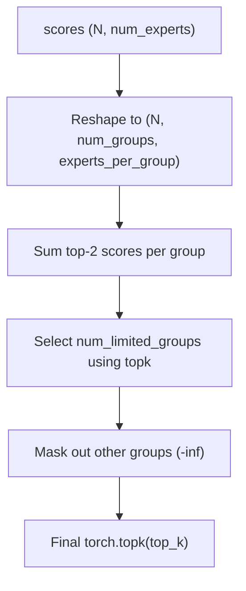
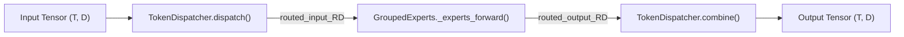
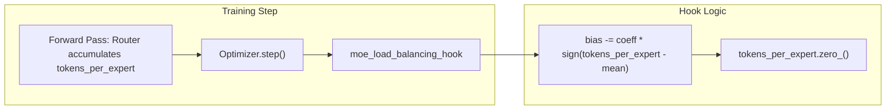

<!-- source: DeepWiki mcp.deepwiki.com · repo pytorch/torchtitan · page 9.3 Mixture of Experts Training · fetched 2026-10-30 -->

# Mixture of Experts Training

<details>
<summary>Relevant source files</summary>

The following files were used as context for generating this wiki page:

- [tests/unit_tests/test_expert_parallel.py](tests/unit_tests/test_expert_parallel.py)
- [torchtitan/components/quantization/utils.py](torchtitan/components/quantization/utils.py)
- [torchtitan/distributed/deepep/deepep.py](torchtitan/distributed/deepep/deepep.py)
- [torchtitan/distributed/deepep/hybridep.py](torchtitan/distributed/deepep/hybridep.py)
- [torchtitan/models/common/moe.py](torchtitan/models/common/moe.py)
- [torchtitan/models/common/moe_sharding.py](torchtitan/models/common/moe_sharding.py)
- [torchtitan/models/common/token_dispatcher.py](torchtitan/models/common/token_dispatcher.py)
- [torchtitan/models/deepseek_v3/sharding.py](torchtitan/models/deepseek_v3/sharding.py)
- [torchtitan/models/gpt_oss/moe.py](torchtitan/models/gpt_oss/moe.py)
- [torchtitan/models/gpt_oss/sharding.py](torchtitan/models/gpt_oss/sharding.py)
- [torchtitan/models/qwen3/sharding.py](torchtitan/models/qwen3/sharding.py)
- [torchtitan/models/qwen3_5/__init__.py](torchtitan/models/qwen3_5/__init__.py)

</details>


## Purpose and Scope

This page describes TorchTitan's training infrastructure for Mixture of Experts (MoE) models, which enables training large models with conditional computation by routing input tokens to specialized expert sub-networks. This document focuses on MoE-specific training considerations including load balancing mechanisms (auxiliary-loss-free), expert routing strategies, grouped GEMM optimizations, parallelization strategies, and training performance optimizations.

Key models utilizing MoE in torchtitan include Llama 4, GPT-OSS, DeepSeek-V3, and Qwen 3.5.

---

## MoE Training Pipeline Overview

Training MoE models requires coordinating multiple specialized components beyond standard transformer training. The key differences include dynamic token routing, load balancing mechanisms, specialized parallelization strategies, and careful gradient handling.

### Natural Language to Code Entity Mapping

The following diagram associates high-level MoE concepts with their specific implementation classes and functions in the codebase.

| Concept | Code Entity | File Path |
| :--- | :--- | :--- |
| **Routing Logic** | `TokenChoiceTopKRouter` | [torchtitan/models/common/moe.py:158-158]() |
| **Expert Computation** | `GroupedExperts` | [torchtitan/models/common/moe.py:32-32]() |
| **Token Dispatching** | `LocalTokenDispatcher` | [torchtitan/models/common/token_dispatcher.py:47-47]() |
| **Distributed Dispatch** | `AllToAllTokenDispatcher` | [torchtitan/models/common/token_dispatcher.py:220-220]() |
| **Load Balancing Hook** | `register_moe_load_balancing_hook` | [torchtitan/components/optimizer.py:13-13]() |

**Sources:** [torchtitan/models/common/moe.py:32-158](), [torchtitan/models/common/token_dispatcher.py:47-220](), [torchtitan/components/optimizer.py:13-13]()

---

## Token-Choice Routing with Top-K

The `TokenChoiceTopKRouter` implements token-choice routing where each token independently selects its top-k experts based on learned routing scores.

### Router Implementation

The router performs the following steps:
1.  **Score Computation**: Linear projection to `num_experts` dimensions via `self.gate` [torchtitan/models/common/moe.py:181-181]().
2.  **Activation**: Applies `sigmoid` or `softmax` based on configuration [torchtitan/models/common/moe.py:221-224]().
3.  **Load Balancing Bias**: Adds `expert_bias` to routing scores to encourage uniform selection without an auxiliary loss [torchtitan/models/common/moe.py:226-228]().
4.  **Top-K Selection**: Selects top-k experts per token using `torch.topk` [torchtitan/models/common/moe.py:293-293]().
5.  **Score Normalization**: Optionally normalizes scores to sum to 1.0 if `route_norm` is enabled [torchtitan/models/common/moe.py:313-315]().

**Sources:** [torchtitan/models/common/moe.py:158-359]()

### Node-Limited Routing

To reduce cross-node communication in distributed settings, the router supports node-limited (group-limited) routing. Experts are divided into groups (e.g., by node), and only `num_limited_groups` are considered before selecting top-k experts [torchtitan/models/common/moe.py:162-165]().



**Sources:** [torchtitan/models/common/moe.py:252-291]()

---

## Token Dispatching and Expert Parallelism

### Token Dispatcher Architecture

Token dispatching is the process of reordering tokens from their sequence order into an expert-major layout for computation.

*   **LocalTokenDispatcher**: Used when Expert Parallelism (EP) is 1. It performs local reordering via `argsort` [torchtitan/models/common/token_dispatcher.py:94-96]().
*   **AllToAllTokenDispatcher**: Used for standard EP. It utilizes `all_to_all_single` to exchange tokens across the EP device mesh [torchtitan/models/common/token_dispatcher.py:251-251]().
*   **DeepEP/HybridEP**: Specialized dispatchers for DeepSeek-style architectures and GB200 systems, providing TMA-optimized communication and non-blocking dispatch [torchtitan/distributed/deepep/hybridep.py:124-134]().

### Dispatch/Combine Flow



**Sources:** [torchtitan/models/common/moe.py:121-140](), [torchtitan/models/common/token_dispatcher.py:109-180]()

---

## Expert Execution and Grouped GEMMs

### GroupedExperts Module

The `GroupedExperts` module manages the parameters for all experts (`w1`, `w2`, `w3`) [torchtitan/models/common/moe.py:43-50](). It uses `torch._grouped_mm` for high performance by batching different experts into a single kernel launch [torchtitan/models/common/moe.py:83-96]().

### Grouped MM Implementation

The `_experts_forward` function calculates offsets via `torch.cumsum` and invokes the grouped kernels:

```python
# From torchtitan/models/common/moe.py
offsets_E = torch.cumsum(num_tokens_per_expert_E, dim=0, dtype=torch.int32)
h_RF = F.silu(
    torch._grouped_mm(
        x_RD.bfloat16(),
        w1_EFD.bfloat16().transpose(-2, -1),
        offs=offsets_E,
    )
)
# ... w3 and w2 follow similar patterns
```

**Sources:** [torchtitan/models/common/moe.py:54-96]()

---

## Load Balancing (Auxiliary-Loss-Free)

TorchTitan implements an auxiliary-loss-free load balancing mechanism. Instead of adding a penalty to the loss function, it dynamically adjusts an `expert_bias` buffer to shift routing preferences.

### The register_moe_load_balancing_hook

The load balancing is enforced by registering a post-step hook on the optimizer [torchtitan/components/optimizer.py:13-13]().



### Implementation in Code

1.  **Accumulation**: During the forward pass, the `MoE` module increments the `tokens_per_expert_E` buffer [torchtitan/models/common/moe.py:495-495]().
2.  **Bias Update**: The hook registered via `register_moe_load_balancing_hook` modifies the `expert_bias` based on the accumulated counts [torchtitan/models/common/moe.py:451-470]().
3.  **Routing**: The next forward pass uses the updated `expert_bias` in `TokenChoiceTopKRouter` [torchtitan/models/common/moe.py:228-228]().

**Sources:** [torchtitan/models/common/moe.py:451-498](), [torchtitan/components/optimizer.py:13-13]()

---

## MoE-Specific Optimizations

### DTensor to Local Conversion
When using Expert Parallelism (EP), parameters are stored as `DTensor`s. However, because routing results in dynamic shapes (different numbers of tokens per expert per rank), `GroupedExperts` converts parameters to local tensors before execution to work with `torch._grouped_mm` [torchtitan/models/common/moe.py:67-74]().

### GPT-OSS Specifics
The GPT-OSS implementation includes a `ScaleBiasForward` autograd function [torchtitan/models/gpt_oss/moe.py:20-20](). For Tensor Parallel MoE, it scales the bias by `1/tp_degree` in the forward pass to cancel extra reduction effects while keeping gradients unchanged in the backward pass [torchtitan/models/gpt_oss/moe.py:30-34]().

### DeepEP Integration
For high-performance communication, DeepEP provides low-level primitives for MoE Expert Parallelism. It supports overlapping expert computation with communication via `EventOverlap` and deferred synchronization [torchtitan/distributed/deepep/deepep.py:183-194]().

**Sources:** [torchtitan/models/common/moe.py:67-96](), [torchtitan/models/gpt_oss/moe.py:20-41](), [torchtitan/distributed/deepep/deepep.py:183-194]()

---

## Summary of Key Components

| Component | Responsibility | Key File |
| :--- | :--- | :--- |
| **MoE** | Top-level module coordinating routing and experts | [torchtitan/models/common/moe.py:421-421]() |
| **TokenChoiceTopKRouter** | Logic for choosing which experts process which tokens | [torchtitan/models/common/moe.py:158-158]() |
| **GroupedExperts** | Container for expert weights and MM execution | [torchtitan/models/common/moe.py:32-32]() |
| **TokenDispatcher** | Handles token movement (Local, All-to-All, or DeepEP) | [torchtitan/models/common/token_dispatcher.py:47-47]() |

**Sources:** [torchtitan/models/common/moe.py:7-20](), [torchtitan/models/common/token_dispatcher.py:1-20]()

---

