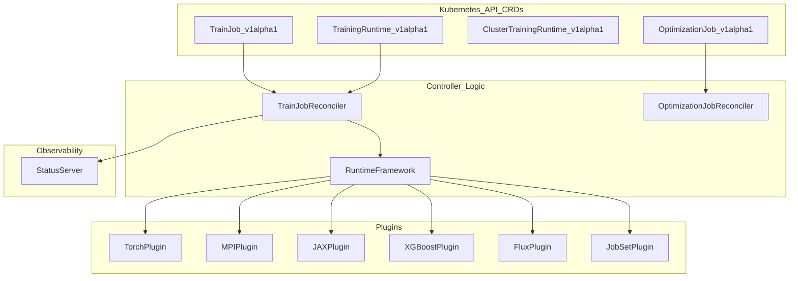
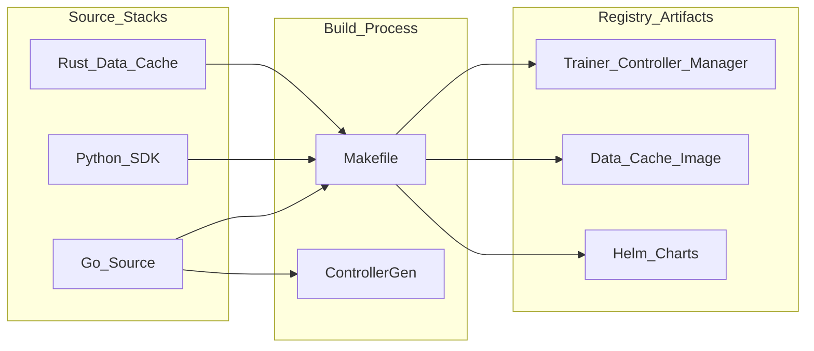

<!-- source: DeepWiki mcp.deepwiki.com · repo kubeflow/trainer · page 1 Overview · fetched 2026-10-21 -->

# Overview

Relevant source files

The following files were used as context for generating this wiki page:

- [ADOPTERS.md](ADOPTERS.md)
- [CONTRIBUTING.md](CONTRIBUTING.md)
- [README.md](README.md)
- [ROADMAP.md](ROADMAP.md)
- [cmd/trainer-controller-manager/Dockerfile](cmd/trainer-controller-manager/Dockerfile)

## Purpose and Scope

Kubeflow Trainer is a Kubernetes-native distributed AI platform designed for scalable training and fine-tuning of machine learning models across diverse frameworks, including PyTorch, JAX, DeepSpeed, MLX, XGBoost, and Flux [README.md:49-51](). It provides a unified, declarative API (`TrainJob`) that streamlines multi-node, multi-GPU distributed jobs and high-performance computing (HPC) workflows on Kubernetes clusters [README.md:49-57]().

The project supersedes the legacy Training Operator V1 (PyTorchJob, TFJob, MPIJob, XGBoostJob) with a unified `TrainJob` API architecture and decoupled runtime framework [README.md:121-129](). It leverages modern Kubernetes orchestration primitives like `JobSet` and `LeaderWorkerSet` (`LWS`) to manage complex distributed topologies [README.md:64-66](). 

This document provides a high-level introduction to Kubeflow Trainer's capabilities and system design. Since this is a parent page, detailed architectural information, core API definitions, and documentation resources are maintained in its child pages:
*   For detailed architectural information, see [System Architecture](#1.1).
*   For core concepts and terminology definitions, see [Key Concepts and Terminology](#1.2).
*   For documentation site structures and KEP-style design proposals, see [Documentation Site and Design Proposals](#1.3).

Sources: [README.md:49-66](), [README.md:121-129]()

## Core Capabilities

### Multi-Framework Training Support
Kubeflow Trainer abstracts framework-specific configurations through an extensible plugin architecture [README.md:49-57](). It supports high-performance communication protocols like MPI, making it ideal for large-scale training requiring fast synchronization between GPU nodes [README.md:49-57]().

| Framework | Key Capabilities |
|-----------|------------------|
| **PyTorch** | Support for DDP, `torchrun`, and TorchTune-based LLM fine-tuning [README.md:49-57](), [ROADMAP.md:48-50](). |
| **JAX** | Distributed JAX initialization with environment variable injection for coordinators [ROADMAP.md:32-32](). |
| **XGBoost** | Distributed gradient boosting using Rabit-based coordination [ROADMAP.md:33-33](). |
| **Flux** | Integration with the Flux HPC framework for complex scheduling and MPI workloads [README.md:40-42](), [ROADMAP.md:13-13](). |
| **DeepSpeed** | Optimized multi-node GPU execution with ZeRO optimizations [ROADMAP.md:53-53](). |

Sources: [README.md:49-57](), [ROADMAP.md:13-33](), [ROADMAP.md:48-53]()

### Distributed Data Cache
The platform features a distributed data cache designed to stream large-scale datasets with zero-copy transfer directly to GPU nodes [README.md:68-71](). This system maximizes GPU utilization by reducing I/O bottlenecks during training [README.md:68-71](). The implementation utilizes a Rust-based core for high-performance data handling [ROADMAP.md:46-46]().

Sources: [README.md:68-71](), [ROADMAP.md:46-46]()

### Python SDK
The Kubeflow Python SDK allows AI practitioners to develop and fine-tune models programmatically [README.md:72-74](). It supports `BuiltinTrainer` for config-driven training (e.g., TorchTune) and `CustomTrainer` for user-defined functions [README.md:72-74](). The SDK can manage local training via local backends or containerized backends like Docker and Podman [ROADMAP.md:45-45]().

Sources: [README.md:72-74](), [ROADMAP.md:45-45]()

## System Components

### Code Entity Bridge: Controller Logic
The following diagram maps high-level functional requirements to the primary entities within the controller and runtime framework.

Sources: [README.md:49-74](), [ROADMAP.md:13-33]()

### Code Entity Bridge: Build and Artifacts
This diagram illustrates how the various language stacks in the repository converge into deployable artifacts via the build system.

Sources: [cmd/trainer-controller-manager/Dockerfile:15-34](), [CONTRIBUTING.md:54-65]()

## Architecture Overview

### TrainJob Execution Workflow
1.  **Job Definition**: A user defines a `TrainJob` specifying the trainer and the `TrainingRuntime` (or `ClusterTrainingRuntime`) to use [README.md:72-74]().
2.  **Initialization**: Initializer containers prepare data and models [README.md:68-71]().
3.  **Orchestration**: The controller translates the `TrainJob` into a `JobSet` or `LeaderWorkerSet` resource for multi-node execution [README.md:64-66]().
4.  **Execution**: Distributed processes are launched across the allocated Pods, utilizing framework-specific plugins (e.g., Torch, JAX, XGBoost) [README.md:49-57]().
5.  **Status Reporting**: The status server collects progress and metrics, exposing them via the `TrainJobStatus` [README.md:20-22]().

Sources: [README.md:20-22](), [README.md:49-74]()

## Deployment and Ecosystem
Kubeflow Trainer is deployed via Helm or Kustomize and integrates with the broader Cloud Native AI ecosystem:
*   **Kueue**: For topology-aware scheduling and multi-cluster job dispatching [README.md:58-60](), [ROADMAP.md:9-10]().
*   **JobSet/LWS**: For managing the lifecycle of groups of Pods and replicated jobs [README.md:64-66]().
*   **Volcano/KAI Scheduler**: For gang scheduling and workload-aware placement [README.md:61-62](), [ROADMAP.md:57-61]().

Sources: [README.md:58-66](), [ROADMAP.md:9-61]()

## Next Steps

*   **System Architecture**: For detailed component interactions and runtime frameworks, see [System Architecture](#1.1).
*   **Key Concepts and Terminology**: For comprehensive definitions of core APIs, plugins, and custom resources, see [Key Concepts and Terminology](#1.2).
*   **Documentation and Proposals**: For guides on Sphinx docs and KEP-style design proposals, see [Documentation Site and Design Proposals](#1.3).
*   **Custom Resources**: For deep dives into CRD specifications, see [Custom Resources and APIs](#2).

Sources: [README.md:49-74](), [ROADMAP.md:9-61]()

---

