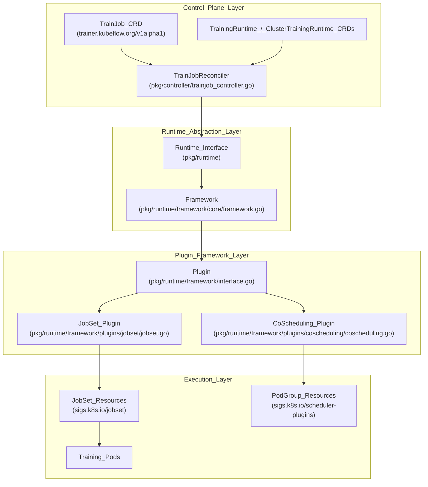
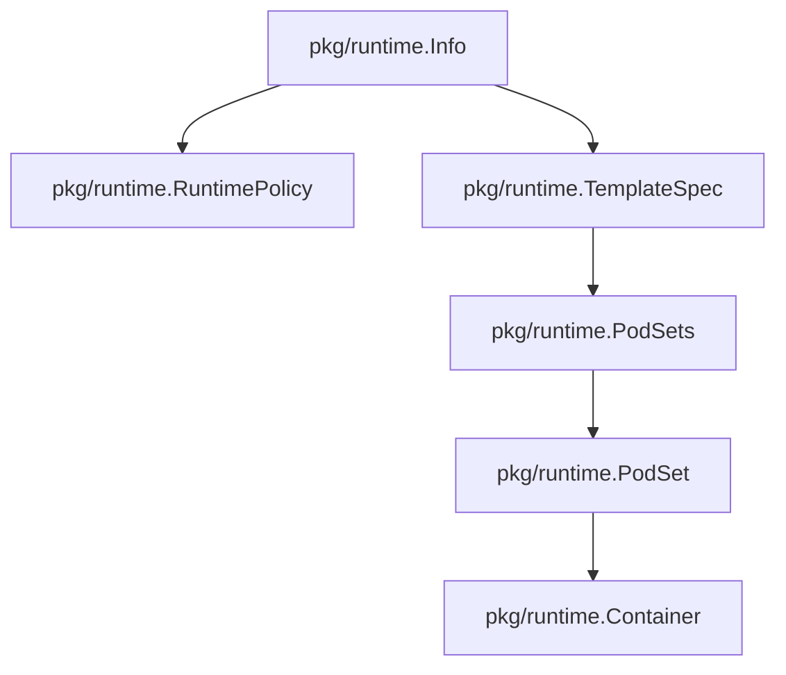

<!-- source: DeepWiki mcp.deepwiki.com · repo kubeflow/trainer · page 1.1 System Architecture · fetched 2026-10-21 -->

# System Architecture

<details>
<summary>Relevant source files</summary>

The following files were used as context for generating this wiki page:

- [Makefile](Makefile)
- [api/python_api/kubeflow_trainer_api/models/jobset_v1alpha2_failure_policy_rule.py](api/python_api/kubeflow_trainer_api/models/jobset_v1alpha2_failure_policy_rule.py)
- [go.mod](go.mod)
- [go.sum](go.sum)
- [manifests/base/rbac/role.yaml](manifests/base/rbac/role.yaml)
- [manifests/third-party/jobset/kustomization.yaml](manifests/third-party/jobset/kustomization.yaml)
- [pkg/controller/trainjob_controller.go](pkg/controller/trainjob_controller.go)
- [pkg/runtime/framework/core/framework.go](pkg/runtime/framework/core/framework.go)
- [pkg/runtime/framework/interface.go](pkg/runtime/framework/interface.go)
- [pkg/runtime/framework/plugins/coscheduling/coscheduling.go](pkg/runtime/framework/plugins/coscheduling/coscheduling.go)
- [pkg/runtime/framework/plugins/jobset/jobset.go](pkg/runtime/framework/plugins/jobset/jobset.go)
- [pkg/runtime/framework/plugins/jobset/jobset_test.go](pkg/runtime/framework/plugins/jobset/jobset_test.go)
- [pkg/runtime/framework/plugins/volcano/volcano.go](pkg/runtime/framework/plugins/volcano/volcano.go)
- [pkg/runtime/runtime.go](pkg/runtime/runtime.go)

</details>


## Purpose and Scope

This document details the overall system architecture of Kubeflow Trainer, explaining how the control plane, runtime framework, and execution layer work together to orchestrate distributed training jobs. It covers the `TrainJob` controller reconciliation flow, the plugin-based runtime system, runtime snapshotting (KEP-2599), and the generation of Kubernetes resources.

For information about specific Custom Resource schemas and their fields, see [TrainJob API]() and [TrainingRuntime and ClusterTrainingRuntime APIs](). For details about the TrainJob lifecycle and reconciliation, see [TrainJob Lifecycle and Controller](). For plugin-specific implementation details, see [Runtime Framework and Plugins]().

Sources: [pkg/controller/trainjob_controller.go:51-141](), [pkg/runtime/framework/core/framework.go:38-96](), [pkg/runtime/runtime.go:36-61]()

## Architecture Overview

Kubeflow Trainer follows a layered architecture with clear separation between the control plane, runtime abstraction, and execution layers. The system is designed to leverage `JobSet` as the underlying orchestration engine while providing a high-level API for ML practitioners.

### Component Interaction Diagram



Sources: [pkg/controller/trainjob_controller.go:51-141](), [pkg/runtime/framework/core/framework.go:38-96](), [pkg/runtime/framework/interface.go:30-84]()

## Control Plane & Component Initialization

### Controller Manager and Configuration

The controller manager initializes the core control loop via `TrainJobReconciler` defined in [pkg/controller/trainjob_controller.go:51-76](). The reconciler watches `TrainJob` instances, resolves their associated runtimes, and drives reconciliation of execution objects through [pkg/controller/trainjob_controller.go:85-141]().

Sources: [pkg/controller/trainjob_controller.go:51-141]()

### Natural Language to Code Entity Mapping: Reconciliation Flow

```mermaid
graph TD
    ReconcileEntry[""pkg/controller.TrainJobReconciler.Reconcile()""] --> GetTrainJob[""r.client.Get()""]
    GetTrainJob --> CheckFinished[""trainjob.IsTrainJobFinished()""]
    CheckFinished -- "Active" --> ReconcileObjs[""pkg/controller.TrainJobReconciler.reconcileObjects()""]
    ReconcileObjs --> NewObjects[""runtime.NewObjects()""]
    NewObjects --> ApplyObjects[""r.client.Apply()""]
    CheckFinished -- "Finished" --> DeadlineCheck[""pkg/controller.TrainJobReconciler.reconcileDeadline()""]
    ApplyObjects --> DeadlineCheck
```

Sources: [pkg/controller/trainjob_controller.go:85-154]()

### Custom Resource Definitions

The control plane defines primary CRDs in the `trainer.kubeflow.org` API group as reflected in [manifests/base/rbac/role.yaml:114-136]():

| CRD | Scope | Purpose |
|-----|-------|---------|
| `TrainJob` | Namespaced | Represents a distributed training job with trainer configuration, initializers, and runtime reference. |
| `TrainingRuntime` | Namespaced | Defines namespace-scoped runtime templates with ML policies and JobSet specifications. |
| `ClusterTrainingRuntime` | Cluster | Defines cluster-wide runtime templates reusable across namespaces. |

Sources: [manifests/base/rbac/role.yaml:114-136]()

## Runtime System & Code Entity Mapping

### Natural Language to Code Entity Mapping: Runtime Representation and Info Struct



Sources: [pkg/runtime/runtime.go:36-90]()

The runtime system uses `runtime.Info` to represent the normalized execution state parsed from runtime CRDs [pkg/runtime/runtime.go:36-47](). `PodSet` structures group pod specifications and track initialization containers, application containers, volumes, and single pod resource requests [pkg/runtime/runtime.go:66-81]().

Sources: [pkg/runtime/runtime.go:36-90]()

## Plugin Framework

### Framework Architecture

The `Framework` struct manages plugin registration and execution pipelines [pkg/runtime/framework/core/framework.go:38-49](). It inspects registered factories and populates plugin slices based on interfaces implemented, such as `EnforceMLPolicyPlugin`, `EnforcePodGroupPolicyPlugin`, `PreComponentBuilderPlugin`, and `ComponentBuilderPlugin` [pkg/runtime/framework/core/framework.go:51-96]().

Sources: [pkg/runtime/framework/core/framework.go:38-96](), [pkg/runtime/framework/interface.go:30-84]()

### Concrete Plugin Roles

The framework executes a pipeline of plugins to build the final training job resources:

| Plugin Interface | Method | Role |
|------------------|--------|------|
| `EnforceMLPolicyPlugin` | `EnforceMLPolicy` | Injects framework-specific configurations (e.g., Torch, MPI, JAX parameters). |
| `EnforcePodGroupPolicyPlugin` | `EnforcePodGroupPolicy` | Configures gang-scheduling labels and annotations (e.g., `CoScheduling` labels) [pkg/runtime/framework/plugins/coscheduling/coscheduling.go:81-91](). |
| `PreComponentBuilderPlugin` | `PreBuildSync` | Consolidates `Info` with the concrete template (e.g., mapping `PodSet` counts to `JobSet` parallelism). |
| `ComponentBuilderPlugin` | `Build` | Generates actual Kubernetes objects like `JobSet` [pkg/runtime/framework/plugins/jobset/jobset.go:70] or `PodGroup` [pkg/runtime/framework/plugins/coscheduling/coscheduling.go:93-139](). |
| `TrainJobStatusPlugin` | `Status` | Aggregates status information from the underlying execution resources [pkg/runtime/framework/core/framework.go:175-178](). |

Sources: [pkg/runtime/framework/core/framework.go:98-180](), [pkg/runtime/framework/interface.go:30-84](), [pkg/runtime/framework/plugins/coscheduling/coscheduling.go:81-139]()

## Execution Layer

### Resource Generation Flow

The plugin framework generates multiple Kubernetes resources through the `ComponentBuilderPlugin` interface invoked during reconciliation via `TrainJobReconciler.reconcileObjects` [pkg/controller/trainjob_controller.go:143-154]().

```mermaid
graph TB
    TrainJobReconciler[""TrainJobReconciler.reconcileObjects()""]
    Framework[""pkg/runtime/framework/core/Framework.RunComponentBuilderPlugins()""]
    
    subgraph "Plugins_ComponentBuilderPlugin"
        JobSetPlugin[""jobset.Build()""]
        CoSchedulingPlugin[""coscheduling.Build()""]
    end
    
    Apply[""r.client.Apply()""]
    
    TrainJobReconciler --> Framework
    Framework --> JobSetPlugin
    Framework --> CoSchedulingPlugin
    
    JobSetPlugin --> Apply
    CoSchedulingPlugin --> Apply
```

Sources: [pkg/controller/trainjob_controller.go:143-154](), [pkg/runtime/framework/core/framework.go:163-173](), [pkg/runtime/framework/plugins/coscheduling/coscheduling.go:93-139]()

---

