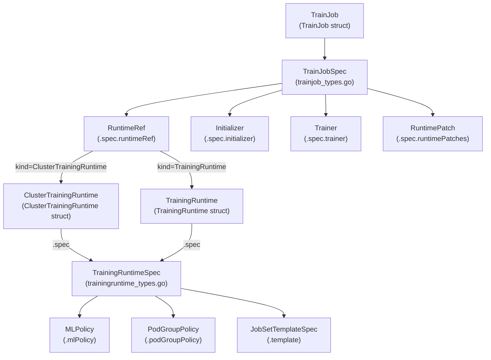
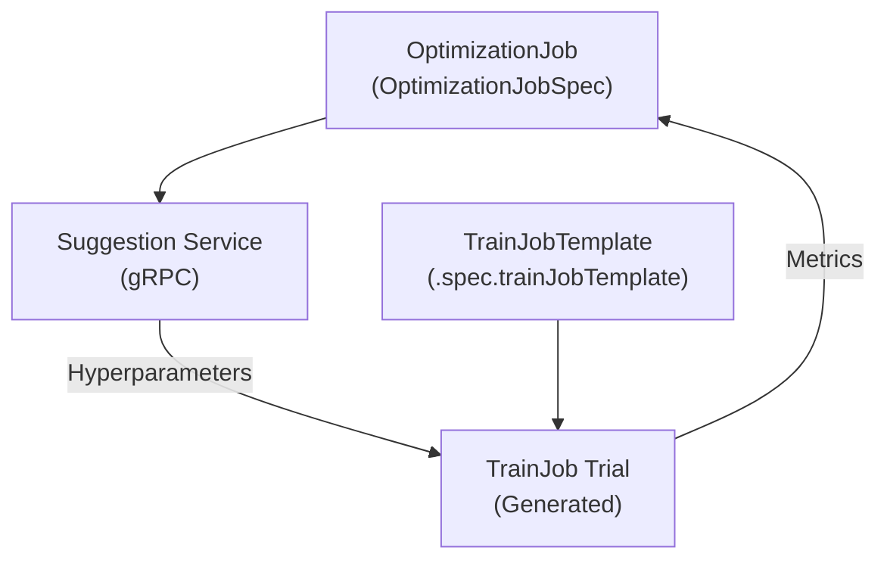
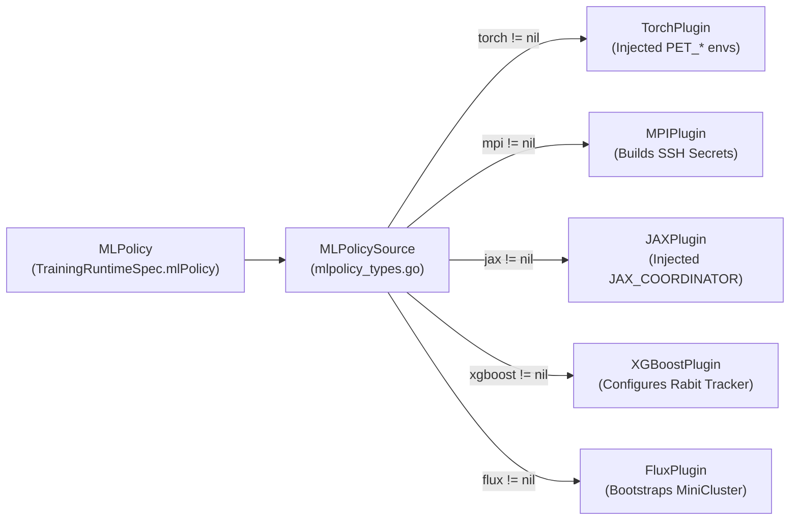
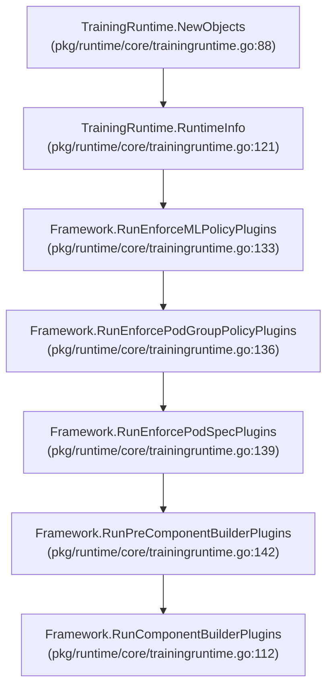

<!-- source: DeepWiki mcp.deepwiki.com · repo kubeflow/trainer · page 1.2 Key Concepts and Terminology · fetched 2026-10-21 -->

# Key Concepts and Terminology

Relevant source files

The following files were used as context for generating this wiki page:

- [api/openapi-spec/swagger.json](api/openapi-spec/swagger.json)
- [charts/kubeflow-trainer/templates/crd/trainer.kubeflow.org_trainjobs.yaml](charts/kubeflow-trainer/templates/crd/trainer.kubeflow.org_trainjobs.yaml)
- [manifests/base/crds/trainer.kubeflow.org_trainjobs.yaml](manifests/base/crds/trainer.kubeflow.org_trainjobs.yaml)
- [pkg/apis/trainer/v1alpha1/trainjob_types.go](pkg/apis/trainer/v1alpha1/trainjob_types.go)
- [pkg/apis/trainer/v1alpha1/zz_generated.deepcopy.go](pkg/apis/trainer/v1alpha1/zz_generated.deepcopy.go)
- [pkg/apis/trainer/v1alpha1/zz_generated.openapi.go](pkg/apis/trainer/v1alpha1/zz_generated.openapi.go)
- [pkg/runtime/core/core.go](pkg/runtime/core/core.go)
- [pkg/runtime/core/core_test.go](pkg/runtime/core/core_test.go)
- [pkg/runtime/core/registry.go](pkg/runtime/core/registry.go)
- [pkg/runtime/core/snapshot.go](pkg/runtime/core/snapshot.go)
- [pkg/runtime/core/snapshot_test.go](pkg/runtime/core/snapshot_test.go)
- [proposals/2170-kubeflow-trainer-v2/README.md](proposals/2170-kubeflow-trainer-v2/README.md)
- [test/integration/webhooks/trainjob_test.go](test/integration/webhooks/trainjob_test.go)

This page defines and explains the core terms used throughout the Kubeflow Trainer codebase. Coverage is focused on the meanings of API types, fields, and architectural abstractions, referencing their concrete code implementations. For full API field references, see [2.1]() (TrainJob) and [2.2]() (TrainingRuntime). For the controller lifecycle that processes these objects, see [2.3](). For plugin implementations, see [4]().

Sources: [pkg/apis/trainer/v1alpha1/trainjob_types.go:40-178](), [pkg/apis/trainer/v1alpha1/trainingruntime_types.go:43-89]()

---

## Custom Resources

Kubeflow Trainer defines four Kubernetes Custom Resource Definitions (CRDs) in the `trainer.kubeflow.org/v1alpha1` API group.

| Resource (plural) | Kind | Scope | Go type | File |
|---|---|---|---|---|
| `trainjobs` | `TrainJob` | Namespaced | `TrainJob` | [pkg/apis/trainer/v1alpha1/trainjob_types.go:40-54]() |
| `trainingruntimes` | `TrainingRuntime` | Namespaced | `TrainingRuntime` | [pkg/apis/trainer/v1alpha1/trainingruntime_types.go:79-89]() |
| `clustertrainingruntimes` | `ClusterTrainingRuntime` | Cluster | `ClusterTrainingRuntime` | [pkg/apis/trainer/v1alpha1/trainingruntime_types.go:43-53]() |
| `optimizationjobs` | `OptimizationJob` | Namespaced | `OptimizationJob` | [pkg/apis/trainer/v1alpha1/optimizationjob_types.go:34-48]() |

### CRD Relationship Map

Title: "Relationship between TrainJob and Runtime Resources"

Sources: [pkg/apis/trainer/v1alpha1/trainjob_types.go:40-178](), [pkg/apis/trainer/v1alpha1/trainingruntime_types.go:43-89](), [pkg/apis/trainer/v1alpha1/zz_generated.openapi.go:36-75]()

---

## TrainJob

`TrainJob` is the primary object submitted by users. It expresses *what* to train — the container image, number of nodes, resources, and data sources — and delegates infrastructure decisions (network topology, process group configuration, scheduling) to the referenced runtime.

### TrainJobSpec Fields

| Field | Go type | Mutable after creation | Purpose |
|---|---|---|---|
| `runtimeRef` | `RuntimeRef` | No | Points to a `TrainingRuntime` or `ClusterTrainingRuntime` [pkg/apis/trainer/v1alpha1/trainjob_types.go:103-106]() |
| `trainer` | `*Trainer` | No | Training container: image, command, args, resources, env [pkg/apis/trainer/v1alpha1/trainjob_types.go:113-116]() |
| `initializer` | `*Initializer` | No | Dataset and model download configuration [pkg/apis/trainer/v1alpha1/trainjob_types.go:108-111]() |
| `runtimePatches` | `[]RuntimePatch` | Yes | SSA patches for runtime templates [pkg/apis/trainer/v1alpha1/trainjob_types.go:118-124]() |
| `suspend` | `*bool` | Yes | Pauses execution; defaults to `false` [pkg/apis/trainer/v1alpha1/trainjob_types.go:126-129]() |
| `managedBy` | `*string` | No | Identifies the reconciling controller [pkg/apis/trainer/v1alpha1/trainjob_types.go:141-152]() |
| `activeDeadlineSeconds` | `int64` | No | Max duration before termination [pkg/apis/trainer/v1alpha1/trainjob_types.go:131-139]() |

The `managedBy` field accepts two values:
- `trainer.kubeflow.org/trainjob-controller` (default)
- `kueue.x-k8s.io/multikueue` [pkg/apis/trainer/v1alpha1/trainjob_types.go:141-152]()

Sources: [pkg/apis/trainer/v1alpha1/trainjob_types.go:102-153](), [manifests/base/crds/trainer.kubeflow.org_trainjobs.yaml:49-152](), [test/integration/webhooks/trainjob_test.go:89-113]()

---

## TrainingRuntime and ClusterTrainingRuntime

A **runtime** is a reusable template that defines how a training job's Pods are structured and coordinated. It contains three main sections defined in `TrainingRuntimeSpec`:

1. **`mlPolicy`** — ML framework parameters (process count, framework settings) [pkg/apis/trainer/v1alpha1/zz_generated.openapi.go:60-62]()
2. **`podGroupPolicy`** — gang-scheduling configuration [pkg/apis/trainer/v1alpha1/zz_generated.openapi.go:59-60]()
3. **`template`** — a `JobSetTemplateSpec` describing the set of Kubernetes Jobs [pkg/apis/trainer/v1alpha1/zz_generated.openapi.go:50-50]()

`TrainingRuntime` (`pkg/runtime/core/trainingruntime.go`) is namespace-scoped, while `ClusterTrainingRuntime` (`pkg/runtime/core/clustertrainingruntime.go`) is cluster-scoped. Both use the `TrainingRuntimeSpec` Go type [pkg/apis/trainer/v1alpha1/trainingruntime_types.go:43-89]().

Sources: [pkg/runtime/core/trainingruntime.go:56-86](), [pkg/runtime/core/clustertrainingruntime.go:42-57](), [pkg/apis/trainer/v1alpha1/trainingruntime_types.go:43-89]()

---

## OptimizationJob

`OptimizationJob` (KEP-2605) is used for hyperparameter optimization. It manages a set of `TrainJob` trials to find the best configuration based on defined objectives.

### Core Optimization Concepts

*   **Objective**: Specifies the metric to track and the direction (`Minimize` or `Maximize`) [pkg/apis/trainer/v1alpha1/zz_generated.openapi.go:62-62]().
*   **SearchSpace**: Defines the range of hyperparameters using `Uniform`, `LogUniform`, or `Categorical` types [pkg/apis/trainer/v1alpha1/zz_generated.openapi.go:79-79]().
*   **SearchAlgorithm**: The algorithm used to suggest new parameters, such as `Grid` or `Random` [pkg/apis/trainer/v1alpha1/zz_generated.openapi.go:78-78]().

### OptimizationJob Orchestration Flow

Title: "OptimizationJob to TrainJob Orchestration"

Sources: [pkg/apis/trainer/v1alpha1/optimizationjob_types.go:34-48](), [pkg/apis/trainer/v1alpha1/zz_generated.openapi.go:63-79]()

---

## mlPolicy

`MLPolicy` provides framework-specific parameters within a training runtime.

### MLPolicy Sources

| Field | Type | Description |
|---|---|---|
| `numNodes` | `*int32` | Total number of training nodes [manifests/base/crds/trainer.kubeflow.org_clustertrainingruntimes.yaml:114-119]() |
| `torch` | `*TorchMLPolicySource` | PyTorch/TorchTune settings [manifests/base/crds/trainer.kubeflow.org_clustertrainingruntimes.yaml:120-121]() |
| `mpi` | `*MPIMLPolicySource` | MPI-specific settings [manifests/base/crds/trainer.kubeflow.org_clustertrainingruntimes.yaml:80-81]() |
| `jax` | `*JAXMLPolicySource` | JAX settings [manifests/base/crds/trainer.kubeflow.org_clustertrainingruntimes.yaml:77-79]() |
| `xgboost` | `*XGBoostMLPolicySource` | XGBoost Rabit settings [pkg/apis/trainer/v1alpha1/zz_generated.openapi.go:79-79]() |
| `flux` | `*FluxMLPolicySource` | Flux HPC manager settings [manifests/base/crds/trainer.kubeflow.org_clustertrainingruntimes.yaml:64-65]() |

### MLPolicy to Plugin Dispatch

Title: "Mapping MLPolicy to Framework Plugins"

Sources: [pkg/apis/trainer/v1alpha1/zz_generated.openapi.go:54-79](), [manifests/base/crds/trainer.kubeflow.org_clustertrainingruntimes.yaml:60-121](), [pkg/apis/trainer/v1alpha1/trainjob_types.go:155-178]()

---

## ReplicatedJobs

A **replicatedJob** is a group of identical Kubernetes Jobs within a `JobSet`. Kubeflow Trainer uses reserved names to identify roles within the training workflow.

| Constant | String value | Role |
|---|---|---|
| `constants.DatasetInitializer` | `"dataset-initializer"` | Prepares data [pkg/runtime/framework/plugins/jobset/builder.go:49]() |
| `constants.ModelInitializer` | `"model-initializer"` | Prepares models [pkg/runtime/framework/plugins/jobset/builder.go:75]() |
| `constants.Node` | `"node"` | Main training worker [pkg/runtime/framework/plugins/jobset/builder.go:126]() |

Sources: [pkg/runtime/framework/plugins/jobset/builder.go:42-139]()

---

## Initializers

**Initializers** prepare data and models using the `storageUri` configuration provided in the `TrainJob` and implemented via `Builder` in `pkg/runtime/framework/plugins/jobset/builder.go`.

- **DatasetInitializer**: Configured via `TrainJob.spec.initializer.dataset`. Used for dataset initialization and pre-processing [pkg/runtime/framework/plugins/jobset/builder.go:55]().
- **ModelInitializer**: Configured via `TrainJob.spec.initializer.model`. Used for pre-trained model initialization [pkg/runtime/framework/plugins/jobset/builder.go:81]().

Sources: [pkg/runtime/framework/plugins/jobset/builder.go:42-99]()

---

## Plugin Framework

The **plugin framework** enables modular logic for framework and scheduling integration, instantiated via `core.NewTrainingRuntime` [pkg/runtime/core/trainingruntime.go:70-86]().

### Plugin Interfaces

The framework defines several interfaces for plugins to hook into the lifecycle:
- **`EnforceMLPolicy`**: Injects ML-specific configurations (e.g., environment variables) into the JobSet.
- **`ComponentBuilder`**: Creates auxiliary Kubernetes objects like Secrets or ConfigMaps via `RunComponentBuilderPlugins` [pkg/runtime/core/trainingruntime.go:112]().
- **`EnforcePodGroupPolicy`**: Configures gang-scheduling resources.
- **`CustomValidation`**: Provides additional validation logic for specific runtimes via `ValidateObjects` [pkg/runtime/core/clustertrainingruntime.go:99-140]().

### Code Entity Execution Pipeline

Title: "Code Entity Execution Pipeline for Runtimes"

Sources: [pkg/runtime/core/trainingruntime.go:88-147]()

---

## JobSet and PodGroups

`JobSet` (`sigs.k8s.io/jobset`) is the compute orchestration primitive. The `TrainingRuntime` template embeds a `JobSetSpec` which the controller uses to create the training workload [pkg/apis/trainer/v1alpha1/zz_generated.openapi.go:52-52]().

### Gang Scheduling
`PodGroup` objects are created to ensure all pods start together. Trainer supports:
- **Coscheduling**: Uses the Kubernetes scheduler-plugins `PodGroup` API [pkg/apis/trainer/v1alpha1/zz_generated.openapi.go:42-42]().
- **Volcano**: Uses the Volcano `PodGroup` API [pkg/apis/trainer/v1alpha1/zz_generated.openapi.go:165-169]().

Sources: [pkg/apis/trainer/v1alpha1/zz_generated.openapi.go:41-78](), [pkg/apis/trainer/v1alpha1/trainingruntime_types.go:102-120]()

---

## Glossary

| Term | Definition |
|---|---|
| `TrainJob` | The primary CRD representing a training task [pkg/apis/trainer/v1alpha1/trainjob_types.go:40](). |
| `RuntimePatch` | Overrides applied to the referenced runtime [pkg/apis/trainer/v1alpha1/trainjob_types.go:118-124](). |
| `OptimizationJob` | CRD for hyperparameter optimization and trial management [pkg/apis/trainer/v1alpha1/optimizationjob_types.go:34](). |
| `PET_*` | Environment variables for distributed PyTorch injected by the Torch plugin [manifests/base/crds/trainer.kubeflow.org_clustertrainingruntimes.yaml:124-130](). |
| `ActiveDeadlineSeconds` | Field that terminates the job if it exceeds a time limit [pkg/apis/trainer/v1alpha1/trainjob_types.go:131-139](). |
| `ManagedBy` | Identifies which controller reconciles the TrainJob [pkg/apis/trainer/v1alpha1/trainjob_types.go:141-152](). |
| `MLPolicy` | Specification of ML framework parameters in a runtime [pkg/apis/trainer/v1alpha1/zz_generated.openapi.go:57-57](). |

Sources: [pkg/apis/trainer/v1alpha1/trainjob_types.go:40-153](), [pkg/apis/trainer/v1alpha1/zz_generated.openapi.go:41-79](), [manifests/base/crds/trainer.kubeflow.org_clustertrainingruntimes.yaml:124-130]()

---

