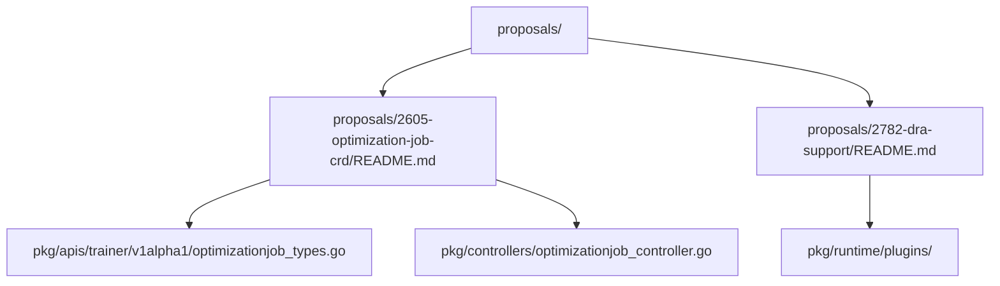

<!-- source: DeepWiki mcp.deepwiki.com · repo kubeflow/trainer · page 1.3 Documentation Site and Design Proposals · fetched 2026-10-21 -->

# Documentation Site and Design Proposals

Relevant source files

The following files were used as context for generating this wiki page:

- [docs/_ext/kubeflow_topnav/topnav.html](docs/_ext/kubeflow_topnav/topnav.html)
- [docs/_static/css/custom.css](docs/_static/css/custom.css)
- [docs/_static/img/kubeflow-trainer-icon.png](docs/_static/img/kubeflow-trainer-icon.png)
- [docs/conf.py](docs/conf.py)
- [docs/contributor-guides/community.md](docs/contributor-guides/community.md)
- [docs/contributor-guides/contributing.md](docs/contributor-guides/contributing.md)
- [docs/contributor-guides/index.md](docs/contributor-guides/index.md)
- [docs/index.rst](docs/index.rst)
- [docs/operator-guides/index.md](docs/operator-guides/index.md)
- [docs/operator-guides/job-scheduling/index.md](docs/operator-guides/job-scheduling/index.md)
- [docs/operator-guides/job-scheduling/overview.md](docs/operator-guides/job-scheduling/overview.md)
- [docs/overview/index.md](docs/overview/index.md)
- [docs/user-guides/deepspeed.md](docs/user-guides/deepspeed.md)
- [docs/user-guides/flux.md](docs/user-guides/flux.md)
- [docs/user-guides/index.md](docs/user-guides/index.md)
- [docs/user-guides/jax-tpu.md](docs/user-guides/jax-tpu.md)
- [docs/user-guides/trainjob-progress.md](docs/user-guides/trainjob-progress.md)
- [proposals/2782-dra-support/README.md](proposals/2782-dra-support/README.md)

## Purpose and Scope

This section details the structure, build system, and organization of the Kubeflow Trainer documentation site located under `docs/` and the Kubernetes Enhancement Proposal (KEP)-style design documents located under `proposals/`. The documentation site is built using Sphinx with the Furo theme and custom styling, providing targeted guidance for AI practitioners, platform administrators, and contributors. Concurrently, the `proposals/` directory houses architectural design specs that drive feature development across core controllers, APIs, and plugins.

**Sources:**
- `docs/conf.py`
- `proposals/2782-dra-support/README.md`

---

## Sphinx Documentation Architecture (`docs/`)

The documentation site source is structured hierarchically to separate user guides, operator guides, contributor documentation, and archived legacy artifacts. Configuration and build scripts reside at the root of the `docs/` directory (`docs/conf.py`).

The directory layout includes:
- `docs/overview/`: General project introduction, architecture summary, and persona-based navigation [docs/overview/index.md:1-135]().
- `docs/getting-started/`: Quick start tutorials and installation guides.
- `docs/user-guides/`: Documentation for ML engineers covering PyTorch, JAX, DeepSpeed, MLX, and TorchTune. Examples include `docs/user-guides/flux.md` for Flux Framework and `docs/user-guides/deepspeed.md` for DeepSpeed.
- `docs/operator-guides/`: Guides for platform administrators on installation, runtimes, ML policies, and job scheduling [docs/operator-guides/index.md:1-100](). This includes detailed sections on job scheduling integrations like Kueue, Slurm Bridge, KAI Scheduler, Coscheduling, and Volcano [docs/operator-guides/job-scheduling/overview.md:1-47]().
- `docs/contributor-guides/`: Developer documentation, contribution workflows, and community guidelines [docs/contributor-guides/index.md:1-34](). This includes `docs/contributor-guides/contributing.md` and `docs/contributor-guides/community.md`.
- `docs/legacy-v1/`: Archived documentation for Kubeflow Training Operator v1 and migration guides to v2.

The documentation uses a custom CSS file (`docs/_static/css/custom.css`) to align with the Kubeflow SDK visual language, defining color palettes, navigation bar styles, and heading styles [docs/_static/css/custom.css:1-271](). The top navigation bar is defined in `docs/_ext/kubeflow_topnav/topnav.html` [docs/_ext/kubeflow_topnav/topnav.html:1-46]().

```mermaid
graph TD
    RootConfig["docs/conf.py"] --> IndexRst["docs/index.rst"]
    IndexRst --> Overview["docs/overview/index.md"]
    IndexRst --> UserGuides["docs/user-guides/index.md"]
    IndexRst --> OperatorGuides["docs/operator-guides/index.md"]
    IndexRst --> ContributorGuides["docs/contributor-guides/index.md"]
    IndexRst --> LegacyV1["docs/legacy-v1/index.md"]

    UserGuides --> UG_Flux["docs/user-guides/flux.md"]
    UserGuides --> UG_DeepSpeed["docs/user-guides/deepspeed.md"]
    UserGuides --> UG_JAX_TPU["docs/user-guides/jax-tpu.md"]
    UserGuides --> UG_TrainJobProgress["docs/user-guides/trainjob-progress.md"]

    OperatorGuides --> OpInst["docs/operator-guides/installation.md"]
    OperatorGuides --> OpRuntime["docs/operator-guides/runtime.md"]
    OperatorGuides --> OpSchedIndex["docs/operator-guides/job-scheduling/index.md"]

    OpSchedIndex --> OpSchedOverview["docs/operator-guides/job-scheduling/overview.md"]
    OpSchedIndex --> OpSchedKueue["Kueue (External Link)"]
    OpSchedIndex --> OpSchedSlurm["docs/operator-guides/job-scheduling/slurm-bridge.md"]
    OpSchedIndex --> OpSchedKAI["docs/operator-guides/job-scheduling/kai.md"]
    OpSchedIndex --> OpSchedCoscheduling["docs/operator-guides/job-scheduling/coscheduling.md"]
    OpSchedIndex --> OpSchedVolcano["docs/operator-guides/job-scheduling/volcano.md"]

    ContributorGuides --> CG_Contributing["docs/contributor-guides/contributing.md"]
    ContributorGuides --> CG_Community["docs/contributor-guides/community.md"]

    StyleSheet["docs/_static/css/custom.css"]
    TopNavHTML["docs/_ext/kubeflow_topnav/topnav.html"]

    IndexRst -- "Uses" --> StyleSheet
    IndexRst -- "Uses" --> TopNavHTML
```

*Diagram 1: Mapping of Sphinx documentation pages in Natural Language Space (`docs/`) to configuration and guide modules in Code Entity Space.*

**Sources:**
- `docs/conf.py`
- `docs/index.rst` [docs/index.rst:1-118]()
- `docs/overview/index.md` [docs/overview/index.md:1-135]()
- `docs/user-guides/index.md`
- `docs/user-guides/flux.md` [docs/user-guides/flux.md:1-141]()
- `docs/user-guides/deepspeed.md` [docs/user-guides/deepspeed.md:1-182]()
- `docs/user-guides/jax-tpu.md` [docs/user-guides/jax-tpu.md:1-196]()
- `docs/user-guides/trainjob-progress.md`
- `docs/operator-guides/index.md` [docs/operator-guides/index.md:1-100]()
- `docs/operator-guides/job-scheduling/index.md` [docs/operator-guides/job-scheduling/index.md:1-66]()
- `docs/operator-guides/job-scheduling/overview.md` [docs/operator-guides/job-scheduling/overview.md:1-47]()
- `docs/contributor-guides/index.md` [docs/contributor-guides/index.md:1-34]()
- `docs/contributor-guides/contributing.md` [docs/contributor-guides/contributing.md:1-4]()
- `docs/contributor-guides/community.md` [docs/contributor-guides/community.md:1-9]()
- `docs/_static/css/custom.css` [docs/_static/css/custom.css:1-271]()
- `docs/_ext/kubeflow_topnav/topnav.html` [docs/_ext/kubeflow_topnav/topnav.html:1-46]()

---

## KEP-Style Design Proposals (`proposals/`)

Feature development in Kubeflow Trainer is guided by rigorous design proposals located in the `proposals/` directory. Each proposal follows a numbered KEP (Kubernetes Enhancement Proposal) format (e.g., `proposals/2605-optimization-job-crd/`, `proposals/2782-dra-support/`), outlining the motivation, proposal specification, alternative designs, and implementation verification plans.

These proposals serve as the upstream specifications for custom resources like `OptimizationJob` and underlying control loops. For example, `proposals/2782-dra-support/README.md` details the design for Dynamic Resource Allocation (DRA) support.

*Diagram 2: Mapping of design proposals in `proposals/` to implementation code entities in `pkg/apis/` and `pkg/controllers/`.*

**Sources:**
- `proposals/2605-optimization-job-crd/README.md`
- `proposals/2782-dra-support/README.md`

---

