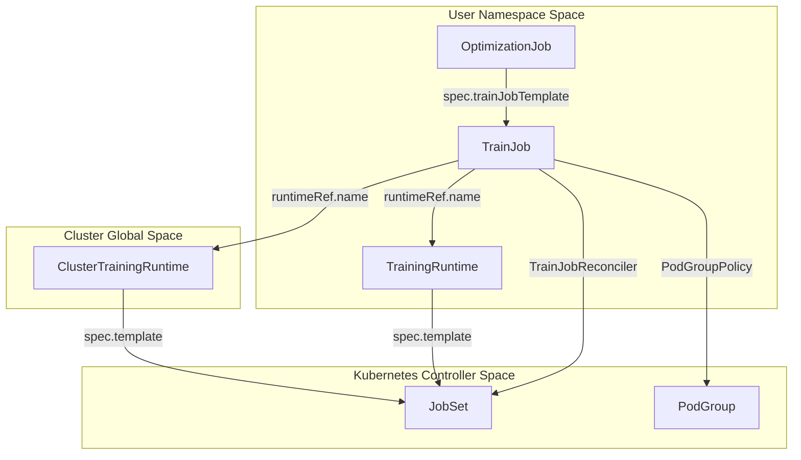
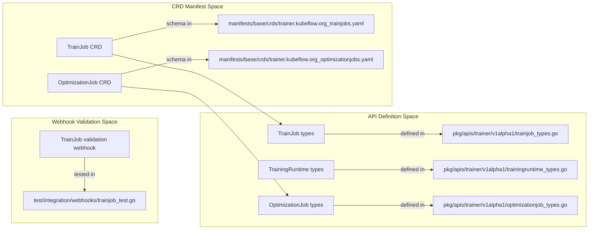

<!-- source: DeepWiki mcp.deepwiki.com · repo kubeflow/trainer · page 2 Custom Resources and APIs · fetched 2026-10-21 -->

# Custom Resources and APIs

Relevant source files

The following files were used as context for generating this wiki page:

- [api/openapi-spec/swagger.json](api/openapi-spec/swagger.json)
- [charts/kubeflow-trainer/templates/crd/trainer.kubeflow.org_trainjobs.yaml](charts/kubeflow-trainer/templates/crd/trainer.kubeflow.org_trainjobs.yaml)
- [charts/kubeflow-trainer/tests/crd/crd_test.yaml](charts/kubeflow-trainer/tests/crd/crd_test.yaml)
- [manifests/base/crds/kustomization.yaml](manifests/base/crds/kustomization.yaml)
- [manifests/base/crds/trainer.kubeflow.org_trainjobs.yaml](manifests/base/crds/trainer.kubeflow.org_trainjobs.yaml)
- [pkg/apis/trainer/v1alpha1/trainjob_types.go](pkg/apis/trainer/v1alpha1/trainjob_types.go)
- [pkg/apis/trainer/v1alpha1/zz_generated.deepcopy.go](pkg/apis/trainer/v1alpha1/zz_generated.deepcopy.go)
- [pkg/apis/trainer/v1alpha1/zz_generated.openapi.go](pkg/apis/trainer/v1alpha1/zz_generated.openapi.go)
- [test/integration/webhooks/trainjob_test.go](test/integration/webhooks/trainjob_test.go)

This page provides an overview of the Kubernetes Custom Resource Definitions (CRDs) that form the declarative API surface of Kubeflow Trainer: **TrainJob**, **TrainingRuntime**, **ClusterTrainingRuntime**, and **OptimizationJob**. These resources enable users to define distributed training jobs, execution environments, and hyperparameter optimization workflows.

As a parent page, this section summarizes high-level concepts and relationships. For detailed specifications, refer to the child pages:
- [TrainJob API](#2.1) — Detailed specification of the TrainJob CRD including spec fields, initializer configuration, trainer settings, RuntimePatches, and ActiveDeadlineSeconds lifecycle management.
- [TrainingRuntime and ClusterTrainingRuntime APIs](#2.2) — Document TrainingRuntime and ClusterTrainingRuntime CRDs, MLPolicy configurations, PodGroupPolicy, JobSet templates, and the runtime snapshot mechanism for mutable runtimes (KEP-2599).
- [TrainJob Lifecycle and Controller](#2.3) — Explain the TrainJobReconciler reconciliation loop, runtime resolution, plugin execution pipeline, object creation, deadline management, and status reporting.
- [Webhooks and Validation](#2.4) — Document admission webhooks for validation and defaulting, RuntimePatch immutability rules, and multi-manager coordination.
- [OptimizationJob API](#2.5) — Document the OptimizationJob CRD (KEP-2605) for hyperparameter optimization, including OptimizationJobSpec fields, SearchSpace types, suggestion service architecture, KUBEFLOW_TRAINER_OPT_* env injection, and status/result tracking.
- [Generated Clients and API Codegen](#2.6) — Document the generated Go clientset/informers/listers/applyconfigurations under `pkg/client`, the OpenAPI swagger spec, the generated Python API models in `api/python_api`, and the codegen scripts.

## Overview of Custom Resources

Kubeflow Trainer defines four core custom resources under the `trainer.kubeflow.org` API group:

| Resource | Scope | Purpose | Code Reference |
|----------|-------|---------|----------------|
| `TrainJob` | Namespaced | Declares training job configurations, dataset/model initializers, and trainer settings. | [`pkg/apis/trainer/v1alpha1/trainjob_types.go:40-54`]() |
| `TrainingRuntime` | Namespaced | Defines reusable runtime templates for specific ML frameworks and JobSets. | [`pkg/apis/trainer/v1alpha1/trainingruntime_types.go:79-89`]() |
| `ClusterTrainingRuntime` | Cluster | Global runtime templates accessible across all namespaces. | [`pkg/apis/trainer/v1alpha1/trainingruntime_types.go:43-53`]() |
| `OptimizationJob` | Namespaced | Orchestrates hyperparameter optimization trials by managing multiple TrainJobs. | [`manifests/base/crds/trainer.kubeflow.org_optimizationjobs.yaml:21-28`]() |

Sources: [`pkg/apis/trainer/v1alpha1/trainjob_types.go:24-54`](), [`pkg/apis/trainer/v1alpha1/trainingruntime_types.go:43-89`](), [`manifests/base/crds/trainer.kubeflow.org_optimizationjobs.yaml:21-28`]()

## Resource Relationships

The relationship between optimization jobs, train jobs, runtime templates, and underlying controller objects is structured to separate user parameters from cluster infrastructure configurations.

### Entity Relationship Diagram

Sources: [`pkg/apis/trainer/v1alpha1/trainjob_types.go:102-106`](), [`pkg/apis/trainer/v1alpha1/trainingruntime_types.go:117-120`](), [`manifests/base/crds/trainer.kubeflow.org_optimizationjobs.yaml:50-580`]()

## API Implementation Space

To bridge natural language concepts to concrete codebase entities, the following diagram maps custom resources and validation webhooks to their corresponding Go types and test packages.

### Code Entity Map

Sources: [`pkg/apis/trainer/v1alpha1/trainjob_types.go:40-54`](), [`pkg/apis/trainer/v1alpha1/trainingruntime_types.go:79-89`](), [`test/integration/webhooks/trainjob_test.go:37-43`](), [`manifests/base/crds/trainer.kubeflow.org_trainjobs.yaml:21-41`]()

## Summary of Core APIs

- **TrainJob**: Combines framework runtimes with dataset and model initialization settings, user trainer commands, runtime patches, and deadline management. For detailed specifications, see [TrainJob API](#2.1).
- **TrainingRuntime and ClusterTrainingRuntime**: Encapsulate framework-specific `MLPolicy` structures (Torch, MPI, JAX, Flux, XGBoost), gang-scheduling policies via `PodGroupPolicy`, and base `JobSet` templates. For details, see [TrainingRuntime and ClusterTrainingRuntime APIs](#2.2).
- **OptimizationJob**: Automates parameter searching using algorithms like Grid and Random search spaces (`CategoricalSpace`, `LogUniformSpace`), communicating parameter assignments via `KUBEFLOW_TRAINER_OPT_*` environment variables. For details, see [OptimizationJob API](#2.5).
- **Validation and Webhooks**: Admission controllers enforce resource immutability rules (such as `spec.runtimeRef`, `spec.initializer`, and `spec.activeDeadlineSeconds`) and validate configuration consistency. For details, see [Webhooks and Validation](#2.4).
- **Clients and Codegen**: Generated Go clientsets, informers, listers, OpenAPI schemas, and Python SDK API models under `api/python_api` and `pkg/client`. For details, see [Generated Clients and API Codegen](#2.6).

Sources: [`pkg/apis/trainer/v1alpha1/trainjob_types.go:101-153`](), [`pkg/apis/trainer/v1alpha1/trainingruntime_types.go:108-120`](), [`test/integration/webhooks/trainjob_test.go:89-164`]()

---

