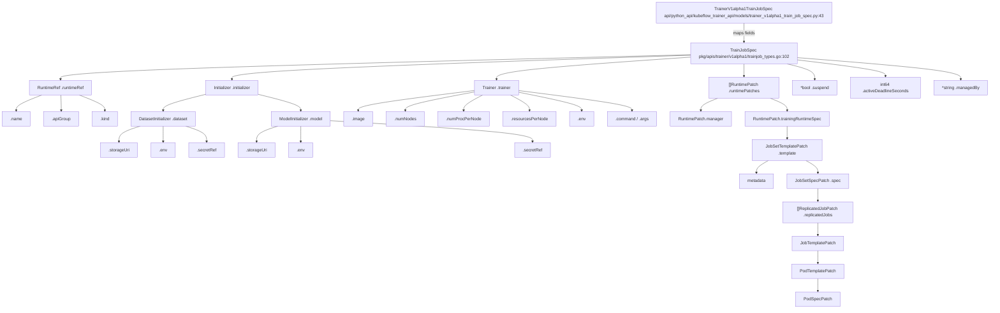
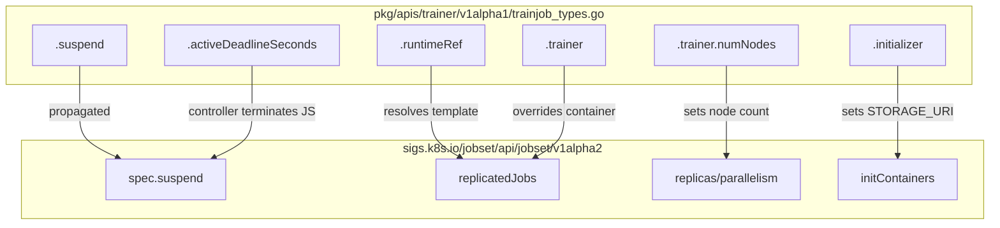

<!-- source: DeepWiki mcp.deepwiki.com · repo kubeflow/trainer · page 2.1 TrainJob API · fetched 2026-10-21 -->

# TrainJob API

<details>
<summary>Relevant source files</summary>

The following files were used as context for generating this wiki page:

- [api/openapi-spec/swagger.json](api/openapi-spec/swagger.json)
- [api/python_api/kubeflow_trainer_api/models/trainer_v1alpha1_pod_spec_patch.py](api/python_api/kubeflow_trainer_api/models/trainer_v1alpha1_pod_spec_patch.py)
- [charts/kubeflow-trainer/templates/crd/trainer.kubeflow.org_trainjobs.yaml](charts/kubeflow-trainer/templates/crd/trainer.kubeflow.org_trainjobs.yaml)
- [manifests/base/crds/trainer.kubeflow.org_trainjobs.yaml](manifests/base/crds/trainer.kubeflow.org_trainjobs.yaml)
- [pkg/apis/trainer/v1alpha1/trainjob_types.go](pkg/apis/trainer/v1alpha1/trainjob_types.go)
- [pkg/apis/trainer/v1alpha1/zz_generated.deepcopy.go](pkg/apis/trainer/v1alpha1/zz_generated.deepcopy.go)
- [pkg/apis/trainer/v1alpha1/zz_generated.openapi.go](pkg/apis/trainer/v1alpha1/zz_generated.openapi.go)
- [pkg/client/applyconfiguration/trainer/v1alpha1/podspecpatch.go](pkg/client/applyconfiguration/trainer/v1alpha1/podspecpatch.go)
- [test/integration/webhooks/trainjob_test.go](test/integration/webhooks/trainjob_test.go)

</details>


This page provides a detailed technical specification of the `TrainJob` custom resource, its spec fields, status definitions, immutability rules, and data structures as defined in the Kubeflow Trainer codebase.

For how the controller processes a `TrainJob` and orchestrates downstream Kubernetes resources, see [TrainJob Lifecycle and Controller](#2.3). For the underlying `TrainingRuntime` and `ClusterTrainingRuntime` resources referenced by a `TrainJob`, see [TrainingRuntime and ClusterTrainingRuntime APIs](#2.2). For admission webhook validation and defaulting rules, see [Webhooks and Validation](#2.4).

---

## Resource Identity

| Field | Value |
|---|---|
| API group | `trainer.kubeflow.org` |
| Version | `v1alpha1` |
| Kind | `TrainJob` |
| Plural | `trainjobs` |
| Singular | `trainjob` |
| Scope | Namespaced |

The Custom Resource Definition is declared in [manifests/base/crds/trainer.kubeflow.org_trainjobs.yaml:16-29](). The backing Go type definitions are defined in [pkg/apis/trainer/v1alpha1/trainjob_types.go:40-54](). Helper functions for inspecting TrainJob states and references are implemented in [pkg/util/trainjob/trainjob.go:32-51]().

**Name Constraints:** A `TrainJob` name must conform to RFC 1035 DNS label format (`[a-z]([-a-z0-9]*[a-z0-9])?`) and cannot exceed 63 characters. These rules are enforced via CEL validation expressions on the CRD schema [pkg/apis/trainer/v1alpha1/trainjob_types.go:36-37]().

Sources: [pkg/apis/trainer/v1alpha1/trainjob_types.go:25-54](), [manifests/base/crds/trainer.kubeflow.org_trainjobs.yaml:16-43](), [pkg/util/trainjob/trainjob.go:32-51]()

---

## TrainJobSpec Structure

The diagram below links the Go struct definitions (`TrainJobSpec`), OpenAPI/Python client models (`TrainerV1alpha1TrainJobSpec`), and YAML field names.

**`TrainJobSpec` — Go types, Python models, and YAML keys**



Sources: [pkg/apis/trainer/v1alpha1/trainjob_types.go:102-153](), [api/python_api/kubeflow_trainer_api/models/trainer_v1alpha1_train_job_spec.py:43-60](), [pkg/client/applyconfiguration/trainer/v1alpha1/trainjobspec.go:25-50]()

---

## Spec Fields and Configuration

### runtimeRef

`runtimeRef` is **required** and **immutable**. It identifies the template for the training runtime. Both namespaced `TrainingRuntime` (checked via `RuntimeRefIsTrainingRuntime`) and cluster-scoped `ClusterTrainingRuntime` (checked via `RuntimeRefIsClusterTrainingRuntime`) are supported [pkg/util/trainjob/trainjob.go:43-51]().

| Field | Type | Default | Required | Description |
|---|---|---|---|---|
| `name` | string | — | Yes | Name of the runtime |
| `apiGroup` | string | `trainer.kubeflow.org` | No | API group |
| `kind` | string | `ClusterTrainingRuntime` | No | Kind of runtime resource |

Sources: [pkg/apis/trainer/v1alpha1/trainjob_types.go:156-178](), [pkg/util/trainjob/trainjob.go:43-51](), [test/integration/webhooks/trainjob_test.go:93-113]()

---

### trainer

`trainer` is optional and **immutable**. It configures the training process container parameters, such as image, command, arguments, and hardware resources per node.

| Field | Type | Description |
|---|---|---|
| `image` | `*string` | Training container image |
| `command` | `[]string` | Entrypoint command |
| `args` | `[]string` | Command arguments |
| `numNodes` | `*int32` | Number of replicated nodes for distributed training |
| `resourcesPerNode` | `*corev1.ResourceRequirements` | Resource requests and limits per training Pod |
| `numProcPerNode` | `*int32` | Process count per node (e.g., GPUs per node) |

Resource requirements are merged using strategic merge patch semantics over the base runtime container definition via `MergeResourceRequirements` [pkg/util/trainingruntime/trainingruntime.go:47-65]().

Sources: [pkg/apis/trainer/v1alpha1/trainjob_types.go:113-116](), [pkg/util/trainingruntime/trainingruntime.go:47-65]()

---

### initializer

`initializer` is optional and **immutable**. It configures dataset and model initialization steps prior to running the training container.

| Field | Type | Description |
|---|---|---|
| `dataset` | `*DatasetInitializer` | Storage URI, environment variables, and secret references for dataset setup |
| `model` | `*ModelInitializer` | Storage URI, environment variables, and secret references for model setup |

The controller injects `STORAGE_URI` environment variables and configures initializer containers (such as HuggingFace or S3 downloaders) based on these properties during JobSet construction [pkg/runtime/framework/plugins/jobset/builder_test.go:66-187]().

Sources: [pkg/apis/trainer/v1alpha1/trainjob_types.go:180-222](), [pkg/runtime/framework/plugins/jobset/builder_test.go:66-187]()

---

### runtimePatches

`runtimePatches` is a list of `RuntimePatch` objects. It is the **only spec field mutable when `suspend` is `true`**. It enables external controllers (such as Kueue) or operators to inject pod-level and job-level configuration patches into replicated jobs.

Each patch is keyed by a unique `manager` string to prevent ownership collisions. 

**`PodSpecPatch` fields** (defined in [pkg/client/applyconfiguration/trainer/v1alpha1/podspecpatch.go:30-56]() and [api/python_api/kubeflow_trainer_api/models/trainer_v1alpha1_pod_spec_patch.py:46-60]()):
- `serviceAccountName`
- `volumes`
- `initContainers` / `containers` (via `ContainerPatch`)
- `imagePullSecrets`
- `securityContext`
- `nodeSelector`
- `affinity`
- `tolerations`
- `schedulingGates`
- `terminationGracePeriodSeconds`

Sources: [pkg/apis/trainer/v1alpha1/trainjob_types.go:118-124](), [pkg/client/applyconfiguration/trainer/v1alpha1/podspecpatch.go:30-56](), [api/python_api/kubeflow_trainer_api/models/trainer_v1alpha1_pod_spec_patch.py:46-60]()

---

### activeDeadlineSeconds

`activeDeadlineSeconds` is an optional, **immutable** integer specifying the maximum duration in seconds that the `TrainJob` may be active before the system terminates it. The timer resets upon resumption from suspension [pkg/apis/trainer/v1alpha1/trainjob_types.go:131-139]().

When the deadline is exceeded:
1. The controller assigns the `Failed` condition with reason `DeadlineExceeded` [pkg/apis/trainer/v1alpha1/trainjob_types.go:81-83]().
2. All running Pods are terminated [manifests/base/crds/trainer.kubeflow.org_trainjobs.yaml:56-62]().
3. The underlying `JobSet` is deleted.

Sources: [pkg/apis/trainer/v1alpha1/trainjob_types.go:131-139](), [manifests/base/crds/trainer.kubeflow.org_trainjobs.yaml:56-65]()

---

### suspend and managedBy

- `suspend`: A `*bool` defaulting to `false` [pkg/apis/trainer/v1alpha1/trainjob_types.go:126-129]() that propagates suspension down to the underlying `JobSet`.
- `managedBy`: An optional immutable string indicating the controlling entity [pkg/apis/trainer/v1alpha1/trainjob_types.go:141-152](). Permitted values are `trainer.kubeflow.org/trainjob-controller` (default) or `kueue.x-k8s.io/multikueue` for MultiKueue dispatching. External controller dispatch status is evaluated via `IsManagedByExternalController` [pkg/util/trainjob/trainjob.go:39-41]().

Sources: [pkg/apis/trainer/v1alpha1/trainjob_types.go:126-152](), [pkg/util/trainjob/trainjob.go:39-41]()

---

## TrainJobStatus

The status structure tracks conditions, individual underlying job states, and aggregated metrics from the status server. Finished states can be checked programmatically using `IsTrainJobFinished` [pkg/util/trainjob/trainjob.go:32-35]().

| Field | Type | Description |
|---|---|---|
| `conditions` | `[]metav1.Condition` | Lifecycle state transitions and reasons |
| `jobsStatus` | `[]JobStatus` | Status of underlying Job objects |
| `trainerStatus` | `*TrainerStatus` | Real-time training metrics and progress |

### Condition Types

| `type` | `status` | `reason` | Meaning |
|---|---|---|---|
| `Suspended` | `True` | `Suspended` | Job is currently suspended [pkg/apis/trainer/v1alpha1/trainjob_types.go:70]() |
| `Suspended` | `False` | `Resumed` | Job has been resumed [pkg/apis/trainer/v1alpha1/trainjob_types.go:74]() |
| `Complete` | `True` | `Complete` | Training completed successfully [pkg/apis/trainer/v1alpha1/trainjob_types.go:61]() |
| `Failed` | `True` | `DeadlineExceeded` | `activeDeadlineSeconds` limit reached [pkg/apis/trainer/v1alpha1/trainjob_types.go:83]() |
| `Failed` | `True` | `TrainingRuntimeNotSupported` | Runtime reference could not be resolved [pkg/apis/trainer/v1alpha1/trainjob_types.go:78]() |

Sources: [pkg/apis/trainer/v1alpha1/trainjob_types.go:56-84](), [pkg/util/trainjob/trainjob.go:32-35]()

---

## Field Immutability Summary

| Field | Immutable | Validation Rule |
|---|---|---|
| `spec.runtimeRef` | Yes | CEL `self == oldSelf` [pkg/apis/trainer/v1alpha1/trainjob_types.go:104]() |
| `spec.initializer` | Yes | CEL `self == oldSelf` [pkg/apis/trainer/v1alpha1/trainjob_types.go:109]() |
| `spec.trainer` | Yes | CEL `self == oldSelf` [pkg/apis/trainer/v1alpha1/trainjob_types.go:114]() |
| `spec.activeDeadlineSeconds` | Yes | CEL `self == oldSelf` [pkg/apis/trainer/v1alpha1/trainjob_types.go:138]() |
| `spec.managedBy` | Yes | CEL `self == oldSelf` [pkg/apis/trainer/v1alpha1/trainjob_types.go:150]() |
| `spec.runtimePatches` | No* | Mutable only when `suspend: true` [pkg/apis/trainer/v1alpha1/trainjob_types.go:118-124]() |

Sources: [pkg/apis/trainer/v1alpha1/trainjob_types.go:104-150]()

---

## TrainJob to Generated Resources Mapping

**Mapping `TrainJobSpec` fields to generated `JobSet` objects**



Sources: [pkg/apis/trainer/v1alpha1/trainjob_types.go:102-153](), [pkg/runtime/framework/plugins/jobset/builder_test.go:66-129]()

---

## Annotated Example: Distributed PyTorch

```yaml
apiVersion: trainer.kubeflow.org/v1alpha1
kind: TrainJob
metadata:
  name: torch-finetune
spec:
  runtimeRef:
    name: torch-distributed
    kind: ClusterTrainingRuntime

  initializer:
    dataset:
      storageUri: "hf://datasets/alpaca"
    model:
      storageUri: "hf://meta-llama/Llama-3.2-1B"

  trainer:
    image: pytorch/pytorch:2.4.0
    numNodes: 2
    numProcPerNode: 8
    resourcesPerNode:
      limits:
        nvidia.com/gpu: "8"

  activeDeadlineSeconds: 3600
```

Sources: [pkg/apis/trainer/v1alpha1/trainjob_types.go:102-153](), [test/integration/webhooks/trainjob_test.go:93-113]()

---

