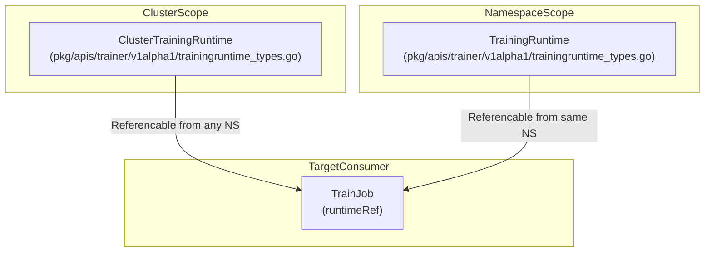
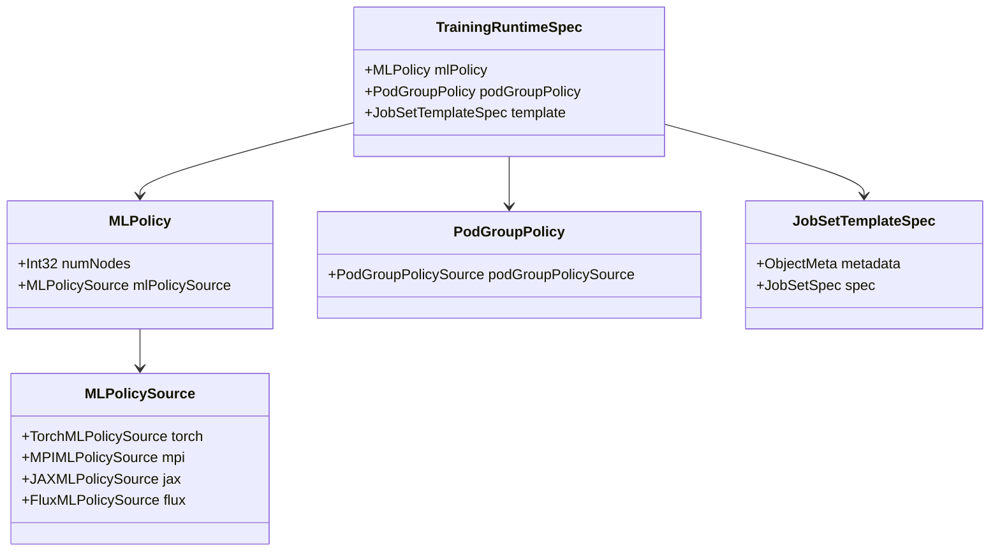
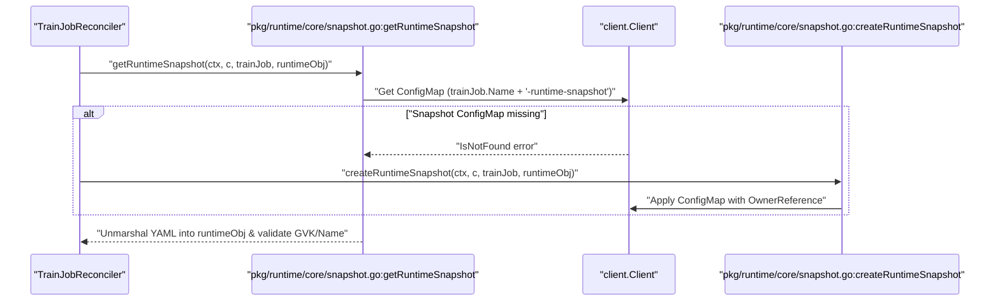

<!-- source: DeepWiki mcp.deepwiki.com · repo kubeflow/trainer · page 2.2 TrainingRuntime and ClusterTrainingRuntime APIs · fetched 2026-10-21 -->

# TrainingRuntime and ClusterTrainingRuntime APIs

<details>
<summary>Relevant source files</summary>

The following files were used as context for generating this wiki page:

- [api/python_api/kubeflow_trainer_api/models/trainer_v1alpha1_ml_policy.py](api/python_api/kubeflow_trainer_api/models/trainer_v1alpha1_ml_policy.py)
- [api/python_api/kubeflow_trainer_api/models/trainer_v1alpha1_ml_policy_source.py](api/python_api/kubeflow_trainer_api/models/trainer_v1alpha1_ml_policy_source.py)
- [charts/kubeflow-trainer/templates/crd/trainer.kubeflow.org_clustertrainingruntimes.yaml](charts/kubeflow-trainer/templates/crd/trainer.kubeflow.org_clustertrainingruntimes.yaml)
- [charts/kubeflow-trainer/templates/crd/trainer.kubeflow.org_trainingruntimes.yaml](charts/kubeflow-trainer/templates/crd/trainer.kubeflow.org_trainingruntimes.yaml)
- [manifests/base/crds/trainer.kubeflow.org_clustertrainingruntimes.yaml](manifests/base/crds/trainer.kubeflow.org_clustertrainingruntimes.yaml)
- [manifests/base/crds/trainer.kubeflow.org_trainingruntimes.yaml](manifests/base/crds/trainer.kubeflow.org_trainingruntimes.yaml)
- [pkg/apis/trainer/v1alpha1/trainingruntime_types.go](pkg/apis/trainer/v1alpha1/trainingruntime_types.go)
- [pkg/client/applyconfiguration/trainer/v1alpha1/mlpolicy.go](pkg/client/applyconfiguration/trainer/v1alpha1/mlpolicy.go)
- [pkg/client/applyconfiguration/trainer/v1alpha1/mlpolicysource.go](pkg/client/applyconfiguration/trainer/v1alpha1/mlpolicysource.go)
- [pkg/runtime/core/core.go](pkg/runtime/core/core.go)
- [pkg/runtime/core/core_test.go](pkg/runtime/core/core_test.go)
- [pkg/runtime/core/registry.go](pkg/runtime/core/registry.go)
- [pkg/runtime/core/snapshot.go](pkg/runtime/core/snapshot.go)
- [pkg/runtime/core/snapshot_test.go](pkg/runtime/core/snapshot_test.go)
- [proposals/2170-kubeflow-trainer-v2/README.md](proposals/2170-kubeflow-trainer-v2/README.md)
- [test/integration/webhooks/clustertrainingruntime_webhook_test.go](test/integration/webhooks/clustertrainingruntime_webhook_test.go)
- [test/integration/webhooks/trainingruntime_webhook_test.go](test/integration/webhooks/trainingruntime_webhook_test.go)

</details>


This page provides a detailed technical reference for the `TrainingRuntime` and `ClusterTrainingRuntime` Custom Resource Definitions (CRDs). It covers their scope distinction, the `TrainingRuntimeSpec` hierarchy (`mlPolicy`, `podGroupPolicy`, and `template`), framework-specific configuration rules, validation webhooks, and the runtime snapshot mechanism (KEP-2599) used to decouple training jobs from runtime mutations.

---

## Resource Overview and Scope Distinction

Both `TrainingRuntime` and `ClusterTrainingRuntime` share an identical Go spec structure (`TrainingRuntimeSpec`) defined in `pkg/apis/trainer/v1alpha1/trainingruntime_types.go` [pkg/apis/trainer/v1alpha1/trainingruntime_types.go:106-120](), but they differ in Kubernetes resource scope:

| Attribute | `TrainingRuntime` | `ClusterTrainingRuntime` |
|-----------|------------------|--------------------------|
| API Kind | `TrainingRuntime` [pkg/apis/trainer/v1alpha1/trainingruntime_types.go:27]() | `ClusterTrainingRuntime` [pkg/apis/trainer/v1alpha1/trainingruntime_types.go:29]() |
| CRD Plural | `trainingruntimes` | `clustertrainingruntimes` |
| Scope | Namespaced [pkg/apis/trainer/v1alpha1/trainingruntime_types.go:77-78]() | Cluster-scoped [pkg/apis/trainer/v1alpha1/trainingruntime_types.go:40-42]() |
| Reference Accessibility | Referencable by `TrainJob` in the *same* namespace [pkg/apis/trainer/v1alpha1/trainingruntime_types.go:77-78]() | Referencable by `TrainJob` in *any* namespace [pkg/apis/trainer/v1alpha1/trainingruntime_types.go:40-42]() |

### Diagram: Resource Scope and Code Entity Mapping



Sources: [pkg/apis/trainer/v1alpha1/trainingruntime_types.go:25-104](), [manifests/base/crds/trainer.kubeflow.org_clustertrainingruntimes.yaml:16-37](), [manifests/base/crds/trainer.kubeflow.org_trainingruntimes.yaml:16-37]().

---

## TrainingRuntimeSpec and Sub-Structures

The `TrainingRuntimeSpec` struct acts as the core blueprint for a runtime, combining model training policies, gang scheduling policies, and underlying JobSet templates [pkg/apis/trainer/v1alpha1/trainingruntime_types.go:106-120]().

```go
type TrainingRuntimeSpec struct {
	MLPolicy       *MLPolicy           `json:"mlPolicy,omitempty"`
	PodGroupPolicy *PodGroupPolicy     `json:"podGroupPolicy,omitempty"`
	Template       JobSetTemplateSpec  `json:"template,omitzero"`
}
```

### Type Hierarchy Diagram



Sources: [pkg/apis/trainer/v1alpha1/trainingruntime_types.go:106-184](), [manifests/base/crds/trainer.kubeflow.org_clustertrainingruntimes.yaml:50-157]().

---

## MLPolicy Configurations

The `MLPolicy` struct governs machine learning framework parameters and selects which framework plugin initializes environment variables and orchestration hooks [pkg/apis/trainer/v1alpha1/trainingruntime_types.go:172-184]().

### Constraints and Validation
- **Mutual Exclusion:** Exactly zero or one framework policy source (`torch`, `mpi`, `jax`, `flux`, `xgboost`) can be configured within `MLPolicySource`. This is enforced via CEL validation rules in the CRD schemas [manifests/base/crds/trainer.kubeflow.org_clustertrainingruntimes.yaml:172-172]() and integration tests in [test/integration/webhooks/trainingruntime_webhook_test.go:121-191]().
- **NumNodes:** Defines the number of training nodes (defaults to `1`) [pkg/apis/trainer/v1alpha1/trainingruntime_types.go:175-178]().

Sources: [pkg/apis/trainer/v1alpha1/trainingruntime_types.go:172-184](), [test/integration/webhooks/trainingruntime_webhook_test.go:82-191]().

---

## PodGroupPolicy and Gang Scheduling

`PodGroupPolicy` enables gang scheduling via third-party schedulers and Kubernetes scheduler plugins [pkg/apis/trainer/v1alpha1/trainingruntime_types.go:135-151]().

### Supported PodGroup Sources
1. **Coscheduling (`CoschedulingPodGroupPolicySource`):** Integrates with the Kubernetes `scheduler-plugins` coscheduling plugin [pkg/apis/trainer/v1alpha1/trainingruntime_types.go:143-146](). It accepts an optional `scheduleTimeoutSeconds` (defaulting to `60` seconds) [pkg/apis/trainer/v1alpha1/trainingruntime_types.go:153-163]().
2. **Volcano (`VolcanoPodGroupPolicySource`):** Integrates with Volcano gang scheduler and supports topology-aware scheduling via `networkTopology` specifications [pkg/apis/trainer/v1alpha1/trainingruntime_types.go:148-150](), [pkg/apis/trainer/v1alpha1/trainingruntime_types.go:165-170]().

Validation logic for coscheduling timeouts is verified in integration tests [test/integration/webhooks/clustertrainingruntime_webhook_test.go:75-104]().

Sources: [pkg/apis/trainer/v1alpha1/trainingruntime_types.go:135-170](), [test/integration/webhooks/clustertrainingruntime_webhook_test.go:75-104]().

---

## JobSet Templates

The `template` field (`JobSetTemplateSpec`) defines the underlying `JobSet` resource managed by JobSet API `sigs.k8s.io/jobset/api/jobset/v1alpha2` [pkg/apis/trainer/v1alpha1/trainingruntime_types.go:122-133](). 

The `ReplicatedJob` definitions must adhere to container naming conventions (such as having a primary container named `node`) so that plugins and controllers can inject framework-specific environment variables and initializers.

Sources: [pkg/apis/trainer/v1alpha1/trainingruntime_types.go:122-133]().

---

## Runtime Snapshot Mechanism (KEP-2599)

To prevent breaking active `TrainJob` instances when underlying `TrainingRuntime` or `ClusterTrainingRuntime` objects are updated or deleted, Kubeflow Trainer implements a runtime snapshot mechanism located in `pkg/runtime/core/snapshot.go` [pkg/runtime/core/snapshot.go:1-136]().

### Implementation Details
When a `TrainJob` reconciles, the controller executes the following snapshot workflow:
1. **`getRuntimeSnapshot`**: Attempts to retrieve a ConfigMap named `<trainJob.Name>-runtime-snapshot` in the same namespace [pkg/runtime/core/snapshot.go:41-50]().
2. **Ownership Validation**: Verifies that the snapshot ConfigMap is controller-owned by the requesting `TrainJob` UID [pkg/runtime/core/snapshot.go:52-55]().
3. **YAML Unmarshaling & GVK Validation**: Unmarshals the stored YAML into the runtime object (`client.Object`) and verifies that the group, version, kind, and name match the `TrainJob`'s `runtimeRef` [pkg/runtime/core/snapshot.go:57-92]().
4. **`createRuntimeSnapshot`**: If the snapshot does not exist, the controller resolves the GroupVersionKind, serializes the active runtime specification to YAML, and applies a controlled ConfigMap using Server-Side Apply [pkg/runtime/core/snapshot.go:100-136]().

### Diagram: Runtime Snapshot Data Flow & Code Entities



Sources: [pkg/runtime/core/snapshot.go:17-136](), [pkg/runtime/core/snapshot_test.go:40-222]().

---

## Sources

- [pkg/apis/trainer/v1alpha1/trainingruntime_types.go]()
- [pkg/runtime/core/snapshot.go]()
- [pkg/runtime/core/snapshot_test.go]()
- [test/integration/webhooks/trainingruntime_webhook_test.go]()
- [test/integration/webhooks/clustertrainingruntime_webhook_test.go]()
- [manifests/base/crds/trainer.kubeflow.org_clustertrainingruntimes.yaml]()
- [manifests/base/crds/trainer.kubeflow.org_trainingruntimes.yaml]()

---

