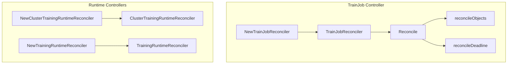
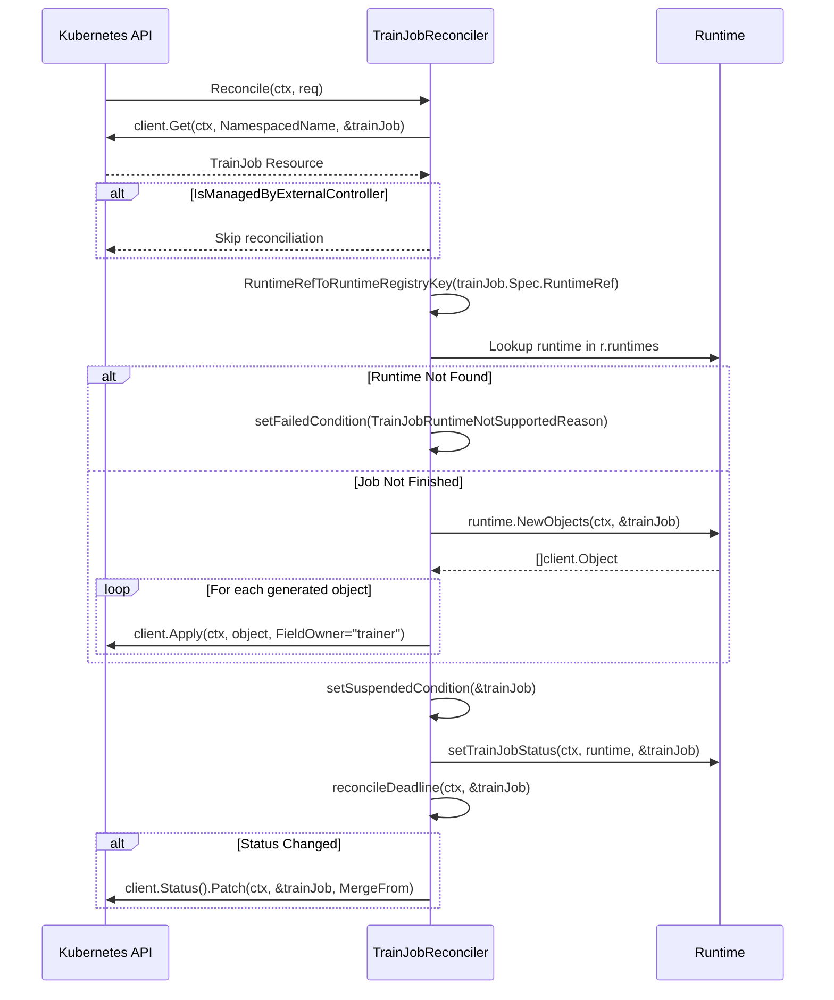

<!-- source: DeepWiki mcp.deepwiki.com · repo kubeflow/trainer · page 2.3 TrainJob Lifecycle and Controller · fetched 2026-10-21 -->

# TrainJob Lifecycle and Controller

Relevant source files

The following files were used as context for generating this wiki page:

- [Makefile](Makefile)
- [api/python_api/kubeflow_trainer_api/models/jobset_v1alpha2_failure_policy_rule.py](api/python_api/kubeflow_trainer_api/models/jobset_v1alpha2_failure_policy_rule.py)
- [go.mod](go.mod)
- [go.sum](go.sum)
- [manifests/base/rbac/role.yaml](manifests/base/rbac/role.yaml)
- [manifests/third-party/jobset/kustomization.yaml](manifests/third-party/jobset/kustomization.yaml)
- [pkg/apply/apply.go](pkg/apply/apply.go)
- [pkg/apply/apply_test.go](pkg/apply/apply_test.go)
- [pkg/controller/clustertrainingruntime_controller.go](pkg/controller/clustertrainingruntime_controller.go)
- [pkg/controller/clustertrainingruntime_controller_test.go](pkg/controller/clustertrainingruntime_controller_test.go)
- [pkg/controller/setup.go](pkg/controller/setup.go)
- [pkg/controller/trainingruntime_controller.go](pkg/controller/trainingruntime_controller.go)
- [pkg/controller/trainingruntime_controller_test.go](pkg/controller/trainingruntime_controller_test.go)
- [pkg/controller/trainjob_controller.go](pkg/controller/trainjob_controller.go)
- [pkg/controller/trainjob_controller_test.go](pkg/controller/trainjob_controller_test.go)
- [proposals/2599-mutable-runtimes/README.md](proposals/2599-mutable-runtimes/README.md)
- [test/integration/controller/clustertrainingruntime_controller_test.go](test/integration/controller/clustertrainingruntime_controller_test.go)
- [test/integration/controller/trainingruntime_controller_test.go](test/integration/controller/trainingruntime_controller_test.go)

This page explains the technical implementation of the `TrainJob` lifecycle and its controllers in Kubeflow Trainer. It covers the `TrainJobReconciler` reconciliation loop, runtime resolution (`TrainingRuntime` and `ClusterTrainingRuntime`), the object creation pipeline via Server-Side Apply (SSA), deadline management (`ActiveDeadlineSeconds`), finalizer coordination, and status reporting.

---

## 1. Controller Architecture and Components

The controller manager runs multiple reconcilers to manage custom resources across the system. The primary reconcilers include `TrainJobReconciler`, `TrainingRuntimeReconciler`, and `ClusterTrainingRuntimeReconciler`.

### Controller Code Entities

Title: ControllerCodeArchitecture

Sources: [pkg/controller/trainjob_controller.go:51-76](), [pkg/controller/clustertrainingruntime_controller.go:38-52](), [pkg/controller/trainingruntime_controller.go:38-52]()

- **`TrainJobReconciler`**: Defined in [pkg/controller/trainjob_controller.go:51-59](), responsible for reconciling `TrainJob` instances. It maintains a map of registered runtimes (`runtimes map[string]jobruntimes.Runtime`), an event `recorder`, and a `clock` for deadline calculations.
- **`ClusterTrainingRuntimeReconciler`**: Defined in [pkg/controller/clustertrainingruntime_controller.go:38-42](), handles cleanup finalizers (`constants.ResourceInUseFinalizer`) for cluster-scoped runtime templates.
- **`TrainingRuntimeReconciler`**: Defined in [pkg/controller/trainingruntime_controller.go:38-42](), manages namespace-scoped training runtimes and handles resource-in-use finalizers.

Sources: [pkg/controller/trainjob_controller.go:51-76](), [pkg/controller/clustertrainingruntime_controller.go:38-52](), [pkg/controller/trainingruntime_controller.go:38-52]()

---

## 2. Reconciliation Loop

The `TrainJobReconciler.Reconcile` method [pkg/controller/trainjob_controller.go:85-141]() implements the core control loop. It processes incoming reconciliation requests by fetching the `TrainJob`, validating its managed-by status, resolving its runtime, generating objects, and synchronizing status.

### Reconciliation Data Flow

Title: TrainJobReconciliationSequence

Sources: [pkg/controller/trainjob_controller.go:85-141](), [pkg/controller/trainjob_controller.go:143-154]()

During reconciliation, if the `TrainJob` is managed by an external controller (such as Kueue), reconciliation is bypassed [pkg/controller/trainjob_controller.go:94-97](). Terminal jobs (where `IsTrainJobFinished` returns true) skip object reconciliation but continue updating status and deadlines [pkg/controller/trainjob_controller.go:108]().

Sources: [pkg/controller/trainjob_controller.go:85-141](), [pkg/controller/trainjob_controller.go:143-154]()

---

## 3. Runtime Resolution and Object Creation

Once a `TrainJob` is verified, its `RuntimeRef` is converted into a registry key using `jobruntimes.RuntimeRefToRuntimeRegistryKey` [pkg/controller/trainjob_controller.go:103](). The corresponding `jobruntimes.Runtime` implementation is retrieved from the controller's runtime registry [pkg/controller/trainjob_controller.go:104]().

Object creation is handled by `reconcileObjects` [pkg/controller/trainjob_controller.go:143-154]():
1. Calls `runtime.NewObjects(ctx, trainJob)` to generate the list of Kubernetes objects (`JobSet`, configmaps, secrets, etc.) [pkg/controller/trainjob_controller.go:144]().
2. Iterates through the generated objects and applies them using Server-Side Apply (SSA) via `client.Apply()`, specifying `client.FieldOwner("trainer")` and `client.ForceOwnership` [pkg/controller/trainjob_controller.go:149]().

Sources: [pkg/controller/trainjob_controller.go:103-104](), [pkg/controller/trainjob_controller.go:143-154]()

---

## 4. Deadline Management

Job timeouts and deadline enforcement are managed by `reconcileDeadline` [pkg/controller/trainjob_controller.go:156-186](). 

- **Conditions**: If `ActiveDeadlineSeconds` is zero, the job is finished, or the job is suspended, deadline reconciliation is skipped [pkg/controller/trainjob_controller.go:157]().
- **Start Time**: The start time is derived from `CreationTimestamp` or adjusted using the `Suspended` condition's `LastTransitionTime` if the job was resumed [pkg/controller/trainjob_controller.go:160-164]().
- **Evaluation**: The controller compares the current time (`r.clock.Now()`) against the calculated deadline [pkg/controller/trainjob_controller.go:168-170](). If exceeded, the `TrainJob` is marked as failed, and a requeue duration is returned [pkg/controller/trainjob_controller.go:137-139]().

Sources: [pkg/controller/trainjob_controller.go:129](), [pkg/controller/trainjob_controller.go:156-186]()

---

## 5. Status Reporting and Finalizers

Status synchronization is executed via `setTrainJobStatus` during each reconciliation cycle [pkg/controller/trainjob_controller.go:125](). It inspects child resources (such as `JobSet` status) and updates the `TrainJob` conditions and job counters. 

For runtime Custom Resources (`TrainingRuntime` and `ClusterTrainingRuntime`), controllers ensure safe deletion by intercepting deletion requests when a `constants.ResourceInUseFinalizer` is present, stripping finalizers once reference checks clear [pkg/controller/clustertrainingruntime_controller.go:68-71](), [pkg/controller/trainingruntime_controller.go:68-71]().

Sources: [pkg/controller/trainjob_controller.go:125](), [pkg/controller/clustertrainingruntime_controller.go:67-72](), [pkg/controller/trainingruntime_controller.go:67-72]()

---

