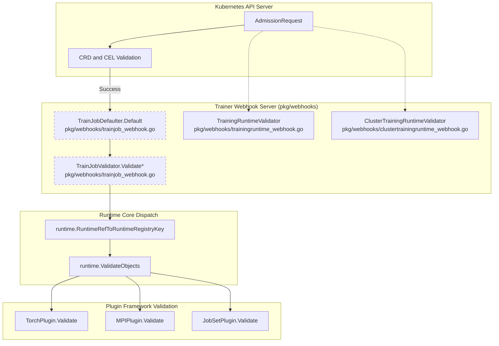
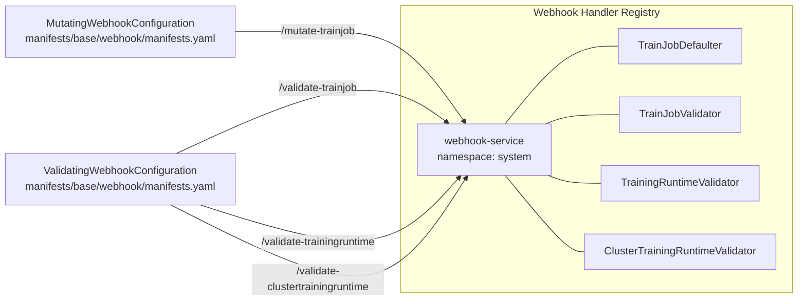

<!-- source: DeepWiki mcp.deepwiki.com · repo kubeflow/trainer · page 2.4 Webhooks and Validation · fetched 2026-10-21 -->

# Webhooks and Validation

Relevant source files

The following files were used as context for generating this wiki page:

- [charts/kubeflow-trainer/templates/rbac/clusterrole.yaml](charts/kubeflow-trainer/templates/rbac/clusterrole.yaml)
- [charts/kubeflow-trainer/templates/webhook/_helpers.tpl](charts/kubeflow-trainer/templates/webhook/_helpers.tpl)
- [charts/kubeflow-trainer/templates/webhook/mutating_webhook_configuration.yaml](charts/kubeflow-trainer/templates/webhook/mutating_webhook_configuration.yaml)
- [charts/kubeflow-trainer/tests/webhook/mutating_webhook_configuration_test.yaml](charts/kubeflow-trainer/tests/webhook/mutating_webhook_configuration_test.yaml)
- [hack/e2e-run-notebook.sh](hack/e2e-run-notebook.sh)
- [manifests/base/webhook/kustomization.yaml](manifests/base/webhook/kustomization.yaml)
- [manifests/base/webhook/kustomizeconfig.yaml](manifests/base/webhook/kustomizeconfig.yaml)
- [manifests/base/webhook/manifests.yaml](manifests/base/webhook/manifests.yaml)
- [manifests/base/webhook/patch_mutating.yaml](manifests/base/webhook/patch_mutating.yaml)
- [manifests/base/webhook/patch_validating.yaml](manifests/base/webhook/patch_validating.yaml)
- [pkg/util/cert/cert_test.go](pkg/util/cert/cert_test.go)
- [pkg/util/tlsconfig/tlsconfig.go](pkg/util/tlsconfig/tlsconfig.go)
- [pkg/util/tlsconfig/tlsconfig_test.go](pkg/util/tlsconfig/tlsconfig_test.go)
- [pkg/webhooks/clustertrainingruntime_webhook.go](pkg/webhooks/clustertrainingruntime_webhook.go)
- [pkg/webhooks/clustertrainingruntime_webhook_test.go](pkg/webhooks/clustertrainingruntime_webhook_test.go)
- [pkg/webhooks/setup.go](pkg/webhooks/setup.go)
- [pkg/webhooks/trainingruntime_webhook.go](pkg/webhooks/trainingruntime_webhook.go)
- [pkg/webhooks/trainingruntime_webhook_test.go](pkg/webhooks/trainingruntime_webhook_test.go)
- [pkg/webhooks/trainjob_webhook.go](pkg/webhooks/trainjob_webhook.go)
- [pkg/webhooks/trainjob_webhook_test.go](pkg/webhooks/trainjob_webhook_test.go)

This page documents the admission webhook system for Kubeflow Trainer, covering validation logic, defaulting mechanisms, `RuntimePatch` immutability rules, multi-manager coordination, and runtime structure verifications across `TrainJob`, `TrainingRuntime`, and `ClusterTrainingRuntime` custom resources.

---

## Overview

Kubeflow Trainer implements a multi-layered admission control architecture to guarantee resource consistency, enforce runtime constraints, and manage multi-manager state coordination:

1. **CRD-Level and CEL Validation**: Basic syntax and structural validation are handled via OpenAPI V3 schema definitions and Common Expression Language (CEL) rules embedded directly in the Custom Resource Definitions.
2. **Mutating Webhook (`TrainJobDefaulter`)**: Handles resource defaulting and tracks timestamps for individual `RuntimePatch` entries to coordinate updates from external managers [pkg/webhooks/trainjob_webhook.go:39-42]().
3. **Validating Webhook (`TrainJobValidator`, `TrainingRuntimeValidator`, `ClusterTrainingRuntimeValidator`)**: Enforces structural invariants on runtime templates and delegates core validation to the plugin framework via `runtime.Runtime.ValidateObjects()` [pkg/webhooks/trainjob_webhook.go:110-121]().

The webhook server components are initialized and registered to the controller manager via `webhooks.Setup()` [pkg/webhooks/setup.go:26-37]().

Sources: [pkg/webhooks/trainjob_webhook.go:39-121](), [charts/kubeflow-trainer/templates/rbac/clusterrole.yaml:54-63]()

---

## Admission Flow and Code Entities

The following diagram bridges natural language operations to the underlying code entities during the admission request lifecycle.

**Diagram: Admission Request Pipeline**

Sources: [pkg/webhooks/trainjob_webhook.go:45-134](), [pkg/webhooks/trainingruntime_webhook.go:50-73](), [pkg/webhooks/clustertrainingruntime_webhook.go:35-57]()

---

## Mutating Webhook and Defaulting

The `TrainJobDefaulter` struct [pkg/webhooks/trainjob_webhook.go:39-42]() applies default values and governs multi-manager coordination rules for `TrainJob` specs.

### RuntimePatch Coordination and Immutability Rules
To support multi-manager environments where different actors (e.g., an SDK client and a model auto-scaler) patch specific components of a `TrainJob`, the webhook tracks the `Time` field for each entry in `TrainJobSpec.RuntimePatches`:

* **On Create**: Every patch in `spec.runtimePatches` receives a timestamp via the configured clock if `Time` is unassigned [pkg/webhooks/trainjob_webhook.go:64-70]().
* **On Update**: The webhook compares the incoming patch against the corresponding patch in `oldObj` using `equality.Semantic.DeepEqual` after temporarily stripping the `Time` field [pkg/webhooks/trainjob_webhook.go:73-86](). If the patch configuration remains unchanged, the existing timestamp (`old.Time`) is preserved [pkg/webhooks/trainjob_webhook.go:82-83](). If any field changes, the timestamp is updated to the current time [pkg/webhooks/trainjob_webhook.go:84-86]().

### Defaulting Implementation
The `Default` method accepts a `clock.PassiveClock` to allow deterministic testing [pkg/webhooks/trainjob_webhook.go:40-41]() and extracts the old object from `admission.Request` during `Update` operations [pkg/webhooks/trainjob_webhook.go:51-62]().

Sources: [pkg/webhooks/trainjob_webhook.go:39-92](), [pkg/webhooks/trainjob_webhook_test.go:42-196]()

---

## Validating Webhook

The validation webhooks ensure resource integrity across `TrainJob` [pkg/webhooks/trainjob_webhook.go:97](), `TrainingRuntime` [pkg/webhooks/trainingruntime_webhook.go:51](), and `ClusterTrainingRuntime` [pkg/webhooks/clustertrainingruntime_webhook.go:35]() resources.

### Runtime Resolution and Object Validation
During `TrainJob` creation or update, `TrainJobValidator` resolves the target runtime via `runtime.RuntimeRefToRuntimeRegistryKey` [pkg/webhooks/trainjob_webhook.go:114-118, 127-131]() and delegates deeper semantic checking to `runtime.ValidateObjects` [pkg/webhooks/trainjob_webhook.go:119, 132]().

### TrainingRuntime Structure Validation
`TrainingRuntimeValidator` and `ClusterTrainingRuntimeValidator` enforce strict layout constraints on the underlying `JobSet` template via `validateReplicatedJobs` [pkg/webhooks/trainingruntime_webhook.go:75-114](), [pkg/webhooks/clustertrainingruntime_webhook.go:56-62]():
* **ReplicatedJob Replicas**: For jobs marked with `constants.LabelTrainJobAncestor` (e.g., `trainer`, `model-initializer`, `dataset-initializer`), the `replicas` field must be strictly equal to `1` [pkg/webhooks/trainingruntime_webhook.go:87-90]().
* **Required Containers**: Validates that each `ReplicatedJob` contains the required container corresponding to its ancestor label, per `expectedContainerNames` [pkg/webhooks/trainingruntime_webhook.go:41-46, 92-111]().
* **Deprecation Warnings**: Issues warning messages if a runtime carries the deprecation label checked by `trainingruntime.IsSupportDeprecated` [pkg/webhooks/trainingruntime_webhook.go:65-71]().

| Ancestor Label (`constants`) | Required Container Name | Replicas Rule |
| :--- | :--- | :--- |
| `constants.AncestorTrainer` | `constants.Node` (`node`) | Must be `1` [pkg/webhooks/trainingruntime_webhook.go:88]() |
| `constants.ModelInitializer` | `constants.ModelInitializer` (`model-initializer`) | Must be `1` [pkg/webhooks/trainingruntime_webhook.go:88]() |
| `constants.DatasetInitializer` | `constants.DatasetInitializer` (`dataset-initializer`) | Must be `1` [pkg/webhooks/trainingruntime_webhook.go:88]() |

Sources: [pkg/webhooks/trainjob_webhook.go:97-138](), [pkg/webhooks/trainingruntime_webhook.go:34-114](), [pkg/webhooks/clustertrainingruntime_webhook.go:35-67](), [pkg/webhooks/trainingruntime_webhook_test.go:32-136]()

---

## Certificate Management and Manifests

Webhooks require TLS transport security. Kubeflow Trainer defines standard `MutatingWebhookConfiguration` and `ValidatingWebhookConfiguration` objects [manifests/base/webhook/manifests.yaml:16-106]().

**Diagram: Webhook Configuration Entities**

### Implementation Details
* **Registration Rules**: Configured for `CREATE` and `UPDATE` operations targeting `trainjobs`, `trainingruntimes`, and `clustertrainingruntimes` [manifests/base/webhook/manifests.yaml:16-106]().
* **Failure Policy**: Enforced as `Fail` across all webhooks to prevent admission if the controller manager is unreachable [manifests/base/webhook/manifests.yaml:28, 54, 74, 94]().
* **RBAC Privileges**: The controller manager ClusterRole includes permissions to manage `mutatingwebhookconfigurations` and `validatingwebhookconfigurations` under `admissionregistration.k8s.io` [charts/kubeflow-trainer/templates/rbac/clusterrole.yaml:54-63]().

Sources: [manifests/base/webhook/manifests.yaml:1-106](), [charts/kubeflow-trainer/templates/rbac/clusterrole.yaml:54-63]()

---

