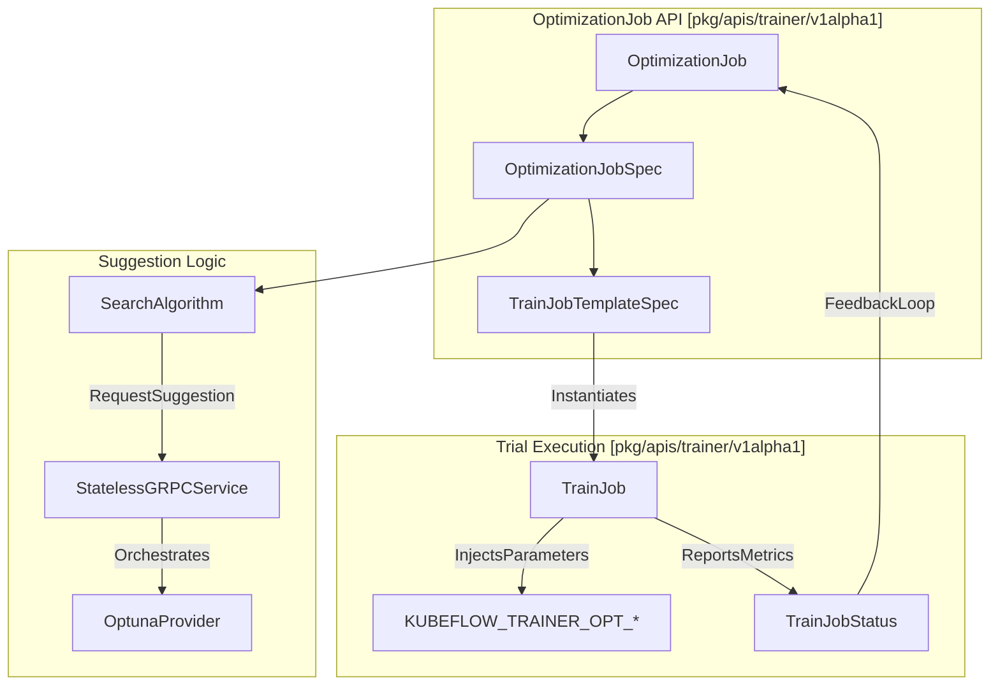
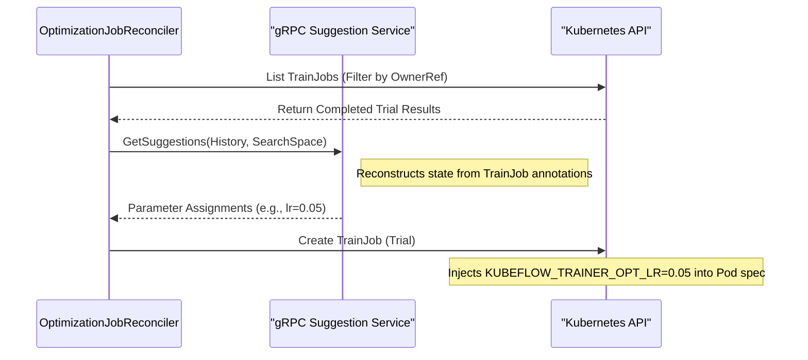

<!-- source: DeepWiki mcp.deepwiki.com · repo kubeflow/trainer · page 2.5 OptimizationJob API · fetched 2026-10-21 -->

# OptimizationJob API

Relevant source files

The following files were used as context for generating this wiki page:

- [api/python_api/kubeflow_trainer_api/models/trainer_v1alpha1_objective.py](api/python_api/kubeflow_trainer_api/models/trainer_v1alpha1_objective.py)
- [charts/kubeflow-trainer/templates/crd/trainer.kubeflow.org_optimizationjobs.yaml](charts/kubeflow-trainer/templates/crd/trainer.kubeflow.org_optimizationjobs.yaml)
- [manifests/base/crds/trainer.kubeflow.org_optimizationjobs.yaml](manifests/base/crds/trainer.kubeflow.org_optimizationjobs.yaml)
- [pkg/apis/trainer/v1alpha1/optimizationjob_types.go](pkg/apis/trainer/v1alpha1/optimizationjob_types.go)
- [pkg/client/applyconfiguration/trainer/v1alpha1/objective.go](pkg/client/applyconfiguration/trainer/v1alpha1/objective.go)
- [proposals/2605-optimization-job-crd/README.md](proposals/2605-optimization-job-crd/README.md)

## Purpose and Scope
This page documents the `OptimizationJob` API (KEP-3562/2605) for hyperparameter optimization (HPO) targeting `TrainJobs` in Kubeflow Trainer [proposals/2605-optimization-job-crd/README.md:1-27](). It details the `OptimizationJobSpec` fields, `SearchSpace` types, the stateless suggestion service architecture, `KUBEFLOW_TRAINER_OPT_*` environment variable injection, and status/result tracking.

Sources: [proposals/2605-optimization-job-crd/README.md:1-27]()

---

## System Architecture

The `OptimizationJob` architecture follows a stateless gRPC provider model. Unlike legacy systems that require a persistent database (such as Katib DB), the controller implemented by `OptimizationJob` reconstructs trial histories directly from the Kubernetes API by inspecting existing `TrainJob` resources [proposals/2605-optimization-job-crd/README.md:86-87]().

### Data Flow and Entity Mapping

The following diagram bridges high-level HPO concepts to specific code entities (`OptimizationJob`, `OptimizationJobSpec`, `TrainJobTemplateSpec`) and data injection mechanisms defined in the codebase.

**HPO Concept to Code Entity Mapping**

Sources: [pkg/apis/trainer/v1alpha1/optimizationjob_types.go:35-109](), [proposals/2605-optimization-job-crd/README.md:71-87]()

---

## OptimizationJob Specification

The `OptimizationJobSpec` defines the search space, optimization objectives, and the template for the training trials. It is immutable after creation [pkg/apis/trainer/v1alpha1/optimizationjob_types.go:67-70]().

### Key Fields
| Field | Type | Description |
| :--- | :--- | :--- |
| `objectives` | `[]Objective` | List of metrics to optimize. Currently limited to 1 objective [pkg/apis/trainer/v1alpha1/optimizationjob_types.go:71-77](). |
| `searchAlgorithm` | `SearchAlgorithm` | The algorithm to use (`random`, `grid`). Defaults to `random` [pkg/apis/trainer/v1alpha1/optimizationjob_types.go:79-82](). |
| `parameters` | `[]Parameter` | The hyperparameters and their respective search spaces (Min: 1, Max: 100) [pkg/apis/trainer/v1alpha1/optimizationjob_types.go:84-90](). |
| `numTrials` | `int32` | Total number of trials to run (Default: 1, Max: 100) [pkg/apis/trainer/v1alpha1/optimizationjob_types.go:92-97](). |
| `parallelTrials` | `int32` | Max number of concurrent trials (Default: 1, Max: 100) [pkg/apis/trainer/v1alpha1/optimizationjob_types.go:99-104](). |
| `trainJobTemplate` | `TrainJobTemplateSpec` | The template `TrainJob` to be instantiated for each trial [pkg/apis/trainer/v1alpha1/optimizationjob_types.go:106-108](). |

Sources: [pkg/apis/trainer/v1alpha1/optimizationjob_types.go:70-109](), [charts/kubeflow-trainer/templates/crd/trainer.kubeflow.org_optimizationjobs.yaml:51-108]()

---

## Search Space Types

The `SearchSpace` acts as a discriminated union (`OneOf`) supporting flexible statistical distributions [pkg/apis/trainer/v1alpha1/optimizationjob_types.go:145-159]():

*   **Uniform**: Continuous uniform distribution over `[min, max]` [pkg/apis/trainer/v1alpha1/optimizationjob_types.go:167-184]().
*   **LogUniform**: Continuous log-uniform distribution where `min > 0` [pkg/apis/trainer/v1alpha1/optimizationjob_types.go:189-207]().
*   **Categorical**: Discrete set of unordered strings [pkg/apis/trainer/v1alpha1/optimizationjob_types.go:222-228]().

Sources: [pkg/apis/trainer/v1alpha1/optimizationjob_types.go:145-228](), [charts/kubeflow-trainer/templates/crd/trainer.kubeflow.org_optimizationjobs.yaml:108-178]()

---

## Parameter Injection and Suggestion Service

Suggestions are injected into the trainer containers via environment variables, avoiding modifications to container entrypoints or CLI arguments. The naming convention uses the prefix `KUBEFLOW_TRAINER_OPT_<PARAMETER_NAME>` (uppercased) [proposals/2605-optimization-job-crd/README.md:75-77]().

**Suggestion Injection Flow**

Sources: [proposals/2605-optimization-job-crd/README.md:82-87](), [pkg/apis/trainer/v1alpha1/optimizationjob_types.go:252-260]()

---

## Status and Result Tracking

The `OptimizationJobStatus` tracks the progress of the optimization experiment and the best performing parameter combinations discovered so far [pkg/apis/trainer/v1alpha1/optimizationjob_types.go:35-50]().

*   **BestTrial**: Captures the parameter assignments and metric values of the trial that achieved the optimal result based on the `ObjectiveDirection` (`Maximize` or `Minimize`) [pkg/apis/trainer/v1alpha1/optimizationjob_types.go:21-27]() [pkg/client/applyconfiguration/trainer/v1alpha1/objective.go:25-32]().
*   **Metrics Integration**: Metrics are collected from `TrainJob` resources using the `TrainJobStatus` API, providing push-based updates from the training runner [proposals/2605-optimization-job-crd/README.md:83-84]().

Sources: [pkg/apis/trainer/v1alpha1/optimizationjob_types.go:21-50](), [pkg/client/applyconfiguration/trainer/v1alpha1/objective.go:25-32](), [proposals/2605-optimization-job-crd/README.md:83-84]()

---

## Validation Rules (CEL)

The API relies on Kubernetes Common Expression Language (CEL) rules for compile-time and admission validation:
*   **Job Invariants**: `parallelTrials` must be less than or equal to `numTrials` [pkg/apis/trainer/v1alpha1/optimizationjob_types.go:68]().
*   **Algorithm Constraints**: `Grid` search requires all parameters to be `Categorical`; `Uniform` and `LogUniform` are not permitted under grid search [pkg/apis/trainer/v1alpha1/optimizationjob_types.go:69]().
*   **Space Boundaries**: For `UniformSpace` and `LogUniformSpace`, `min` must be strictly less than `max` [pkg/apis/trainer/v1alpha1/optimizationjob_types.go:166]() [pkg/apis/trainer/v1alpha1/optimizationjob_types.go:188]().
*   **Log Distribution**: For `LogUniformSpace`, `min` must be strictly greater than `0` [pkg/apis/trainer/v1alpha1/optimizationjob_types.go:187]().

Sources: [pkg/apis/trainer/v1alpha1/optimizationjob_types.go:66-70](), [charts/kubeflow-trainer/templates/crd/trainer.kubeflow.org_optimizationjobs.yaml:153-157]()

---

