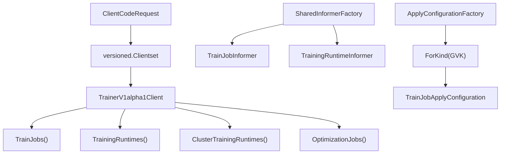
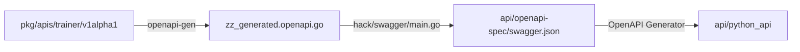
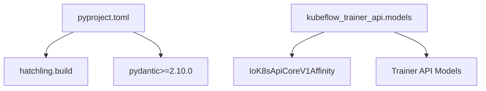
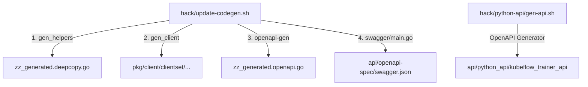

<!-- source: DeepWiki mcp.deepwiki.com · repo kubeflow/trainer · page 2.6 Generated Clients and API Codegen · fetched 2026-10-21 -->

# Generated Clients and API Codegen

Relevant source files

The following files were used as context for generating this wiki page:

- [api/python_api/kubeflow_trainer_api/models/__init__.py](api/python_api/kubeflow_trainer_api/models/__init__.py)
- [api/python_api/pyproject.toml](api/python_api/pyproject.toml)
- [hack/update-codegen.sh](hack/update-codegen.sh)
- [pkg/client/applyconfiguration/trainer/v1alpha1/clustertrainingruntime.go](pkg/client/applyconfiguration/trainer/v1alpha1/clustertrainingruntime.go)
- [pkg/client/applyconfiguration/trainer/v1alpha1/jobsettemplatespec.go](pkg/client/applyconfiguration/trainer/v1alpha1/jobsettemplatespec.go)
- [pkg/client/applyconfiguration/trainer/v1alpha1/mpimlpolicysource.go](pkg/client/applyconfiguration/trainer/v1alpha1/mpimlpolicysource.go)
- [pkg/client/applyconfiguration/trainer/v1alpha1/podgrouppolicy.go](pkg/client/applyconfiguration/trainer/v1alpha1/podgrouppolicy.go)
- [pkg/client/applyconfiguration/trainer/v1alpha1/podgrouppolicysource.go](pkg/client/applyconfiguration/trainer/v1alpha1/podgrouppolicysource.go)
- [pkg/client/applyconfiguration/trainer/v1alpha1/trainer.go](pkg/client/applyconfiguration/trainer/v1alpha1/trainer.go)
- [pkg/client/applyconfiguration/trainer/v1alpha1/trainingruntime.go](pkg/client/applyconfiguration/trainer/v1alpha1/trainingruntime.go)
- [pkg/client/applyconfiguration/trainer/v1alpha1/trainjob.go](pkg/client/applyconfiguration/trainer/v1alpha1/trainjob.go)
- [pkg/client/applyconfiguration/trainer/v1alpha1/volcanopodgrouppolicysource.go](pkg/client/applyconfiguration/trainer/v1alpha1/volcanopodgrouppolicysource.go)
- [pkg/client/applyconfiguration/utils.go](pkg/client/applyconfiguration/utils.go)
- [pkg/client/clientset/versioned/clientset.go](pkg/client/clientset/versioned/clientset.go)
- [pkg/client/clientset/versioned/fake/clientset_generated.go](pkg/client/clientset/versioned/fake/clientset_generated.go)
- [pkg/client/clientset/versioned/fake/doc.go](pkg/client/clientset/versioned/fake/doc.go)
- [pkg/client/clientset/versioned/fake/register.go](pkg/client/clientset/versioned/fake/register.go)
- [pkg/client/clientset/versioned/scheme/doc.go](pkg/client/clientset/versioned/scheme/doc.go)
- [pkg/client/clientset/versioned/scheme/register.go](pkg/client/clientset/versioned/scheme/register.go)
- [pkg/client/informers/externalversions/factory.go](pkg/client/informers/externalversions/factory.go)
- [pkg/client/informers/externalversions/generic.go](pkg/client/informers/externalversions/generic.go)
- [pkg/client/informers/externalversions/internalinterfaces/factory_interfaces.go](pkg/client/informers/externalversions/internalinterfaces/factory_interfaces.go)
- [pkg/client/informers/externalversions/trainer/v1alpha1/clustertrainingruntime.go](pkg/client/informers/externalversions/trainer/v1alpha1/clustertrainingruntime.go)
- [pkg/client/informers/externalversions/trainer/v1alpha1/trainingruntime.go](pkg/client/informers/externalversions/trainer/v1alpha1/trainingruntime.go)
- [pkg/client/informers/externalversions/trainer/v1alpha1/trainjob.go](pkg/client/informers/externalversions/trainer/v1alpha1/trainjob.go)

The Kubeflow Trainer codebase relies heavily on code generation to maintain consistency between its Custom Resource Definitions (CRDs) defined in Go, strongly typed Kubernetes Go clientsets, informers, listers, apply configurations, OpenAPI schemas, and Python API client models (`kubeflow_trainer_api`). 

This document details the architecture, data flows, generated packages under `pkg/client` and `api/python_api`, and the underlying code generation scripts located in the `hack/` directory.

---

## 1. Go Code Generation and Client Packages (`pkg/client`)

Kubeflow Trainer uses Kubernetes `k8s.io/code-generator` tools to automatically generate type-safe Go clients, shared informers, listers, and Server-Side Apply (SSA) configurations for all custom resources (`TrainJob`, `TrainingRuntime`, `ClusterTrainingRuntime`, and `OptimizationJob`). These generated entities reside under the `pkg/client/` directory.

### Clientset (`pkg/client/clientset/versioned`)
The versioned clientset provides programmatic access to Kubeflow Trainer custom resources over the Kubernetes REST API. 
- `Interface` [pkg/client/clientset/versioned/clientset.go:31-34]() defines methods to access discovery clients and group-version interfaces like `TrainerV1alpha1()`.
- `Clientset` [pkg/client/clientset/versioned/clientset.go:37-40]() embeds the discovery client and initializes the `trainerv1alpha1` client implementation [pkg/client/clientset/versioned/clientset.go:91-91]().
- `scheme.Register` [pkg/client/clientset/versioned/scheme/register.go:30-36]() registers `trainerv1alpha1` types into the runtime scheme so that client payloads serialize and deserialize correctly.

### Informers and Listers (`pkg/client/informers` and `pkg/client/listers`)
Informers provide event-driven caching for Kubernetes resources, reducing direct load on the Kubernetes API server.
- `GenericInformer` [pkg/client/informers/externalversions/generic.go:29-34]() defines methods to fetch a `SharedIndexInformer` and a `GenericLister` across all Trainer GVRs.
- `sharedInformerFactory` [pkg/client/informers/externalversions/factory.go:40-59]() coordinates background workers, synchronization, and custom resync intervals for Trainer resources.

### Apply Configurations (`pkg/client/applyconfiguration`)
Apply configurations facilitate Server-Side Apply (SSA) patterns for custom resources and external types (e.g., JobSet, Core v1, Volcano). 
- `ForKind` [pkg/client/applyconfiguration/utils.go:32-37]() inspects a `GroupVersionKind` and returns the corresponding apply configuration builder struct (e.g., `TrainJobApplyConfiguration`, `ClusterTrainingRuntimeApplyConfiguration`).

### Fake Clientset (`pkg/client/clientset/versioned/fake`)
To support unit testing without a live Kubernetes cluster, `NewSimpleClientset` and `NewClientset` provide mock clients backed by an object tracker or field-managed object tracker [pkg/client/clientset/versioned/fake/clientset_generated.go:34-132]().

+-------------------------------------------------------------------------+
|                  Natural Language & Conceptual Space                    |
|  "Kubeflow Trainer Go Client & Informer Framework for Unit Testing"     |
+-------------------------------------------------------------------------+
                                     |
                                     v
+-------------------------------------------------------------------------+
|                        Code Entity Space                                |
|  - versioned.NewSimpleClientset(...) [pkg/client/clientset/versioned/fake/clientset_generated.go:38-38]()
|  - sharedInformerFactory [pkg/client/informers/externalversions/factory.go:40-59]()
|  - applyconfiguration.ForKind(...) [pkg/client/applyconfiguration/utils.go:32-37]()
|  - trainerv1alpha1.TrainerV1alpha1Client [pkg/client/clientset/versioned/clientset.go:37-40]()
+-------------------------------------------------------------------------+

Title: "Go Client Architecture Mapping"

Sources:
- `hack/update-codegen.sh` [hack/update-codegen.sh:1-100]()
- `pkg/client/clientset/versioned/clientset.go` [pkg/client/clientset/versioned/clientset.go:1-120]()
- `pkg/client/clientset/versioned/scheme/register.go` [pkg/client/clientset/versioned/scheme/register.go:1-56]()
- `pkg/client/clientset/versioned/fake/clientset_generated.go` [pkg/client/clientset/versioned/fake/clientset_generated.go:1-142]()
- `pkg/client/informers/externalversions/generic.go` [pkg/client/informers/externalversions/generic.go:1-68]()
- `pkg/client/informers/externalversions/factory.go` [pkg/client/informers/externalversions/factory.go:1-186]()
- `pkg/client/applyconfiguration/utils.go` [pkg/client/applyconfiguration/utils.go:1-126]()

---

## 2. OpenAPI Specification and Swagger Generation

Kubeflow Trainer generates an OpenAPI v2 specification to document its API models and power downstream code generators (such as the Python SDK).

### OpenAPI Generation Process
1. **`openapi-gen`**: The script runs `k8s.io/kube-openapi/cmd/openapi-gen` against the core types under `pkg/apis/trainer/v1alpha1` and external dependency packages (`k8s.io/api`, `sigs.k8s.io/jobset`, `volcano.sh/apis`) [hack/update-codegen.sh:76-96](). This produces `zz_generated.openapi.go` inside `pkg/apis/trainer/v1alpha1`.
2. **Swagger JSON Compiler**: The utility script `hack/swagger/main.go` compiles the generated Go OpenAPI definitions into a single JSON file located at `api/openapi-spec/swagger.json` [hack/update-codegen.sh:98-100]().

Title: "OpenAPI and Swagger Codegen Pipeline"

Sources:
- `hack/update-codegen.sh` [hack/update-codegen.sh:1-100]()

---

## 3. Python API Models (`api/python_api`)

To allow Python clients (such as the Kubeflow SDK) to interact with Trainer CRDs and schema definitions, OpenAPI-derived Python models are maintained under `api/python_api`.

### Package Structure (`pyproject.toml`)
The Python package is defined as `kubeflow_trainer_api` and uses modern packaging standards via Hatchling [api/python_api/pyproject.toml:1-39]():
- **Metadata**: Specifies project name `kubeflow_trainer_api`, dynamic versioning, and Python `>=3.9` constraints [api/python_api/pyproject.toml:1-4]().
- **Dependencies**: Requires `pydantic>=2.10.0` for runtime data validation and serialization of Kubernetes resource schemas [api/python_api/pyproject.toml:27-27]().
- **Models**: The `kubeflow_trainer_api.models` subpackage exports auto-generated Pydantic models corresponding to Kubernetes core, batch, autoscaling, and Trainer custom resource types [api/python_api/kubeflow_trainer_api/models/__init__.py:31-35]().

+-------------------------------------------------------------------------+
|                  Natural Language & Conceptual Space                    |
|  "Python SDK Pydantic Models for Kubeflow Trainer CRDs"                 |
+-------------------------------------------------------------------------+
                                     |
                                     v
+-------------------------------------------------------------------------+
|                        Code Entity Space                                |
|  - kubeflow_trainer_api.models [api/python_api/kubeflow_trainer_api/models/__init__.py:31-35]()
|  - Hatchling build-system [api/python_api/pyproject.toml:34-36]()
|  - Pydantic dependency [api/python_api/pyproject.toml:27-27]()
+-------------------------------------------------------------------------+

Title: "Python API Model Package Mapping"

Sources:
- `api/python_api/pyproject.toml` [api/python_api/pyproject.toml:1-39]()
- `api/python_api/kubeflow_trainer_api/models/__init__.py` [api/python_api/kubeflow_trainer_api/models/__init__.py:1-83]()

---

## 4. Codegen Scripts and Automation (`hack/`)

Code generation tasks are automated via shell scripts and Make targets to ensure code artifacts do not drift from API type definitions.

### `hack/update-codegen.sh`
The primary script responsible for generating Go helpers, clients, informers, listers, and swagger specs:
- **Deepcopy & Defaults**: Invokes `kube::codegen::gen_helpers` on `pkg/apis` to generate `zz_generated.deepcopy.go` and `zz_generated.defaults.go` [hack/update-codegen.sh:34-38]().
- **Clientset & ApplyConfig Generation**: Configures `kube::codegen::gen_client` with external type mappings for JobSet (`sigs.k8s.io/jobset/api/jobset/v1alpha2`), core Kubernetes primitives, and Volcano scheduling specs [hack/update-codegen.sh:41-66]().
- **OpenAPI & Swagger Generation**: Executes `openapi-gen` and compiles the JSON swagger spec [hack/update-codegen.sh:68-100]().

Title: "Codegen Execution Dataflow"

Sources:
- `hack/update-codegen.sh` [hack/update-codegen.sh:1-100]()

---

