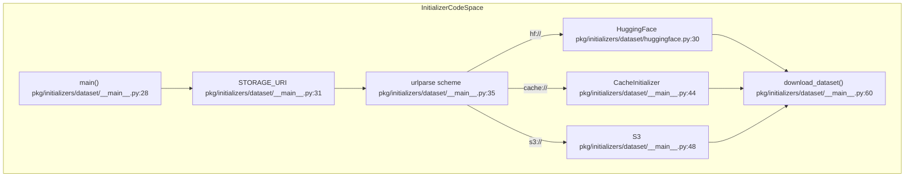
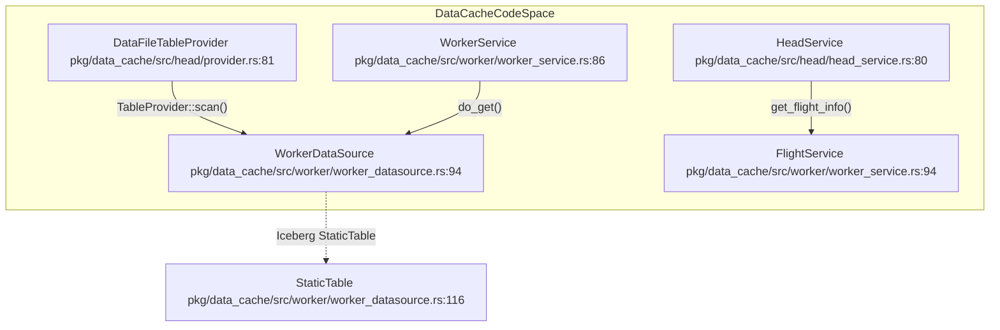

<!-- source: DeepWiki mcp.deepwiki.com · repo kubeflow/trainer · page 3 Initializers and Data Management · fetched 2026-10-21 -->

# Initializers and Data Management

Relevant source files

The following files were used as context for generating this wiki page:

- [pkg/data_cache/Cargo.lock](pkg/data_cache/Cargo.lock)
- [pkg/data_cache/Cargo.toml](pkg/data_cache/Cargo.toml)
- [pkg/data_cache/cmd/head/main.rs](pkg/data_cache/cmd/head/main.rs)
- [pkg/data_cache/src/config/config.rs](pkg/data_cache/src/config/config.rs)
- [pkg/data_cache/src/head/head_service.rs](pkg/data_cache/src/head/head_service.rs)
- [pkg/data_cache/src/head/provider.rs](pkg/data_cache/src/head/provider.rs)
- [pkg/data_cache/src/head/writer.rs](pkg/data_cache/src/head/writer.rs)
- [pkg/data_cache/src/worker/worker_datasource.rs](pkg/data_cache/src/worker/worker_datasource.rs)
- [pkg/data_cache/src/worker/worker_service.rs](pkg/data_cache/src/worker/worker_service.rs)
- [pkg/data_cache/test/Cargo.lock](pkg/data_cache/test/Cargo.lock)
- [pkg/data_cache/test/Cargo.toml](pkg/data_cache/test/Cargo.toml)
- [pkg/initializers/dataset/__main__.py](pkg/initializers/dataset/__main__.py)
- [pkg/initializers/dataset/huggingface.py](pkg/initializers/dataset/huggingface.py)
- [pkg/initializers/dataset/huggingface_test.py](pkg/initializers/dataset/huggingface_test.py)
- [pkg/initializers/dataset/main_test.py](pkg/initializers/dataset/main_test.py)
- [pkg/initializers/model/__main__.py](pkg/initializers/model/__main__.py)
- [pkg/initializers/model/huggingface.py](pkg/initializers/model/huggingface.py)
- [pkg/initializers/model/main_test.py](pkg/initializers/model/main_test.py)

## Purpose and Scope

This page provides a high-level overview of the initializer subsystem and data management capabilities in Kubeflow Trainer. Initializers are specialized components responsible for preparing datasets and models prior to training execution [pkg/initializers/dataset/__main__.py:28-60](), [pkg/initializers/model/huggingface.py:30-55](), while the distributed data cache system provides zero-copy data streaming across worker nodes [pkg/data_cache/Cargo.toml:1-36]().

For detailed technical specifications, configuration parameters, and deep-dive implementation workflows, refer to the child pages:
- [Dataset and Model Initializers](#3.1)
- [Distributed Data Cache System](#3.2)

Sources: [pkg/initializers/dataset/__main__.py:28-60](), [pkg/initializers/model/huggingface.py:30-55](), [pkg/data_cache/Cargo.toml:1-36]()

---

## Dataset and Model Initializers

Dataset and model initializers parse the `STORAGE_URI` environment variable to dispatch loading operations to specific provider implementations such as HuggingFace (`HuggingFace`), S3-compatible storage (`S3`), or the cached data source (`CacheInitializer`) [pkg/initializers/dataset/__main__.py:31-56](). The entrypoint function `main()` [pkg/initializers/dataset/__main__.py:28]() inspects the URI scheme [pkg/initializers/dataset/__main__.py:35](), instantiates the corresponding provider class [pkg/initializers/dataset/__main__.py:40-50](), loads configuration from environment variables [pkg/initializers/dataset/__main__.py:59](), and executes resource downloads [pkg/initializers/dataset/__main__.py:60]() using underlying libraries like `huggingface_hub` [pkg/initializers/model/huggingface.py:49-54]().

Title: Initializer Provider Dispatch Flow

Sources: [pkg/initializers/dataset/__main__.py:28-60](), [pkg/initializers/dataset/main_test.py:23-88](), [pkg/initializers/model/huggingface.py:30-55]()

For comprehensive details on storage URI patterns, OpenDAL utilities, container Dockerfiles, and Python dependency management (`uv.lock`), see [Dataset and Model Initializers](#3.1).

Sources: [pkg/initializers/dataset/__main__.py:28-60](), [pkg/initializers/model/huggingface.py:30-55]()

---

## Distributed Data Cache System

The distributed data cache is a high-performance Rust subsystem [pkg/data_cache/Cargo.toml:1-36]() structured around a head-worker architecture [pkg/data_cache/src/head/head_service.rs:80](), [pkg/data_cache/src/worker/worker_service.rs:86](). It leverages the Apache Arrow Flight protocol for zero-copy data streaming [pkg/data_cache/src/head/head_service.rs:17-22](), [pkg/data_cache/src/worker/worker_service.rs:22-27]() and Apache Iceberg for table metadata processing and file scanning [pkg/data_cache/src/head/provider.rs:31-36](), [pkg/data_cache/src/worker/worker_datasource.rs:110-120](). The head service (`HeadService`) coordinates partition ranges and worker assignments [pkg/data_cache/src/head/head_service.rs:80-128](), while worker services (`WorkerService` and `WorkerDataSource`) load assigned Iceberg file subsets, assign global row ordering via `cache_index`, and serve record batches over Flight RPC [pkg/data_cache/src/worker/worker_datasource.rs:94-148](), [pkg/data_cache/src/worker/worker_service.rs:86-167]().

Title: Distributed Data Cache Entity Architecture

Sources: [pkg/data_cache/Cargo.toml:1-36](), [pkg/data_cache/src/head/head_service.rs:80-166](), [pkg/data_cache/src/worker/worker_service.rs:86-167](), [pkg/data_cache/src/worker/worker_datasource.rs:94-148](), [pkg/data_cache/src/head/provider.rs:81-110]()

For deep-dive documentation on head-worker coordination, `cache_index` and `IndexPair` mechanics, Arrow Flight RPC protocols, and `LeaderWorkerSet` deployments, see [Distributed Data Cache System](#3.2).

Sources: [pkg/data_cache/src/head/head_service.rs:80-166](), [pkg/data_cache/src/worker/worker_service.rs:86-167](), [pkg/data_cache/Cargo.toml:1-36]()

---

