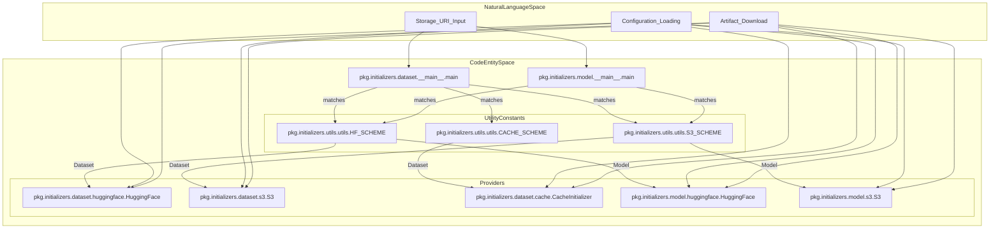
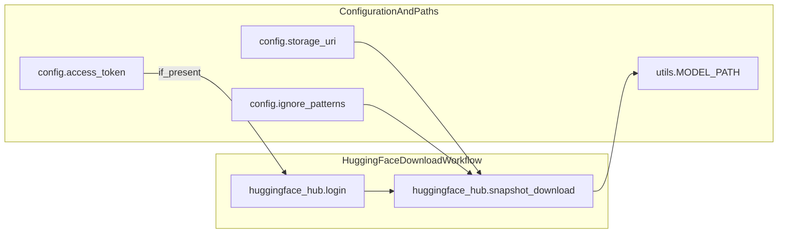
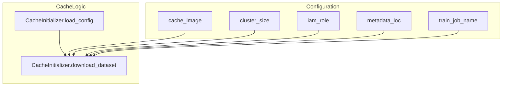

<!-- source: DeepWiki mcp.deepwiki.com · repo kubeflow/trainer · page 3.1 Dataset and Model Initializers · fetched 2026-10-21 -->

# Dataset and Model Initializers

Relevant source files

The following files were used as context for generating this wiki page:

- [.github/dependabot.yml](.github/dependabot.yml)
- [api/python_api/uv.lock](api/python_api/uv.lock)
- [cmd/initializers/dataset/Dockerfile](cmd/initializers/dataset/Dockerfile)
- [cmd/initializers/dataset/pyproject.toml](cmd/initializers/dataset/pyproject.toml)
- [cmd/initializers/dataset/uv.lock](cmd/initializers/dataset/uv.lock)
- [cmd/initializers/model/Dockerfile](cmd/initializers/model/Dockerfile)
- [cmd/initializers/model/pyproject.toml](cmd/initializers/model/pyproject.toml)
- [cmd/initializers/model/uv.lock](cmd/initializers/model/uv.lock)
- [pkg/initializers/dataset/__main__.py](pkg/initializers/dataset/__main__.py)
- [pkg/initializers/dataset/huggingface.py](pkg/initializers/dataset/huggingface.py)
- [pkg/initializers/dataset/huggingface_test.py](pkg/initializers/dataset/huggingface_test.py)
- [pkg/initializers/dataset/main_test.py](pkg/initializers/dataset/main_test.py)
- [pkg/initializers/model/__main__.py](pkg/initializers/model/__main__.py)
- [pkg/initializers/model/huggingface.py](pkg/initializers/model/huggingface.py)
- [pkg/initializers/model/huggingface_test.py](pkg/initializers/model/huggingface_test.py)
- [pkg/initializers/model/main_test.py](pkg/initializers/model/main_test.py)
- [pkg/initializers/model/s3_test.py](pkg/initializers/model/s3_test.py)
- [pkg/initializers/types/types.py](pkg/initializers/types/types.py)
- [pkg/initializers/utils/opendal.py](pkg/initializers/utils/opendal.py)
- [pkg/initializers/utils/opendal_test.py](pkg/initializers/utils/opendal_test.py)
- [pkg/initializers/utils/utils.py](pkg/initializers/utils/utils.py)

## Purpose and Scope

This page explains dataset-initializer and model-initializer containers within Kubeflow Trainer. It covers their implementation, HuggingFace and S3 integration via OpenDAL, storage URI patterns, Python packaging using `uv` (`uv.lock` and `pyproject.toml`), Dockerfile definitions, and end-to-end initialization workflows.

---

## Overview

Dataset and model initializers are containerized processes executed as JobSet ReplicatedJobs within a TrainJob's execution graph. They pre-populate shared volumes with necessary datasets and model weights before training pods start. This eliminates redundant downloads across distributed nodes and guarantees that all workers use a synchronized local artifact copy.

The initializers rely on Python environments managed by `uv` for reproducible dependency resolution [cmd/initializers/dataset/Dockerfile:17-26](), [cmd/initializers/model/Dockerfile:17-26]().

**Container Images:**
- `ghcr.io/kubeflow/trainer/dataset-initializer`
- `ghcr.io/kubeflow/trainer/model-initializer`

**Key Capabilities:**
- **HuggingFace Integration:** Native `hf://` URI handling using `huggingface-hub` [pkg/initializers/dataset/__main__.py:39-44](), [cmd/initializers/dataset/pyproject.toml:6-6]().
- **S3 Support:** S3-compatible storage integration powered by OpenDAL [pkg/initializers/dataset/__main__.py:47-50](), [cmd/initializers/dataset/pyproject.toml:7-7]().
- **Storage URI Patterns:** Protocol dispatch via URI schemes (`hf://`, `s3://`, `cache://`) [pkg/initializers/dataset/__main__.py:37-57]().
- **OpenDAL Utilities:** Abstracted storage multi-cloud layer using `opendal` Python bindings [cmd/initializers/dataset/pyproject.toml:7-7](), [cmd/initializers/model/pyproject.toml:7-7]().

Sources: [cmd/initializers/dataset/Dockerfile:1-30](), [cmd/initializers/model/Dockerfile:1-30](), [pkg/initializers/dataset/__main__.py:28-63](), [pkg/initializers/types/types.py:1-80](), [cmd/initializers/dataset/pyproject.toml:1-12]()

---

## Initializer Architecture and Code Mapping

The initialization entrypoints (`pkg.initializers.dataset` and `pkg.initializers.model`) parse the `STORAGE_URI` environment variable to instantiate the correct provider class.

### Diagram: Natural Language Space to Code Entity Space for Initializers

Sources: [pkg/initializers/dataset/__main__.py:31-63](), [pkg/initializers/model/__main__.py:28-57](), [pkg/initializers/types/types.py:21-80](), [pkg/initializers/utils/utils.py:1-40]()

---

## Configuration Types and Dataclasses

Initializer configurations are strongly typed Python dataclasses located in `pkg/initializers/types/types.py`.

| Class Name | Key Fields | Default `ignore_patterns` |
|------------|------------|---------------------------|
| `HuggingFaceDatasetInitializer` | `storage_uri`, `access_token` | `None` [pkg/initializers/types/types.py:22-25]() |
| `HuggingFaceModelInitializer` | `storage_uri`, `access_token` | `["*.msgpack", "*.h5", "*.bin", "*.pt", "*.pth"]` [pkg/initializers/types/types.py:42-46]() |
| `S3DatasetInitializer` | `storage_uri`, `endpoint`, `region` | `None` [pkg/initializers/types/types.py:30-37]() |
| `S3ModelInitializer` | `storage_uri`, `role_arn` | `["*.msgpack", "*.h5", "*.bin", "*.pt", "*.pth"]` [pkg/initializers/types/types.py:52-61]() |
| `CacheDatasetInitializer` | `train_job_name`, `metadata_loc`, `cluster_size` | `N/A` [pkg/initializers/types/types.py:66-80]() |

Sources: [pkg/initializers/types/types.py:15-80]()

---

## HuggingFace Integration and Workflow

The HuggingFace initializer relies on `huggingface_hub`. By default, legacy weight formats (`.bin`, `.pt`, `.pth`) are excluded during model initialization to prioritize modern formats such as `.safetensors` and `.gguf`. [pkg/initializers/types/types.py:44-46](), [pkg/initializers/model/huggingface.py:52-52]()

The `HuggingFace.download_model` method parses `storage_uri` to obtain the repository ID and triggers a snapshot download into `utils.MODEL_PATH`. [pkg/initializers/model/huggingface.py:36-55]()

### Diagram: HuggingFace Download Execution Flow

Sources: [pkg/initializers/model/huggingface.py:30-56](), [pkg/initializers/model/huggingface_test.py:88-116](), [pkg/initializers/types/types.py:42-47](), [cmd/initializers/dataset/pyproject.toml:6-6]()

---

## S3 Integration and OpenDAL Utilities

For S3-compatible storage, initializers use Python bindings for `opendal` (`opendal>=0.47.6`) defined in `pyproject.toml` [cmd/initializers/dataset/pyproject.toml:7-7](). OpenDAL provides a unified storage API that handles credentials, endpoint configurations, region parameters, and streaming downloads without coupling implementation details to specific cloud provider SDKs.

Sources: [cmd/initializers/dataset/pyproject.toml:1-12](), [cmd/initializers/model/pyproject.toml:1-11]()

---

## Distributed Data Cache Integration

The `CacheInitializer` coordinates with Kubeflow Trainer's distributed data cache subsystem [pkg/initializers/dataset/__main__.py:43-46](). It uses parameters defined in `CacheDatasetInitializer` to spin up caching infrastructure.

### Diagram: Cache Initializer Mapping

Sources: [pkg/initializers/types/types.py:65-80](), [pkg/initializers/dataset/__main__.py:45-50]()

---

## Initialization Workflow Sequence

Entrypoint scripts follow a strict sequential lifecycle:
1. **Environment Validation:** Check that `STORAGE_URI` is present via `utils.STORAGE_URI_ENV` [pkg/initializers/dataset/__main__.py:31-35]().
2. **Scheme Parsing:** Parse `storage_uri` via `urllib.parse.urlparse` to resolve the provider scheme (`hf`, `s3`, or `cache`) [pkg/initializers/dataset/__main__.py:37-57]().
3. **Configuration Loading:** Invoke `load_config()`, mapping environment variables to dataclass attributes using `utils.get_config_from_env` [pkg/initializers/dataset/__main__.py:59-59](), [pkg/initializers/model/huggingface.py:32-34]().
4. **Execution:** Execute `download_dataset()` or `download_model()` [pkg/initializers/dataset/__main__.py:60-60]().

Sources: [pkg/initializers/dataset/__main__.py:28-63](), [pkg/initializers/dataset/main_test.py:22-101](), [pkg/initializers/model/__main__.py:28-57](), [pkg/initializers/model/huggingface.py:32-55]()

---

## Python Packaging and Dockerfiles

Both initializers use `uv` for lightning-fast dependency synchronization from pinned `uv.lock` files. 

The Dockerfiles use a multi-stage pattern or copy the locked dependencies directly into a slim Python 3.14 base image:
- `pyproject.toml` declares core dependencies such as `huggingface-hub`, `opendal`, and `kubernetes` [cmd/initializers/dataset/pyproject.toml:1-12]().
- `uv sync --locked --no-dev` installs production dependencies inside the container image [cmd/initializers/dataset/Dockerfile:26-26](), [cmd/initializers/model/Dockerfile:26-26]().

Sources: [cmd/initializers/dataset/Dockerfile:1-30](), [cmd/initializers/model/Dockerfile:1-30](), [cmd/initializers/dataset/pyproject.toml:1-12](), [cmd/initializers/model/pyproject.toml:1-11](), [cmd/initializers/dataset/uv.lock:1-12](), [cmd/initializers/model/uv.lock:1-16]()

---

